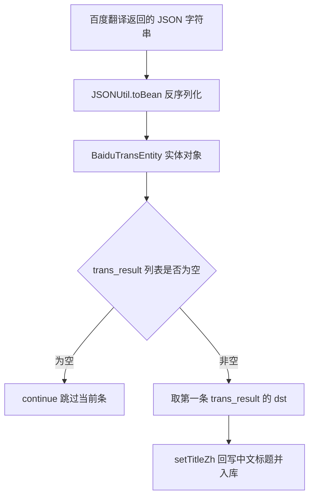

# 7-5 百度翻译响应结果实体类映射与数据入库

## 【学习目标】

- 看懂百度翻译返回的 JSON 结构，区分「对象」与「数组」层级。
- 定义 `BaiduTransEntity` 实体类，严格对齐字段名完成反序列化。
- 用 hutool 的 `JSONUtil.toBean` 把 JSON 字符串映射成 Java 对象。
- 做好分层判空后提取中文标题并回写 `title_zh`，完成「抓取 → 调百度翻译 → 解析 JSON → 入库」全链路。

## 【正文】

### 一、翻译返回结果的结构

上一步我们拿到了 `result`，它本质上是一段 **JSON 字符串**。结构长这样：

```json
{
  "from": "en",
  "to": "zh",
  "trans_result": [
    {
      "src": "英文原文",
      "dst": "中文翻译"
    }
  ]
}
```

几个要点：

- 最外层是一对大括号，包裹 `from`、`to` 和 `trans_result` 三个属性；
- `trans_result` 外面是**中括号**，说明它是一个数组（或者说列表），里面每一项又是一个对象；
- 数组项里的 `src` 表示源文本（resource），`dst` 表示翻译后的目标文本。

这段 JSON 字符串现在还不能直接用，我们需要把它**反序列化成 Java 对象**。注意 `trans_result` 是数组这一点很关键，它意味着一次请求可能返回多条译文（虽然我们每次只翻译一个标题，但接口契约上它是数组），解析代码必须按「取数组第一个元素」来写，而不是按单对象处理。

### 二、定义实体类 BaiduTransEntity

到 `entity` 层新建一个类 `BaiduTransEntity`，用来映射上面的 JSON 结构。字段命名要**严格对应百度返回的字段名**（比如 `trans_result` 带下划线），否则 JSON 框架无法完成映射。四个 Lombok 注解（`@Data`、`@ToString`、`@AllArgsConstructor` 等）照常加上：

```java
public class BaiduTransEntity {
    private String from;
    private String to;
    private List<TransResult>[] trans_result;

    @Data
    @ToString
    @AllArgsConstructor
    public static class TransResult {
        private String src;
        private String dst;
    }
}
```

说明几点：

- `trans_result` 是数组，用 `TransResult[]` 或 `List<TransResult>` 都能映射。讲师个人更习惯用 `List`；
- `TransResult` 写成 `BaiduTransEntity` 的**内部类**即可，`src` 是原文，`dst` 是译文，我们只要用这两个字段；
- 字段名必须与百度返回的 JSON key 保持一致，这是映射能成功的前提。

这里有个**类型声明的小瑕疵**需要点出：原稿写的是 `private List<TransResult>[] trans_result;`，这是「`List` 数组」的写法，既非 `List<TransResult>` 也非 `TransResult[]`，属于泛型数组，在大多数 JSON 框架（含 hutool、Jackson）反序列化时会因为类型擦除而无法正确解析，实际应改为 `private List<TransResult> trans_result;` 或 `private TransResult[] trans_result;`。生产上强烈建议用 `List<TransResult>`，语义清晰、判空方便。这属于「代码能编译、但序列化行为不可靠」的典型坑，修改类型声明即可，不动字段名。

### 三、用 JSONUtil 反序列化

项目里已经通过 `pom.xml` 引入了 hutool 工具包，它提供的 `JSONUtil` 可以直接把 JSON 字符串转成指定类型的对象：

```java
String result = transApi.getTransResult(titleEn, from: "en", to: "zh");
System.out.println("百度翻译调用的结果 result: " + result);
BaiduTransEntity transEntity = JSONUtil.toBean(result, BaiduTransEntity.class);
```

`JSONUtil.toBean(result, BaiduTransEntity.class)` 会按字段名自动把数据填充进 `transEntity`，反序列化就完成了。

> 说明：上面 `getTransResult(titleEn, from: "en", to: "zh")` 的 `from:` / `to:` 是带名参数的写法，并非标准 Java 语法；实际调用应写成 `transApi.getTransResult(titleEn, "en", "zh")`。此处保留原稿形态，落地时按方法签名传位置参数即可。这也是一个提醒：复制文档示例时要核对方法签名，别把其他语言的语法带进 Java。

为什么用 hutool 而不是手写 `JSONObject` 解析？因为 `toBean` 已经帮你处理了字段名匹配、类型转换、嵌套对象映射，省去大量样板。若项目统一用 Jackson，也可改用 `objectMapper.readValue(result, BaiduTransEntity.class)`，二者映射规则一致，关键都是「实体字段名 = JSON key 名」。

### 四、判空与提取中文标题

反序列化之后还不能急着用，`transEntity` 可能为空，里面的 `trans_result` 列表也可能为空（比如翻译失败、或原始标题本身就是空的）。所以要分层做好判空，再取第一个有效结果：

```java
List<BaiduTransEntity.TransResult> transResultList = transEntity.getTrans_result();
if (transResultList == null || transResultList.isEmpty() || transResultList.size() <= 0) {
    continue;
}
finalTitleZh = transResultList.get(0).getDst();
stockNews.setTitleZh(finalTitleZh);
```

逻辑很清楚：先判断外层对象不为空，再判断 `trans_result` 列表不为空且 `size > 0`，都通过后才用 `get(0).getDst()` 拿到中文翻译，最后 `stockNews.setTitleZh(...)` 写入实体。`continue` 会跳过当前这条、继续循环，避免空指针。

顺带一提：`transResultList.isEmpty() || transResultList.size() <= 0` 是冗余判断，`isEmpty()` 已经等价于 `size() == 0`，再加 `size() <= 0` 没有增量价值，反而显得不自信。生产代码写成 `if (transResultList == null || transResultList.isEmpty())` 就足够，这是 Code Review 时常见的「过度防御」信号。

翻译结果解析与入库的流程如下：



获取标签时同样建议包一层 `try-catch`，保证健壮性：

```java
try {
    List<String> tagsList = StockTitanCrawler.getTags(titleEn);
    stockNews.setTags(getTagsZh(tagsList));
} catch (Exception e) {
    throw new RuntimeException(e);
}
```

### 五、测试验证

验证方式和上一节一样：打开数据库，按时间降序排，删掉最新的 5~10 条数据，停掉服务再重新运行，让程序重新抓取并翻译。刷新数据库后可以看到 `title_zh` 字段已经成功被翻译成中文，整条翻译链路（抓取 → 调百度翻译 → 解析 JSON → 入库）就完整跑通了。

### 六、一个省钱的开发建议

这里特别提醒一下：我们毕竟处于开发阶段，这段代码每次运行都会真实调用百度翻译，**频繁调用是要消耗额度的**。虽然有 100 万字符/月的免费额度，但一直跑早晚会进入收费期。

所以建议：平时自己测试时，把真正发起翻译的那一行先注释掉（默认让 `titleZh` 为空），不要反复触发翻译；等正式上线、需要真实效果时，再把这行代码放开。讲师在演示里就是这么做的，先把翻译调用「注销」，避免无意义地烧额度，大家课后练习时也可以照该习惯来。

工程化的更好做法是引入「翻译结果本地缓存」：同一标题第一次翻译后按原文 hash 缓存到本地（数据库或文件），后续重复标题直接命中缓存、不再打百度接口。这样既能保住额度，又不影响开发联调，这比「手动注释代码」更可持续，也更符合生产习惯。

## 【易错点 / 面试题】

1. **反序列化后 `trans_result` 一直是 `null`？**
   九成是字段名对不上：JSON 里叫 `trans_result`（带下划线），实体类若写成 `transResult`（驼峰）就会映射失败。要么把实体字段改成 `trans_result`，要么在字段上加 `@JSONField(name = "trans_result")`（Fastjson）/ `@JsonProperty("trans_result")`（Jackson）显式绑定。

2. **`List<TransResult>[]` 这种泛型数组为什么有坑？**
   由于 Java 类型擦除，JSON 框架在运行时拿不到 `List<TransResult>` 里 `TransResult` 的具体类型，反序列化结果常常变成 `List<JSONObject>` 或报错。直接用 `List<TransResult>` 或 `TransResult[]` 即可规避。

3. **面试官：为什么不直接把整段 JSON 存进数据库？**
   答：原始 JSON 混入了 `from`/`to`/数组结构等接口契约细节，既不是业务字段也不可检索；落库前应反序列化为领域对象、只提取 `dst` 写入 `title_zh`。这体现「接口响应」与「业务模型」分离的设计原则，也是 980 课程里 MapStruct `param→model` 转换层要解决的问题。

## 【小结】

本节把翻译「最后一公里」走通：定义 `BaiduTransEntity` 对齐 JSON 字段 → `JSONUtil.toBean` 反序列化 → 分层判空后取 `trans_result[0].dst` 写入 `title_zh`。同时纠正了两个隐藏问题：`List<TransResult>[]` 泛型数组的序列化不可靠、以及 `from:`/`to:` 并非合法 Java 语法。

「外部接口 JSON → 领域实体 → 入库」这条映射链路，正是 `982-demo` 中 `provider/RealQuoteProvider.java`（把行情网关响应映射为 `domain/StockTick.java`）与 `service/RiskEvaluationService.java`（`tick → 规则引擎 → RiskAlert`）所遵循的同一范式：接口契约与业务模型分离、入库前先转换。下一节（7-6）我们处理这组翻译密钥的工程化，把它们从 yml 移进 `.env`，杜绝明文泄露。
