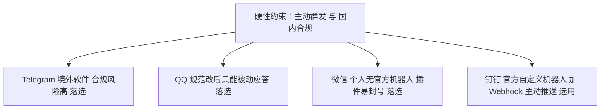

# 8-1 聊天工具机器人选型与注意事项

## 【学习目标】

- 明确本课程「股票异动消息主动群发」对机器人选型的核心要求：官方支持、可主动推送、合规低风险。
- 横向对比钉钉 / Telegram / QQ / 微信四类候选，理解各自的落选原因。
- 建立「技术选型要服务于业务场景 + 合规底线」的判断框架。
- 清楚课程合规边界：仅用于编程学习与技术研究，不得用于违法违规用途。

## 【正文】

### 一、课程选型：钉钉机器人

这一章我们进入「机器人集成」环节。课程里选择**钉钉**作为聊天机器人，用来做股票异动消息的群发推送。

选钉钉主要因为它在国内使用广泛，机器人推送能力成熟，而且和各类 **API 集成**非常方便，无论群发消息还是其他交互，优势都很明显，接入成本低。

但要强调一点：选型不是「钉钉最先进」这么简单，而是「钉钉最契合本课程的场景」，我们的核心诉求是**程序主动把异动预警推到群里**，而不只是被动应答。把这点作为标尺，再去看其他候选，结论就很清楚了。

### 二、候选工具横向对比

除钉钉外，常见聊天工具还有微信、QQ、Telegram。我们用一张对照表把「能否主动推送」「合规风险」「课程适配度」量化出来：

| 工具 | 官方机器人能力 | 能否主动群发 | 合规 / 风险 | 课程适配度 | 结论 |
|---|---|---|---|---|---|
| **钉钉** | 官方自定义机器人 + Webhook | 能（Webhook 主动推送） | 国内合规、文档完善 | 高 | **选用** |
| **Telegram** | Bot API 能力最强、自由度极高 | 能 | 境外软件、国内不受监管、法律风险高 | 中 | 落选（合规） |
| **QQ** | 自带机器人，但规范改后只能被动响应 | 不能（仅被动应答） | 国内合规 | 低（场景不符） | 落选（被动） |
| **微信** | 个人微信无官方机器人；企业微信有推送 | 个人无 / 企业有 | 第三方插件易被封号 | 低 | 落选（封号） |

把这张表记住，选型逻辑就不再是「凭感觉」，而是「按场景逐条打勾」。

### 三、其他候选工具及落选原因

#### 1. Telegram

讲师其实原本打算用 Telegram，但它是一款**境外开发的聊天软件**，在国内不受监管，使用上存在一定风险。另一方面，Telegram 自由度极高，很多人用它做机器人开发来接广告、搞推广、甚至代别人开发赚钱，灵活归灵活，但法律风险也高。因此正式课程里我们没有选择它。

（补充：讲师自己平时做股票推送时其实是用 Telegram 的，手机端和电脑端都能收消息，体验还不错。但如果仅仅把机器人当作「消息推送通道」来用，钉钉同样强大且合规，所以课程以钉钉为准。）

#### 2. QQ

QQ 平台是自带机器人的，早些年甚至能**主动推送**，也就是我们的程序定时往群里发消息。但后来 QQ 的规范改了：机器人**不能再主动推送**，只能被动响应。换言之，在群里建好机器人后，只有用户先@它、向它提问，它才会回复，形式是被动的。

这种被动模式其实也能玩出花样，比如把 **DeepSeek** 这类大模型接进去，用户在群里问「今天星期几」「有什么新闻」，机器人调用大模型算出结果再推送回来。但对我们这门课的场景，**程序主动把异动预警推到群里**，被动模式并不合适，所以 QQ 也被排除。

#### 3. 微信

先说结论：个人微信**官方并没有提供机器人服务**。企业微信倒是可以实现机器人推送（开通企业微信功能即可），但并不是所有人都有企业微信，所以这里讨论的是**个人微信**。

市面上确实有一些第三方开发的微信机器人插件，原理上也能实现推送，但按微信官方的态度，这类第三方方案已经被封掉一大批；实现方式通常是装一个 Python 插件、调用 Python 端代码来主动推送。课程资料里也提供了相关资源供学习，但**个人不建议使用微信机器人**，因为很容易导致微信封号。

### 四、为什么最终落到钉钉

综合下来，钉钉是官方文档完善、能力清晰、且适合「主动群发预警」这一课程场景的选择。微信、QQ、Telegram 各自的局限（封号风险、只能被动、合规风险）让它们都不适合作为本课程的主线。所以我们后续就围绕**钉钉机器人**展开：官方文档里该讲的都会讲、该实现的都会实现；而微信不支持的那些能力，我们就不展开讨论了。

这里顺带把「选型框架」提炼成一条可复用的方法论：**先定义业务场景的硬性约束（本课=主动推送+国内合规），再拿约束去过滤候选**。凡是约束不满足的直接淘汰（QQ 被动、微信封号、Telegram 合规），剩下的里选集成成本最低的就是答案（钉钉）。这套框架同样适用于 982 课程后面的「行情源 A 股/美股双源开关」「风控规则引擎」等任何选型决策。

候选工具按硬性约束过滤的过程如下：

### 五、合规与责任声明

最后必须强调几点注意事项：

- **禁止将课程所讲内容用于任何违反法律法规的行为**；
- 本课程**仅用于编程学习与技术研究**；
- 学员基于所学做出的任何行为，由学员**本人负责**，与课程平台无关。

请合规学习、正当使用。

## 【易错点 / 面试题】

1. **为什么 QQ 机器人「只能被动」会导致课程场景不成立？**
   本课程的预警链路是「程序定时扫描 → 主动推群」。QQ 改规范后机器人只能被@才应答，等于失去了「主动触发」能力，无法在无人操作时自动推送异动。选型时必须先锁定「主动推送」这一硬约束，再据此淘汰。

2. **Telegram 能力最强为什么不选？**
   技术能力只是选型维度之一，合规与法律风险是更高优先级的约束。涉及境内用户、境内业务的自动化推送，优先选国内受监管的官方通道（钉钉），而不是合规边界模糊的境外工具。

3. **面试官：做技术选型时你怎么权衡？**
   能讲出「场景约束先行、再按约束过滤候选、最后在达标项里选集成成本最低」的框架，并举一两个工程例子（如本课机器人选型、或 982 的行情源双源开关），就能体现工程成熟度，而不是只会罗列工具特性。

## 【小结】

本节完成了「消息推送通道」的选型决策：以「主动群发 + 国内合规」为硬约束，逐条过滤 Telegram（合规）、QQ（被动）、微信（封号），最终锁定官方能力完善、集成成本低的钉钉。这把「场景驱动选型」的方法论落地了一次。

该选型结论直接决定了第 8-2 节的架构形态：钉钉机器人通过 **Webhook 主动推送**，成为 `982-demo` 中「感知 → 决策 → 执行」闭环里「执行/通知」那一环的聊天端落点。在 `982-demo` 里，`scheduler/RiskScanScheduler.java` 用 Java 21 虚拟线程周期扫描、主动触发告警打印，正是本节「主动推送」诉求在工程侧的同构实现（把钉钉 Webhook 接入后，告警即主动推群）。下一节我们就实操配置钉钉机器人。
