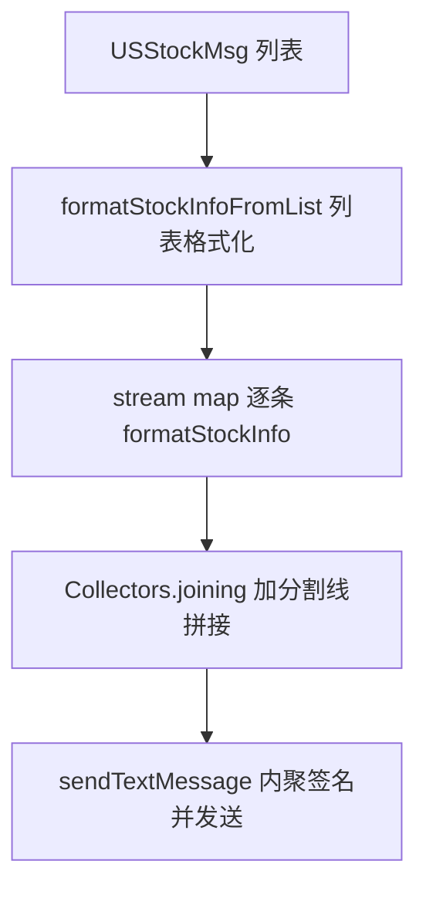

# 8-5 优化钉钉机器人消息内容格式与数据规范

## 【学习目标】

学完本节，你应当能够：

- 说清「裸 JSON 直接推送」为何不可读，并设计 `USStockMsg` 的格式化模板；
- 实现单条 `formatStockInfo` 与列表 `formatStockInfoFromList`，用 Stream 把多条异动拼成带分割线的可读文本；
- 理解钉钉签名随发送方法下沉后的代码结构，掌握 `\n` 换行在推送文本里的通用写法与放置习惯；
- 评估「推送里引入大模型走势分析」的取舍：时效性 vs 智能化，明确推送与深度分析的职责边界。

## 【正文】

### 一、为什么需要格式化：从裸 JSON 到可读消息

上节虽然打通了发送，但推送内容本质是原始对象数组，直接把 `USStockMsg` 列表丢给接收方。用户看到的只是一长串字段与逗号，无法快速分辨哪只股票、什么时间、异动几次。格式化就是把对象「打扮」成清晰可读文本的过程，这一步与「数据能不能发出去」无关，只关乎「人能不能一眼看懂」。

待格式化的载体是 `USStockMsg`，它承载一次推送所需的全部字段：

```java
public class USStockMsg {
    private String code;
    private String titleZh;
    private String titleEn;
    private int counts24Hour;
    private int counts3Day;
    private int counts1Week;
    // ... getter and setter methods
}
```

`code` 为股票代码，`titleZh` / `titleEn` 为中英文标题，`counts24Hour` / `counts3Day` / `counts1Week` 为三个时间窗口的异动命中数。后续所有排版都围绕这六个字段展开。注意该类的 getter 命名需与格式化方法里调用的 `getCode()` / `getCounts24Hour()` 等严格一致，否则编译期即报错，这是「数据结构」与「展示逻辑」的契约。

### 二、单条格式化方法 formatStockInfo

新增 `public String formatStockInfo(USStockMsg stockMsg)`，按既定模板把字段拼成固定格式文本：代码取 `getCode()`、时间取发布时间、标题同时保留中文与英文、标签取 `getTags()`、统计部分列出三个窗口的异动次数。

```java
public String formatStockInfo(USStockMsg stockMsg) {
    return "代码：" + stockMsg.getCode() + "\n" +
           "时间：" + stockMsg.getPubDateJ() + "\n" +
           "标题（英文）：" + stockMsg.getTitle() + "\n" +
           "标题（中文）：" + stockMsg.getTitleZh() + "\n" +
           "标签：" + stockMsg.getTags() + "\n" +
           "统计：24小时内异动=" + stockMsg.getCounts24Hour() + "次" +
           "3天内异动=" + stockMsg.getCounts3Day() + "次" +
           "1周内异动=" + stockMsg.getCounts1Week() + "次";
}
```

字段之间用换行符 `\n` 连接，`\n` 在钉钉、Telegram 等多数 IM 工具里都是通用换行写法。一个排版习惯：把 `\n` 放在字段**后面**而非前面，可避免末行多出空行。拼接时字段间的 `+` 号不能遗漏，否则编译报错。为提升可读性，可在 `emerg` 这类标签处补对应 emoji，让标题与统计不至于冷冰冰，显示更友好，emoji 属于展示层增强，不影响数据结构。

### 三、列表批量格式化 formatStockInfoFromList

业务侧拿到的是 `List<USStockMsg>` 而非单对象，需用列表方式处理：遍历、逐条格式化、再拼成一条大消息。JDK 8 的 Stream 即可优雅实现：

```java
public String formatStockInfoFromList(List<USStockMsg> stocks) {
    return stocks.stream()
                 .map(this::formatStockInfo)
                 .collect(Collectors.joining("\n\n----------\n\n"));
}
```

逻辑是：列表每项经 `formatStockInfo` 转为一段文本形成流，最后 `Collectors.joining` 用分隔串 `"\n\n----------\n\n"` 拼接成整体。分隔串充当分割线，把每只股票的消息隔开。若去掉分割线，多条消息会糊成一段，用户一眼难辨边界。`Collectors.joining` 的入参是「元素间的连接符」，不会在首尾额外添加，因此分割线只出现在两条消息之间，正是我们想要的。

列表格式化的处理流程如下：



### 四、签名随发送方法下沉

格式化完成后，发送方法本身也做了封装：签名计算内聚进 `sendTextMessage`，对外只收 `textContent`。完整实现如下：

```java
public void sendTextMessage(String textContent) {
    try {
        Long timestamp = System.currentTimeMillis();
        String stringToSign = timestamp + "\n" + secret;
        Mac mac = Mac.getInstance("HmacSHA256");
        mac.init(new SecretKeySpec(secret.getBytes("UTF-8"), "HmacSHA256"));
        byte[] signData = mac.doFinal(stringToSign.getBytes("UTF-8"));
        String sign = URLEncoder.encode(new String(Base64.encode(signData)), "UTF-8");
        System.out.println(sign);

        DingTalkClient client = new DefaultDingTalkClient("https://oapi.dingtalk.com/robot/send?access_token=" + access_token);
        OapiRobotSendRequest req = new OapiRobotSendRequest();
        req.setMsgType("text");
        req.setText(new TextContent(textContent));
        client.execute(req);
    } catch (Exception e) {
        e.printStackTrace();
    }
}
```

注意这里 `Base64.encode(signData)` 与上节的 `Base64.encodeBase64String` 同源，仅写法不同；`req.setText(new TextContent(textContent))` 把已格式化文本包成 `TextContent`。整段用 `try-catch` 兜住，异常时打印栈而非向上抛，保证单次发送失败不影响定时任务主流程。把签名逻辑收敛进发送方法后，`formatStockInfoFromList` 只关心「文本长什么样」，职责更清晰。

### 五、签名与请求 URL 的形式化表达

钉钉自定义机器人的安全校验依赖 HMAC-SHA256 签名，计算过程可写成：

\[
\text{sign} = \text{Base64}(\text{HmacSHA256}(\text{timestamp} + 「\n」 + \text{secret}))
\]

其中 `timestamp` 为当前时间戳、`secret` 为机器人密钥。最终请求地址形如：

\[
\text{https://oapi.dingtalk.com/robot/send?access\_token=xxx\&sign=xxx\&timestamp=xxx}
\]

`access_token` 与 `sign` 均为必需参数，缺一则服务端拒绝。

### 六、接入发送流程并运行验证

改完直接运行：群里很快收到格式良好的消息。以 `FFAI` 为例，依次展示代码、时间、标题（英文 / 中文，中文为空因翻译开关未开，翻译能力已实现、课后开启即可）、标签与统计，24 小时内异动 1 次、3 天内 1 次、1 周内 2 次。

为验证分割线效果，特意删掉库里几条旧数据、重启后只收到 3 条新消息，彼此被 `\n\n----------\n\n` 清晰分隔。若不加分隔线，所有信息挤成一段，用户难辨股票边界、可读性差。补充分隔后留白充足，不再拥挤。建议在「统计」段末尾再补一个分号，让该段读起来更顺。到这一步，钉钉机器人的业务对接与展示效果均达标。

### 七、text 与 markdown 消息类型的取舍

本节用 `text` 类型，特点是零格式、最稳。若想让异动统计更醒目（如加粗代码、分点列表），可改用钉钉 `markdown` 消息类型，它支持 `#`、 `**`、`-` 等语法，视觉效果更好。取舍如下：

| 维度 | text 类型 | markdown 类型 |
|---|---|---|
| 渲染能力 | 仅纯文本 + `\n` | 标题 / 列表 / 加粗 / 链接 |
| 复杂度 | 低，拼接字符串即可 | 中，需按 markdown 语法组织 |
| 兼容性 | 所有群机器人 | 群机器人支持 |
| 适用 | 告警广播 | 需重点突出的日报 |

风控告警用 `text` 已足够；若做「每日异动日报」则 `markdown` 更合适。切换只需改 `req.setMsgType("markdown")` 并相应调整格式化输出，签名与发送骨架不变。

### 八、标题与多语言的取舍

标题的英文 / 中文如何取舍，完全取决于受众：推送只面向国内用户，直接去掉英文；做国际化则去掉中文也无妨。按受众偏好选择，无硬性要求。多语言字段预留（`titleZh` / `titleEn`）的好处正在于此，展示层决定取哪个，数据层无需改动。

### 九、进阶：引入大模型做走势分析（可选，需权衡时效性）

对接完成后可进一步引入 AI 分析：推送前先调一次大模型，对个股走势给出上涨 / 下跌判断。但存在关键权衡，尤其美股，个人建议用海外模型（如谷歌系）分析效果更佳；一旦在推送流程内加入大模型分析，**数据量越大，消息推送越慢，时效性随之下降**，且用户并非对每只股票都感兴趣。

更灵活的职责划分是「人做最终判断」：推送负责及时通知，深度分析交给用户按需调用。例如看到感兴趣的 `BNR`，把标题复制到对话模型让其分析当前形势、给出止损 / 止盈点。即消息推送与深度分析各司其职。

### 十、DingTalk markdown 类型的完整消息结构

若改用 `markdown` 类型让异动更醒目，请求体不再是 `text` 字段，而是 `markdown` 对象。其结构示意如下（字段名与 `text` 类型不同，注意区分）：

```json
{
  "msgtype": "markdown",
  "markdown": {
    "title": "股票异动播报",
    "text": "#### 异动提醒\n- **代码**：FFAI\n- **24h 异动**：1 次\n- **3d 异动**：1 次\n- **1w 异动**：2 次"
  }
}
```

`markdown.text` 支持 `#` / `**` / `-` / 链接 等语法，群机器人渲染效果优于纯 `text`。切换只需改 `req.setMsgType("markdown")` 并相应组织格式化输出，签名与发送骨架不变，这正是「格式化」与「发送」分离带来的好处：换展示形态不动传输层。

### 十一、emoji 规范与推送可观测性

emoji 用在 `emerg` / `warning` 等标签前能提升扫读效率，但需约定统一映射（如 `emerg→🚨`、`warning→⚠️`），避免随心所欲导致团队消息风格割裂。推送链路还应可观测：记录每条消息的字数、发送耗时、成功 / 失败，经 Micrometer 暴露指标，发送连续失败（机器人被限流或 token 失效）时及时告警，推送通道本身也是系统一环，它挂了意味着告警沉默，风险比偶发漏推更高。这些生产化考量与 982-demo 的 Actuator / resilience4j 设计同源。

## 【易错点 / 面试题】

1. **问：`formatStockInfoFromList` 用 `Collectors.joining` 拼接，为什么分隔串要写成 `"\n\n----------\n\n"` 而非单 `\n`？**
   答：单 `\n` 只能换行、无法区分不同股票；双换行 + 分割线 + 双换行，既在视觉上断开每条消息，又保留块内字段换行，用户在群里一眼可辨股票边界。这是可读性设计而非功能需求。

2. **问：发送方法内为什么要 `try-catch` 包住、异常只 `printStackTrace`？**
   答：推送处于定时任务链末端，单条发送失败不应中断整轮扫描；捕获后打印栈便于排查（如 `secret` 错误、网络抖动），同时让调度器继续处理下一批。生产环境建议改为结构化日志 + 失败计数埋点，而非 `printStackTrace`。

3. **问：推送里嵌大模型分析有什么代价？**
   答：每条消息多一次同步模型调用，数据量大时整体延迟上升、时效性下降；且多数用户只关心部分股票，全量分析是浪费。妥善做法是推送只通知，分析由用户按需触发。

4. **问：为什么把签名逻辑下沉进 `sendTextMessage` 而非留在业务方法？**
   答：签名是「发送」这一动作的横切关注点，与「数据如何格式化」无关。下沉后 `formatStockInfoFromList` 只产出文本、`sendTextMessage` 只管签名+发送，单一职责、便于各自单测与复用。

## 【小结】

本节把 `USStockMsg` 从裸对象打磨成带分割线的可读推送，用 `formatStockInfo` + `formatStockInfoFromList` 两步格式化，并把签名内聚进 `sendTextMessage`。它仍是风控闭环**执行通道的呈现层**：告警内容由 `RiskEvaluationService`（`982-demo/src/main/java/com/riskbot/service/RiskEvaluationService.java`）产出，经 `RiskScanScheduler`（`982-demo/src/main/java/com/riskbot/scheduler/RiskScanScheduler.java`）周期触发后，借由 `DingTalkApi` 这类推送渠道抵达用户。后续课程会扩展到 Telegram 与飞书接入，思路与此一致，只需替换渠道实现，格式化与签名逻辑可复用。
