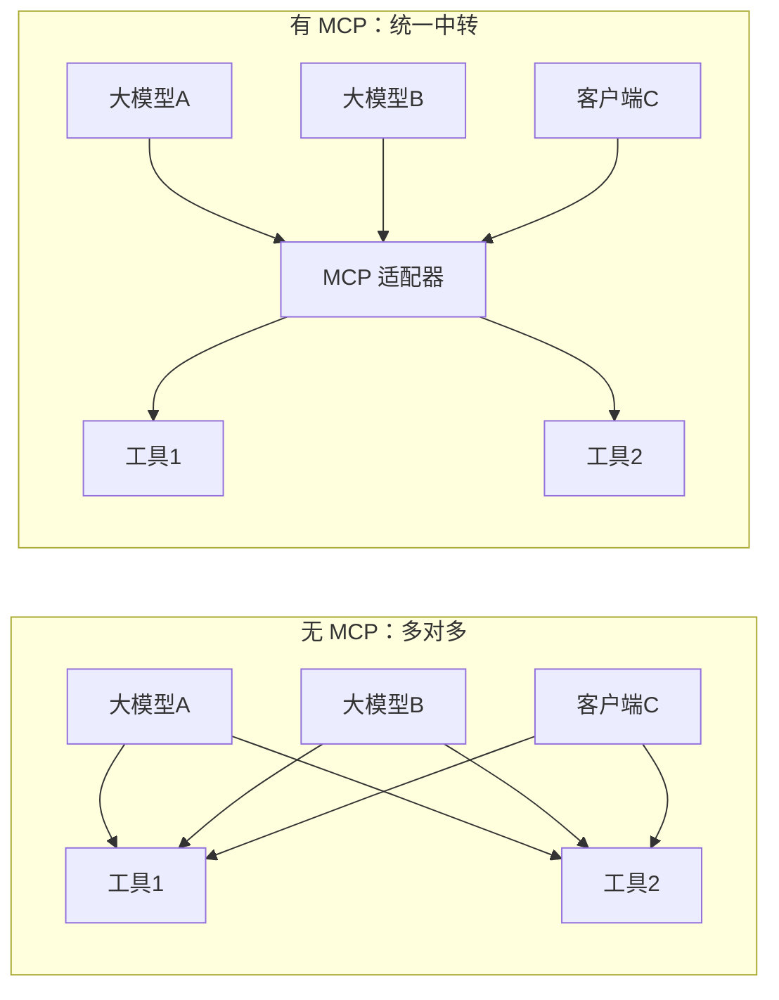

# 9-1 MCP 基础入门，搞清 MCP 是什么？能干什么？

## 【学习目标】

学完本节，你应当能够：

- 从「数据对外开放」的真实需求出发，说清 MCP 解决的核心痛点；
- 用一句话定义 MCP（Model Context Protocol）并讲清它作为「开放标准 / 适配器」的定位；
- 讲出 MCP 的传输方式（stdio / SSE / Streamable HTTP）、四类核心原语（Tools / Resources / Prompts / Sampling）与初始化握手流程；
- 用架构对比图解释「无 MCP 的多对多对接」与「有 MCP 的统一中转」差异，并说清它和 Function Calling、HTTP 协议的异同。

## 【正文】

### 一、从一个真实的业务场景说起

本课程项目后续有几类真实查询需求，先列出来便于理解 MCP 的价值：

- 根据股票代码查询相关股票信息；
- 根据股票代码查询某段日期内的股票信息；
- 查询某时间段内出现次数超过指定阈值的异动股票；
- 根据标题关键字查询股票信息（如英伟达在某时段出现十次，是否超过十次）。

这类需求本质都是数据查询。第一反应通常是直连数据库跑 SQL、页面展示，自己看完全够用。但一旦要把能力开放给其他人、尤其是让大模型自主调用，「直接查库」这条路就走不通：大模型不会写你的业务 SQL，也不会持有你的库连接，更不该拿到库账号。

### 二、数据对外开放的几种形式

让数据对外可用，主流有两类形式：

1. **调用第三方接口**：钉钉机器人、百度翻译、织物 API 等平台把数据以 API / SDK 形式开放，通常需走验签；
2. **自建 RESTful Web Service**：自己开发一套标准接口供外部调用，是否验签视需求而定。

当前技术栈以 RESTful Web Service 为主流。理解「数据对外开放」有这两条主线即可，历史细节不作展开。

### 三、什么是 MCP

结合 AI 技术，出现了一种名为 MCP 的服务。MCP 把上述能力（如前文四个查询工具）自行开发成系统，再封装为 MCP 服务对外提供，供其他大模型、其他客户端调用。

MCP 即 **Model Context Protocol**，是一种开放标准的协议，为大型语言模型（LLM）提供统一、标准化的方法，使其能与外部工具和数据交互、互通。官方中文文档含概念、实例与教程：`https://docs.mcpn.org/introduction`。语言支持上 Java、TypeScript、Python 等均覆盖，覆盖面广。

需要强调：MCP 不是又一个「大模型」，而是一层**通信协议**。它定义的是「宿主应用（Host）如何发现能力、如何发起调用、如何回收结果」的规范，至于背后是查数据库、调 REST、还是跑一段脚本，协议本身不关心。

### 四、为什么需要 MCP：从「每把锁配一把钥匙」说起

官方图示里画了一堆厂商 / 个人开发的工具（Google、Slack、Google Maps、Figma、Google Drive、WhatsApp 等）。在没有 MCP 的年代，每个大模型要用一个外部工具，都得为其开发一套对接方案。一个形象比喻：**API 像锁，每个工具是一把不同的锁，你需要为每把锁配一把不同的钥匙**，外部工具越多，对接方案越繁琐。

引入 MCP 后，整套标准被统一。本地电脑即 MCP Client，把各类外部服务视为「锁」，MCP 协议充当适配器（adapter），不同工具都经该适配器连入电脑。它是一层中间介质。对各厂商而言，只需开发一个服务端（一个工具），让各类客户端来用即可；客户端可替换（Windows、不同品牌笔记本），因为 MCP 协议通用，符合规范即可互通。

### 五、有 MCP 与没有 MCP 的架构对比

官方第二张图解释了前图：无 MCP 时，假设 GitHub 提供 MCP 工具，要在不同大模型 / 客户端里调用，就得为每个客户端各开发一套服务，三个客户端要开发三套系统，每个工具三个版本。客户端与大模型规模越大，工作量、连接线、系统复杂度越高。

引入 MCP 后：只需开发一个工具交给 MCP，由它中转、代理，其他客户端 / 工具都经 MCP 实现互动，灵活调度、灵活调用、灵活通信。左侧图（无 MCP）是多对多关系，连线越多越复杂；右侧图（有 MCP）连线大幅减少，系统更精简。这正是 MCP 流行的原因。

### 六、MCP 的传输方式与运行形态

理解 MCP 不能只停留在「概念」，它的落地靠具体传输：

- **stdio（标准输入输出）**：本机进程间通信，MCP 客户端启动服务端子进程、经 stdin/stdout 收发 JSON-RPC 消息。本地工具（如读本地文件、查本地库）多用此形态，零网络、延迟低。
- **SSE（Server-Sent Events）**：服务端推送事件 + 客户端 HTTP POST 回传，适用于远端服务。早期远程 MCP 常用，现逐步被更规范的形态替代。
- **Streamable HTTP**：在 HTTP 上承载双向消息流，是当前远程 MCP 推荐的主流传输，兼顾防火墙友好与流式能力。

课程里我们主要接触本机 / 远程两类 MCP 服务，并会在 Cursor、ChatBox、Dify 等客户端里挂载，它们本质都是 MCP Client，差异只在传输与界面。

### 七、MCP 的四类核心原语

MCP 不止「调函数」，它定义了四类可被大模型使用的能力：

1. **Tools（工具）**：可由模型调用执行的操作，对应我们课程的 `stock-mcp` 查询工具、邮件发送工具；每个工具带名称、描述、JSON Schema 参数。
2. **Resources（资源）**：可被读取的上下文数据（文件、记录、配置），模型按需取用，类似「只读数据源」。
3. **Prompts（提示词模板）**：服务端预置的可复用提示词，客户端一键调用，规范常见任务的话术。
4. **Sampling（采样）**：服务端反向请求大模型补全（如工具内部需要再请模型决策），体现「服务端也能召唤模型」的能力，涉及权限与计费，需谨慎开启。

对课程而言，重点在 **Tools**，把四个股票查询、邮件发送封装成标准 Tool，大模型按 schema 自主填参调用，正是后续章节的实战内容。

### 八、MCP 的调用生命周期（JSON-RPC 2.0）

MCP 消息体基于 JSON-RPC 2.0。一次工具调用的大致流程：

1. **initialize**：客户端与服务端握手，协商协议版本与能力；
2. **tools/list**：客户端拉取服务端已注册工具清单（名称 + 描述 + 输入 schema）；
3. **tools/call**：客户端（代表大模型）发起调用，带具体参数；
4. **返回结果**：服务端执行后回传结构化结果，客户端交给大模型继续推理。

这套握手与发现机制，正是「大模型无需硬编码每个工具、只要问 MCP 有哪些能力即可」的实现基础，也是它优于「每把锁配一把钥匙」的根本原因。

### 九、P 到底是什么：协议的本质

MCP 的 P 即 Protocol（协议）。回想 TCP/IP、HTTP，它们同属协议范畴。以 HTTP 为例：Java 工程里写最多的就是接口，早期通过 HTTP 协议请求，后来形成 RESTful Web Service 规范，本质仍是一套 HTTP 协议。阿里、腾讯的在线 API，都是发一个 HTTP 请求过去、遵循同一协议。

区别在于：过去用本地系统调用外部在线 API，现在用本地大模型调用外部接口 / 外部 MCP 工具。理解方式完全一致，只是换了一种表达形式，让大模型使用资源后变得更智能、更自动化。

### 十、MCP 与 Function Calling、HTTP 的关系

容易混淆的三组概念，厘清边界：

- **MCP vs HTTP**：HTTP 是传输协议（怎么把字节送达）；MCP 是应用层协议（大模型与工具怎么对话）。MCP 常跑在 HTTP / stdio 之上，二者不在同一层。
- **MCP vs Function Calling**：Function Calling 是「某家大模型厂商」定义的工具调用约定（OpenAI、智谱、DeepSeek 各有细节）；MCP 是「跨模型、跨客户端」的通用标准。MCP 把 Function Calling 的「能力发现 + 调用」标准化、与具体模型解耦。
- **MCP vs 插件 / Agent 框架**：插件是平台封闭生态，Agent 框架管编排；MCP 专注「工具如何被标准暴露」，可被任意 Agent 框架接入。Spring AI 2.0.1 的服务端侧提供注解式 `@McpTool` + `@McpResource`，客户端侧以 `McpToolCallback` 挂载，就是把 MCP 工具纳进统一 Advisor 链。

### 十一、一句话总结 MCP

用一句话概括：MCP 让普通人通过自然语言描述，把需求与大模型结合，去调用一套功能强大的工具链，这套工具链即 MCP 提供的工具，可有各种形式。具体而言，大模型据此自动执行相应调用：查询 Circle 信息、查询项目发布、调用函数做网页分析并生成报表、发送邮件、写入本地文件、生成市场调查报告与审核后的 PPT，乃至制定含天气 / 时间 / 交通 / 高铁 / 航班的旅游计划，均可通过自然语言表达实现。

### 十二、MCP 与 Agent 编排的关系

MCP 解决「工具如何被标准暴露」，而 Agent 解决「多个工具如何被协同调度」。二者是不同层：MCP 是能力底座，Agent（如 ReAct、Supervisor/Worker）是上层编排。一个 Supervisor Agent 可以把多个 MCP 工具（股票查询、邮件、日历）当作可调用能力，按规划分步触发，MCP 让这些能力「即插即用」，Agent 不必为每个工具写定制对接。课程的 982-demo 中 `RiskQueryAgent` 把 `queryRisk` 挂成 `@Tool` 由 `ToolCallingAdvisor` 驱动循环，正是「单工具 + 单 Agent」的最小形态；当工具数量变多、来源变杂，升级为 MCP 标准化暴露就是自然演进。

### 十三、什么时候该用 MCP，什么时候直接 Function Calling

选型上给一条实践准则：若你的工具只服务单一模型、单一应用，直接用该模型的 Function Calling 最省事；若工具要跨模型、跨客户端（Cursor / ChatBox / Dify / 自研 Agent）复用，或要接入第三方现成 MCP 服务，则用 MCP 避免重复对接。课程的 `stock-mcp` 之所以走 MCP，正是为了让同一套股票查询能力能被多个客户端挂载，而非为每个客户端各写一套适配。

### 十四、课程后续章节地图

建立 MCP 认知后，后续章节会沿两条线展开：一是**工具实战**，把四个股票查询、邮件发送逐个实现成 MCP 工具（含 9-10 / 9-11 的邮件工具）；二是**客户端接入**，在 Cursor、ChatBox、Dify 里挂载自研 MCP 服务，验证「自然语言 → MCP 工具 → 结果」的闭环。再往后进入「自然语言操作数据库」，把股票数据本身也变成可查询的 MCP 能力。

## 【易错点 / 面试题】

1. **问：MCP 和直接调 RESTful API 有什么区别？**
   答：RESTful API 是「人 / 代码按固定端点调用」；MCP 是「大模型按统一协议自主发现并调用工具」。无 MCP 时每对（模型 × 工具）都要定制对接，MCP 把这层多对多收敛为「模型→MCP→工具」的统一中转，降低集成复杂度。

2. **问：MCP 的 P（Protocol）和我们熟知的 HTTP 协议是什么关系？**
   答：同类概念，都是「双方约定的通信规范」。MCP 定义「大模型 ↔ 外部工具 / 数据」的通信规范，类比 HTTP 定义「客户端 ↔ 服务端」的规范。MCP 常承载于 HTTP / stdio 之上，二者分层不同。

3. **问：MCP 与某家大模型的 Function Calling 是替代关系吗？**
   答：不是替代，是标准化。Function Calling 绑定具体模型厂商，MCP 把「能力发现 + 调用」做成跨模型、跨客户端的开放标准，可被任意模型经 MCP Client 接入。Spring AI 2.0.1 用 `@McpTool` / `McpToolCallback` 把 MCP 工具挂进统一 Advisor 链，机制与 `@Tool` 同源。

4. **问：为什么无 MCP 时是多对多、有 MCP 后连线减少？**
   答：无 MCP 时 N 个模型 × M 个工具需 N×M 套对接；有 MCP 后模型只对接 MCP 一层、工具只对接 MCP 一层，对接数降为 N+M，复杂度随规模显著收敛。

## 【小结】

本节建立了 MCP 的核心认知：它是大模型调用外部工具的开放标准协议，把「每把锁配一把钥匙」的多对多对接收敛为统一中转，并定义了 Tools / Resources / Prompts / Sampling 四类原语与 JSON-RPC 调用生命周期。课程后续会把四个股票查询需求开发成 `stock-mcp` 模块的工具，正是 MCP 思路的落地。需要强调：MCP 工具在 Spring AI 中的注册机制，与 982-demo 风控问答 Agent 所用完全一致，`RiskQueryAgent`（`982-demo/src/main/java/com/riskbot/agent/RiskQueryAgent.java`）通过 `@Tool` + `@ToolParam` 把 `queryRisk` 挂进 `ChatClient`，并由 2.0 的 `ToolCallingAdvisor` 在 Advisor 链统一驱动工具循环；MCP 服务端侧在 2.0.1 进一步提供注解式 `@McpTool` + `@McpResource`，客户端侧以 `McpToolCallback` 挂载，机制同源。下一节进入 MCP 的具体使用场景与典型用法。
