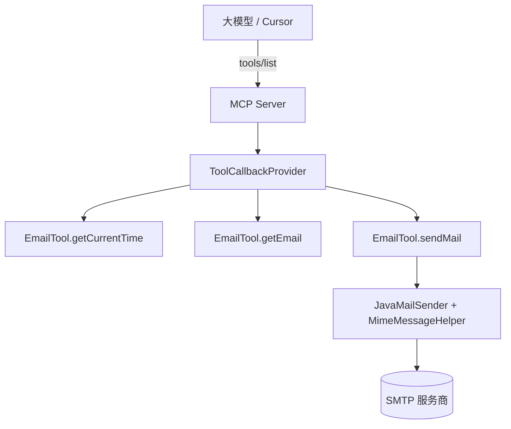

# 9-11 MCP 邮件工具实战落地 - 处理 HTML 与 MarkDown 内容

## 【学习目标】

学完本节，你应当能够：

- 复现并修复「HTML 被当纯文本发出」的问题，理解 `setText(content, true)` 的 HTML 标识作用与 MIME `Content-Type` 根因；
- 说清 Markdown 邮件为何也要转换，并引入 Flexmark 做 Markdown → HTML 渲染；
- 用 `contentType` 字段（1=Markdown / 2=HTML）让大模型区分格式，实现 `if / else if` 分支发送；
- 对照工具 schema 与渲染结果，确认两种格式都能正确呈现，并留意渲染用户内容的注入风险。

## 【正文】

### 一、问题：HTML 邮件被当成纯文本发出

先复现问题。在 Cursor 新开对话，让大模型「写一份北京一日游攻略，以 HTML 形式显示，并发送到老板邮箱」。大模型先取老板地址、生成 HTML 攻略、再调 `sendMail` 发出。邮件确实到了，但正文是一大堆 HTML 标签与前端代码，收件人不知所谓、样式也未渲染。根因在发送代码：`MimeMessageHelper.setText(content)` 默认按纯文本（`text/plain`）处理，HTML 标签被原样显示。本质是 MIME 的 `Content-Type` 头决定了邮件客户端如何渲染正文，声明 `text/plain` 就当文本，声明 `text/html` 才渲染。

### 二、修复：setText 的 HTML 标识（true）

修法简单：`setText` 有重载，第二个参数传 `true` 即声明内容为 HTML、按 HTML 渲染（底层把 `Content-Type` 设为 `text/html;charset=UTF-8`）。把发送代码改为 `helper.setText(content, true)`（对应配置里的 `html` 标识），重启 MCP 服务再发。这次收到邮件，HTML 正确渲染、行程清晰美观，证明 HTML 方式有效。日常收到的多数公司邮件本质都以 HTML 格式发送、带特定样式。

### 三、新场景：Markdown 邮件同样需要转换

换一种情况：让大模型「写一份无锡一日游攻略，以 Markdown 形式显示，发送到老板邮箱」。收到邮件，正文仍是 Markdown 源码（`#`、`*` 等标记），同样不适合直接展示，代码里 Markdown 最终被当普通文本 / HTML 源码处理，未真正渲染。妥善做法是把 Markdown **转换**成 HTML 再发。Markdown 当下是主流文档格式，表达简洁、结构清晰，工作里常用；最终呈现给用户的应是渲染好的 HTML。

需要澄清一个常见误解：`setText(content, true)` 的 `true` 只声明「内容是 HTML」，并不把 Markdown 翻译成 HTML。若直接 `setText(markdown, true)`，邮件客户端收到的是被标为 `text/html` 的 Markdown 源码，标签未解析、仍是一团 `#`。所以 Markdown 必须先经解析器转成真正的 HTML 字符串，再 `setText(html, true)`。

### 四、引入 Flexmark 做 Markdown → HTML 转换

做 Markdown 转 HTML，引入 **Flexmark**（Java 的 Markdown 解析库）。先在 `pom.xml` 加 Flexmark 坐标，刷新加载依赖。再写静态方法 `convertMarkdownToHtml(String markdown)`：用 Flexmark 的 `Parser` 把 Markdown 解析成文档对象，再 `HtmlRenderer` 渲染成 HTML 字符串返回。建议直接复用官方 / 现成写法，不手写解析逻辑，`Parser.builder().build()` 解析、`HtmlRenderer.builder().build()` 渲染是 Flexmark 固定套路。Flexmark 还支持扩展（表格、删除线、任务列表），按需加 `extension` 即可覆盖更丰富语法。

### 五、新增 contentType 参数区分两种格式

为让大模型区分内容到底是 HTML 还是 Markdown，给 `EmailInfo` 加 `contentType` 字段（`@ToolParam` 描述清楚）：约定 **1 表示 Markdown，2 表示 HTML**。类型用 `int`、动态判断，不写死。在 `sendMail` 加 `if / else if`：

- `contentType == 1`（Markdown）：先 `convertMarkdownToHtml` 转 HTML，再 `helper.setText(htmlContent, true)` 发出；
- `contentType == 2`（HTML）：直接 `helper.setText(content, true)` 发送；
- 否则（大模型偶发曲解、判不出）：走默认分支按普通方式发。

```java
@Tool(description = "给指定的邮箱发送邮件，email 为收件人地址，subject 为邮件标题，content 为邮件的内容")
public void sendMail(EmailInfo emailInfo) {
    log.info("============ 调用MCP工具：sendMail ============");
    Integer contentType = emailInfo.getContentType();
    try {
        MimeMessage mimeMessage = mailSender.createMimeMessage();
        MimeMessageHelper helper = new MimeMessageHelper(mimeMessage);
        helper.setFrom(from);
        helper.setTo(emailInfo.getEmail());
        helper.setSubject(emailInfo.getSubject());
        if (contentType == 1) {
            helper.setText(emailInfo.getContent(), true); // true 表示 HTML 格式
        }
        mailSender.send(mimeMessage);
    } catch (MessagingException e) {
        log.error("邮件发送失败：{}", e.getMessage());
    }
}
```

> 注：上段示例聚焦分支结构，`contentType == 1` 分支演示了「Markdown 经转换后按 HTML 发送」的落点；实际工程里该分支应先调 `convertMarkdownToHtml` 得到 `htmlContent` 再 `setText(htmlContent, true)`，与 `contentType == 2` 分支共用同一 `setText(..., true)` 出口，保证两路都走 HTML 渲染。

工具对外暴露的参数结构随之多出一个 `contentType`：

```json
{
  "name": "sendMail",
  "description": "发送邮件",
  "parameters": {
    "type": "object",
    "properties": {
      "emailInfo": {
        "type": "object",
        "properties": {
          "email": { "type": "string" },
          "subject": { "type": "string" },
          "content": { "type": "string" },
          "contentType": { "type": "integer" }
        }
      }
    }
  }
}
```

大模型生成的正文是一段标准 HTML：

```html
<html>
<head>
    <meta charset="UTF-8">
    <title>北京1日精...</title>
</head>
<body>
    <h2>北京1日精...</h2>
    <p>...详细行程安排...</p>
</body>
</html>
```

### 六、渲染用户内容的注入风险

附一个生产必知的安全点：邮件正文是 HTML 时，若 `content` 来自不可信输入（如用户提交的文本），直接 `setText(html, true)` 会把对方写的 `<script>` / `` 当 HTML 渲染。现代邮件客户端大多沙箱化、禁脚本，但 `` 追踪像素、钓鱼链接仍可行。稳妥做法是：对 HTML 内容做白名单清洗（只保留 `p` / `b` / `a` 等安全标签），或对不可信来源坚持 `text/plain`。本课程场景内容由大模型生成、风险可控，但真实产品务必加清洗层。

### 七、端到端验证与小结

改完重启服务再测：① 用 Markdown 发无锡攻略，邮件内容已渲染成美观 HTML；② 用 HTML 发一次，同样 HTML、显示依旧好。两种格式均能正确支持。`setText` 配合 `contentType` 的写法比写死完善得多；官方库是否内置此类自定义设置，可关注后续更新。

到本节，「电子邮件 + MCP」工具链讲完。下一章正式进入**与数据库交互**，用自然语言操作数据库做查询，那就要用到我们的股票数据。

### 八、Flexmark 扩展与邮件 HTML 的样式内联

Flexmark 默认只覆盖 CommonMark 核心语法。若大模型生成的 Markdown 含表格、删除线、任务列表，需显式加对应扩展（如 `TablesExtension`、`StrikethroughExtension`），否则表格会被当成普通段落。渲染后还需注意：邮件客户端大多**不支持外部 CSS 与 `<style>` 中的类选择器**，靠 `<link>` 引样式会失效。稳妥做法是把样式写成**内联 style**（如 `<p style="color:#333">`），或让大模型直接生成内联样式的 HTML。这一点与网页开发不同，是邮件 HTML 特有的坑。

### 九、完整发送分支与工具注册架构

把两节串起来，`sendMail` 的真实分支应同时覆盖 Markdown 转换与 HTML 直发，且异常统一走日志：Markdown 分支先 `convertMarkdownToHtml` 得 `htmlContent` 再 `setText(htmlContent, true)`；HTML 分支直接 `setText(content, true)`；未知 `contentType` 走默认纯文本。整个 `stock-mcp` 的工具注册架构可归纳如下：



注解 `@Tool` + `@ToolParam` 经 `ToolCallbackProvider` 注册进 MCP Server，客户端发现后按需 `tools/call`，`sendMail` 最终落到 `JavaMailSender` 发往 SMTP，链路清晰、职责分层，与 982-demo `RiskQueryAgent` 的 `@Tool` 驱动循环同源。

## 【易错点 / 面试题】

1. **问：`setText(content)` 与 `setText(content, true)` 的根本区别？**
   答：前者按 `text/plain` 处理，HTML 标签原样显示；后者按 `text/html` 处理，标签被渲染。漏掉 `true` 是 HTML 邮件「源码满天飞」的直接原因。

2. **问：为什么 Markdown 邮件不能直接 `setText(md, true)`？**
   答：`true` 只声明「内容是 HTML」，并不把 Markdown 翻译成 HTML。Markdown 语法（`#`、`*`）不是合法 HTML，仍需 Flexmark 先 `convertMarkdownToHtml` 再 `setText(html, true)`，否则收到的仍是 Markdown 源码。

3. **问：`contentType` 用 `int` 且约定 1/2，大模型填错（如填 0 或 3）怎么办？**
   答：走默认分支按普通方式发，保证不崩；但体验下降。妥善做法是 `@ToolParam` 描述写清枚举含义，并在分支里对未知值打日志告警，便于迭代 schema 描述提升大模型命中率。

4. **问：渲染 HTML 邮件有安全风险吗？**
   答：有。不可信来源的内容若直接 `setText(html, true)`，其中的追踪像素 / 钓鱼链接会被渲染。应对是对 HTML 做标签白名单清洗，或对不可信输入坚持 `text/plain`。

## 【小结】

本节补全了 MCP 邮件工具的格式渲染：用 `setText(content, true)` 解决 HTML 渲染，用 Flexmark 把 Markdown 转 HTML，并以 `contentType` 字段让大模型正确区分两路。工具注册范式与 982-demo 的 `RiskQueryAgent`（`982-demo/src/main/java/com/riskbot/agent/RiskQueryAgent.java`）同源，`@Tool` + `@ToolParam` 描述进入 schema、`ToolCallingAdvisor` 驱动调用；区别仅在于邮件工具经 `stock-mcp` 以 MCP 协议暴露。下一章切入自然语言操作数据库，进入与股票数据真正交互的查询工具开发。
