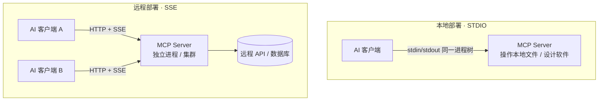
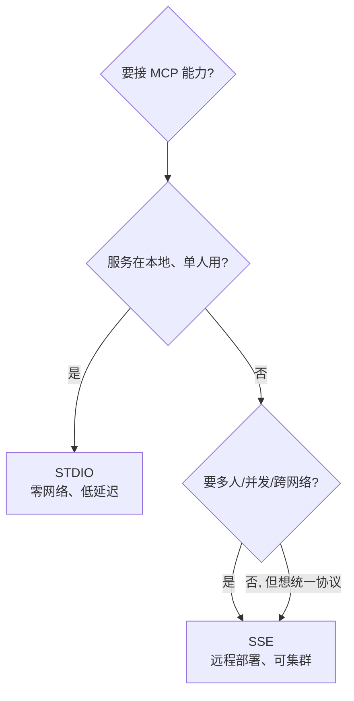

# 9-3 MCP 通信机制全面分析：STDIO 与 SSE 怎么选

## 【学习目标】

学完本节，你应该能够：

- 说清 MCP 当前两种主流传输机制（STDIO、SSE）各自的工作模型与适用边界。
- 在「本地单进程」和「远程多客户端」两种需求下，正确选择传输方式。
- 理解课程前面「前端后端交互」章节用的就是 SSE，并能预判未来 HTTP Streaming 的走向。

## 【正文】

### 一、传输机制解决的是什么问题

MCP 协议规定了「客户端和服务器说什么」（工具清单、调用请求、返回结果），但没规定「用什么通道说」。传输机制（Transport）就是这条通道。它决定了：进程怎么拉起、请求怎么发出、响应怎么回流、能否并发、能否跨网络。选错传输，轻则配置繁琐，重则生产环境扛不住并发。

当前最成熟的两种是 **STDIO**（Standard Input/Output，标准输入输出）和 **SSE**（Server-Sent Events，服务端推送事件）。我们课程前面做前端和后端实时交互那一章，底层就是 SSE。

### 二、STDIO：本地标准输入输出

STDIO 主要用在本地，服务就跑在你自己机器上。它能直接操作本地应用程序和文件：让模型生成一段 HTML，再把内容写进本地某目录、创建目录、创建文件、写入代码，这一整套本地动作靠 STDIO 就能完成。你本机那些设计类软件（3D 设计、本地 PS）内部模型要和本地服务交互，本质也是 STDIO 模式。

**工作模型**：客户端负责拉起 Server 子进程，然后通过子进程的 stdin 发请求、从 stdout 收响应。因为客户端、服务端在同一台机器、同一个进程树里，它不依赖任何外部网络环境，哪怕离线也能跑，而且延迟极低、速度相当快。

**进程生命周期注意点**：STDIO 模式下 Server 的生命周期由客户端掌控，客户端启动，子进程随之拉起；客户端退出，子进程应被回收。这意味着每个客户端连接通常对应一个独立子进程，进程间不共享状态，天然串行。低配机器上同时开多个客户端各拉一个 Server，CPU 开销会叠加。

**代价**：

- **并发弱**：它是单进程通信，同一时刻只能服务一个客户端请求。多个计算机节点要访问该服务，就可能出现延迟甚至卡住。
- **吃本地 CPU**：由于逻辑跑在进程内部，对本地硬件（尤其 CPU）开销偏高，低配机器容易遇到性能瓶颈。
- **配置繁琐**：MCP 工具支持 Python、TypeScript、Java 多种语言，构建前必须把运行环境配好（Node.js、Python 还是 JDK 都得提前装）。

**常见疑问**：本地部署一个 Java 后端服务，用 SSE 交互但服务本身在本地，可以吗？可以。只要客户端程序和 MCP 服务在同一台电脑，STDIO 还是 SSE 都能跑，区别只在通道形态，不在「是否跨机器」。

### 三、SSE：远程 Server-Sent Events

SSE 是本课程用得最多的一种，也是当前比较主流的方式。它用于**远程通信**：用一台专门的服务器，或企业内网里一台专门提供 MCP 通信的服务，其他 MCP 客户端来调用它。这种部署天生适合团队和企业场景。

**工作模型**：客户端通过 HTTP 连上 Server 的 SSE 端点，Server 用持久连接不断往回推消息。因为是远程部署，它支持一定并发，也支持集群、分布式部署，并发性明显强于 STDIO。生产级应用要面向大量客户、还可能并发访问，必然选 SSE。

**体验与配置优势**：SSE 持续推送的特性让客户端响应和用户体验更好；更关键的是配置比 STDIO 简单，你不需要配一堆本地运行环境，只要配一个 SSE 服务的 URL（地址），MCP 客户端拿到地址就能调用，就像前端里配个接口地址那样直白。

**可靠性补充**：SSE 是单向流式（服务端 → 客户端）通道，生产上要考虑连接断开后的重连与心跳。选第三方 SSE Server 时，要确认它的可用性 SLA 与超时策略，否则客户端会卡在「等推送」。

**补充**：SSE 不只是远程工具，本地同样能通信，只是它天生更适合跨网络，物理服务器分布在不同地区、不同网络里，都能靠 SSE 打通。

### 四、两种机制对照

| 维度 | STDIO | SSE |
|---|---|---|
| 部署位置 | 本地单进程 | 远程 / 集群 |
| 并发能力 | 弱（单进程串行） | 强（支持并发 + 集群） |
| 网络依赖 | 无，可离线 | 需 HTTP 可达 |
| 配置成本 | 高（装运行时环境） | 低（配一个 URL） |
| 进程生命周期 | 客户端拉起 / 回收子进程 | Server 独立常驻 |
| 典型场景 | 本地文件操作、设计软件 | 企业内网服务、第三方 API |
| 课程用法 | Cursor 接本地 filesystem（9-5） | 高德地图、课程股票 MCP（9-6 / 10-x） |

### 五、选型决策树

决策依据很朴素：本地、单人、要碰文件 → STDIO；远程、多人、要高可用 → SSE。不要因为「SSE 配置简单」就把它用在纯离线单机场景，那样反而引入不必要的网络依赖。

### 六、未来的 HTTP Streaming

MCP 还会推出一种新的通信机制 **HTTP Streaming（HTTP 流）**。它在「持续回流响应」的思路上和 SSE 一脉相承，目标是把双向流式通信做得更标准（对应 2026 年 MCP 规范演进方向）。现阶段你只需知道它的演进方向，选型仍按上面的对照表：本地轻量用 STDIO，生产远程用 SSE。

### 七、生产选型清单

把前面结论收敛成一份可执行清单，落地时逐条对照：

- **单人本地、碰文件/设计软件**：STDIO，零网络、低延迟，但只挂最小权限目录。
- **团队共享、要并发、跨网络**：SSE，独立部署、可集群，配 URL 即可，注意鉴权与配额。
- **要离线演示**：STDIO 或本地起的 SSE 都行，关键是不依赖外网可达。
- **高可用诉求**：SSE 必须配超时、重连、熔断，把远程 Server 当外部依赖对待。
- **未来演进**：关注 HTTP Streaming，迁移成本低（上层协议不变），不必现在提前切换。

无论选哪种，上层 MCP 报文（工具描述、`tools/list`、`tools/call`）完全一致，换传输不换工具定义，这是 MCP 标准化的核心价值。

## 【易错点 / 面试题】

1. **面试题：STDIO 和 SSE 的本质区别是什么？**
   答：STDIO 是「客户端拉起子进程、走标准输入输出」的本地单进程通道，零网络、低延迟但并发弱、配置重；SSE 是「客户端经 HTTP 连远程 Server、Server 持续推送」的远程通道，配置轻、并发强，但要保证网络可达。两者只是传输通道不同，上层 MCP 协议报文一致。

2. **易错点**：把 STDIO 工具直接拿去给多个同事共用。STDIO 单进程串行，多人同时触发会排队甚至卡死；团队共享能力务必改成 SSE 部署，或每人本地各跑一份。

3. **面试题：为什么课程前面前后端交互用 SSE、MCP 也用 SSE？**
   答：SSE 天然适合「服务端主动推、客户端持续收」的半双工流式场景，前后端实时更新和 MCP 工具调用的响应回流是同一类需求，所以都选它；区别只是前者推业务数据，后者推 MCP 协议报文。

4. **易错点**：以为 SSE 远程就「永远在线」。远程 Server 有可用性边界，客户端要处理重连与超时，生产环境还需鉴权与配额保护。

## 【小结】

STDIO 胜在简单、离线、快，但并发弱、配置繁琐；SSE 胜在并发强、配置简单、适合远程和生产。选型不靠偏好，靠「是否跨网络、是否要并发」。下一节（9-4）换个角度：目前有哪些平台已经把各种能力做成了现成的 MCP Server，你可以直接拿来用。落地到本门课程，课程第 10 章的「股票 MCP 工具」正是以 SSE 形态对外提供服务；而 `982-demo` 里 `agent/RiskQueryAgent.java` 用的 `ChatClient` + `@Tool` 是工具挂载的「客户端侧」写法，理解 STDIO/SSE 之后，你就能判断自己封装的风控工具该以哪种通道暴露出去。
