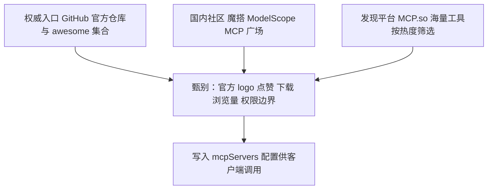

# 9-4 MCP 服务平台指南：去哪找现成的 MCP Server

## 【学习目标】

学完本节，你应该能够：

- 列出当前最主流的 MCP Server 分发平台，并说清各自的侧重点（权威仓库 / 国内社区 / 发现平台）。
- 看懂 `mcpServers` 这份 JSON 配置的结构，知道怎么追加第二个服务而不覆盖已有配置。
- 掌握「面对海量相似 Server 如何甄别」的工程原则，避免踩到低质或重复的轮子。

## 【正文】

### 一、为什么需要平台：配置的本质是注册

MCP 客户端（Cursor、Claude、VS Code 插件，或自研项目）本身不带任何工具，它只认一份配置。配置里写清楚「有哪些 Server、怎么连」，客户端才能去发现并调用里面的工具。一个 MCP Server 往往提供几十种工具，配置对了，这些工具才对你可见、可被调用。所以「找平台」的本质，就是找一份可信、好用的 `mcpServers` 配置来源。

下面按「权威入口 → 国内社区 → 发现平台」三层来介绍。

### 二、平台一：GitHub 官方与集合仓库

第一个和第二个，都是 GitHub 上非常常见的仓库。

首先是**官方的 MCP 服务仓库**（`modelcontextprotocol`），内容做了分类，比如文件系统、金融与金融科技、区块链等等，相关 Server 一大堆。不过它基本是英文的，需要自己翻译，再按需求点进去看。

其次是 `awesome-mcp-servers` 这类集合仓库，它把各种 MCP 服务器按分类整理好了。因为全球开发者极多，类似服务数量极其庞大，你在别的网站搜，可能搜出几十甚至几百个几乎一样的结果。**重要原则：一定要认真甄别**，面对大型企业或规模较大的项目，优先选点赞率、收藏率、下载量都高、被大厂广泛使用的服务。

以 `filesystem`（文件系统）为例，它的介绍里会说明如何部署。基于本地使用时涉及一些命令；它主要支持两种运行方式，**Docker** 和 **NPX**，两种部署形式都可以。就像课程后面要做的 Java 程序，构建好之后也能通过 Docker 部署到本地，再用 SSE 方式传输。直接用标准 STDIO 或 NPX 也都可以。

Docker 形态的 `filesystem` 配置大致如下，把本地目录通过 `--mount` 挂载进容器即可：

```json
{
  "mcpServers": {
    "filesystem": {
      "command": "docker",
      "args": [
        "run",
        "-it",
        "--mount", "type=bind,src=/Users/username/Desktop,dst=/projects/Desktop",
        "--mount", "type=bind,src=/path/to/other/allowed/dir,dst=/projects/other/allowed/dir",
        "--mount", "type=bind,src=/path/to/file.txt,dst=/projects/path/to/file.txt",
        "--projects"
      ]
    }
  }
}
```

核心点是：你需要学会生成这样一个 **JSON 配置结构**。它是一份大配置，里面是 `mcpServers` 对象，按一个个服务去匹配。比如第一个配 `filesystem`，要加第二个，就在后面加一个逗号、再写一个服务名（比如 `ABC`），名字和你提供的服务名称对应。只有配置好了，大模型才能识别它；识别之后，才能进来找到对应的 MCP 工具。

### 三、平台二：魔搭社区 ModelScope（MCP 广场）

**魔搭社区（ModelScope）** 做工作流智能体时用得尤其多。它有一个 **MCP 广场**，注册之后你甚至能自己动手创建、上传 MCP 文件。社区里包含很多分类。

举个例子，比如 `12306-mcp`，通过 12306 平台的 MCP，你可以查询车票、过滤列车信息。它的运作方式很清晰：类型是 SSE，配置里只有一个 URL：

```json
{
  "mcpServers": {
    "12306-mcp": {
      "url": "https://mcp-api.inference.modelscope.net/a28622fb961"
    }
  }
}
```

把这段配置复制过去，粘贴到任何支持 MCP 的客户端里（Cursor、Claude、VS Code 插件，甚至我们自己写的大模型项目），就能直接使用了。道理就是这么简单。

### 四、filesystem 文件系统 MCP 实战

`filesystem` 值得单独拎出来说，因为它非常实用，和很多智能体高度相关。在魔搭上，filesystem 的官方版本是**全中文**的，提供了读取文件内容、读取多个文件、编写文件、修改文件等大量方法；GitHub 上那个英文版本功能完全一样。任选其一连接即可。它也提供 Docker 构建方式，直接用 Docker 跑起来就能被调用。

### 五、平台三：阿里云百炼（Bailian）

阿里云百炼同样可以使用，内部提供了不少 MCP 相关工具。像支付宝、通义等阿里云产品，以及数字人视频这类能力，都能在百炼里找到对应的 MCP 工具。不过部分能力需要先完成开通手续、开通相关服务才能用。它基于阿里云的技术和资源开发，提供了不少智能体和 MCP 工具资源。

### 六、平台四：MCP.so 发现平台

`MCP.so` 是一个英文发现平台，包含的内容非常多，工具种类极其丰富。它发展速度很快，目前已有上万种 MCP 工具（数量级已超 **15000**），你第二天刷新可能还会增加几十个。比如搜索 「file」，与文件相关的就有 **378 个**，你不可能一个个去试，所以基本就是看它的点赞率、下载量、浏览量来筛选。那些浏览量最高、带着官方 logo 标志的，基本可认为是官方出品，可以放心去提供支持和试用。

### 七、平台对照与甄别原则

| 平台 | 语言 | 侧重点 | 适合谁 |
|---|---|---|---|
| `modelcontextprotocol` / `awesome-mcp-servers` | 英文 | 权威、全分类 | 想追源头、看规范的人 |
| 魔搭社区 ModelScope | 中文 | 国内社区 + 可自传 | 国内用户、中文资料优先 |
| 阿里云百炼 | 中文 | 阿里系能力（支付 / 通义 / 数字人） | 已在阿里云体系内的团队 |
| MCP.so | 英文 | 海量发现、按热度筛选 | 想广撒网找现成工具的人 |

**工程原则（务必遵守）**：面对爆炸式增长的 Server，不要凭名字相信它。依次看：是否官方 logo、点赞 / 下载 / 浏览量、是否在 `awesome` 列表被收录、权限边界是否清晰（尤其 filesystem 类会碰本地文件）。低质 Server 可能返回脏数据，甚至越权访问，带进你的 Agent 链路会放大风险。

三类平台到落地配置的路径如下：



### 八、进阶：自研 Server 怎么发布出去

当你像 9-7 那样写好自己的 MCP 工具，下一步往往想让它被更多客户端复用。发布路径有两条：

- **进社区广场**：魔搭 MCP 广场支持注册后上传自己的 Server，填好名称、描述、SSE 地址或启动命令，别人就能搜到并一键接入。
- **私有分发**：企业内部把 SSE 地址配进内网客户端的 `mcpServers`，不必公开到公网，兼顾复用与安全。

无论哪条路，配置结构都和本节一致：STDIO 给 `command`+`args`，SSE 给 `url`。保持结构统一，你的自研工具就能无缝接入任意兼容客户端。

## 【易错点 / 面试题】

1. **易错点**：追加第二个 Server 时把整段 JSON 覆盖重写。正确做法是保留原 `mcpServers` 对象，在已有服务后面加逗号、再写新的服务节点，否则已有的能力会全部掉线。

2. **面试题：SSE 类型的 Server 为什么配置里只要一个 URL？**
   答：SSE 是远程服务，客户端经 HTTP 连上该地址就能建立持久推送通道，Server 的发现、调用都走这条通道，所以只需一个 `url`；而 STDIO 类（如 docker / npx filesystem）要在本地拉起进程，所以给的是 `command` + `args`。

3. **易错点**：在 filesystem 类 Server 里把整个用户目录挂进去。权限越大越危险，应按需只挂 Agent 真正要读写的目录，遵循最小权限。

4. **面试题：面对几十个同名 Server 怎么选？**
   答：看官方 logo、点赞 / 下载 / 浏览量、是否被 `awesome` 列表收录、权限边界是否声明清晰；优先选大厂或高星实现，避免低质 Server 把脏数据带进链路。

## 【小结】

找 MCP Server 有「权威仓库 → 国内社区 → 发现平台」三条路，但无论哪条，甄别都是第一位的。下一节（9-5）我们不再「找」，而是动手在 Cursor 里把本地 filesystem 真正接进来跑通。落地到本门课程，课程第 10 章的「股票 MCP 工具」就是把行情查询做成一份可被任意客户端以 SSE URL 接入的 Server；当你后面在 `982-demo` 里用 `agent/RiskQueryAgent.java` 的 `ChatClient` + `@Tool` 让模型「查某票风险」时，那套 `@Tool` 方法在协议层与这里的 `mcpServers` 注册是同一回事，一个定义「客户端侧工具」，一个定义「服务端暴露工具」。
