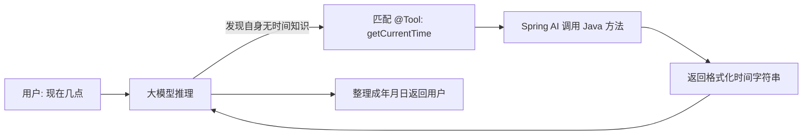

# 9-7 用 Spring AI 开发第一个 MCP 工具

## 【学习目标】

学完本节，你应该能够：

- 在 Spring Boot 多模块工程里新建一个 `stock-mcp` 子模块，并引入 Spring AI 的 MCP Server 依赖。
- 用 `@Tool` 注解把一个普通 Java 方法暴露成可被大模型调用的 MCP 工具，并理解「工具描述写给谁看」。
- 把自研 MCP Server 以 SSE 形态接回 Cursor，验证「模型答不上来时会主动调工具」这一闭环，并映射到 `982-demo` 的等价写法。

## 【正文】

### 一、从「整合别人」到「自己造」

前面几节，我们一直是用本地或远程的工具去「整合」别人提供的第三方 MCP 服务。从这节开始，真正动手用代码实现一个属于自己的 MCP 工具，这是把课程风控能力做成对外服务的前置步骤（第 10 章的「股票 MCP 工具」就建立在这套骨架之上）。

### 二、创建 stock-mcp 子模块

项目是主工程带多子模块的结构，已有一个 Web 类型的 `stock-web` 模块。MCP 这部分照葫芦画瓢，建一个同级别的子模块。

命名规范：前面是项目名，后面跟模块用途说明（端口一般动态分配，通常不写）。演示里命名为 `stock-mcp`。创建时其它选项保持默认，依赖和配置之后再补。

### 三、引入依赖：pom.xml 与 Spring AI

模块建好后引入坐标和依赖（配套文档第八章有完整清单，照着引入）。核心点：MCP 工具和 AI 强相关，本质就是 AI 的一个模块。Spring 官方推出了 **Spring AI** 这一能力，我们用的是 Spring 全家桶。课程录制时 Spring Boot 最新是 4.0.1、Spring AI 最新是 1.1.2；需要说明：本课程的配套工程 `982-demo` 采用 **Spring AI 2.0.1**（2026-10 最新稳定线），但开发者 API，`@Tool`、`ToolCallbackProvider`、`ChatClient`，在两代版本里保持一致，所以本节写法直接可平移到 2.0.1。

依赖里最关键的是 **MCP Server** 模块（我们要构建 MCP 服务器，服务器里再包含若干 MCP 工具）。另外顺手加了 **Lombok**（和实体类相关，不加也行）。复制到 `pom.xml`，Maven 重新加载即可。

### 四、配置文件 application.yml

这份配置复用之前项目的三份文件（application、dev、prod），复制过来后改几处：

- 应用名改成 `us-stock-monitor-mcp`；
- 去掉 `MyBatis-Plus`、百度翻译、钉钉相关的密钥配置（暂时用不到）；
- 端口方面，`prod` 是 9090 先不管，`dev` 原 6060 改成 **7070**，数据库配置先全部注释；
- 多环境配置保留，默认激活 `dev`。

基础部分大致如下：

```yaml
spring:
  application:
    name: us-stock-monitor-mcp
  profiles:
    active: dev
logging:
  level:
    root: info
```

再补一段 Spring AI 配置：服务器名字精简成 `stock-mcp`；版本号可用 `1.0.1`、`1.0.2` 或 `2.0.1`，都能跑；还有一个 **SSE 端点**，因采用 SSE 模式，服务链接需加 `/sse` 端点（规范起见建议加上）。再往下是**异步处理机制**，通过异步方式进行 MCP 通信。

### 五、启动类 Application

启动类复用之前项目的写法，复制过来把类名改成 `Application`（用 IDE 的 Rename 重构；快捷键偶尔失效可在右键菜单 Refactor → Rename）。之前负责加载 `.env` 的类这里用不到，删掉。到这步一个能启动的 Spring Boot 骨架就出来了，只是还没有任何 MCP 工具。

### 六、开发第一个 MCP 工具：DateTool

重头戏来了：开发一个 MCP 工具。用最简单的「获取当前时间」举例。为什么选它？因为大模型基于历史数据训练，你问「现在几点了」它答不上来；这时就需要一个跟时间相关的工具补这个短板。

步骤：

1. 新建包 `com.itzixi.mcp.tool`；
2. 在该包下新建 Java 类 `DateTool`；
3. 给类加 `@Component` 让它被 Spring 容器识别，再加 Lombok 的 `@Slf4j` 引入日志；
4. 写 `public String getCurrentTime()` 方法：用 `LocalDateTime.now()` 拿当前时间，`DateTimeFormatter.ofPattern` 格式化，用 `String.format("当前的时间是：%s", currentTime)` 拼成接近自然语言的话返回；方法里 `log.info("调用MCP工具:获取当前时间")` 打一条日志；
5. 关键一步：给方法加 Spring AI 的 `@Tool` 注解（包是 `org.springframework.ai.tool`），只有加了它，容器才能识别这是可被 MCP、被大模型调用的工具；
6. 给工具写一段 **description**（给大模型参考用），描述越精确，大模型越容易用对。这里写「获取当前日期和时间按照特定格式表示出来的时间值」。

```java
import org.springframework.stereotype.Component;
import org.slf4j.Logger;
import org.slf4j.LoggerFactory;
import java.time.LocalDateTime;
import java.time.format.DateTimeFormatter;

@Component
public class DateTool {

    private static final Logger log = LoggerFactory.getLogger(DateTool.class);

    @Tool
    public String getCurrentTime() {
        log.info("调用MCP工具...");
        LocalDateTime currentTime = LocalDateTime.now();
        String result = String.format("当前的时间是：%s", currentTime);
        return result;
    }
}
```

**为什么 `@Tool` 是核心**：`@Tool` 的作用是把「一个 Java 方法」声明成「一个可被模型调用的工具」，Spring AI 会据此生成工具的名称、参数 schema 和描述，注册进 MCP 协议层。模型在推理时看到这份工具清单，发现用户问「时间」、自己答不了，就发起调用。`description` 不是给人看的注释，是给模型做意图匹配的检索文本，写清楚「返回什么、什么格式」，模型才选得准。



> 补充：打日志这一步，若前面学过 AOP，可用 AOP 统一处理，不用在每个方法里手写，能省事。

### 七、注册工具：ToolCallbackProvider

工具写好后，还要在启动类里**注册**，否则不生效，就像 Spring Boot 拦截器，注册完才发挥作用。

做法是在 `Application` 里用 `@Bean` 定义一个 `ToolCallbackProvider`，把 `DateTool` 对象传进去，返回 `ToolCallbackProvider`（通过 `.build()` 构建）：

```java
import org.springframework.boot.SpringApplication;
import org.springframework.boot.autoconfigure.SpringBootApplication;
import org.springframework.context.annotation.Bean;
import org.springframework.context.annotation.Configuration;
import org.springframework.web.bind.annotation.RestController;

@SpringBootApplication
public class Application {

    public static void main(String[] args) {
        SpringApplication.run(Application.class, args);
    }

    @Bean
    ToolCallbackProvider registMCPTools(DateTool dateTool) {
        return new ToolCallbackProvider() {
            @Override
            public Object invoke(Object[] args) {
                return dateTool.getCurrentTime();
            }
        };
    }
}
```

`ToolCallbackProvider` 里有一个工具数组，可往里放多个工具，先放 `DateTool`，以后有更多工具继续加，用同样方式注册。别忘了 `@Bean`，让 Spring 纳入容器。

**与 2.0.1 的现代写法对应**：`ToolCallbackProvider` 是显式注册工具的方式；在 Spring AI 2.0.1 里，等价且更简洁的做法是 `ChatClient.Builder.defaultTools(this)`，把带 `@Tool` 方法的对象直接挂给 `ChatClient`，由 2.0 的 `ToolCallingAdvisor` 在 Advisor 链统一驱动工具循环。`982-demo` 的 `src/main/java/com/riskbot/agent/RiskQueryAgent.java` 正是这么写的（以下为工程源文件逐字摘录）：

```java
    public RiskQueryAgent(ChatClient.Builder builder, RiskEvaluationService evaluationService) {
        this.evaluationService = evaluationService;
        // defaultTools(this)：把本类的 @Tool 方法注册给 ChatClient
        this.chatClient = builder.defaultTools(this).build();
    }

    @Tool(description = "查询指定股票代码当前的风险评估结果（异动告警列表），支持 A股/美股")
    public List<RiskAlert> queryRisk(@ToolParam(description = "股票代码，如 600519 或 AAPL") String symbol) {
        return evaluationService.evaluate(symbol);
    }
```

课程 9-7 的 `DateTool` 与 `982-demo` 的 `queryRisk` 是同一范式：一个 `@Tool` 方法 = 一个对外工具；区别只在 `DateTool` 走 `ToolCallbackProvider` 注册、`RiskQueryAgent` 走 `defaultTools(this)` 注册，两者在协议层结果一致。

### 八、构建、启动与 IDE 运行配置

注册完，对整个项目执行 `install` 完成构建。构建成功后启动，会看到它用的是 **Netty** 框架，端口 **7070**，`dev` 环境，启动成功。

IDE 技巧：项目变多时直接在控制台启动会很乱（`Application`、`Application1/2/3/4` 分不清）。更好做法是在 Run/Debug Configurations 里点加号选 Spring Boot，分别建 `mcp` 和 `web` 两个配置并改名，可一键分别启动、同时停止。IDEA 偶尔有小 bug 导致配置没立刻显示，点一下保存一般就好。

### 九、在 Cursor 中接入测试

MCP 服务启动后，打开 **Cursor**，在 `mcp.json` 里添加我们的服务。URL 是本地地址加端口再加 `/sse`：

```json
{
  "mcpServers": {
    "stock-mcp-server": {
      "url": "http://127.0.0.1:7070/sse"
    }
  }
}
```

地址可以是内网 IP，也可直接 `127.0.0.1`。保存刷新后，能看到注册的工具被识别（如 `getCurrentTime` / 「当前时间」）。

验证：在 Cursor 里问「现在几点了」。若 MCP 正常工作，模型发现自己答不上来，会**主动调用 `getCurrentTime`** 拿到真实时间，再整理成年月日返回。若把该 MCP 工具禁用再问同样问题，模型就真无从知晓，只能靠命令行去查。这一对比说明：自己构建的 MCP 工具比单纯依赖大模型灵活得多。第一个 MCP 工具真正开发成功。

## 【易错点 / 面试题】

1. **面试题：`@Tool` 的 `description` 写给谁看，能不能不写？**
   答：写给大模型做工具匹配用的检索文本，不是给人看的注释。不写或写得太泛，模型容易选错工具或填错参数；精确描述「返回什么、什么格式」能显著提升命中率。

2. **易错点**：工具方法写了但忘了注册（没加 `@Bean` 的 `ToolCallbackProvider` 或没 `defaultTools(this)`），客户端看不到工具。注册是「暴露」动作，缺一不可。

3. **面试题：Spring AI 1.x 的 `ToolCallbackProvider` 和 2.0.1 的 `defaultTools(this)` 什么关系？**
   答：都是把 `@Tool` 方法注册进调用链路的方式；1.x 常用显式 `ToolCallbackProvider` Bean，2.0.1 推荐 `ChatClient.Builder.defaultTools(...)` 由 `ToolCallingAdvisor` 统一驱动工具循环。开发者 API（`@Tool`/`@ToolParam`）不变，`982-demo` 即采用 2.0.1 写法。

4. **易错点**：SSE 端点忘了加 `/sse`，客户端连不上。采用 SSE 模式时服务地址必须带 `/sse` 端点（如 `http://127.0.0.1:7070/sse`）。

## 【小结】

本节从建模块、引依赖、写 `@Tool`、注册工具、启动、到接回 Cursor 验证，走完了「自研 MCP 工具」全链路。下一章（第 10 章）会把这套骨架替换成真正的股票行情工具，做成对外 MCP Server。落地到本门课程，`982-demo` 的 `src/main/java/com/riskbot/agent/RiskQueryAgent.java` 用 Spring AI 2.0.1 的 `ChatClient` + `@Tool` 实现了等价能力（让模型「查某票风险」），`service/RiskEvaluationService.java` 负责「行情 → 规则引擎 → 告警」的编排并带 resilience4j 熔断保护；你在本节写的 `DateTool` 与那里的 `queryRisk` 是同一范式的两面，先搞懂这个最小例子，后面封装风控工具就只是把「时间」换成「异动判定」而已。
