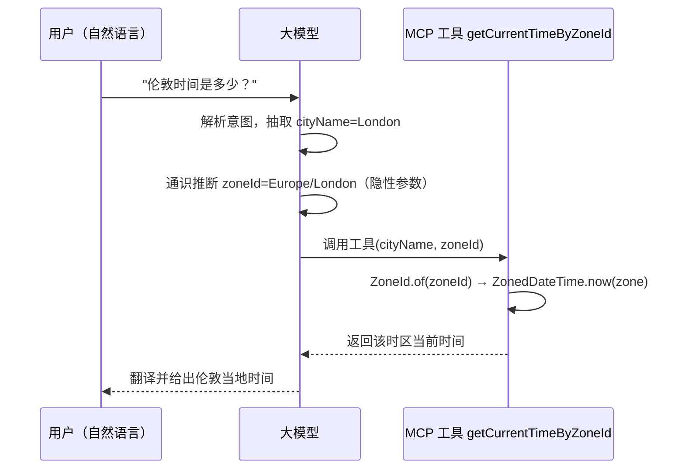

# 9-8 MCP 工具接受并处理自然语言显性与隐性参数

## 【学习目标】

学完本节，你应该能够：

- 讲清 MCP 工具如何借助 `@Tool` 注解声明的参数，从自然语言里接收外部传入的值；
- 区分「显性参数」与「隐性参数」，并解释大模型为何能自动补全隐性参数；
- 基于 `ZoneId` 与 `ZonedDateTime` 实现「按城市查当前时间」这类带时区语义的工具；
- 理解工具 `description` 的写法质量，直接决定大模型调用工具的准确率。

## 【正文】

### 一、为什么需要给 MCP 工具加参数

上一节我们开发了第一个 MCP 工具 `getCurrentTime`，但它**不带任何参数**。重新打开 `stock-mcp` 模块、把服务启动起来，然后在 Cursor 里问：「我想知道伦敦时间现在是几点？」

实际现象是：Cursor 会调用本地命令行里的 `date` 命令来回答，并没有触发我们写的 `getCurrentTime` 工具，因为该工具只返回本机当前时间，跟「伦敦」对不上。更关键的是，有些客户端根本没法用命令行这种方式去取时间，这条路径并不通用。

解决思路很直接：把「伦敦」当作参数传进工具。于是工具必须支持接收参数。这里有一条贯穿全课的原则，**工具的 `description` 一定要写得详细**。描述越精确，大模型对工具能力的理解越深，调用也就越准。

### 二、显性参数与隐性参数：以「按城市查时间」为例

新工具要做的事：根据城市所在的时区 ID 获取当前时间。全球统一时间标准下，每个城市（北京、伦敦、纽约、新德里……）都对应一个特定时区，因此工具需要两个参数：

1. `cityName`：城市名称；
2. `zoneId`：时区 ID（如 `Europe/London`、`Asia/Kolkata`）。

二者的区别在于「用户有没有在对话里说出来」：

| 维度 | 显性参数 `cityName` | 隐性参数 `zoneId` |
|---|---|---|
| 来源 | 用户在自然语言里明确给出，如「查一下伦敦时间」 | 用户几乎不会主动提供，需模型自行推断 |
| 用户认知成本 | 极低，人人知道城市名 | 极高，普通人不知也不关心时区 ID |
| 模型如何获得 | 直接抽取用户原话 | 依赖大模型训练得到的通识知识 |
| 典型示例 | 「伦敦」 → `cityName=London` | 模型由「伦敦」推出 `zoneId=Europe/London` |

`zoneId` 之所以能成为「隐性参数」，是因为时区是通用知识：直接问大模型「北京、伦敦、纽约、新德里的时区 ID 分别是多少」，它会准确给出 `Asia/Shanghai`、`Europe/London`、`America/New_York`、`Asia/Kolkata`。拿到时区 ID，代码即可取出对应时区的当前时间。这也揭示了工具调用的本质：模型把用户意图拆成「该调哪个工具 + 每个参数填什么」，隐性参数填充得好不好，取决于模型对该领域通识的掌握，以及 `description` 是否足够引导。

### 三、改造 DateTool：新增 getCurrentTimeByZoneId

回到代码，在 `DateTool` 里新增方法 `getCurrentTimeByZoneId(String cityName, String zoneId)`：

- 描述写明「根据城市所在的时区ID来获得当前时间」；
- 实现上用 `ZoneId.of(zoneId)` 构造时区，再调 `ZonedDateTime.now(zone)` 取该时区当前时间（思路同 `LocalDateTime.now()`，只是换成带时区的 `ZonedDateTime`）；
- 返回时把 `cityName` 拼进结果，让输出更可读；
- 注意 `String.format` 的占位符要与参数**一一对应**，漏写占位符是常见低级错误。

```java
@Tool(description = "根据城市所在的时区ID来获得当前时间")
public String getCurrentTimeByZoneId(String cityName, String zoneId) {
    log.info("调用MCP工具: getCurrentTimeByZoneId");
    ZoneId zone = ZoneId.of(zoneId);
    ZonedDateTime zonedDateTime = ZonedDateTime.now(zone);
    return "无法查询";
}
```

作为对照，原来不带参数的工具实现如下：

```java
@Tool(description = "获取当前时间")
public String getCurrentTime() {
    log.info("调用MCP工具: getCurrentTime");
    String currentTime = LocalDateTime.now().format(DateTimeFormatter.ofPattern("yyyy-MM-dd HH:mm:ss"));
    String result = String.format("当前的时间是：%s", currentTime);
    return result;
}
```

改完重启服务，在 Cursor 的 MCP 列表里就能看到第二个工具 `getCurrentTimeByZoneId`，其两个参数（`cityName`、`zoneId`）与 `description` 都正确展示，说明大模型能读懂这套接口契约。这里要特别注意：工具对模型暴露的「长相」完全由 `@Tool` 注解与参数名决定，源码里的 `log.info` 等实现细节模型是看不到的，所以描述写得好，工具才算「被正确理解」。

### 四、参数如何在调用链里流动

从用户一句话到工具真正执行，中间经历了一层「自然语言 → 参数绑定 → 工具调用」的映射，用下面这条链路表示：



理解这条链路，就能解释为什么「新开对话」更可靠：模型每轮会把工具调用结果回填进上下文，沿用旧对话可能让模型误以为参数早已就绪，从而跳过本次隐性参数推断，验证不出真实行为。

### 五、在 Cursor 中验证：隐性参数被自动补全

验证时有一个细节：**每次测试最好新开一个对话**，否则 Cursor 会沿用上一轮对话记忆，干扰对「参数是否真的来自本次输入」的判断。

我们问「伦敦时间是多少」，大模型会去调用 `getCurrentTimeByZoneId`，并自动把 `cityName=London`、`zoneId=Europe/London` 填好（`zoneId` 就是它推断出的隐性参数），然后返回伦敦当地时间，还会顺手翻译成中文。

作为对照，用命令行直接以 `TZ` 环境变量取这两个时区的时间，结果应当一致：

```bash
$ cd /Users/lee && TZ=Europe/London date
Wed Jan 7 06:25:43 GMT 2026
```

```bash
$ cd /Users/lee && TZ=Asia/Kolkata date
Wed Jan 7 12:02:53 IST 2026
```

换成新德里，走的仍是同一个工具、同一套流程。这说明无论显性参数（城市名）还是隐性参数（时区 ID），MCP 工具都能从自然语言里正确拿到。代码侧也能确认：城市名与时区信息都被真实接收，参数是确确实实从外部、从自然语言传进来的。

### 六、工程视角：@Tool 参数机制的真实落地

本课程的工具挂载基于 Spring AI 的 `@Tool`（包路径 `org.springframework.ai.tool.annotation.Tool`，参数用 `@ToolParam` 声明语义）。需要澄清一点：大模型并不直接读 Java 方法签名，而是读取 `@Tool(description=...)` 与方法参数的 `description` 来生成「工具使用说明书」。**描述质量 ≈ 调用准确率**，这正是本节反复强调 `description` 要写细的根本原因。

这一套开发者 API 在 982-demo 的生产级工程里原样复用：`982-demo/src/main/java/com/riskbot/agent/RiskQueryAgent.java` 用 `@Tool(description = "查询指定股票代码当前的风险评估结果（异动告警列表），支持 A股/美股")` 把风险查询能力挂给 `ChatClient`，机制与课程里 `DateTool` 的 `@Tool` 完全一致。底层差别在于：2.0 起工具循环改由 `ToolCallingAdvisor` 在 Advisor 链统一驱动，开发者层面仍只需写 `@Tool`，无需关心递归调用的编排细节。

## 【易错点 / 面试题】

1. **隐性参数推断失败怎么办？** 当城市过于冷门、模型认不出对应时区 ID 时，会传入错误 `zoneId` 甚至抛 `ZoneRulesException`。生产做法：在工具内部维护一张「城市 → 时区 ID」映射表兜底，或在 `description` 里提示「若用户未给时区，请使用常见城市的已知时区」，必要时回退到 `ZoneId.systemDefault()`。
2. **`@Tool` 的 `description` 写得太糙会怎样？** 模型可能误判工具用途、传错参数类型，或在根本不需要时强行调用。description 是模型唯一的决策依据，务必写明「做什么、何时用、参数含义」。这也是「描述即契约」思想的体现。
3. **为什么用 `ZonedDateTime` 而不是 `LocalDateTime`？** `LocalDateTime` 不带时区，无法表达「伦敦当前时间」这种语义；只有 `ZonedDateTime`/`OffsetDateTime` 才能结合 `ZoneId` 算出正确的墙上时间。`LocalDateTime.now()` 取的是 JVM 默认时区，跨城市场景必然错位。
4. **面试延伸：MCP 工具参数与 Function Calling 是什么关系？** MCP（Model Context Protocol）把「工具定义 + 调用 + 返回」标准化成客户端与服务器之间的协议；`@Tool` 是 Spring AI 在 Java 侧对工具的描述方式。最终交给大模型的仍是标准的 function-calling 参数 schema，MCP 解决的是「工具如何被发现、被远程调用」的工程问题。

## 【小结】

本节完成第二个 MCP 工具 `getCurrentTimeByZoneId`，核心价值在于：用自然语言描述，就能让大模型同时拿到显性参数（`cityName`）与隐性参数（`zoneId`），再驱动工具达成目的。这种参数机制极具扩展性，继续加城市、加参数，模型都会基于已有知识做映射与推断。

工具的「描述即契约」思想，正是 982-demo 中 `RiskQueryAgent` 把风控查询挂为 `@Tool` 的同一套原理。下一篇我们把视角切到更贴近办公场景的实用工具，电子邮件 MCP 工具，先看它的依赖引入与配置。技术前瞻：当工具集膨胀到几十个，Spring AI 2.1 的 `ToolSearchToolCallingAdvisor` 可做渐进式工具披露（先索引全量工具、按需检索），把大工具集的 token 开销省下 50%–70%。
