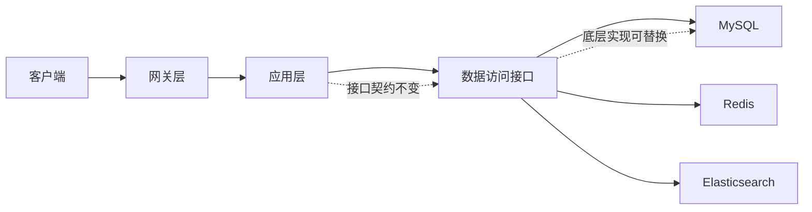

# 六大数据库存储实战: 为什么服务端必须做架构分层

## 纲要

- 分层的三条根本理由
  - 问题域不同：网络问题、业务问题、数据问题各归各位
  - 职责分离：运维与研发的关注点天然切分
  - 架构灵活：层间部署隔离，可独立替换与调度
- 分层的本质：用接口隔离细节，换取可组装、可调度的架构
- 从"能不能替换某个组件"反推分层是否做到位

## 问题域不同：三类问题应当分开解决

三层架构之所以成立，首先是因为三层面向的是完全不同的问题。

- **网关层**管网络。它解决的是"请求怎么进来、怎么分摊、哪些请求不该进来"这类网络与安全问题，同时为后端提供负载均衡与风险屏蔽能力。
- **应用层**管业务。它解决的是"这个动作在业务上意味着什么、要经过哪些步骤、如何产生业务结果"这类业务逻辑问题。
- **存储层**管数据。它对上层提供的是数据的读写操作能力，解决的是"数据怎么落地、怎么取出来"的问题。

把三个不同性质的问题混在一起，代价是任何一个变化都要牵动整体。网络策略调整要改业务代码、换数据库要重写接口层——这显然是不可接受的。分层之后，网络的事归网关，业务的事归应用，数据的事归存储，各自在自己的作用域内演进。

## 职责分离：让不同的人专注于自己的模块

在成规模的互联网团队里，人员角色通常是拆开的：

- **运维同学**负责网关层网络设备的部署维护，以及存储层的数据基建（数据库实例的搭建、主从配置、备份容灾等）。
- **后端研发**的主要精力放在应用层业务逻辑的实现上，同时依托存储层暴露出来的数据读写接口，完成表结构设计、索引设计与数据操作。

这种分工之所以能跑通，正是因为分层把两者的边界划清楚了：研发不需要关心数据库实例跑在哪台物理机上、网关怎么做四层负载；运维不需要读懂业务的领域模型。各司其职，每个人关注自己负责的模块与服务，协作效率最高。

## 架构灵活：部署隔离带来的可替换性

分层的第三个理由是灵活性。层与层之间的部署是隔离的，因此：

- 网关层组件的升级替换不影响应用层代码；
- 应用层从单体迁移到微服务，可以逐步推进；
- 存储层的结构与服务可以在不动业务代码、或只做少量改动的前提下替换，去适配不同的网络架构与性能要求。

这一点在存储层尤其重要。业务初期可能一台 MySQL 就够，流量上来后可能需要引入 Redis 抗热点读、引入 Elasticsearch 承接搜索、引入 HBase 存放时序 Feed。如果分层做得干净，这些替换动作都被收敛在存储层内部，对应用层的冲击可以控制在最小范围。

## 分层的本质

综合以上三点，服务端架构分层的本质可以概括为一句话：**隔离并屏蔽具体实现细节，通过接口的方式实现架构的组装和灵活调度**。

换句话说，评价一个分层做得好不好，有一个很实用的检验方法：假设你要把底层的某个组件换掉（比如把 MySQL 换成其他关系型数据库，或者引入一层缓存），需要做多少改动？如果改动被限制在某一层内部，说明分层是有效的；如果改动要穿透到业务最上层，说明层与层之间的抽象边界没有划好。

## 小结

分层不是形式主义，也不是为了画图好看。它解决的是真实的问题：让不同性质的问题各自演化、让不同角色的人高效协作、让组件具备被替换的可能。理解了这三点，再看存储层的各种设计取舍，就会明白为什么存储层是整个分层体系中最需要谨慎对待的一环。

相关度：94%。是否需要继续：[否]。代码是否可运行：[否]。
