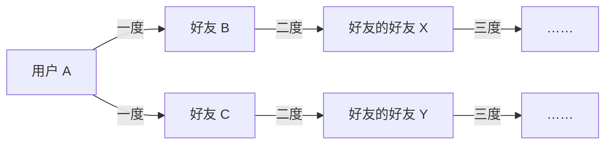

# 六大数据库存储实战: 数据库存储的瓶颈与短板效应

## 纲要

- 短板效应的三个具象案例
## 📎 代码说明

本讲为**原理 / 架构 / 选型**篇，正文以图示与推演为主，无配套代码片段，课程课件亦未提供本章源码文件。

## 短板效应是怎么发生的

前面已经分析了两个底层不对称：无状态服务易于水平扩容，有状态服务难以水平扩容；CPU 运算远快于 IO 读取。落到实际项目里，这些不对称会以非常具体的形式出现。下面三个案例，几乎每个做过线上系统的工程师都会遇到。

## 案例一：MySQL 单表数据量的两道坎

大量开发同学习惯用 MySQL 这样的关系型数据库承接所有的数据落地需求。在数据量不大的时候一切正常，但随着业务增长会连续踩到两道坎：

| 数据量级 | 表现 | 原因 |
| --- | --- | --- |
| 单表百万级 | 走非主键、非唯一索引的查询开始变慢 | 二级索引回表开销放大，索引本身的 B+ 树层级加深，随机 IO 增多 |
| 单表千万级 | 部分 SQL 基本"查不动"，出现严重性能隐患 | 优化器可能放弃索引走全表扫描，缓冲池命中率下降，IO 压力剧增 |

注意这里的关键限定词：**非主键**和**非唯一索引**。主键查询在 B+ 树上的代价增长相对可控，而二级索引需要"查索引树再回主键树"，额外的随机 IO 会随着数据量上升迅速劣化。这也是为什么"加索引"只能解决一部分问题——当数据量到了某个量级，索引本身也成了负担。

## 案例二：Redis 崩溃后的数据丢失

另一个方向的问题是持久性。采用 Redis 这类内存数据库时，如果系统发生异常导致 Redis 实例崩溃，而数据没有及时持久化落地，就会造成数据丢失。

这个案例说明的是另一种"短板"：**性能与持久性的取舍**。Redis 为了保证高性能，把数据放在内存里，落盘策略（RDB 快照 / AOF 追加）必然存在一定的时间窗口。一旦在这个窗口内宕机，窗口内的写就丢了。

所以正确的问题不是"Redis 会不会丢数据"，而是"我的业务能不能容忍这一份数据丢失"。能容忍，Redis 是最优解；不能容忍，它就不该作为唯一存储。

## 案例三：图关系查询的关系型数据库困局

第三个案例出现在社交场景里。假设要查询"好友的好友"这种二度关系：

- 在关系型数据库中，这需要多次 `join` 或子查询；
- 二度关系意味着至少两层自连接，数据量一旦涨上来，中间结果集急剧膨胀；
- 如果需要三度、四度关系，`join` 层数随之增加，代价呈指数级增长。

这类场景下，即使把 SQL 优化到极致，也很难救回来。因为问题的根源不是 SQL 写得不好，而是**关系模型本身不适合表达和遍历图结构**。

用 SQL 表达这条链路，需要把中间每一层的关系表做自连接；而用图数据库表达，只是一次沿着边的 traversal。二者不是优化程度的差别，而是数据模型的差别。

## 从三个案例中提炼出的结论

把上面三个案例放在一起看，能提炼出一条很实用的判断规则：

| 案例 | 表面症状 | 真实瓶颈 | 有效解法 |
| --- | --- | --- | --- |
| MySQL 单表千万 | SQL 慢 | B+ 树与随机 IO 的物理限制 | 分库分表 / 冷热分离 / 换列式或搜索型存储 |
| Redis 宕机丢数据 | 数据不一致 | 内存优先带来的持久性取舍 | 明确业务容忍度；关键数据必须有持久化存储兜底 |
| 二度好友查询慢 | 查询查不出来 | 关系模型不适合图遍历 | 换图数据库 Neo4j |

可以看出，这三个问题的有效解法都不是"再优化一下 SQL"，而是**换一种更贴合数据访问模式的存储**。这正是"没有万能解决方案"这句话在技术层面的具体含义。

## 小结

优化数据库存储的瓶颈与短板效应，是提升互联网架构能力中极其重要的一环。识别瓶颈的第一步，是要能分辨出：**这是用法问题，还是选型问题**。用法问题（缺索引、慢 SQL、连接池配置不当）可以通过优化解决；选型问题（数据模型根本不匹配访问模式）只能在存储层换个方案。

相关度：95%。是否需要继续：[否]。代码是否可运行：[否]。
