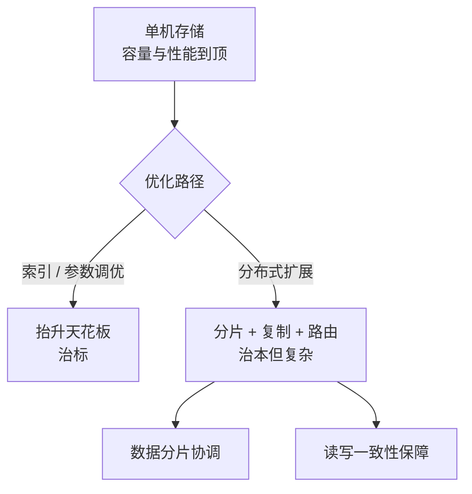

# 六大数据库存储实战: 数据库方案远不止 CRUD 的三层能力模型

## 纲要

- 后端研发的三个成长阶段：初级、中级、高级
- 除了 CRUD 之外必须补齐的三项能力
  - 场景适配：识别读写比例、数据模式稳定性、数据丢失容忍度
  - 分布式扩展：有状态服务的分片与扩容
  - 分布式一致性：主从延迟这类问题的最大化取舍

## 从 CRUD 往上走：三个阶段

很多同学觉得数据库解决方案无非就是 CRUD。客观地说，CRUD 确实覆盖了大部分基础需求，但它只是链路的起点。后端研发的成长轨迹大致可以划分为三个阶段：

**初级阶段。** 使用 Java Web 应用，配合 ORM 框架，通过 JDBC 驱动连接 MySQL，完成 `select` / `insert` / `update` / `delete` 这些基础操作，以及带有 `group by`、`having` 这类聚合能力的 SQL。这个阶段已经可以满足大量互联网基础应用。

**中级阶段。** 开始察觉关系型数据库的性能瓶颈：数据量膨胀后读写性能急剧下降；面对非常复杂的查询条件，单纯的索引优化已经解决不了问题。这时工程师会去寻求使用不同的数据源，尝试在业务架构维度做突破。

**高级阶段。** 根据实际的业务场景定制数据库解决方案，熟练使用不同的数据库搭建、拼凑出自己的后端存储业务架构。

三个阶段的分水岭不在于会不会写 SQL，而在于**遇到问题时脑子里有几套候选方案**。

## 能力一：场景适配

第一项需要补齐的能力是场景适配——针对什么样的场景，使用什么样的数据库解决方案。在做判断之前，通常需要先回答几个问题：

| 判断维度 | 需要明确的问题 | 对选型的影响 |
| --- | --- | --- |
| 读写比例 | 读多写少，还是写多读少？ | 读多写少可考虑缓存层；写多读少需要考虑写入吞吐与扩展性 |
| 数据模式 | 数据存储结构是预先定义好的，还是会持续变化？ | 结构稳定适合关系型；schema 频繁变化适合文档型 |
| 丢失容忍度 | 能否容忍一定程度的数据丢失来换取性能？ | 能容忍则可以使用内存型数据库；不能容忍必须有持久化兜底 |
| 查询模式 | 是简单 KV 查询、复杂条件查询、全文搜索还是图遍历？ | 直接决定候选数据库的类型 |

这些读写能力的适用性考量非常重要。除了 CRUD 以外，第一件要做的事就是：**弄清楚目标数据库的优势与劣势，把它套用到自己的场景中，放大优势、屏蔽劣势**。

## 能力二：分布式扩展

第二项能力是突破单机瓶颈。

再优秀的数据库解决方案，随着数据量和流量的增长，都会遇到单机性能的天花板。索引优化、参数调优这些手段能解决一部分单机问题，但最终必然走向分布式扩展。

然而存储是有状态的服务，分布式扩展的过程远比应用层加机器复杂：

1. **数据分片**：数据要按某个维度（如用户 ID、订单 ID）分布到多个节点。分片键选得不好，会带来数据倾斜与跨片查询。
2. **扩容搬迁**：节点数量变化时，数据要在节点之间迁移，同时尽量不影响在线读写。
3. **读写路由**：请求要能准确路由到目标分片，并且在迁移过程中保持路由正确。

## 能力三：分布式一致性

第三项能力是处理分布式下的一致性问题。

一个典型场景：MySQL 采用读写分离架构，一条数据写入主库之后，业务立刻从从库 `select`，却发现数据还没同步到位。这就是分布式环境下最常见的一致性问题表现。

处理这类问题没有银弹，只能在业务层面做最大化的取舍：

- 对一致性有强要求的读操作，强制走主库；
- 引入一致性中间件或在写后设置短暂的读主窗口；
- 使用缓存一致性策略（延迟双删、订阅 binlog 更新缓存等）；
- 在业务设计上规避，比如写后立即读的场景直接读本地流程数据而非回查数据库。

## 小结

后端研发工程师除了 CRUD，还需要具备三项能力：**场景适配的选型能力**、**分布式扩展的瓶颈处理能力**、**分布式一致性问题的优化解决能力**。这三项能力串起来，就是从"会用数据库"走向"能设计存储架构"的完整路径。

相关度：95%。是否需要继续：[否]。代码是否可运行：[否]。
