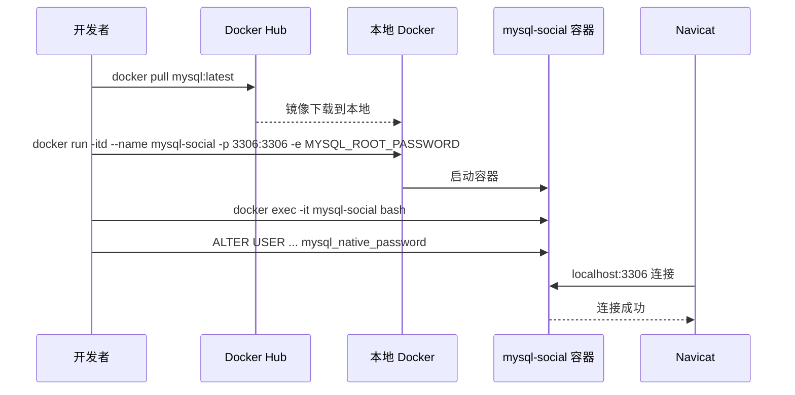

# 12. 六大数据库存储实战: 使用 Docker 完成 MySQL 的高效部署

## 纲要

- 安装 Docker Desktop 与配置国内镜像加速
- Docker 的两个核心面板：Images 与 Containers
- 用 `docker pull` / `docker run` 跑通一个入门容器
- 端口映射：容器内端口 → 宿主机端口
- 拉取并启动 MySQL 容器，设置 root 密码
- 进入容器修改 root 加密方式，用客户端连接
- 常见错误：端口被占用、容器名冲突

## 📎 代码说明

本讲代码以**内联片段**形式呈现在正文中。本章课件源码（`code/socialecom/第二章代码/`）中无正文直接引用的类文件，故不做文件级关联，请以正文片段为准。

## 环境准备

### 安装 Docker

进入 Docker 官网，浏览器会默认识别本机芯片状态，下载对应的安装包直接安装即可。安装完成后，应用程序里会出现 Docker 图标，打开后就是 **Docker Desktop**——本地的 Docker 应用程序。

Docker Desktop 上有两个重要的面板：

| 面板 | 含义 |
| --- | --- |
| Images | 当前本地环境内已经安装的 Docker 镜像，每个 image 有自己的名字与版本 |
| Containers | 基于 image 启动的容器，同一个 image 可以启动多个 container，各自有不同的名字与 ID |

### 配置镜像加速

默认会使用海外镜像下载 Docker Hub 内的 image，速度往往不理想。打开设置（Settings → Docker Engine），加入 `registry-mirrors` 配置，例如：

```json
{
  "registry-mirrors": [
    "https://hub-mirror.c.163.com",
    "https://docker.mirrors.ustc.edu.cn",
    "https://registry.docker-cn.com"
  ]
}
```

填好后点击 **Apply & Restart** 生效。

## 跑通第一个容器

学习 Docker 最好还是从命令行入手。先拉一个入门镜像：

```bash
docker pull docker/getting-started:latest
```

冒号后面跟的是版本号。首次拉取会显示下载进度，拉完后在 Docker Desktop 的 Images 面板里就能看到 `docker/getting-started`，版本为 `latest`。

启动它：

```bash
docker run -d -p 8001:80 docker/getting-started
```

参数含义：

| 参数 | 含义 |
| --- | --- |
| `-d` | 后台启动 |
| `-p 8001:80` | 端口映射，把容器内的 80 端口映射到宿主机的 8001 端口 |
| 末尾镜像名 | 指定用哪个 image 启动 |

**端口映射非常关键**：这个镜像内部是一个 Web 容器，Web 服务监听容器内的 80 端口；由于这个 80 端口属于 Container 内部，必须映射到宿主机的 8001 端口，才能通过 `localhost:8001` 访问到容器内 80 端口的网页服务。

命令执行后会输出一串类似 traceID 的内容，那就是 **Container ID**。切到 Containers 面板可以看到该容器状态为绿色的 running。浏览器访问 `http://localhost:8001`，就能看到 Docker 的 getting-started 学习页面。

## 部署 MySQL

### 拉取镜像

```bash
docker pull mysql:latest
```

拉完后在 Dashboard 中可以看到 `mysql` 的 latest 版本镜像已经就位。

### 启动容器

```bash
docker run -itd --name mysql-social -p 3306:3306 -e MYSQL_ROOT_PASSWORD=123456 mysql:latest
```

逐段拆解这条命令：

| 片段 | 含义 |
| --- | --- |
| `-itd` | 后台 + 交互式命令行方式启动容器 |
| `--name mysql-social` | 指定容器名字为 `mysql-social` |
| `-p 3306:3306` | 把宿主机 3306 端口与容器 3306 端口映射起来 |
| `-e MYSQL_ROOT_PASSWORD=123456` | 通过环境变量直接设置 root 密码 |
| `mysql:latest` | 指定使用的镜像 |

这样一来，默认就可以通过宿主机的 3306 端口访问容器内的 MySQL 服务。

### 两个常见报错

**端口被占用**：如果本机 3306 已被占用（例如之前装过 MySQL 或已经跑着一个容器），会报端口 bind 失败。解决办法是在 Docker Desktop 里把占用端口的旧容器 stop 掉再启动。

**容器名冲突**：再次执行同样的 `docker run` 会报 `Conflict. The container name is already in use`——因为上一条命令其实已经把 `mysql-social` 这个 container 创建出来了（状态可能是 created 而非 running）。不需要重复创建，直接启动已存在的容器即可：

```bash
docker start mysql-social
```

启动成功后，`mysql-social` 容器就在 3306 端口上提供服务了。

## 进入容器修改 root 加密方式

MySQL 8 版本默认的加密方式会导致部分客户端（如 Navicat）连不上，需要先修改 root 用户的密码加密方式。

### 进入容器 shell

可以在 Docker Desktop 里点击 **Open in Terminal** 通过 bash 连接进容器内部，也可以用命令行：

```bash
docker exec -it mysql-social bash
```

进入容器后，用内部自带的 mysql client 连接本地 3306 端口：

```bash
mysql -uroot -p123456
```

### 修改加密方式

```sql
ALTER USER 'root'@'%' IDENTIFIED WITH mysql_native_password BY '123456';
FLUSH PRIVILEGES;
```

这条语句把 root 用户的登录密码加密方式改成 `mysql_native_password`，再用 `FLUSH PRIVILEGES` 让配置生效。

等价写法（如果账号限定为 localhost）：

```sql
ALTER USER 'root'@'localhost' IDENTIFIED WITH mysql_native_password BY '123456';
FLUSH PRIVILEGES;
```

## 用客户端连接验证

打开 Navicat 新建连接：

| 配置项 | 值 |
| --- | --- |
| 连接名 | socialIMOC |
| 主机 | localhost |
| 端口 | 3306 |
| 用户名 | root |
| 密码 | 123456 |

保存后即可成功连接进容器内的 MySQL 服务，后续项目的数据库环境就搭建完成了。

## 完整流程回顾



## API 速览

| 命令 | 作用 | 关键参数 |
| --- | --- | --- |
| `docker pull <image>:<tag>` | 从镜像池拉取镜像 | `image` 镜像名，`tag` 版本（缺省 latest） |
| `docker run` | 创建并启动容器 | `-d` 后台、`-itd` 后台交互、`--name` 容器名、`-p 宿主:容器` 端口映射、`-e` 环境变量 |
| `docker start <name>` | 启动已存在但未运行的容器 | 容器名或 ID |
| `docker exec -it <name> bash` | 进入容器内部 shell | `-it` 交互式终端 |
| `docker ps` | 查看运行中的容器 | 无 |
| `docker stop <name>` | 停止容器 | 容器名或 ID |
| `mysql -uroot -p<pwd>` | 容器内连接 MySQL | 用户名 / 密码 |

## Demo 示例

### 运行说明

1. 安装 Docker Desktop 并配置 `registry-mirrors` 后重启。
2. 依次执行下面的命令，即可得到一个监听本机 3306 端口的 MySQL 8 服务。
3. 用任意 MySQL 客户端以 `root / 123456` 连接 `localhost:3306` 验证。

### 一键脚本

```bash
#!/usr/bin/env bash
set -e

# 拉取 MySQL 最新镜像
docker pull mysql:latest

# 启动容器：后台运行、命名、端口映射、设置 root 密码
docker run -itd --name mysql-social -p 3306:3306 \
  -e MYSQL_ROOT_PASSWORD=123456 \
  mysql:latest

# 等待 MySQL 初始化完成
sleep 20

# 进入容器修改 root 的加密方式，兼容旧版客户端
docker exec -it mysql-social mysql -uroot -p123456 -e \
  "ALTER USER 'root'@'%' IDENTIFIED WITH mysql_native_password BY '123456'; FLUSH PRIVILEGES;"

echo "MySQL 已就绪：localhost:3306  root/123456"
```

### 代码说明

- `docker pull` 负责把镜像拉到本地 Images 列表。
- `docker run` 一次性完成"创建 + 启动"，`-p 3306:3306` 是宿主机到容器的端口映射，少了它外部访问不到容器内的 MySQL。
- `-e MYSQL_ROOT_PASSWORD` 通过环境变量注入 root 密码，避免进入容器再做初始化。
- `docker exec` 用于在已运行的容器内执行命令；这里直接把 SQL 通过 `-e` 参数传给 mysql client，省去交互式进入的步骤。
- 若端口被占用，先 `docker stop` 掉占用 3306 的旧容器；若容器名冲突，改用 `docker start mysql-social` 复用已创建的容器。

### 技术点总结

- Docker 部署中间件的标准动作就是：**拉镜像 → 起容器 → 映射端口 → 注入环境变量**。
- 容器内的端口默认对外不可见，**端口映射是外部访问的前提**。
- 同一个 image 可以启动多个 container，容器名必须唯一。
- MySQL 8 默认加密插件与部分客户端不兼容，需要改成 `mysql_native_password` 并 `FLUSH PRIVILEGES`。
- 以上命令与 SQL 均依据讲稿中的实操步骤整理，可在任意装有 Docker 的机器上直接执行。

