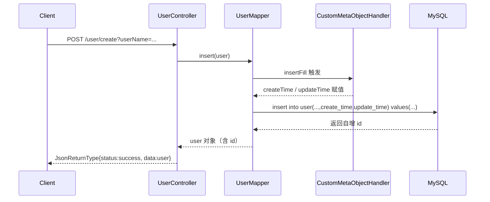

# 14. 六大数据库存储实战: 用户模块 CRUD 与自动填充时间字段

## 纲要

- 统一返回结构 JsonReturnType：status + data
- 主键查询、创建、更新三个接口的实现
- `@TableId` 自增主键回写
- create_time / update_time 的自动填充：注解 + MetaObjectHandler
- 一个典型的排错案例：SQL 日志定位字段重复拼接
- `@JsonFormat` 定制时间序列化格式

## 📎 文本↔代码关联

本讲对应课件源码（去品牌化副本，位于 `code/socialecom/`；包名已由原占位包名统一改写为 `com.social.ecom`）：

| 代码文件 | 正文提及 | 职责 |
| --- | --- | --- |
| `code/socialecom/第二章代码/socialecom/src/main/java/com/social/ecom/base/JsonReturnType.java` | 21 次 | 统一 JSON 返回结构（code / message / data） |
| `code/socialecom/第二章代码/socialecom/src/main/java/com/social/ecom/pojo/User.java` | 7 次 | 实体类，主键 `IdType.AUTO` 自增，含乐观锁 `version` 字段，含自动填充时间字段 |
| `code/socialecom/第二章代码/socialecom/src/main/java/com/social/ecom/SocialecomApplication.java` | 3 次 | Spring Boot 启动类（组件扫描入口） |
| `code/socialecom/第二章代码/socialecom/src/main/java/com/social/ecom/helper/CustomMetaObjectHandler.java` | 3 次 | MyBatis-Plus 字段自动填充处理器（create/update 时间） |
| `code/socialecom/第二章代码/socialecom/src/main/resources/application.properties` | 2 次 | 应用配置（数据源 / MyBatis-Plus 日志 / 端口） |
| `code/socialecom/第二章代码/socialecom/src/main/java/com/social/ecom/mapper/UserMapper.java` | 2 次 | `User` 的 MyBatis-Plus Mapper 接口 |
| `code/socialecom/第二章代码/socialecom/src/main/java/com/social/ecom/controller/UserController.java` | 2 次 | HTTP 接口层，路由前缀 `/user`；端点：`/get`、`/create`、`/update`、`/getforupdate`、`/updatebyversion`、`batchget`、`getbycondition` |

## 统一返回结构

直接在响应体里返回领域对象，无法完备地描述接口遇到错误或发生异常的情况。因此需要定义 `status` 与 `data` 组合的通用返回结构。

在 `base` 包下新建 `JsonReturnType`：

```java
package com.social.ecom.base;

public class JsonReturnType {

    private String status;

    private Object data;

    public static JsonReturnType createType(Object model){
        JsonReturnType returnType = new JsonReturnType();
        returnType.setData(model);
        returnType.setStatus("success");
        return returnType;
    }

    public static JsonReturnType createErrorType(String errMsg){
        JsonReturnType returnType = new JsonReturnType();
        returnType.setData(errMsg);
        returnType.setStatus("fail");
        return returnType;
    }

    // getter / setter 省略
}
```

约定很清晰：**成功走 `createType`，`status` 为 `success`；失败走 `createErrorType`，`status` 为 `fail`，`data` 里放错误描述**。

## 主键查询

Controller 中最基础的查询接口：

```java
@RequestMapping(value = "/get", method = {RequestMethod.GET})
@ResponseBody
public JsonReturnType get(@RequestParam(name = "id") Long id){
    User user = userMapper.selectById(id);
    if(user != null){
        return JsonReturnType.createType(user);
    }else{
        return JsonReturnType.createErrorType("用户不存在");
    }
}
```

请求 `/user/get?id=1` 返回 `status=success` 并带回 user 对象；请求一个不存在的 id 时返回：

```json
{
  "status": "fail",
  "data": "用户不存在"
}
```

## 创建用户

```java
@RequestMapping(value = "/create", method = {RequestMethod.GET, RequestMethod.POST})
@ResponseBody
public JsonReturnType create(@RequestParam(name = "userName", defaultValue = "") String userName,
                             @RequestParam(name = "userPassword", defaultValue = "") String userPassword,
                             @RequestParam(name = "userTel", defaultValue = "") String userTel){

    User user = new User();
    user.setUserName(userName);
    user.setUserTel(userTel);
    user.setUserPassword(userPassword);

    userMapper.insert(user);

    return JsonReturnType.createType(user);
}
```

两个细节：

- **字符串入参统一给 `defaultValue = ""`**，防止上游不传值时报错。
- 由于 `User` 的主键被声明为自增，`insert` 执行后 MyBatis-Plus 会把数据库生成的 id **回写进 user 对象**，因此返回值里能直接看到 `id=2` 这样的结果。

调用示例：`/user/create?userName=xyz&userTel=13512345678&userPassword=pwd`。

## 更新用户

与 create 的区别是需要明确指定更新哪条记录，因此多一个 `id` 入参，并且**先从库中把记录读出来再改**：

```java
@RequestMapping(value = "/update", method = {RequestMethod.GET, RequestMethod.POST})
@ResponseBody
public JsonReturnType update(@RequestParam(name = "id", defaultValue = "0") Long id,
                             @RequestParam(name = "userName", defaultValue = "") String userName,
                             @RequestParam(name = "userPassword", defaultValue = "") String userPassword,
                             @RequestParam(name = "userTel", defaultValue = "") String userTel){

    User user = userMapper.selectById(id);
    user.setUserName(userName);
    user.setUserTel(userTel);
    user.setUserPassword(userPassword);

    int rowAffected = userMapper.updateById(user);
    if(rowAffected < 1){
        return JsonReturnType.createErrorType("更新失败");
    }
    return JsonReturnType.createType(user);
}
```

`updateById` 返回**影响行数**，用它做校验是必要的习惯——实际更新的条数必须与期望一致。

## 时间字段自动填充

业务表通常都需要 `create_time` 与 `update_time`，用于后续数据抽取与记录更新条数统计。手写赋值既繁琐又容易遗漏，MyBatis-Plus 提供了自动填充机制。

### 第一步：实体字段加注解

```java
@TableId(value = "id", type = IdType.AUTO)
private Long id;

private String userName;
private String userPassword;
private String userTel;

@TableField(fill = FieldFill.INSERT, value = "create_time")
@JsonFormat(pattern = "yyyy-MM-dd HH:mm:ss", timezone = "GMT+8")
private Date createTime;

@TableField(fill = FieldFill.INSERT_UPDATE, value = "update_time")
@JsonFormat(pattern = "yyyy-MM-dd HH:mm:ss", timezone = "GMT+8")
private Date updateTime;
```

- `FieldFill.INSERT`：执行 `insert` 时自动赋值。
- `FieldFill.INSERT_UPDATE`：执行 `insert` 或 `update` 时都自动赋值。
- `value` 显式声明映射到的数据库列名（下划线风格）。

### 第二步：实现 MetaObjectHandler

在 `helper` 包下新增填充处理器，并用 `@Component` 交给 Spring 管理：

```java
package com.social.ecom.helper;

import com.baomidou.mybatisplus.core.handlers.MetaObjectHandler;
import org.apache.ibatis.reflection.MetaObject;
import org.springframework.stereotype.Component;

import java.util.Date;

@Component
public class CustomMetaObjectHandler implements MetaObjectHandler {

    @Override
    public void insertFill(MetaObject metaObject) {
        this.setFieldValByName("createTime", new Date(), metaObject);
        this.setFieldValByName("updateTime", new Date(), metaObject);
    }

    @Override
    public void updateFill(MetaObject metaObject) {
        this.setFieldValByName("updateTime", new Date(), metaObject);
    }
}
```

注意：`setFieldValByName` 里传的是**实体属性名**（`createTime`），而不是数据库列名。

### 排错：SQL 日志暴露字段重复

第一次启用自动填充后调用 create 报错。打开 MyBatis-Plus 的 SQL 日志：

```properties
mybatis-plus.configuration.log-impl=org.apache.ibatis.logging.stdout.StdOutImpl
```

日志里的 insert 语句把 `create_time` 拼了两次——原因是在 `insertFill` 中复制代码时误写：

```java
// 错误写法：两次都填了 createTime
this.setFieldValByName("createTime", new Date(), metaObject);
this.setFieldValByName("createTime", new Date(), metaObject);

// 正确写法
this.setFieldValByName("createTime", new Date(), metaObject);
this.setFieldValByName("updateTime", new Date(), metaObject);
```

这就是 SQL 日志的价值：**拼接出来的语句一览无余，定位问题非常快**。

## 时间序列化格式

未加注解时，`Date` 类型字段序列化出来的格式冗长且不友好。加上 `@JsonFormat` 指定 pattern 与时区：

```java
@JsonFormat(pattern = "yyyy-MM-dd HH:mm:ss", timezone = "GMT+8")
private Date createTime;
```

再次调用 update，返回的 `createTime` / `updateTime` 就变成了 `2023-08-01 15:20:33` 这种易读格式。

## 数据流回顾



## API 速览

| API | 签名 | 说明 |
| --- | --- | --- |
| `BaseMapper.selectById` | `T selectById(Serializable id)` | 按主键查询，未命中返回 null |
| `BaseMapper.insert` | `int insert(T entity)` | 插入，返回影响行数；自增 id 回写到实体 |
| `BaseMapper.updateById` | `int updateById(T entity)` | 按主键更新，返回影响行数 |
| `@TableId` | `@TableId(value="id",type=IdType.AUTO)` | 声明主键与生成策略 |
| `@TableField` | `@TableField(fill=FieldFill.INSERT,value="create_time")` | 字段映射与自动填充策略 |
| `@Version` | `@Version` | 乐观锁版本号字段 |
| `@JsonFormat` | `@JsonFormat(pattern=...,timezone=...)` | 定制日期序列化格式 |
| `MetaObjectHandler` | `insertFill(MetaObject)` / `updateFill(MetaObject)` | 插入 / 更新时的字段填充回调 |
| `setFieldValByName` | `setFieldValByName(String fieldName,Object val,MetaObject)` | 按实体属性名写入值 |
| `JsonReturnType.createType` | `createType(Object model)` | 成功返回结构 |
| `JsonReturnType.createErrorType` | `createErrorType(String errMsg)` | 失败返回结构 |

## Demo 示例

### 运行说明

1. 用 Docker 起一个 MySQL（见前面），创建库 `socialecom`，建表：

```sql
CREATE TABLE `user` (
  `id` bigint(20) NOT NULL AUTO_INCREMENT,
  `user_name` varchar(64) DEFAULT NULL,
  `user_password` varchar(64) DEFAULT NULL,
  `user_tel` varchar(32) DEFAULT NULL,
  `create_time` datetime DEFAULT NULL,
  `update_time` datetime DEFAULT NULL,
  `version` int(11) DEFAULT 0,
  PRIMARY KEY (`id`)
) ENGINE=InnoDB DEFAULT CHARSET=utf8mb4;
```

2. 配置 `application.properties`：

```properties
spring.datasource.url=jdbc:mysql://localhost:3306/socialecom?useUnicode=true&characterEncoding=UTF-8
spring.datasource.username=root
spring.datasource.password=123456
spring.datasource.driver-class-name=com.mysql.cj.jdbc.Driver

mybatis-plus.configuration.log-impl=org.apache.ibatis.logging.stdout.StdOutImpl

server.port=9090
```

3. 启动类扫描 Mapper：

```java
@SpringBootApplication
@MapperScan("com.social.ecom.mapper")
public class SocialecomApplication {
    public static void main(String[] args) {
        SpringApplication.run(SocialecomApplication.class, args);
    }
}
```

4. 依次请求验证：

```bash
curl 'http://localhost:9090/user/create?userName=xyz&userTel=13512345678&userPassword=pwd'
curl 'http://localhost:9090/user/get?id=2'
curl 'http://localhost:9090/user/update?id=2&userName=social'
```

### 关键依赖

```xml
<dependency>
  <groupId>com.baomidou</groupId>
  <artifactId>mybatis-plus-boot-starter</artifactId>
  <version>3.4.0</version>
</dependency>
<dependency>
  <groupId>mysql</groupId>
  <artifactId>mysql-connector-java</artifactId>
  <scope>runtime</scope>
</dependency>
```

### 技术点总结

- 统一 `status + data` 返回结构，能让错误语义显式化，避免客户端靠 HTTP 码猜。
- 字符串入参统一 `defaultValue = ""`，数值入参如非必传要用 `required = false`，否则类型无法接收空值。
- `insert` 后自增主键会自动回写实体，可直接返回给前端。
- `updateById` 务必校验影响行数。
- 时间字段用 `FieldFill` + `MetaObjectHandler` 自动填充，避免业务代码里散落 `new Date()`。
- 遇到 SQL 行为异常，第一件事是打开 `log-impl` 看真实语句。

