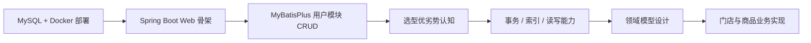

# 19. 六大数据库存储实战: Mysql 章节导览与新零售核心能力蓝图

## 纲要

- 章节定位
## 📎 文本↔代码关联

本讲对应课件源码（去品牌化副本，位于 `code/socialecom/`；包名已由原占位包名统一改写为 `com.social.ecom`）：

| 代码文件 | 正文提及 | 职责 |
| --- | --- | --- |
| `code/socialecom/第三章代码/socialecom/src/main/java/com/social/ecom/pojo/Shop.java` | 3 次 | 实体类，主键 `IdType.AUTO` 自增，含乐观锁 `version` 字段，含自动填充时间字段 |
| `code/socialecom/第三章代码/socialecom/src/main/java/com/social/ecom/pojo/Seller.java` | 3 次 | 实体类，主键 `IdType.AUTO` 自增，含乐观锁 `version` 字段，含自动填充时间字段 |
| `code/socialecom/第三章代码/socialecom/src/main/java/com/social/ecom/pojo/SkuAttributeInfo.java` | 2 次 | 实体类，主键 `IdType.AUTO` 自增，含自动填充时间字段 |
| `code/socialecom/第三章代码/socialecom/src/main/java/com/social/ecom/pojo/Stock.java` | 2 次 | 实体类，主键 `IdType.AUTO` 自增，含自动填充时间字段 |
| `code/socialecom/第三章代码/socialecom/src/main/java/com/social/ecom/pojo/Item.java` | 2 次 | 实体类，主键 `IdType.AUTO` 自增，含自动填充时间字段 |

## 正文

### 从 Web 脚手架走向领域能力的三个台阶

在前面里，我们完成了三件基础工作：用 Docker 部署 MySQL，用 Spring Boot 搭出 Web 入口，再用 MyBatisPlus 打通了用户模块的增删改查。这套组合具备了"能访问数据库"的能力，但它距离一个可运营的新零售系统还差得很远。

真正的差距在于：**数据库的价值不在能存取数据，而在于能否用最低的成本、最稳的一致性，支撑住业务模型之间的关系。** 本章要做的就是把这个差距补上。



### 第一台阶：看清 MySQL 的选型边界

选型不是背"MySQL 好还是 Oracle 好"，而是回答三个问题：

| 问题 | 对应本章内容 | 影响的下游决策 |
| --- | --- | --- |
| 它能做什么别人做不到的 | 完整 SQL 标准、InnoDB 事务 ACID | 交易类强一致场景是否敢托付 |
| 它的性能天花板在哪 | 单表千万级瓶颈、固定表结构 | 是否需要分库分表、读写分离 |
| 出了边界怎么办 | 分布式方案的自相矛盾 | 是否引入 Redis / Elasticsearch |

只有先把边界画清楚，后面的优化才有靶心——否则很容易出现"单体 MySQL 拼命调参，其实应该换个存储"的资源错配。

### 第二台阶：吃透事务、索引、读写三大基础能力

这一层是本章篇幅最重的部分，也是最能拉开工程师差距的部分。三块能力的定位各不相同：

- **事务**：解决"数据不能错"。隔离级别、MVCC 快照读、当前读、行锁/间隙锁，共同构成了并发下的一致性保障。
- **索引**：解决"数据读得快"。聚簇索引与非聚簇索引的结构差异，决定了查询是 O(1) 直达还是多一次磁盘寻址；覆盖索引、最左前缀、最左匹配等原则决定了索引是助力还是拖累。
- **读写**：解决"容量扛得住"。读写分离、分库分表是在单表到极限之后的扩展手段，但会带来主从延迟与跨库事务的代价。

三者之间的关系可以用一句话概括：**事务划定正确性底线，索引决定单次查询成本，读写方案决定整体吞吐上限。**

### 第三台阶：领域模型驱动的业务实现

技术能力最终要落到模型上。本章后半段会把一个典型的新零售商品域拆成可落地的实体，并用 MyBatisPlus 完成全套实现：

```dir
com.social.ecom
├── pojo            领域实体：Seller / Shop / Item / Sku / SkuAttributeInfo / Stock
├── mapper          数据访问层
├── service         领域服务：级联查询、详情组装
├── controller      REST 接口
└── helper          全局配置：分页、乐观锁、填充策略
```

这条链路里有个关键设计取舍：**商品、类目、品牌、SKU、库存之间天然存在多对一关系，但在互联网应用中不使用数据库外键约束，而是在应用层保证关联正确性。** 原因是联动更新/删除时外键会带来难以控制的代价，而应用层可以按需编排。

### 章节学习与验收清单

- 能说清 MySQL 三大优势与三大劣势，并为每个劣势举出演进方案
- 能默写出四种隔离级别与脏读、不可重复读、幻读的对应矩阵
- 能解释为什么 `select` 走快照读而 `update` / `select for update` 走当前读
- 能判断一条 SQL 在 MyBatisPlus 中最终加的是行锁、表锁还是间隙锁
- 能独立生成 Seller / Shop 两层代码，并完成商品详情页的级联组装

## 小结

