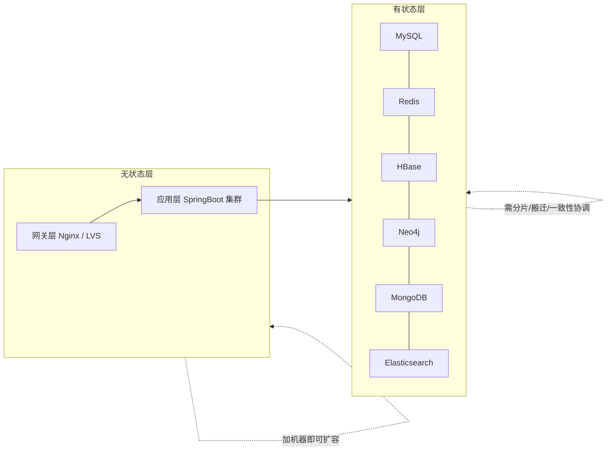
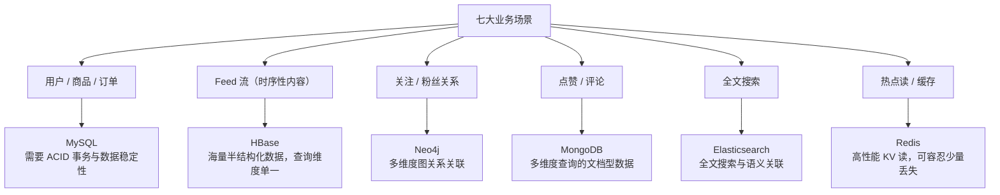

# 1. 六大数据库存储实战: 没有万能的技术手段，只有适配业务的存储选型

## 纲要

- 为什么看似简单的 CRUD 背后，藏着决定项目成败的存储架构
## 📎 代码说明

本讲为**原理 / 架构 / 选型**篇，正文以图示与推演为主，无配套代码片段，课程课件亦未提供本章源码文件。

## 存储设计为什么能决定一个项目的成败

很多同学在接触服务端存储时会有一种印象：所谓存储方案，无非是引入一家数据库厂商的产品，用关系型数据库暴露出来的 CRUD 接口，把查询结果映射成 Java 对象模型，再序列化成 JSON 返回给前端。按照这个理解，存储设计不过是写几条 `select` / `insert` 的事。

但只要真正经历过线上流量压力就会发现，一套优秀的存储解决方案，对整个项目的成败会产生深远影响。原因在于两个基本事实。

**第一，互联网业务大多是集中式数据管理场景，天然属于 IO 密集型。**

用户的每一次请求，本质上都是一次数据操作加一次结果返回。当用户 DAO 层把请求打到数据库、数据库再吐回结果，整条链路的耗时大头往往不在 CPU 计算上，而在磁盘 IO 与网络 IO 上。这类场景一旦发生性能问题，优化的难度远高于应用层。

**第二，存储是有状态服务，扩展成本高。**

应用服务通常是无状态的：同一份代码部署到任意一台机器上，用户请求在任何时刻执行的代码逻辑都完全一致。所以只要加机器、挂负载均衡，就能线性扩容。

而存储不一样。存储要把数据本身一起"搬"，它是有状态的服务。一旦你要横向扩容，就必须面对数据搬迁、分片路由、副本一致性等一大串额外算力开销。

把这两点放在一起，结论就很清晰了：在 IO 密集型的场景下，瓶颈发生在难以水平扩展的存储层——那么一套完备的数据库架构解决方案，就成了整个后端架构里最需要前置设计的一环。

## 后端研发需要跨越的三道门槛

在大部分团队的招聘标准里，CRUD 能力是入场券，不是加分项。会写 CRUD 但背后的存储知识体系没有跟上，很难在高并发场景下被委以重任。整体上可以把能力划分为三个阶段：

| 阶段 | 典型行为 | 关注点 |
| --- | --- | --- |
| 初级 | 使用 ORM 框架 + JDBC 驱动完成 `select` / `insert` / `update` / `delete`，会写 `group by`、`having` 等聚合语句 | 功能可用 |
| 中级 | 察觉到数据量膨胀后读写性能急剧下降，复杂查询条件无法单靠索引解决，开始尝试引入不同数据源做架构突破 | 单机性能瓶颈 |
| 高级 | 依据实际业务场景定制数据库解决方案，熟练组合多种数据库拼出完整的后端存储架构 | 场景适配 + 分布式扩展 + 一致性取舍 |

也就说，除了基础的 CRUD 之外，真正需要补齐的是三项能力：**场景适配能力**、**分布式扩展能力**、**分布式一致性问题的取舍能力**。

## 三层学习目标

围绕上面三项能力，这门课程的目标可以拆成三条递进的线索。

**其一，深入原理。** 不是停留在"会用某个数据库"的层面，而是理解各大数据库解决方案的内部机制，知道它的优势从何而来、劣势又源于何处。只有知道原理，选型时才不会拍脑袋。

**其二，分布式扩展。** 单机一定会有瓶颈。索引优化、参数调优只能把天花板往上抬一点，真正突破单机限制靠的是分布式解决方案——分片、复制、读写分离、分布式事务。而存储是有状态服务，分布式化过程中必然伴随数据分片与读写一致性问题。

**其三，场景落地。** 在业务场景的约束范围内，选择最能发挥该存储优势、最能屏蔽其劣势的方案。最终目标是把"选型"从经验玄学变成有依据的推理。

## 七大核心业务场景与六大数据库

为了让上面三条线索有落点，课程引入了一个社交新零售项目，围绕七大核心业务场景串联整个技术栈：**用户、商品、订单、关注粉丝关系、Feed 流、点赞、评论**。在这七个场景下，分别引入六种主流数据库，各自匹配不同的诉求。

把它们整理成选型表更直观：

| 数据库 | 类型 | 主要解决什么问题 | 典型场景 |
| --- | --- | --- | --- |
| MySQL | 关系型 | 需要 ACID 事务、强一致、数据稳定可靠 | 用户、商品、订单、库存 |
| Elasticsearch | 搜索型非关系型 | 全文检索、语义关联搜索、复杂聚合 | 商品搜索、内容检索 |
| Redis | KV 型非关系型 | 极高读写性能，容忍一定程度数据丢失 | 缓存、计数、会话 |
| HBase | 列式非关系型 | 海量半结构化 / 非结构化数据，查询维度单一 | Feed 流、时序数据 |
| MongoDB | 文档型非关系型 | 字段可扩展、写入量大且查询条件复杂 | 点赞、评论 |
| Neo4j | 图型非关系型 | 图形关系下的多度 traversal 查询 | 关注 / 粉丝关系链 |

## 小结

这六种数据库没有谁替代谁，它们各自解决某一类特定场景下的部分问题，对这些场景之外的诉求则可能完全无能为力。把它们的适用边界理清楚，再回过头看业务需求，选型才有依据。这也正是贯穿整门课程的主线：**先理解存储，再谈架构**。

