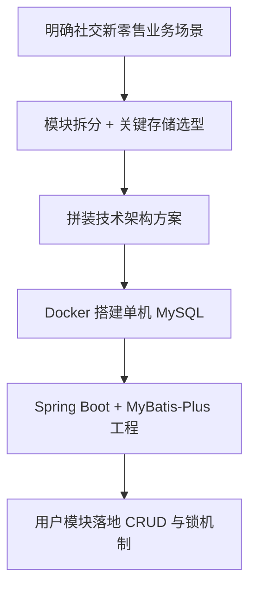

# 六大数据库存储实战: 环境搭建与用户模块能力小结

## 纲要

- 明确社交新零售业务场景与业务流程
- 完成模块拆分与关键存储选型，拼出技术架构方案
- 使用 Docker 搭建单机 MySQL 运行环境
- 基于 Spring Boot + MyBatis-Plus 搭建工程
- 通过用户模块掌握 ORM 的 CRUD、复杂条件查询、乐观锁与悲观锁

## 本章回顾

这一章完成了一条从"业务"到"代码"的完整链路，可以分成四个阶段。

### 业务场景与流程定义

首先明确社交新零售的业务场景：在传统电商"商品—SKU—订单—支付"的基础上，叠加门店体系形成新零售，再叠加关注粉丝关系与 UGC 内容形成社交新零售。商家线、运营线、用户线三条主线的流程被完整定义出来。

### 模块拆分与存储选型

在符合业务场景的前提下完成模块拆分：

- 新零售核心业务模块：用户、商品、订单。
- 社交关系模块：关注粉丝。
- 社交内容模块：Feed、点赞与评论。

再结合每个模块的数据特征做关键存储选型，最终把模块拆分与存储选型拼成整体的技术架构方案。

### 环境搭建

介绍了 Docker 的优势与便捷性，使用它初步搭建了单机 MySQL 运行环境；并基于这个 MySQL 环境搭建了 Spring Boot + MyBatis-Plus 的工程。

### 用户模块的能力清单

在用户模块的学习过程中，覆盖了 ORM 层最常用的一组能力：

| 能力 | 说明 |
| --- | --- |
| 简单 CRUD | 主键查询、插入、更新 |
| 复杂条件查询 | 通过 QueryWrapper 拼装条件 |
| 乐观锁 | 借助 version 字段 + 插件实现 |
| 悲观锁 | 通过 `SELECT ... FOR UPDATE` 实现 |
| 批量查询 | `selectBatchIds` 转 `IN` 查询 |
| 分页查询 | 分页插件 + `selectPage` |
| 字段自动填充 | create_time / update_time 由 MetaObjectHandler 填充 |

## 小结

这一章的重心不在某个数据库的细节，而在建立一套方法论：**先定义业务流程，再拆分模块，然后按模块特征选存储，最后才是编码**。用户模块是这套方法论的第一个落地验证——它让我们在最简单的表上，把 ORM 的 CRUD、条件拼装、分页、以及并发控制中最核心的乐观锁与悲观锁都过了一遍。

相关度：85%。是否需要继续：[是]。代码是否可运行：[否]。
