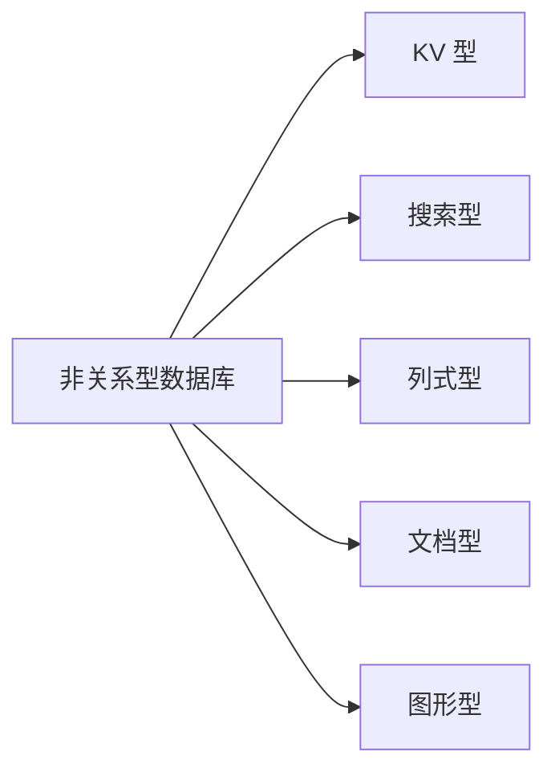
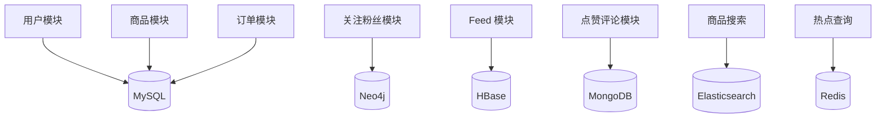

# 六大数据库存储实战: 存储选型全景与各类数据库的取舍

## 纲要

- 关系型数据库的优势、劣势与适用场景
- 非关系型数据库的五个细分分类：KV 型、搜索型、列式型、文档型、图形型
- 每一类的核心优势、主要劣势、适用场景与典型中间件
- 选型的核心原则：没有通用解，只有取舍

## 📎 代码说明

本讲为**原理 / 架构**篇，正文以推演与图示为主，无配套代码片段；本章课件源码中亦无对应类文件。

## 关系型数据库

典型选型包括互联网最常用的开源数据库 MySQL，以及 Oracle、SQL Server、DB2 等，都是关系型数据库的典范。

### 优势

- **标准的 SQL 语句**：操作简便且非常强大，单表查询、多表 JOIN、GROUP BY、UNION 等场景都能覆盖。SQL 可以说是数据层操作最强大的表达工具，能搞定各式各样的数据查询、增加、删除与修改场景。
- **事务性得天独厚**：在应用程序中操作关系型数据库可以保证 **ACID** 特性，数据存储非常稳定，不会产生一致性问题。
- **数据稳定性高**：依托索引、外键与事务，数据本身的可信度最高。

### 劣势

优势和劣势往往是同一枚硬币的两面：

- **高并发大数据量支撑能力弱**。为了支撑 SQL 的强大能力，数据库内部需要用各种**索引、外键**来保证数据一致性；一旦数据量超过一定程度，整个存取场景就会产生很大问题。
- **表结构固定，扩展不便**。SQL 有标准定义，表结构随之固化；要扩展就得 `ALTER TABLE` 增加或删除字段，会使原本表结构内的数据发生偏移并产生影响。在高流量产线上做这类操作，风险不小。
- **没有搜索能力**。虽然可以用 `LIKE` 做字符串模糊检索，但它本质上不是全文索引与全文搜索，而且存在很大的性能问题。

### 适用场景

**核心的、需要稳定的强一致场景**，非常适合关系型数据库。

## 非关系型数据库

非关系型数据库是为解决关系型数据库的问题而研发出来的。但它的分类比关系型数据库复杂很多，原因只有一条：

> 任何存储选型都是用来解决某一类特定场景下的部分问题，而对该场景下的其他问题可能无能为力。

因此在技术设计中，真正要做的不是寻找"银弹"，而是**做存储选型与方案上的取舍**。

### KV 型

典型中间件是 Redis。

- **优势**：查询速度非常快。可以类比 Java 的 Map 数据结构，支持 O(1) 维度的快速查询，这是 KV 型存储能带来的最大收益。
- **劣势**：存储方式简单，导致**查询方式单一**——只能通过某一个固定的 key 找到对应的一串数据结构；同时数据不稳定，Redis 为了保证高性能，数据无法保证强一致落地。
- **适用场景**：读多写少，且能容忍一定的数据丢失。

### 搜索型

典型中间件是 Elasticsearch、Solr。

- **优势**：顾名思义支持**全文搜索**，并且支持复杂的聚合与 GROUP BY 能力，因此往往被称为搜索引擎。
- **劣势**：为满足搜索场景，**倒排索引**的建设对内存与算力的消耗非常大；为了维护倒排索引，数据的**延迟性也比较高**。
- **适用场景**：需要全文搜索，且写入的内容不要求立刻就能搜到，通常可容忍秒级延迟。

### 列式型

先澄清概念：关系型数据库的数据存取以**行**为单位，而列式数据库以**列**为单位存储，不同行的同一列数据会被存放在一起。

- **优势**：支持**海量数据存储**，扩展非常方便；由于整列数据物理相邻，对列做 GROUP BY、AVG 这类聚合分析时，实时性非常高。
- **劣势**：**条件查询能力很弱**。
- **适用场景**：预估未来会有大规模数据增长量的存储需求。
- **典型中间件**：HBase、Google Bigtable。

### 文档型

典型中间件是 MongoDB、CouchDB。它常常被拿来与关系型数据库直接对比。

- **优势**：**表字段可扩展，无需预先定义**；相比关系型数据库有得天独厚的读写性能优势。
- **劣势**：无法像关系型数据库那样支持 **JOIN** 操作；虽然字段可扩展又能像关系型数据库一样做条件筛选，但这种筛选需要把大量文档数据加载进内存，内存消耗非常大。
- **适用场景**：对写数据量要求非常高，同时读取的查询条件又非常复杂。它不像 KV 型只能按 key 查询，可以做复杂条件查询，但不支持 JOIN——这正是它与关系型数据库 PK 选型时最关键的分界点。

### 图形型

归到非关系型数据库只是大类上的归属。

- **优势**：如果数据的存储与获取方式本身就是**图形关联**的，它的存储与查询能力非常强。
- **劣势**：一旦脱离图场景，能力就变得非常弱，甚至近乎于没有。
- **适用场景**：有明确图形关系的场景，例如社交关系中的关系链。
- **典型中间件**：Neo4j。

## 选型对照总表

| 分类 | 典型中间件 | 核心优势 | 主要劣势 | 适用场景 |
| --- | --- | --- | --- | --- |
| 关系型 | MySQL、Oracle、SQL Server、DB2 | 标准 SQL、事务 ACID、数据稳定 | 大数据量高并发弱、表结构难改、无搜索能力 | 强一致的核心业务 |
| KV 型 | Redis | O(1) 极速查询 | 查询维度单一、数据可能丢失 | 读多写少，可容忍丢失 |
| 搜索型 | Elasticsearch、Solr | 全文搜索、复杂聚合 | 内存算力消耗大、数据延迟高 | 全文搜索，容忍秒级延迟 |
| 列式型 | HBase、Bigtable | 海量存储、易扩展、列聚合快 | 条件查询弱 | 数据量将大规模增长 |
| 文档型 | MongoDB、CouchDB | 字段可扩展、读写性能好 | 不支持 JOIN、内存消耗大 | 写量大且查询条件复杂 |
| 图形型 | Neo4j | 图关联查询极强 | 非图场景几乎无用 | 明确的图关系，如社交关系链 |

## 落到社交新零售场景的思考

回到拆分出来的业务模块，可以顺着上面的对照表做一次初步映射：

- **用户、商品、订单**：强一致核心数据 → 关系型数据库。
- **关注粉丝关系链**：图结构 → 图形数据库。
- **Feed 信息流**：时序性、海量增长 → 列式存储。
- **点赞与评论**：写量大、查询条件多样 → 文档型数据库。
- **商品全文搜索**：搜索型存储。
- **高频查询加速**：KV 型缓存。

## 小结

存储选型的本质，是承认"没有万能方案"这一事实，然后按业务特征做取舍：要强一致就接受扩展的代价，要极速查询就接受维度的单一，要全文搜索就接受延迟与资源开销。把这张优劣势对照表记牢，后续每一章的具体存储落地都会变得有据可依。

相关度：93%。是否需要继续：[是]。代码是否可运行：[否]。
