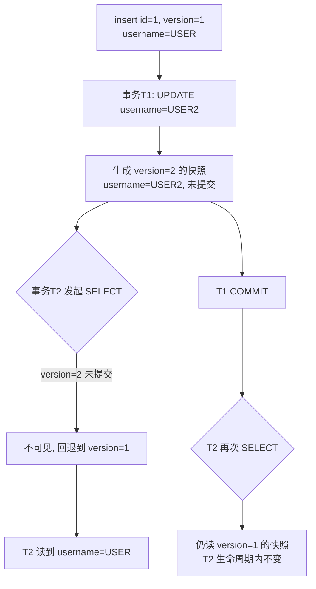

# 23. 六大数据库存储实战: MVCC 快照读与当前读如何撑起可重复读

## 纲要

- 两组关键概念
## 📎 代码说明

本讲代码以**内联片段**形式呈现在正文中。本章课件源码（`code/socialecom/第三章代码/`）中无正文直接引用的类文件，故不做文件级关联，请以正文片段为准。

## 正文

### 为什么需要区分快照读和当前读

前面的实验留下一个关键问题：**在读已提交和可重复读下，为什么别的事务还在修改、甚至还没提交，我却能读到事务开启时的那份老数据？**

答案分成两半：读的方式不同。

- **快照读**：对应 MVCC（多版本视图控制），走的是版本可见性判定，不加锁，不会和任何人打架。
- **当前读**：背后对应的是数据锁的争夺，主要区分行锁、间隙锁和表锁。

理解清楚"什么时候走快照、什么时候走当前读"，整个事务隔离的行为就全部解释得通了。

### 哪些语句走快照读，哪些走当前读

规则非常干净：

| 读写类型 | 触发语句 | 语义 |
| --- | --- | --- |
| 快照读 | 普通的 `SELECT`（不带 `FOR UPDATE` / `LOCK IN SHARE MODE`） | 读 MVCC 快照 |
| 当前读 | `SELECT ... FOR UPDATE`、`SELECT ... LOCK IN SHARE MODE` | 读最新已可见版本 + 抢锁 |
| 当前读 | `UPDATE` / `DELETE` / `INSERT` | 写操作，必须读到最正确的数据 |

值得注意的是：**哪怕没有显式 `BEGIN`，单条 `SELECT` 语句也会隐式开启一个事务。** 所以只要是普通 select，就一定走快照读。

这背后的逻辑也很自然——**读快照是因为我只想看；读当前是因为我要写，所以必须拿到最新的值。**

### 快照读：MVCC 的版本链是怎么选出来的

以 `user` 表中 `id = 1` 这一行为例。在 InnoDB 存储引擎内部，每一条行记录背后都有一个 `version` 版本号。

> 这里的 `version` 不是应用层为了做乐观锁自己加的字段，而是 InnoDB 用来管理这条数据库行状态的真实版本号。

推演一遍整个过程：



详细拆开：

1. 事务发生 `INSERT` 产生 `id = 1` 的记录时，`version = 1`，这是内存里唯一的一份数据。
2. 有一条 `UPDATE` 要修改这条记录时，InnoDB 不会原地覆盖，而是**把 version=1 的数据做成快照**，在修改方的事务空间内生成一条 `id = 1`、`version = 2`、已修改待提交的记录。
3. 此时真实数据并没有发生变更，变更只存在于修改方事务的内存快照里。
4. 另一个事务 `BEGIN` 时，会取当时的全局 transaction id，作为自己可见性判定的基准。
5. 当这个事务发起 `SELECT`（快照读）时，InnoDB 去找"最新的、已经提交的版本数据"。`version = 2` 虽然是最新的，但对应事务还没提交，按照隔离级别约定不能被其他事务感知到，于是退回到 `version = 1` 的快照。
6. **在这个事务的整个生命周期里，对 `id = 1` 的所有快照读永远读 `version = 1`，哪怕之后 version=2 变成了已提交状态。**

这就是可重复读的物理实现：**不是"锁住数据不让别人改"，而是"让你始终读同一份快照"。**

### 当前读：为什么会阻塞

还是上面那个场景，但这次事务 B 用的是当前读：

```sql
-- 事务 A
BEGIN;
UPDATE user SET username = 'USER2' WHERE id = 1;   -- 未提交

-- 事务 B
BEGIN;
SELECT * FROM user WHERE id = 1 FOR UPDATE;         -- 阻塞，直到 A 提交
```

此时的矛盾是：

- B 用的是当前读，按语义它要读**最新的数据**，也就是 `version = 2`；
- 但在可重复读约定下，未提交的数据不能被其他事务感知，所以又不能返回 `version = 1` 的老快照给 B。

两条路都走不通，唯一的办法就是**让 B 等待**。这也解释了 `SELECT FOR UPDATE` 为什么会给行记录加锁：本质原因是 `id = 1` 这条数据正处于"已修改待提交"状态，而事务 A 在执行 `UPDATE`（本身就是当前读）时已经优先给这条记录上了锁。B 的当前读隐含着对这条行锁的争夺，自然拿不到锁。

一旦事务 A `COMMIT`，B 的当前读解锁，就能读到最新的 `version = 2`、`username = USER2`。

> 换句话说：**当前读是"我要读最新且已可见的版本，读不到就等"，而"等"的表现形式就是锁等待。**

### 表锁、行锁怎么判断

顺着当前读往下看，就必须区分三种锁。最直观的是表锁：整张表被锁住。

```sql
-- 极度不推荐：不对任何条件做限定，整张表当前读，加表锁
SELECT * FROM user FOR UPDATE;
```

一旦整张表被上了表锁，无论其它操作的行锁多么精细，都会被阻塞住。

那么带条件的呢？

```sql
-- 危险：username 上没有索引，需要全表扫描后才能加锁，实际会退化成表锁
SELECT * FROM user WHERE username = '123' FOR UPDATE;

-- 安全：主键等值查询，命中行锁
SELECT * FROM user WHERE id = 1 FOR UPDATE;

-- 安全：若 username 是唯一索引，同样命中行锁
SELECT * FROM user WHERE username = 'unique_name' FOR UPDATE;
```

这里的判断标准非常关键：

> **当前读如果要针对 `WHERE` 条件做筛选，那么这个字段必须加索引，才能把表锁降级为行锁。**

原因是没有索引时，MySQL 无法直接定位目标行，只能全表扫描并逐行尝试加锁，最终效果等同于表锁。主键查询默认就是行锁；唯一索引也会命中行锁。

### 三类锁的对照

| 锁类型 | 触发场景 | 影响范围 | 是否推荐 |
| --- | --- | --- | --- |
| 表锁 | `select ... for update` 无条件，或条件字段无索引 | 整张表写入被阻塞 | 极力避免 |
| 行锁 | 主键等值 / 唯一索引等值 + 当前读 | 单行 | 推荐 |
| 间隙锁 | 非唯一索引上的范围当前读 | 索引区间内的 insert | 谨慎使用 |

工程上的实践建议由此而来：**先用快照读把要处理的数据捞出来，拿到主键 ID 集合，再用主键做行锁粒度的数据修改。** 中间过程可能产生少量增量数据，可以通过补偿方案兜底，但换来的是并发写能力的大幅提升。

```sql
-- 先快照读拿主键（不加锁）
SELECT id FROM user WHERE username = 'USER1';

-- 再用主键当前读逐行加锁处理
SELECT * FROM user WHERE id = 1 FOR UPDATE;
```

## 小结

