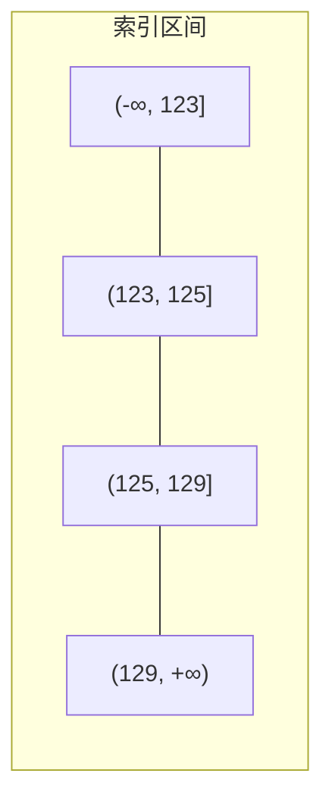
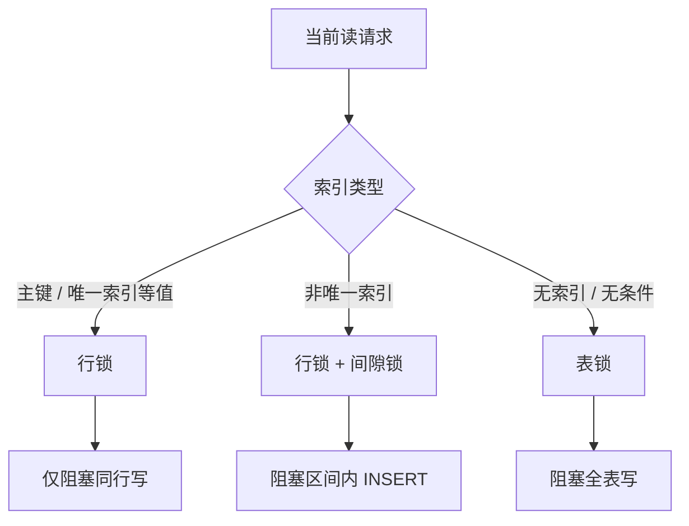

# 24. 六大数据库存储实战: 间隙锁如何用左开右闭区间堵住幻读

## 纲要

- 间隙锁要解决的问题
## 📎 代码说明

本讲代码以**内联片段**形式呈现在正文中。本章课件源码（`code/socialecom/第三章代码/`）中无正文直接引用的类文件，故不做文件级关联，请以正文片段为准。

## 正文

### 行锁管不到的地方

前面我们确认了表锁与行锁的判定规则：主键或唯一索引的等值当前读会命中行锁。但行锁有一个天然盲区——

> **它只能锁住已经存在的行。**

想象这样一个场景：事务 A 用 `SELECT ... FOR UPDATE` 锁住了 `username = '123'` 这一批记录，它想表达的是"在我这个事务里，`username = 123` 的结果集不能变"。假如这时事务 B 插入了一条 `username = '123'` 的新记录并提交，A 再查一次就多出一行——这就是幻读。

要堵住这个口子，就必须有一种能锁住"还不存在的数据"的机制，这就是**间隙锁（Gap Lock）**。

### 用一个例子看清左开右闭

假设 `username` 上有索引，表里有三条记录：`123`、`125`、`129`。

```sql
-- 事务 A
BEGIN;
SELECT * FROM user WHERE username = '123' FOR UPDATE;
```

这条语句会做两件事：

1. 对所有 `username = 123` 的索引记录加**行锁**；
2. 为了防止后续在这个位置附近产生新的 `INSERT`，再在间隙上加**间隙锁**。

间隙锁的区间是**左开右闭**。这是理解它最关键的一点：



几个命题逐个验证：

- 事务 A 锁住 `123` 时，受影响的是 `(-∞,123]` 这个左开右闭区间。此区间内发生的 `INSERT` 会被阻塞。
- 事务 A 锁住 `125` 时，受影响的是 `(123,125]`。`123` 本身不受影响，但插入 `124` 会被阻塞。
- 事务 A 锁住 `129` 时，同理是 `(125,129]`，永远是左开右闭。

> 注意，间隙锁**不影响**已有的 `SELECT`(快照读)、`UPDATE`、`DELETE`，它只阻塞 `INSERT`。这是它精准打击幻读、同时尽量不伤及并发的原因。

### 为什么要锁"间隙"而不是锁"行"

假设查询条件命中的是 `124`——这个值在表里根本不存在。直觉上会觉得"那我锁住 124 就行了"，但这是做不到的。

类比一下 Java 的锁就很清楚了：`synchronized` 一定要作用在**一个存在的对象**上，必须锁对象。**没有对象可供加锁的时候，就只能把这个对象所在的"两个邻居之间的空隙"锁住。**

所以 MySQL 提供的方案的本质是：

> **锁间隙。而"锁间隙"在物理层上就是锁住间隙两端的索引，并且采用左开右闭的方式去锁。**

这样就解释了为什么它必须使用左右两个边界——因为真正存在、可供加锁的，只有间隙两端的那两条索引记录。

### 由间隙锁推出的一条重要工程禁忌

把上面的推导连起来，会得到一个非常重要的结论：

> **在大型互联网应用场景下，极度不推荐针对非唯一索引使用 `SELECT ... FOR UPDATE`。**

原因是：

1. 非唯一索引上有大量同值记录和宽广的间隙；
2. `SELECT ... FOR UPDATE` 在这些记录上既要加行锁，又要加覆盖相邻区间的间隙锁；
3. 结果就是**连带一大批无关数据的 INSERT 一起被 block 住**，写并发断崖式下降。

推荐的替代写法分三步：

```sql
-- 1. 用快照读捞出目标主键，这一步不走锁
SELECT id FROM user WHERE username = 'USER1';

-- 2. 用主键做行锁粒度的数据处理
SELECT * FROM user WHERE id = 1 FOR UPDATE;

-- 3. 期间可能产生少量增量数据，用其他补偿方案兜底
```

这里做了一个明确的取舍：**用"放弃强一致区间锁"换取"高并发写能力"，把中间状态的差异交给应用层补偿。**

### 三种锁的完整对照

| 锁类型 | 锁定对象 | 主要由什么语句触发 | 阻塞谁 |
| --- | --- | --- | --- |
| 表锁 | 整张表 | 无条件的当前读、条件字段无索引的当前读 | 所有写入 |
| 行锁 | 单条索引记录 | 主键 / 唯一索引等值当前读 | 同行的写入 |
| 间隙锁 | 索引之间的左开右闭区间 | 非唯一索引上的范围 / 等值当前读 | 区间内的 INSERT |

### 回到那张隔离级别矩阵

现在可以完整回答前面实验留下的问题：**为什么 MySQL 在可重复读级别下也不产生幻读？**

答案是两套机制配合：

- 对**快照读**，MVCC 保证了事务内读到的永远是同一份快照，别人提交的新插入行我根本看不见；
- 对**当前读**，间隙锁从物理上堵住了邻域内的 `INSERT`，让新行根本插不进来。

这也是为什么前面那张矩阵表可以放心地把 MySQL 可重复读这一行的"幻读"填成"不会"——**InnoDB 让可重复读达到了串行化的一致效果，却不需要把事务真的串行化。**



## 小结

