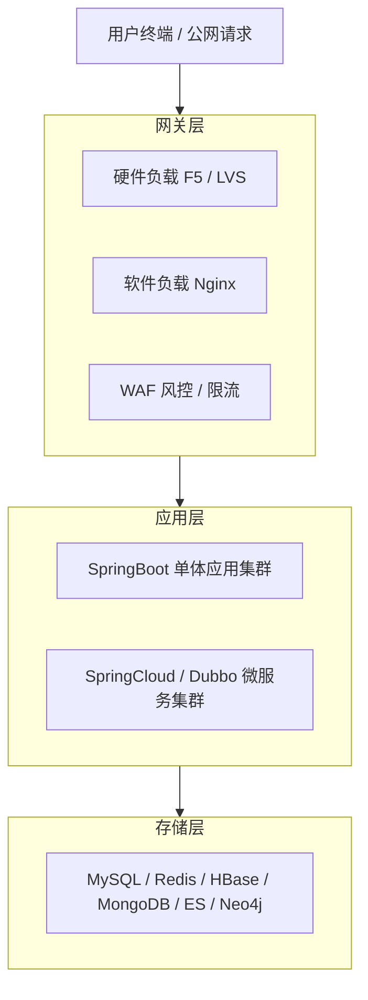

# 2. 六大数据库存储实战: 服务端架构的常见分层与三层职责

## 纲要

- 传统互联网研发模式下的三层服务端架构
## 📎 代码说明

本讲为**原理 / 架构 / 选型**篇，正文以图示与推演为主，无配套代码片段，课程课件亦未提供本章源码文件。

## 三层架构的总览

服务端架构在绝大多数互联网公司里都是分层的。最典型的就是三层模型：网关层、应用层、存储层。三层各自的设计理念、面向的服务要素与能力模型都不相同，理解它们的边界，是后续讨论存储选型的起点。

## 网关层：网络接入的第一道关口

网关层负责承接来自公网的请求。技术上通常分两类：

- **硬件负载**：F5、LVS，性能高、成本也高。
- **软件负载**：Nginx 等，灵活可控，互联网公司使用最广。

它的职责可以概括为三件事：

1. **网络接入**：把用户在公网上的 HTTP 请求、或者更底层的 TCP/IP 请求，接入到机房内部的核心网关。
2. **负载均衡**：通过硬件或软件的负载均衡策略，把请求分发到后端的应用层服务。
3. **安全风控**：在网关层部署 WAF 等策略，把恶意请求拦截在应用层之外，同时承担限流职责。

网关层的价值在于：这些能力对业务是透明的。业务代码不需要关心请求从哪来、是否被限流、是不是恶意攻击，网关统一兜住。

## 应用层：业务逻辑的主战场

应用层是后端研发投入精力最多的地方，承载具体的业务逻辑。它有两种典型形态：

**单体应用。** 用 SpringBoot / Tomcat 这类方式打成单体包，对外提供一个应用服务。单体应用依然可以构建集群——只需要依赖上层的 F5 / Nginx / LVS 做负载均衡，把流量分发到多台单体实例上即可。

**微服务应用。** 用 SpringCloud 或 Dubbo 这类微服务框架搭建服务集群。微服务体系在"服务与服务之间的调用"上有天然优势：通过注册中心做多集群部署，服务消费者订阅服务列表，由框架完成负载均衡的路由选择。

两种形态没有绝对的对错，本质相同：**借助框架实现具体的业务逻辑，藏在网关层背后，把应用能力外化出去**。差别只在于服务治理的能力由谁提供——单体靠外部网关，微服务靠自带注册中心。

## 存储层：数据中心化管理的底座

存储层是整个后端架构中做"数据中心化管理"的层级。它承担两件事：

1. **数据落地**：集中式地管理整个互联网应用中所有数据的持久化。
2. **能力输出**：借助底层的数据存储能力，向上提供统一的读写服务。

这也是本课程关注的重点。前面提到的三层中，网关层与应用层都是无状态的、以 CPU 计算为主，加机器就能扩容；存储层则是有状态的、以 IO 为主，横向扩展需要付出数据搬迁和分片协调的代价。所以架构设计的难点，几乎永远落在存储层。

## 三层的职责边界

| 层级 | 面向的问题 | 主要负责人 | 扩展方式 | 典型组件 |
| --- | --- | --- | --- | --- |
| 网关层 | 网络接入、负载均衡、恶意请求屏蔽 | 运维 | 加机器 + DNS 映射 | F5、LVS、Nginx、WAF |
| 应用层 | 具体业务逻辑实现 | 后端研发 | 水平扩容 + 注册中心 | SpringBoot、Tomcat、SpringCloud、Dubbo |
| 存储层 | 数据落地与读写能力输出 | 运维部署、研发做表结构与数据操作 | 分片 / 复制 / 读写分离（成本高） | MySQL、Redis、HBase、MongoDB、Elasticsearch、Neo4j |

## 小结

三层架构的意义不在于"分了三层"，而在于每一层只解决一类问题，层与层之间通过接口衔接。这样的结构天然具备两个好处：**职责分离**（运维负责网关与存储的基建部署维护，研发专注应用层业务逻辑）、**灵活替换**（在不改动或少量改动业务代码的前提下替换存储结构与服务，去适配不同的网络与性能要求）。

