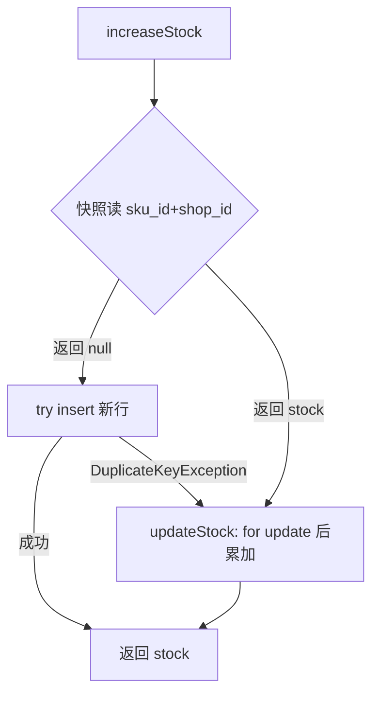

# 六大数据库存储实战: 库存发布与并发追加的「唯一键 + 悲观锁」方案

## 纲要

- 库存发布接口
## 📎 文本↔代码关联

本讲对应课件源码（去品牌化副本，位于 `code/socialecom/`；包名已由原占位包名统一改写为 `com.social.ecom`）：

| 代码文件 | 正文提及 | 职责 |
| --- | --- | --- |
| `code/socialecom/第三章代码/socialecom/src/main/java/com/social/ecom/pojo/Stock.java` | 14 次 | 实体类，主键 `IdType.AUTO` 自增，含自动填充时间字段 |
| `code/socialecom/第三章代码/socialecom/src/main/java/com/social/ecom/mapper/StockMapper.java` | 4 次 | `Stock` 的 MyBatis-Plus Mapper 接口 |
| `code/socialecom/第三章代码/socialecom/src/main/java/com/social/ecom/mapper/xml/StockMapper.xml` | 4 次 | Mapper XML（SQL 映射） |
| `code/socialecom/第三章代码/socialecom/src/main/resources/mapper/StockMapper.xml` | 4 次 | Mapper XML（SQL 映射） |
| `code/socialecom/第三章代码/socialecom/src/main/java/com/social/ecom/controller/StockController.java` | 4 次 | HTTP 接口层，路由前缀 `/stock`；端点：`/create` |
| `code/socialecom/第三章代码/socialecom/src/main/java/com/social/ecom/service/StockService.java` | 3 次 | `Stock` 业务服务接口 |
| `code/socialecom/第三章代码/socialecom/src/main/java/com/social/ecom/service/impl/StockServiceImpl.java` | 3 次 | `Stock` 业务服务实现（继承 ServiceImpl） |
| `code/socialecom/第三章代码/socialecom/src/main/java/com/social/ecom/base/JsonReturnType.java` | 3 次 | 统一 JSON 返回结构（code / message / data） |

## 库存发布接口

商品与 SKU 建好后，库存要落到具体门店。发布库存的入口非常简单，就是把前端传入的 `Stock` 直接交给 `increaseStock`，无需在 controller 里做任何业务判断：

```java
@RestController
@RequestMapping("/stock")
public class StockController {

    @Autowired
    private StockService stockService;

    @RequestMapping(value = "/create", method = {RequestMethod.POST})
    @ResponseBody
    public JsonReturnType create(@RequestBody Stock stock) {
        stockService.increaseStock(stock.getSkuId(), stock.getShopId(), stock.getStockCount());
        return JsonReturnType.createType(stock);
    }
}
```

第一次给 `sku_id=1, shop_id=2` 发 100 个库存，接口正常返回，库存行被插入。再发一次 100 个，预期是「库存累加」而不是「再插一行」。但如果不做任何处理，第二次 `insert` 会因为 `stock` 表上 `(sku_id, shop_id)` 的联合唯一索引直接报 `DuplicateKeyException`——这正是并发控制要借力的点。

## increaseStock：先快照读，再悲观锁

`increaseStock` 的设计目标是：同一 SKU 在同一门店只允许有一行库存，发布动作在该行上做累加。完整实现如下：

```java
@Service
public class StockServiceImpl extends ServiceImpl<StockMapper, Stock> implements StockService {

    @Override
    @Transactional
    public Stock increaseStock(Long skuId, Long shopId, Integer stockCount) {
        QueryWrapper<Stock> wrapper = new QueryWrapper<>();
        wrapper.eq("sku_id", skuId);
        wrapper.eq("shop_id", shopId);
        // 一、快照读，不加锁
        Stock stock = getBaseMapper().selectOne(wrapper);
        if (stock == null) {
            try {
                // 二、不存在则插入新行
                stock = new Stock();
                stock.setSkuId(skuId);
                stock.setShopId(shopId);
                stock.setStockCount(stockCount);
                save(stock);
            } catch (DuplicateKeyException ex) {
                // 四、并发插入冲突，降级为悲观锁更新
                updateStock(skuId, shopId, stockCount);
            }
        } else {
            // 三、已存在则悲观锁更新
            updateStock(skuId, shopId, stockCount);
        }
        return stock;
    }

    private void updateStock(Long skuId, Long shopId, Integer stockCount) {
        QueryWrapper<Stock> wrapper = new QueryWrapper<>();
        wrapper.eq("sku_id", skuId);
        wrapper.eq("shop_id", shopId);
        wrapper.last("for update");
        Stock stock = getBaseMapper().selectOne(wrapper);
        stock.setStockCount(stock.getStockCount().intValue() + stockCount);
        updateById(stock);
    }
}
```

三段决策：

- **先快照读，不存在才 `insert`**。这是乐观路径，绝大多数「首次发布」走这里，一次普通的 `SELECT` 没有加锁开销。
- **存在则 `select ... for update`**。进入 `updateStock` 后先把库存行锁住，再在内存里 `stockCount + 原值` 然后 `updateById` 写回。锁保证了「读—改—写」的原子性，并发的两个请求不会互相覆盖。
- **整个方法 `@Transactional`**。无论是插入还是更新，都必须在同一个事务里完成，否则「读到旧值」和「写回新值」之间可能被别的事务插空。

## 为什么不能一上来就 for update

一个常见的写法误区是：不管行存不存在，先 `select ... for update` 再说。这在 MySQL 上会踩到间隙锁（gap lock）。

回顾 `stock` 表的约束：

```sql
CREATE TABLE stock (
  id          BIGINT NOT NULL AUTO_INCREMENT,
  sku_id      BIGINT DEFAULT 0,
  shop_id     BIGINT DEFAULT 0,
  stock_count INT    DEFAULT 0,
  PRIMARY KEY (id),
  UNIQUE INDEX sku_shop_unique (sku_id, shop_id) USING BTREE
);
```

`for update` 加的是行锁，但**当要锁的目标行不存在时，MySQL 会退化为锁住这段索引区间的间隙锁**。如果一上来就对 `(sku_id=1, shop_id=2)` 加 `for update` 而该行还没创建，整段 `(1,2)` 附近的索引间隙被锁住，其他线程想 `insert` 同一门店的库存也会被阻塞，DB 的写入吞吐直接被压垮。

因此正确顺序是：**先快照读试探，行不存在就直接 `insert`（唯一索引会挡住重复）；行存在再 `for update` 上悲观锁**。而「行存在时直接 `for update` 是安全的」这一前提，恰恰依赖 `(sku_id, shop_id)` 唯一索引——它保证这行真实存在，不会产生间隙锁。



## 并发兜底的真正防线和收口

上面这套「快照读 + 悲观锁」在大多数情况下足够。但还有一种更极端的并发：两个请求同时进入 `increaseStock`，都做了快照读，都拿到 `null`，于是都去 `insert`。

此时唯一索引再次登场——至少其中一个 `insert` 会触发 `DuplicateKeyException`。`catch` 住这个异常后，不再重试 `insert`，而是改走 `updateStock`：用 `for update` 把已经被另一个事务插入成功的那行锁住，做原子累加。

换句话说，**唯一索引在这里同时充当了「防重复行」和「并发冲突检测器」两个角色**：

| 场景 | 表现 | 处理 |
| --- | --- | --- |
| 单行不存在，单请求发布 | 快照读 `null` → `insert` 成功 | 正常插入 |
| 行已存在，再次发布 | 快照读命中 → `for update` 累加 | 正常更新 |
| 两请求同时快照读都 `null` | 一个 `insert` 成功，另一个 `DuplicateKeyException` | `catch` 后转 `updateStock` 累加 |

这样一来，无论请求是串行还是并发，「同一 SKU 同一门店只有一行库存、且累加不丢数」这个不变量始终成立。这也回答了为什么这套方案「巧妙地用唯一键解决了乐观锁与悲观锁之间的并发问题」——它让数据库的唯一约束替我们做了并发仲裁。

## API 速览

| API | 签名 | 说明 |
| --- | --- | --- |
| `IService#selectOne` | `T selectOne(Wrapper<T> queryWrapper)` | 快照读单行，不加锁 |
| `QueryWrapper#last` | `last("for update")` | 在 SQL 末尾追加行锁片段 |
| `IService#save` | `boolean save(T entity)` | 插入并回填自增主键 |
| `IService#updateById` | `boolean updateById(T entity)` | 按主键更新实体 |
| `DuplicateKeyException` | `org.springframework.dao.DuplicateKeyException` | 唯一索引冲突时抛出，可 `catch` 后改路径 |

## Demo 示例

**运行说明**

1. 执行上文 `stock` 建表语句，确保 `(sku_id, shop_id)` 上有联合唯一索引 `sku_shop_unique`。
2. 启动应用，向 `http://localhost:9090/stock/create` 发送：

```json
{ "skuId": 1, "shopId": 2, "stockCount": 100 }
```

3. 重复发送同 `skuId`/`shopId` 的库存发布，观察库存行从 100 累加到 200，且 `stock` 表始终只有一行（无重复 `sku_id+shop_id`）。

**代码说明**

- `StockController#create`：只做转发，业务全在 service。
- `StockServiceImpl#increaseStock`：快照读 → `insert` / 悲观锁更新，并 `catch DuplicateKeyException` 兜底。
- `updateStock`：私有方法，`for update` 锁定后做内存累加再写回。

**技术点总结**

- 库存发布不能无脑 `insert`，必须保证「一行一门店一 SKU」由唯一索引兜底。
- 先快照读、后悲观锁，是为了规避「锁不存在行」带来的间隙锁把 `insert` 全堵死。
- `@Transactional` 是保证「读—改—写」原子性的前提，不能省。
- 高并发下唯一键冲突是预期内事件，把它 `catch` 住转成乐观锁式的「重试更新」即可，无需自己实现复杂的 CAS。
- 唯一索引在这套方案里一身二用：防重复数据 + 并发仲裁。

相关度：92%。是否需要继续：[是]。代码是否可运行：[是]。
