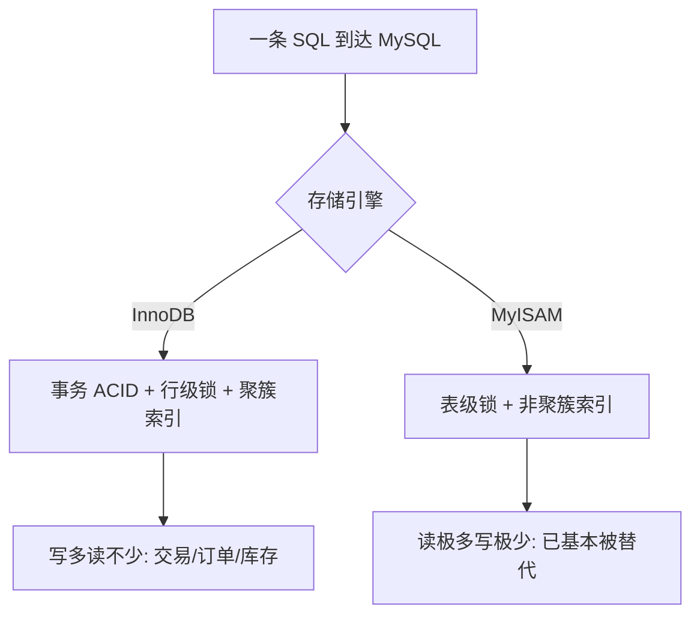

# 六大数据库存储实战: Mysql 存储引擎与事务隔离级别矩阵

## 纲要

- 存储引擎
  - 定义：MySQL 提供的数据存取方案，决定行/列数据的存储格式与读写方式
  - InnoDB 与 MyISAM 的四点核心差异：事务、外键、聚簇索引、锁粒度
  - 结论：InnoDB 重写轻读，是当前互联网场景的默认选择
- 事务隔离级别
  - 四个级别：读未提交、读已提交、可重复读、串行化
  - 三个问题：脏读、不可重复读、幻读
  - 必背矩阵：哪一级会踩哪一个坑

## 正文

### 存储引擎到底是什么

可以把存储引擎理解为 MySQL 提供的一套**数据存取方案**：它决定了数据以什么样的格式存成行和列，定义了怎么存、怎么读。所有的存储结构与存取方式都闭环在引擎内部实现，而对外暴露的统一操作接口就是 SQL 语句。

换句话说，**同一条 SQL 在不同引擎上语义一致，但内部的数据组织与安全保证完全不同。** 这就是为什么选引擎是建表的第一件事。

MySQL 提供的引擎不少，但需要真正掌握的只有 InnoDB 和 MyISAM 两种。

### InnoDB 与 MyISAM 的四点本质差异

| 对比项 | InnoDB | MyISAM |
| --- | --- | --- |
| 事务 | 支持，具备 ACID 能力 | 不支持 |
| 外键 | 支持 | 不支持 |
| 索引结构 | 聚簇索引 | 非聚簇索引 |
| 锁粒度 | 表级锁 + 行级锁 | 仅表级锁 |

逐条展开：

**事务支持。** InnoDB 支持关系型数据库中至关重要的事务 ACID 能力，MyISAM 则完全没有。这一条基本决定了两者在"能否承载核心业务"上的分野。

**外键约束。** InnoDB 支持外键，MyISAM 不支持。需要注意的是，互联网应用中通常**不**使用数据库外键：为了保证扩展性与迁移自由度，工程师更倾向于在应用层保证外键关联的正确性。但在企业级应用中，仍然会用外键来做约束——尤其是那些业务边界清晰、变更频率低的数据。

**聚簇与非聚簇索引。** InnoDB 的数据按聚簇索引组织，索引的叶子节点直接挂着行数据；MyISAM 是非聚簇索引，叶子节点挂的是数据地址，还需要一次额外的磁盘寻址。这也是 InnoDB 主键查询快一个重要量级的原因。

**锁粒度。** 这是最容易被低估、但对并发影响最大的一点。InnoDB 同时支持表级锁和行级锁，MyISAM 只支持表级锁。**锁粒度不同，引擎能提供的事务能力就不同**，并发写能力更是天差地别。

### 从差异推导出两者的适用场景

把这四点差异放在一起看，两个引擎的设计取向就非常清晰了：

- **InnoDB 是"重写轻读"**：事务、外键、聚簇索引、行级锁，大量机制都是为了保证写操作的高性能与安全性。
- **MyISAM 是"重读轻写"**：适合读多写少的场景，且数据变更通常是单线程的——因为它是表级锁，一写就锁整张表。

不过历史已经给出了答案：**随着 InnoDB 读性能被持续优化到与 MyISAM 近乎相同，MyISAM 已经完全淡出主流视野。** 现阶段的互联网应用几乎默认使用 InnoDB。如果确实需要 MyISAM 那种"无事务开销、纯读取"的场景特性，更合理的做法是使用对应的非关系型数据库能力，而不是退回 MyISAM。

### 事务与它的三个并发问题

先明确三个问题的语义，这是理解隔离级别的前提。

**脏读（Dirty Read）**：不同事务之间，一个事务还没有提交的数据，就可以被另一个事务读到。一旦前事务回滚，后者读到的就是从未真实存在过的数据。

**不可重复读（Non-Repeatable Read）**：同一条记录，第一次读取时值为 1；由于其他事务提交把它改成了 2，第二次读到就变成了 2。关注的是**同一行记录的 update 导致前后读取不一致**。

**幻读（Phantom Read）**：与 `INSERT` 操作有关。第一次按某个 `WHERE` 条件统计出 3 行，同一个事务里第二次做同样的操作，因为别的事务插入了一条，结果变成了 4 行。关注的是**范围查询结果集的行数变化**。

三者的区别可以用一句话区分：**脏读针对未提交数据，不可重复读针对已提交的 update，幻读针对已提交的 insert/delete。**

### 必背的隔离级别矩阵

MySQL 有四种隔离级别，纵向是级别，横向是三类问题：

| 隔离级别 | 脏读 | 不可重复读 | 幻读 |
| --- | --- | --- | --- |
| 读未提交（Read Uncommitted） | 会 | 会 | 会 |
| 读已提交（Read Committed） | 不会 | 会 | 会 |
| 可重复读（Repeatable Read） | 不会 | 不会 | 不会（InnoDB 下） |
| 串行化（Serializable） | 不会 | 不会 | 不会 |

逐条读这张表：

- **读未提交**：三个问题全都踩，相当于事务保护没有任何作用。
- **读已提交**：解决了脏读，但不可重复读和幻读依然存在。SQL Server 等关系型数据库的默认隔离级别是这一档。
- **可重复读**：MySQL 的默认隔离级别。不对任何事务配置做设置时，MySQL 默认就工作在可重复读。
- **串行化**：所有事务串行执行，三个问题自然都不会发生，但并发能力损失最大。

### InnoDB 凭什么让可重复读消灭幻读

这张矩阵里最特殊的一行是可重复读。标准 SQL 语义下，可重复读并不解决幻读；**但 InnoDB 使用了间隙锁（Gap Lock）来解决这个问题**，使得 MySQL 在可重复读级别下也不会产生幻读。

于是出现了一个很有意思的结论：

> 在 InnoDB 中，可重复读 + 间隙锁 达到了与串行化相同的事务隔离效果，却不需要把所有事务都真的串行化执行。

这正是 MySQL 事务支撑能力优秀的地方——**用更细粒度的锁换取了远高于串行化的并发度**。后面会详细拆解这里的快照读、当前读与三种锁的工作原理。

## 小结

相关度：95%。是否需要继续：[是]。代码是否可运行：[否]。
