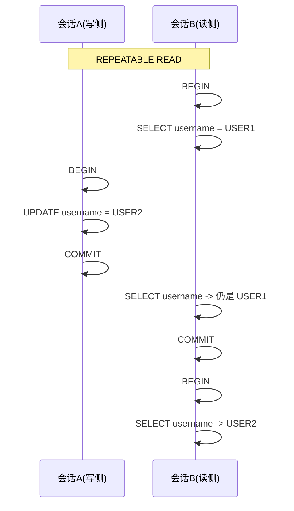

# 六大数据库存储实战: 双会话实测 Mysql 四种事务隔离级别

## 纲要

- 实验环境
## 📎 代码说明

本讲代码以**内联片段**形式呈现在正文中。本章课件源码（`code/socialecom/第三章代码/`）中无正文直接引用的类文件，故不做文件级关联，请以正文片段为准。

## 正文

### 实验准备

这一节用实际操作验证隔离级别的差异。测试用表是第二章已经建好的 `user` 表，数据库版本为 MySQL 8。

在 MySQL 客户端里开**两个新建查询窗口**，这两个窗口分别对应数据库的两条连接会话。后文称它们为会话 A（写侧）和会话 B（读侧）。

```sql
-- 查看当前会话的事务隔离级别
SELECT @@transaction_isolation;
-- +---------------------------------+
-- | @@transaction_isolation         |
-- +---------------------------------+
-- | REPEATABLE-READ                 |
-- +---------------------------------+
```

可以看到默认就是 `REPEATABLE-READ`，也就是 MySQL 的默认事务隔离级别。

修改隔离级别的语句只对当前会话生效，需要注意必须对两个窗口分别设置：

```sql
-- 注意是 SESSION TRANSACTION ISOLATION LEVEL，中间没有下划线
SET SESSION TRANSACTION ISOLATION LEVEL READ UNCOMMITTED;
SET SESSION TRANSACTION ISOLATION LEVEL READ COMMITTED;
SET SESSION TRANSACTION ISOLATION LEVEL REPEATABLE READ;
SET SESSION TRANSACTION ISOLATION LEVEL SERIALIZABLE;
```

> 写这条语句时很容易手滑写成 `SET SESSION_TRANSACTION...`，MySQL 会直接报错，需要留意。

### 实验一：读未提交（脏读）

两个会话都切到 `READ UNCOMMITTED`，然后按时间序执行：

```sql
-- 会话 A
BEGIN;
UPDATE user SET username = 'USER1' WHERE id = 1;   -- 未提交

-- 会话 B
BEGIN;
SELECT username FROM user WHERE id = 1;              -- 读到 USER1
```

会话 A 还没有提交，会话 B 已经读到了被修改的值。再让会话 A 回滚：

```sql
-- 会话 A
ROLLBACK;

-- 会话 B
SELECT username FROM user WHERE id = 1;              -- 值又变回原来的内容
```

**结论**：在读未提交级别下，只要事务产生了 update，无论是否提交，都会被其他事务查询到。换句话说，**脏读就是"能读到别人没提交的中间状态"**，如果对方回滚，你读到的数据从未真实存在过。这也是为什么这个级别相当于没有事务保护。

### 实验二：读已提交（解决脏读，暴露不可重复读）

两个会话都切到 `READ COMMITTED`。

```sql
-- 会话 A
BEGIN;
UPDATE user SET username = 'USER1' WHERE id = 1;   -- 不提交

-- 会话 B
BEGIN;
SELECT username FROM user WHERE id = 1;              -- 读不到 USER1，脏读被挡住
```

脏读消失了，这是读已提交带来的第一个效果。接着让会话 A 提交：

```sql
-- 会话 A
COMMIT;

-- 会话 B（自身没有任何 commit / rollback）
SELECT username FROM user WHERE id = 1;              -- 读到了提交后的新值
```

**结论**：会话 B 处于同一个事务内，既没有提交也没有回滚，仅仅因为会话 A 提交了修改，B 就读到了不一样的数据。这就是不可重复读——**同一个事务里两次读到的数据不一致，读到什么取决于外部事务什么时候提交。**

这一步也暴露了一个工程风险：如果一段业务代码在同一事务里先读余额再读同一行的其他字段，而中间有别的事务提交了修改，就可能读到互相矛盾的数据。

### 实验三：可重复读（让读在事务内稳定）

两个会话都切到 MySQL 默认的 `REPEATABLE READ`。测试前先把之前可能挂起的事务提交掉，避免干扰：

```sql
-- 会话 A
BEGIN;
UPDATE user SET username = 'USER2' WHERE id = 1;

-- 会话 B
BEGIN;
SELECT username FROM user WHERE id = 1;              -- USER1（旧值）

-- 会话 A
COMMIT;

-- 会话 B（仍在自己的事务里）
SELECT username FROM user WHERE id = 1;              -- 依然是 USER1

-- 会话 B
COMMIT;
BEGIN;
SELECT username FROM user WHERE id = 1;              -- USER2（新事务才看得到）
```

**结论**：在可重复读级别下，事务 B 的整个生命周期里读到的数据是恒定的，不会因为外部事务提交而改变。**只有当 B 自己提交、重开事务之后，才能看到新的值。** 这种机制保证了同一个事务内不会出现两条不一致的数据。

### 实验四：可重复读下的幻读测试

幻读的场景稍复杂，我们以 `username` 字段作为条件来观察。两个会话保持 `REPEATABLE READ`。

```sql
-- 会话 B：先建立"视角"
BEGIN;
SELECT * FROM user WHERE username = 'USER1';        -- 返回 1 条记录

-- 会话 A：提交一条满足条件的新数据
BEGIN;
INSERT INTO user (username, user_password, user_tel) VALUES ('USER2', '123456', '13800000000');
COMMIT;

-- 会话 B：仍在自己的事务里
SELECT * FROM user WHERE username = 'USER1';        -- 仍然 1 条记录
SELECT * FROM user;                                  -- 仍然看不到新插入的行
```

会话 A 提交之后，会话 B 无论重试多少次，看到的还是自己事务开启时的那一份结果。

**结论**：在 MySQL 的可重复读隔离级别下，**连幻读也不会产生**。测试到这里，自然的疑问是：MySQL 到底是怎么做到的？这就要引入 MVCC 快照读、当前读以及行锁/间隙锁的原理了。

### 四组实验对照表

| 隔离级别 | 脏读 | 不可重复读 | 幻读 | 实验现象 |
| --- | --- | --- | --- | --- |
| READ UNCOMMITTED | 发生 | 发生 | 发生 | A 未提交的 update 立刻被 B 读到 |
| READ COMMITTED | 不发生 | 发生 | 发生 | A 提交后 B 在同一事务内读到新值 |
| REPEATABLE READ | 不发生 | 不发生 | 不发生 | B 事务内始终读到事务开始时的快照 |
| SERIALIZABLE | 不发生 | 不发生 | 不发生 | 事务串行执行，并发度最低 |



## API 速览

| 语句 | 作用 | 备注 |
| --- | --- | --- |
| `SELECT @@transaction_isolation` | 查看当前会话隔离级别 | MySQL 8 使用 `@@transaction_isolation`（旧版本可用 `@@tx_isolation`） |
| `SET SESSION TRANSACTION ISOLATION LEVEL REPEATABLE READ` | 设置会话级隔离级别 | 仅对当前连接生效，断开后失效 |
| `SET GLOBAL TRANSACTION ISOLATION LEVEL <level>` | 设置全局隔离级别 | 对新连接生效，重启后失效 |
| `BEGIN` / `START TRANSACTION` | 开启事务 | 不显式开启时，单条 SQL 也隐含事务 |
| `COMMIT` / `ROLLBACK` | 提交 / 回滚 | 事务结束，快照随之释放 |

## Demo 示例

**运行说明**

1. 本地启动 MySQL 8（Docker 方式见第二章），连接后使用 `socialecom` 库。
2. 打开两个查询窗口分别作为会话 A、会话 B，保证是两条独立连接。
3. 两个窗口统一执行一次 `SET SESSION TRANSACTION ISOLATION LEVEL ...`，按上表从上到下逐组验证。
4. 每组实验结束后务必在两个窗口分别执行 `COMMIT`，避免挂起的事务影响下一组结果。

**代码说明**

只需要一张最简 `user` 表即可复现全部实验：

```sql
CREATE TABLE IF NOT EXISTS `user` (
  `id`            BIGINT      NOT NULL AUTO_INCREMENT,
  `username`      VARCHAR(60) NOT NULL DEFAULT '',
  `user_password` VARCHAR(60) NOT NULL DEFAULT '',
  `user_tel`      VARCHAR(60) NOT NULL DEFAULT '',
  `create_time`   DATETIME    DEFAULT NULL,
  `update_time`   DATETIME    DEFAULT NULL,
  PRIMARY KEY (`id`)
) ENGINE=InnoDB DEFAULT CHARSET=utf8mb4;

INSERT INTO `user` (`username`, `user_password`, `user_tel`)
VALUES ('USER', '123456', '13800000000');
```

> 字符串字段统一定义为 `NOT NULL DEFAULT ''`，不让数据库出现 NULL 值，这是为后续索引优化保留空间。

**技术点总结**

- 隔离级别是**会话级**概念，两条连接可以配置不同级别，测试时必须两个窗口都设置。
- 实验出现"结果不符合预期"时，第一件事是确认两侧是否还有未提交/未回滚的事务。
- 所有 SQL 脚本均可直接在 MySQL 客户端执行，不依赖任何 Java 代码。

相关度：95%。是否需要继续：[是]。代码是否可运行：[是]。
