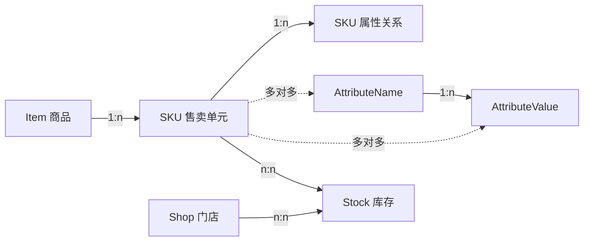

# 六大数据库存储实战: SKU 发布与多对多关系表，以及库存表的唯一索引设计

## 纲要

- `sku` 表：挂在 `item_id` 下的最小售卖单元
- 为什么单张表无法承载 SKU 与属性库的多对多关系
- `sku_attribute_info` 关系表的建模与索引
- `@TableField(exist = false)` 踩坑：`exist = true` 会引发类型解析失败
- `createSku` 的事务边界与自增 ID 回填
- `stock` 表：`sku_id` + `shop_id` 联合唯一索引的必要性

## sku 表：可交易的最小单元

商品（item）只是展示聚合体，没有价格与库存；真正可交易的是挂在商品下的 SKU：

```sql
CREATE TABLE sku (
  id          BIGINT NOT NULL AUTO_INCREMENT,
  create_time DATETIME,
  update_time DATETIME,
  item_id     BIGINT,
  price       DECIMAL(10, 2),
  PRIMARY KEY (id),
  INDEX item_id_index (item_id) USING BTREE
);
```

两个设计点：

- `item_id` 上建 BTREE 索引，因为"按商品查它的所有 SKU"是最高频的查询
- `price` 用 `DECIMAL(10, 2)` 而不是浮点类型，10 位总长度、2 位小数足以覆盖人民币的所有金额要求，且不会有精度损失

## 多对多关系必须靠关系表承载

`sku` 表里看不到任何与属性库相关的字段，这是有意为之。回顾领域模型：**SKU 与属性名、属性值同时是多对多关系**，单张表结构无法支撑，必须引入一张关系表：

```sql
CREATE TABLE sku_attribute_info (
  id                 BIGINT NOT NULL AUTO_INCREMENT,
  create_time        DATETIME,
  update_time        DATETIME,
  sku_id             BIGINT,
  attribute_name_id  BIGINT,
  attribute_value_id BIGINT,
  PRIMARY KEY (id),
  INDEX sku_id_index (sku_id) USING BTREE
);
```

这张表的 `id` 是自增且无业务含义的——它只是一张关系表。用一行记录表达"某个 SKU 的某个属性名取某个属性值"：

| id | sku_id | attribute_name_id | attribute_value_id | 含义 |
| --- | --- | --- | --- | --- |
| 1 | 1 | 1（颜色） | 1（红色） | iPhone Xs 红色 |
| 2 | 1 | 2（尺寸） | 4（4 寸） | iPhone Xs 4 寸 |
| 3 | 2 | 1（颜色） | 2（蓝色） | iPhone Xs 蓝色 |
| 4 | 2 | 2（尺寸） | 5（5 寸） | iPhone Xs 5 寸 |

同一个 SKU 拥有多个属性时，会产生多行记录，`sku_id` 与 `attribute_name_id` 相同而 `attribute_value_id` 不同。这种结构可以干净地表达多对多关系。

## 领域模型：把关系表装进 SKU

关系表不需要独立的 Service 与 Controller——它是 SKU 的附属数据。因此保留它的 Entity 与 Service（供批量插入使用），**删掉它的 Controller**，避免对外暴露一个语义不完整的接口。

在 `Sku` 领域模型中直接内联关系表的数据：

```java
@Data
@EqualsAndHashCode(callSuper = false)
@ApiModel(value = "Sku对象", description = "")
public class Sku implements Serializable {

    @TableId(value = "id", type = IdType.AUTO)
    private Long id;

    @TableField(fill = FieldFill.INSERT)
    private Date createTime;

    @TableField(fill = FieldFill.INSERT_UPDATE)
    private Date updateTime;

    private Long itemId;

    private BigDecimal price;

    @TableField(exist = false)
    private List<SkuAttributeInfo> skuAttributeInfoList = new ArrayList<>();

    // 只有当外部通过门店 ID 请求到 SKU 信息的时候才能有库存信息
    @TableField(exist = false)
    private Integer stockCount;
}
```

### 踩坑：exist 注解写错会直接报错

这里有一个非常容易犯的错误：把注解写成 `@TableField(exist = true)`。

`exist = true` 的含义是"这个字段在数据库表里真实存在"，MyBatis-Plus 会在自动生成的 `SELECT` / `INSERT` 语句中把它拼进去。而 `List<SkuAttributeInfo>` 根本不是一个可映射的列，于是 SQL 解析阶段直接抛异常：

```text
TypeException: Could not set parameters for mapping ...
```

正确写法是 `exist = false`——告诉框架这个字段与数据库无关，不要拼进 SQL。这个报错在开发过程中出现过一次，排查时看到的是 JSON 解析层面的异常信息，真正的根因在实体注解上。

## 发布 SKU 的接口与事务

发布 SKU 的接口放在 `ItemController` 而不是单独建 `SkuController`：

```java
@RestController
@RequestMapping("/item")
public class ItemController {

    @Autowired
    private ItemService itemService;

    @RequestMapping(value = "/createsku", method = {RequestMethod.POST})
    @ResponseBody
    public JsonReturnType createsku(@RequestBody Sku sku) {
        itemService.createSku(sku);
        return JsonReturnType.createType(sku);
    }
}
```

这样设计的考虑是：**对外暴露的语义是"给商品发布一个 SKU"**，前端感知到的是 item 而不是 sku。把所有面向前端的操作收敛在 `ItemController` 内，接口语义更稳定。

业务逻辑放在 `ItemServiceImpl` 而不是 Controller——Controller 不应该承载业务组装逻辑：

```java
@Service
public class ItemServiceImpl extends ServiceImpl<ItemMapper, Item> implements ItemService {

    @Autowired
    private SkuService skuService;

    @Autowired
    private SkuAttributeInfoService skuAttributeInfoService;

    @Override
    @Transactional
    public Sku createSku(Sku sku) {
        skuService.save(sku);
        sku.getSkuAttributeInfoList().forEach(skuAttributeInfo -> {
            skuAttributeInfo.setSkuId(sku.getId());
            skuAttributeInfoService.save(skuAttributeInfo);
        });
        return sku;
    }
}
```

三个关键点：

- **`@Transactional`**：涉及 `sku` 与 `sku_attribute_info` 两张表的写入，必须包在同一个事务内，否则会出现"有 SKU 无属性"的脏数据
- **自增 ID 回填**：`save(sku)` 执行完之后，MyBatis-Plus 会把自增生成的 ID 附着回 `sku` 对象上，因此后续 `sku.getId()` 才能拿到真实主键。这个顺序不能颠倒
- **关系数据的 `skuId` 由后端赋值**：前端传入的 `skuAttributeInfoList` 里 `skuId` 为空（创建前还没有 ID），后端在遍历时补齐

## 请求与响应

```http
POST http://localhost:9090/item/createsku
Content-Type: application/json

{
  "itemId": 1,
  "price": 8000,
  "skuAttributeInfoList": [
    {"attributeNameId": 1, "attributeValueId": 1},
    {"attributeNameId": 2, "attributeValueId": 4}
  ]
}
```

落库结果：`sku` 表新增一条 `item_id=1, price=8000` 的记录，`sku_attribute_info` 表新增两条 `sku_id` 相同的记录，分别对应"颜色=红色"与"尺寸=4 寸"。

再发布一个 9000 元的蓝色 5 寸版本，就得到两个 SKU，后续下单时就可以分别选择。

## stock 表：库存的联合唯一索引

有了 SKU 之后，还需要把库存分配到门店。库存表绑定的是 `sku_id` 与 `shop_id` 的组合：

```sql
CREATE TABLE stock (
  id          BIGINT NOT NULL AUTO_INCREMENT,
  create_time DATETIME,
  update_time DATETIME,
  sku_id      BIGINT DEFAULT 0,
  shop_id     BIGINT DEFAULT 0,
  stock_count INT    DEFAULT 0,
  PRIMARY KEY (id),
  UNIQUE INDEX sku_shop_unique (sku_id, shop_id) USING BTREE
);
```

两个关键设计：

- **联合索引的字段顺序**：绝大多数查询是"按 `sku_id` + `shop_id` 定位唯一的库存行"，因此联合索引把 `sku_id` 放在前面。建索引时的字段顺序必须和查询语句里条件的拼接顺序一致，才能真正用上这个索引
- **必须是唯一索引**：唯一约束保证同一个 SKU 在同一个门店下只能有一行库存记录，不允许出现两行。这条约束是后续用"唯一键 + 悲观锁"解决并发库存累加问题的前提



## API 速览

| API | 说明 | 参数 | 返回值 |
| --- | --- | --- | --- |
| `@Transactional` | 声明式事务，保证多表写入原子性 | — | — |
| `IService.save(T entity)` | 插入并回填自增主键 | 实体对象 | `boolean` |
| `@TableField(exist = false)` | 声明非表字段，不拼接进 SQL | `exist` | — |
| `@TableId(type = IdType.AUTO)` | 自增主键策略 | 主键策略 | — |
| `@RequestBody` | JSON 请求体反序列化 | — | — |

## Demo 示例

### 运行说明

1. 执行 `sku`、`sku_attribute_info`、`stock` 三张建表语句
2. 确认 `attribute_name` / `attribute_value` 表中已有"颜色/红色/蓝色"、"尺寸/4 寸/5 寸"数据
3. 启动应用，按上文的 HTTP 示例发布 SKU
4. 检查 `sku` 与 `sku_attribute_info` 两张表的数据是否符合预期

### 代码说明

- `Sku` 实体中的 `skuAttributeInfoList` 与 `stockCount` 都是非表字段，前者承载关系数据，后者只在"按门店查询 SKU"时才有值
- `createSku` 的事务注解来自 `org.springframework.transaction.annotation.Transactional`，需要在配置类上开启 `@EnableTransactionManagement`
- `sku_attribute_info` 只保留 Service 层，Controller 已删除，避免对外暴露不完整的语义接口

### 技术点总结

- 多对多关系必须用独立关系表承载，不能塞进主表的字段
- 非表字段漏加或加错 `exist = false` 是 MyBatis-Plus 最常见的运行时报错来源
- 利用自增主键回填，可以在一次请求内完成"主表插入 → 关系表批量插入"
- 联合索引的字段顺序要与查询条件顺序一致
- 库存表上的联合唯一索引，是后续并发控制方案的地基

## 总结

SKU 发布是导购链路走向交易链路的连接点：商品负责展示，SKU 负责售卖，属性关系表负责描述"具体是哪一款"。这一节的工程要点有三个——多对多必须建关系表、`@TableField(exist = false)` 不能写错、多表写入必须包事务。库存表则通过 `sku_id + shop_id` 的联合唯一索引，为后续"同一 SKU 在同一门店只允许一行库存"的并发控制提供了数据库层的保证。

相关度：90%。是否需要继续：[是]。代码是否可运行：[是]。
