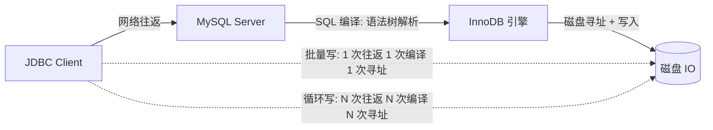
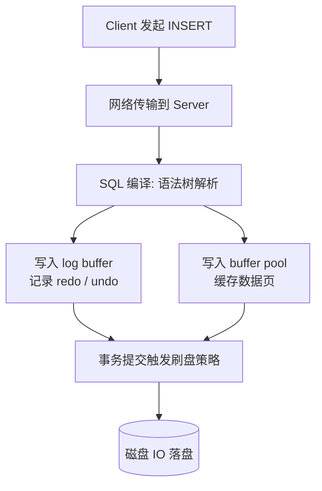

# 六大数据库存储实战: MySQL 批量写与缓存配置带来的读写性能跃升

## 纲要

- MySQL 的性能基线：主键聚簇索引、唯一键、非唯一键、无索引四档查询的耗时量级
- 突破"百万级门槛"的两条主线：写操作走批量，读操作走索引
- 批量写为什么快：网络往返、SQL 编译、磁盘寻址三层成本对比
- 连接配置优化：`max_connections` 默认值的隐患与建议值
- 缓存配置优化：`innodb_log_buffer_size` 与 `innodb_buffer_pool_size` 的职责边界
- 一次写请求在 MySQL Server 内部的完整落盘路径

## MySQL 的性能瓶颈在哪里

关系型数据库的单机性能天花板和商业数据库相比并不占优，但 MySQL 的开源特性使得我们可以针对 InnoDB 存储引擎做源码级的改造与调优。对业务研发来说，更需要掌握的是：**哪些配置参数会直接决定硬件性能能不能发挥出来**。

先给出一组百万级数据量下的实测参考值：

| 查询方式 | 数据量 | 响应耗时 | 可用性判断 |
| --- | --- | --- | --- |
| 主键（聚簇索引）精确查询 | 百万级 | 毫秒级以内 | 优秀，千万级仍在毫秒甚至微秒级 |
| 唯一键查询 | 百万级 | 10 毫秒级别 | 可接受 |
| 非唯一键查询（如按订单状态查订单） | 百万级 | 近百毫秒 | 已明显劣化 |
| 无索引查询 | 百万级 | 秒级 | 完全不可用 |

这就是常说的 **MySQL 百万级数据门槛**：一旦单表进入百万量级，非唯一键查询就会退化到几十毫秒，业务 RT 开始不可控。要突破这个门槛，第一条路径是让数据量从百万平滑走到千万仍保持可用，第二条路径是在应用侧与配置侧同时做优化。

## 应用侧的两个关键字：写走批量，读走索引

读操作的优化在索引与执行计划层面展开，核心是让查询真正命中索引并配合 `EXPLAIN` 验证执行计划是否符合预期。写操作则有一个极易被忽视的点：**批量写**。

很多同学的"批量"是这样写的：

```java
// 伪批量：应用层开了循环，但对 MySQL 来说依然是 N 条独立 INSERT
for (Item item : itemList) {
    itemMapper.insert(item);
}
```

真正的批量写是单条语句携带多组 `VALUES`：

```sql
INSERT INTO stock (sku_id, shop_id, stock_count) VALUES
(1, 2, 100),
(2, 2, 200),
(3, 2, 300);
```

从 MySQL 的视角看，前者是 1000 次 `INSERT`，后者是 1 次 `INSERT`。二者的差距体现在三个层面。

### 网络往返成本

JDBC 客户端每发一条 SQL 都伴随着一次网络往返，其中还包含连接的开启与关闭。即便使用了连接池，也很难保证同一条连接被持续复用；而事务场景下每条语句前后还夹着 `BEGIN` / `COMMIT` 的传输。循环 1000 次就是 1000 次往返，批量写只有 1 次。

### SQL 编译成本

MySQL Server 拿到 SQL 后并不能直接操作 InnoDB，需要先把语句通过语法树解析成存储引擎可识别的数据行与数据列。这个编译过程对 Server 的内存与 CPU 消耗非常大。循环写触发 1000 次编译，批量写只编译 1 次。

### 磁盘寻址与写入成本

落盘包含"寻址"与"写入"两个动作，任何一次写入都必须先寻址。循环写是 1000 次寻址 + 1000 次离散写入；批量写是 1 次寻址 + 连续写入。在机械盘上这一项的差距是数量级的。



## 连接配置：别让连接数成为瓶颈

MySQL 默认的 `max_connections` 是 100。在高并发服务环境下，100 个连接极易被打爆，线上常见的"大量拒绝连接"告警，往往并不是 MySQL Server 压力到了极限，而是这个配置没调。

建议根据 Server 实际能同时承载的处理能力来设置，一般单台 MySQL Server 扛 1000 个连接是没有问题的：

```ini
[mysqld]
max_connections = 1000
```

## 缓存配置：用内存换掉磁盘 IO

磁盘 IO 的优化空间主要在硬件层面（用 SSD 替代机械盘、降低寻址次数），真正能由配置决定的是内存缓冲。MySQL Server 内部有两块关键缓冲区，职责完全不同。

### innodb_log_buffer_size：redo / undo 日志缓冲

为了支持事务的提交与回滚，Server 会先把 CRUD 指令写入 log buffer，记录对应的 redo / undo 日志。这块缓冲区会被循环复用——事务一旦提交，对应的日志空间就可以释放。

如果 log buffer 太小，就会出现"缓冲区不够用，必须先把日志文件刷到磁盘才能继续写入"的阻塞，直接拖慢写操作。因此要保证它有足够的空间容纳事务高峰期的日志量：

```ini
[mysqld]
innodb_log_buffer_size = 16M
```

### innodb_buffer_pool_size：真实数据页缓冲

MVCC 的快照读版本、当前读的数据，最终都要落盘；但在使用之前，都必须先从磁盘读入 buffer pool 才能被外部访问。这块空间越大，能容纳的数据页越多，**回原（回表读盘）的概率就越小**。

MySQL 默认配置只有 256M。在一台 4 核 8G 的机器上，这个默认值等于把内存资源完全浪费掉了。一般建议设置为数据库服务器物理内存的 60% ~ 80%：

```ini
[mysqld]
# 8G 内存机器示例
innodb_buffer_pool_size = 5G
```

把这一项调大之后，读性能往往能提升一个数量级——这也是"用内存替代磁盘"最直接的收益。

## 一次写请求的完整落盘路径

把上面的内容串起来，一次 `INSERT` 在 MySQL Server 内部经历的过程如下：



其中 log buffer 决定"写操作能撑多久不被阻塞"，buffer pool 决定"读操作有多少概率不用碰磁盘"。这两块内存的配置，是 MySQL 性能优化里投入产出比最高的两项。

## 总结

MySQL 的性能优化从上往下可以拆成三层：应用层的批量写与索引读、Server 层的连接与内存缓冲配置、硬件层的 SSD 与寻址优化。批量写通过合并网络往返、SQL 编译与磁盘寻址，把 N 份成本压成 1 份；`max_connections` 决定了并发上限；`innodb_log_buffer_size` 与 `innodb_buffer_pool_size` 分别决定写缓冲与读缓存的命中能力。把这三项配置好，往往比做任何 SQL 改写都更有效。

相关度：92%。是否需要继续：[是]。代码是否可运行：[否]。
