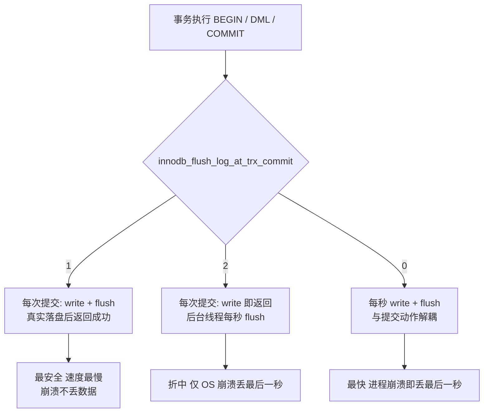

# 六大数据库存储实战: MySQL 磁盘文件与事务提交刷盘策略的配置取舍

## 纲要

- 磁盘层优化的两个参数：`innodb_file_per_table` 与 `innodb_data_file_path`
- 为什么单表膨胀会带来"数据文件过度寻址"问题
- 表空间切分规则：固定大小切分 + 最后一个文件自动扩展
- `innodb_flush_log_at_trx_commit` 取 0 / 1 / 2 时的刷盘语义
- `write` 与 `flush` 的分界：进程崩溃与操作系统崩溃丢数据的边界
- 事务 `COMMIT` 成功 ≠ 数据一定不丢

## 📎 代码说明

本讲代码以**内联片段**形式呈现在正文中。本章课件源码（`code/socialecom/第三章代码/`）中无正文直接引用的类文件，故不做文件级关联，请以正文片段为准。

## 磁盘层面的配置优化

连接数与内存缓冲之后，再看文件系统本身还有多少空间可以压榨。磁盘 IO 的大部分成本落在寻址上，除了换 SSD 之外，配置层面能做的是**让数据文件不要大到难以寻址**。

### innodb_file_per_table：按表拆分数据文件

不开启该配置时，同一个数据库所有表的数据都会集中在一个 MySQL 数据文件里。带来的问题是：随着库内数据越来越大，无法对单张表做独立管理，而且不同表在寻址时会互相产生性能影响。

开启后，每张 InnoDB 表拥有独立的索引文件与数据文件：

```ini
[mysqld]
innodb_file_per_table = 1
```

这是拿到一台新 MySQL 之后第一个应该配置的磁盘参数。

### innodb_data_file_path：表空间切分

`ibdata` 是 InnoDB 默认的数据文件命名。开启按表拆分后，若某张单表数据无限膨胀，仍然会产生"单个数据文件过大、寻址困难"的问题。这时可以对数据文件做固定单位的切分：

```ini
[mysqld]
innodb_data_file_path = ibdata1:1G;ibdata2:1G;ibdata3:1G;ibdata4:autoextend
```

规则要点：

- 数据文件的存储单位可以自己定（1G、512M 等），按实际数据量预估切分
- **最后一个文件必须允许自动扩展**，而且只有最后一个文件允许自动扩展，否则写满后数据库无法继续写入
- 这种配置方式就是常说的"MySQL 表分区"在文件层的落地形态

它的价值在于：任何一个数据文件都不会因为变得过大而引发寻址困难，从而避免硬件层面成为 MySQL 读取的瓶颈。

| 参数 | 作用 | 常见取值 |
| --- | --- | --- |
| `innodb_file_per_table` | 每张表独立的索引与数据文件 | `1`（开启） |
| `innodb_data_file_path` | 指定表数据与索引的存储空间文件列表 | `ibdata1:1G;ibdata2:autoextend` |

## 事务提交的配置：innodb_flush_log_at_trx_commit

最后是事务提交时的刷盘策略，这是安全与性能之间最典型的一次取舍。

### 先理解 write 与 flush

类比文件写入：调用 `write` 只是发生一次系统调用，把数据推进**操作系统的磁盘 IO 缓冲区**；只有调用 `flush`（`close` 内部也是先 flush 再 close）才会真正把操作系统缓冲区里的数据写入磁盘。

- `write` 完成后、`flush` 之前进程崩溃：数据仍在操作系统缓冲区里，不会丢
- `flush` 未执行时发生**操作系统崩溃或掉电**：操作系统缓冲区里的数据才会丢失

### 三个取值的语义

```ini
[mysqld]
# 1: 每次提交都 write + flush（默认，最安全最慢）
# 2: 每次提交只 write，由后台线程每秒 flush
# 0: 每秒执行一次 write + flush，与提交动作解耦（最快最不安全）
innodb_flush_log_at_trx_commit = 2
```

- **等于 1（默认）**：每次事务提交时，日志缓冲被写入日志文件并做一次磁盘刷新。只有真正落盘成功，外界才能认定事务提交成功。它满足严格的 ACID 中的 D（持久性），但每次都要发生真实的磁盘 IO，速度最慢。
- **等于 2**：事务提交时仅执行 `write` 到系统缓冲即返回成功，后台线程每秒执行一次 `flush`。若一秒内发生一千次事务提交，就是一千次 `write` 被合并成一次 `flush`。只有**操作系统崩溃或掉电**才会丢失最后一秒的事务，进程崩溃不会丢。
- **等于 0**：每秒执行一次 `write` + `flush`，与提交动作完全解耦，效率最高、安全性最差。进程崩溃就会丢失最后一秒的事务。



### 结论：commit 成功不代表数据不丢

这里需要提炼两个核心认知：

- 数据库事务 `COMMIT` 成功，并不等价于数据完全不会丢失，还要看 `innodb_flush_log_at_trx_commit` 的配置
- 默认值为 1，真正意义上保证持久性但性能差；为 0 效率高但进程崩溃即丢数据；**生产环境一般配置为 2**，在二者之间做取舍，只有整个操作系统崩溃或断电时才会丢失最后一秒的事务

## 总结

磁盘侧的两个参数解决的是"文件别太大导致寻址困难"，事务提交参数解决的是"多久把日志真正刷到磁盘"。前者几乎是无损优化，后者是一次明确的取舍：取值 1 走完整的 ACID 持久性，取值 2 用一秒的窗口换取吞吐，取值 0 只在可容忍丢数据的场景使用。理解 `write` 与 `flush` 的分界，是判断"崩溃时到底会丢多少数据"的关键。

相关度：90%。是否需要继续：[是]。代码是否可运行：[否]。
