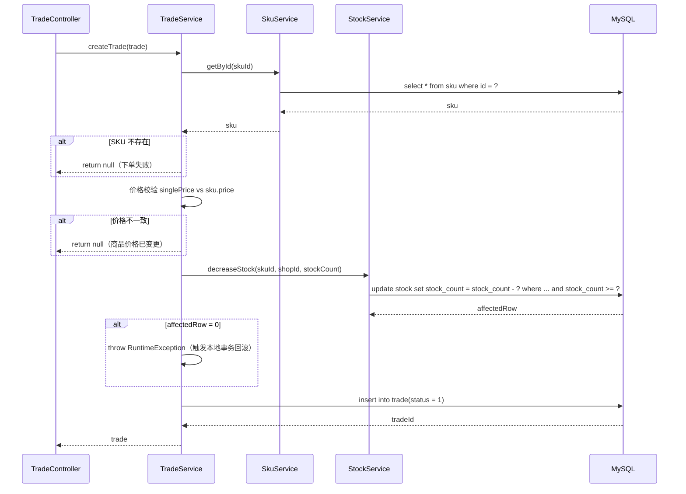
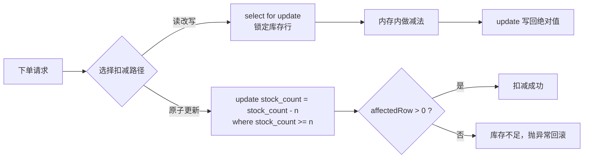

# 39. 六大数据库存储实战: 下单交易的本地事务串联与原子扣库存

## 纲要

- 交易表建模
## 📎 文本↔代码关联

本讲对应课件源码（去品牌化副本，位于 `code/socialecom/`；包名已由原占位包名统一改写为 `com.social.ecom`）：

| 代码文件 | 正文提及 | 职责 |
| --- | --- | --- |
| `code/socialecom/第四章代码/socialecom/src/main/java/com/social/ecom/pojo/Trade.java` | 11 次 | 实体类，主键 `IdType.AUTO` 自增，含自动填充时间字段 |
| `code/socialecom/第四章代码/socialecom/src/main/java/com/social/ecom/mapper/StockMapper.java` | 8 次 | `Stock` 的 MyBatis-Plus Mapper 接口 |
| `code/socialecom/第四章代码/socialecom/src/main/resources/mapper/StockMapper.xml` | 8 次 | Mapper XML（SQL 映射） |
| `code/socialecom/第四章代码/socialecom/src/main/java/com/social/ecom/pojo/Stock.java` | 7 次 | 实体类，主键 `IdType.AUTO` 自增，含自动填充时间字段 |
| `code/socialecom/第四章代码/socialecom/src/main/java/com/social/ecom/controller/TradeController.java` | 6 次 | HTTP 接口层，路由前缀 `/trade`；端点：`/create`、`pay`、`cancel` |
| `code/socialecom/第四章代码/socialecom/src/main/java/com/social/ecom/base/JsonReturnType.java` | 5 次 | 统一 JSON 返回结构（code / message / data） |
| `code/socialecom/第四章代码/socialecom/src/main/java/com/social/ecom/mapper/TradeMapper.java` | 5 次 | `Trade` 的 MyBatis-Plus Mapper 接口 |
| `code/socialecom/第四章代码/socialecom/src/main/resources/mapper/TradeMapper.xml` | 5 次 | Mapper XML（SQL 映射） |
| `code/socialecom/第四章代码/socialecom/src/main/java/com/social/ecom/service/TradeService.java` | 5 次 | `Trade` 业务服务接口 |
| `code/socialecom/第四章代码/socialecom/src/main/java/com/social/ecom/service/impl/TradeServiceImpl.java` | 5 次 | `Trade` 业务服务实现（继承 ServiceImpl） |
| `code/socialecom/第四章代码/socialecom/src/main/java/com/social/ecom/service/StockService.java` | 4 次 | `Stock` 业务服务接口 |
| `code/socialecom/第四章代码/socialecom/src/main/java/com/social/ecom/service/SkuService.java` | 3 次 | `Sku` 业务服务接口 |

## 交易表为什么必须冗余价格

下单链路的第一步是把交易主表 `trade` 建出来。这张表承载的是一次交易动作的完整快照：

```sql
CREATE TABLE `trade` (
  `id`           BIGINT       NOT NULL AUTO_INCREMENT COMMENT '主键',
  `create_time`  DATETIME     DEFAULT NULL COMMENT '创建时间',
  `update_time`  DATETIME     DEFAULT NULL COMMENT '更新时间',
  `sku_id`       BIGINT       DEFAULT NULL COMMENT '购买的 SKU',
  `shop_id`      BIGINT       DEFAULT NULL COMMENT '下单门店',
  `stock_count`  INT          DEFAULT NULL COMMENT '本次购买件数',
  `single_price` DECIMAL(16,2) DEFAULT NULL COMMENT '下单时刻的单价',
  `total_price`  DECIMAL(16,2) DEFAULT NULL COMMENT '下单时刻的总价',
  `user_id`      BIGINT       DEFAULT NULL COMMENT '下单用户',
  `status`       INT          DEFAULT NULL COMMENT '1 待支付，2 支付成功，3 已取消',
  PRIMARY KEY (`id`),
  KEY `idx_user_status` (`user_id`, `status`)
) ENGINE=InnoDB DEFAULT CHARSET=utf8mb4;
```

几个字段的设计动机值得单独说明：

- `sku_id + shop_id` 唯一确定一行库存记录，是扣库存的定位条件。
- `stock_count` 记录本次在该 SKU 上买多少件。
- `single_price` / `total_price` 看似冗余——既然已经有 `sku_id`，用外键把商品价格关联出来再乘数量不就行了？答案是不行。用户在下单那一刻价格就已经锁定，商家后续的改价不应该影响历史订单。如果不落快照，一次后台改价会把所有历史订单的金额一起改写，这在财务上不可接受。因此交易表要全量记录交易时刻生成的所有数据。
- `status` 是订单状态机载体，本阶段先用 `int` 表达，语义为：1 待支付、2 支付成功、3 已取消。

索引方面，除了主键，最关键的是 `(user_id,status)` 联合索引。用户的「我的订单」查询几乎总是「某个用户的某种状态的订单」，把 `status` 编码进索引可以让这类查询直接走覆盖索引完成筛选。

## 端到端代码生成

表建好后，用 MyBatis-Plus Generator 把 `trade` 表的端到端文件一次性生成，service 层文件生成后需要手动把业务方法补进去。

```dir
src/main/java/com/social/ecom
├── MybatisPlusGenerator.java
├── controller
│   ├── StockController.java
│   └── TradeController.java
├── mapper
│   ├── StockMapper.java
│   └── TradeMapper.java
├── pojo
│   ├── Stock.java
│   └── Trade.java
└── service
    ├── impl
    │   ├── StockServiceImpl.java
    │   └── TradeServiceImpl.java
    ├── StockService.java
    └── TradeService.java
src/main/resources/mapper
├── StockMapper.xml
└── TradeMapper.xml
```

`trade` 实体与表的映射关系是标准的驼峰转下划线：

```java
@Data
@ApiModel(value = "Trade对象")
public class Trade implements Serializable {

    @TableId(value = "id", type = IdType.AUTO)
    private Long id;

    @TableField(fill = FieldFill.INSERT)
    private Date createTime;

    @TableField(fill = FieldFill.INSERT_UPDATE)
    private Date updateTime;

    private Long skuId;
    private Long shopId;
    private Integer stockCount;
    private BigDecimal singlePrice;
    private BigDecimal totalPrice;
    private Long userId;
    /** 1 待支付，2 支付成功，3 已取消 */
    private Integer status;
}
```

金额字段统一用 `BigDecimal`，避免浮点精度问题；`create_time` / `update_time` 交给 `FieldFill` 自动填充。

## 下单主流程

整个下单动作收敛在 `TradeServiceImpl#createTrade` 一个方法里，流程如下：



对应的实现：

```java
@Service
public class TradeServiceImpl extends ServiceImpl<TradeMapper, Trade> implements TradeService {

    @Autowired
    private SkuService skuService;

    @Autowired
    private StockService stockService;

    @Override
    @Transactional(rollbackFor = Exception.class)
    public Trade createTrade(Trade trade) {
        // 一、加载 SKU，确认商品存在
        Sku sku = skuService.getById(trade.getSkuId());
        if (sku == null) {
            return null;
        }

        // 二、价格校验：前端看到的单价必须与库内当前单价一致
        if (sku.getPrice().compareTo(trade.getSinglePrice()) != 0) {
            return null;
        }

        // 三、扣减库存，失败则抛异常回滚整笔本地事务
        boolean stockDecreaseSuccess =
                stockService.decreaseStock(trade.getSkuId(), trade.getShopId(), trade.getStockCount());
        if (!stockDecreaseSuccess) {
            throw new RuntimeException("扣减库存失败");
        }

        // 四、落库订单，初始状态为待支付
        trade.setStatus(1);
        save(trade);
        return trade;
    }
}
```

有三个关键决策点：

**为什么用返回值而不是直接依赖异常驱动分支。** SKU 不存在、价格不一致属于「业务前置校验失败」，不需要回滚任何已执行的写操作，直接返回 `null` 让 controller 转成失败响应即可；而库存扣减失败意味着前面可能已经有写操作发生，必须用异常触发事务回滚。

**`@Transactional` 必须显式指定 `rollbackFor`。** Spring 默认只在抛出 `RuntimeException`/`Error` 时回滚，一旦后续接入受检异常或非运行时异常就可能出现「库存扣了、订单没建」的脏数据。显式写 `rollbackFor = Exception.class` 是刚需。

**价格必须由前端回传并在服务端重校验。** 服务端不能直接信任前端传来的单价作为结算依据，而是把用户看到的单价拿回来与库内单价做 `compareTo` 对比。注意 `BigDecimal` 的等值判断要用 `compareTo() != 0`，不能用 `equals()`——后者连精度小数位都要求一致，会误判。

## 扣库存：悲观锁还是原子更新

扣减库存有两种主流写法：

| 方案 | 实现 | 优点 | 缺点 |
| --- | --- | --- | --- |
| 悲观锁 | `select ... for update` 取出库存行，在内存中减完再 `update` 写回 | 逻辑直观，扣减前后可读到明细 | 多一次加锁查询；在外部内存计算后再写回，存在额外内存开销与更高的锁持有时间 |
| 原子更新 | 单条 `UPDATE` 直接在 SQL 内做减法，并把库存充足作为 `WHERE` 条件 | 一次网络往返；靠行锁+条件保证原子性，天然防超卖 | 拿不到扣减前的明细，语句写错容易误伤 |

本场景选择原子更新。`MyBatis-Plus` 的拼装对象方式只适合简单的 ORM 操作，复杂 SQL 仍然推荐写 XML：

```java
public interface StockMapper extends BaseMapper<Stock> {

    /**
     * 原子扣减库存，返回受影响行数：0 表示库存不足
     */
    int decreaseStock(@Param("skuId") Long skuId,
                      @Param("shopId") Long shopId,
                      @Param("stockCount") Integer stockCount);

    /**
     * 订单取消后的库存回补
     */
    int tradeRollbackStock(@Param("skuId") Long skuId,
                           @Param("shopId") Long shopId,
                           @Param("stockCount") Integer stockCount);
}
```

```xml
<mapper namespace="com.social.ecom.mapper.StockMapper">

    <update id="decreaseStock">
        update stock
           set stock_count = stock_count - #{stockCount}
         where sku_id = #{skuId}
           and shop_id = #{shopId}
           and stock_count >= #{stockCount}
    </update>

    <update id="tradeRollbackStock">
        update stock
           set stock_count = stock_count + #{stockCount}
         where sku_id = #{skuId}
           and shop_id = #{shopId}
    </update>
</mapper>
```

关键在于 `and stock_count >= #{stockCount}` 这条额外条件。如果只写 `sku_id` 和 `shop_id`，那么这行库存记录仍然会被扣成负数，并且 `UPDATE` 照样返回 `affectedRow = 1`，上层完全感知不到超卖。加上充足性条件后，余额不足时语句不产生任何效果，`affectedRow` 为 0。

注意 `#{}` 里的名字要与 `@Param` 注解保持一致——XML 中的 `where sku_id = #{skuId}` 依赖命名绑定，写成实体属性名或写错下划线都会导致参数绑定失败。

service 层只做受影响行数的判定：

```java
@Override
public boolean decreaseStock(Long skuId, Long shopId, Integer stockCount) {
    int affectedRow = getBaseMapper().decreaseStock(skuId, shopId, stockCount);
    return affectedRow > 0;
}

@Override
public boolean tradeRollbackStock(Long skuId, Long shopId, Integer stockCount) {
    int affectedRow = getBaseMapper().tradeRollbackStock(skuId, shopId, stockCount);
    return affectedRow > 0;
}
```

作为对照，库存的增加（采购入库）走的是悲观锁路径，因为它需要在扣减前后读取并合并明细：

```java
private void updateStock(Long skuId, Long shopId, Integer stockCount) {
    QueryWrapper<Stock> wrapper = new QueryWrapper<>();
    wrapper.eq("sku_id", skuId);
    wrapper.eq("shop_id", shopId);
    wrapper.last("for update");
    Stock stock = getBaseMapper().selectOne(wrapper);
    stock.setStockCount(stock.getStockCount().intValue() + stockCount);
    updateById(stock);
}
```

两条路径的差异可以用一张图概括：



## 接口层的异常兜底

controller 需要同时兜住「返回 null」和「抛异常」两种失败形态：

```java
@RestController
@RequestMapping("/trade")
public class TradeController {

    @Autowired
    private TradeService tradeService;

    @RequestMapping(value = "/create", method = RequestMethod.POST)
    @ResponseBody
    public JsonReturnType create(@RequestBody Trade trade) {
        try {
            trade = tradeService.createTrade(trade);
        } catch (Exception ex) {
            // 库存扣减失败等异常在此统一转成失败报文
            return JsonReturnType.createErrorType("下单失败");
        }
        if (trade == null) {
            return JsonReturnType.createErrorType("下单失败");
        }
        return JsonReturnType.createType(trade);
    }
}
```

真实生产中 `userId` 应由登录态 token 解析得到，这里为了聚焦的交易链路，直接通过 JSON 反序列化传入。

## 实测验证

服务端口为 `9090`，用 POST 请求调用 `/trade/create`：

```json
{
  "skuId": 1,
  "shopId": 2,
  "stockCount": 1,
  "singlePrice": 8000,
  "totalPrice": 8000,
  "userId": 1
}
```

**场景一：库存充足。** 返回下单成功，`trade` 表新增一条记录，`sku_id`、`stock_count`、`single_price`、`user_id`、`status` 均为预期值，`stock` 表对应库存行减 1。

**场景二：库存为零。** 手动把库存改成 0 后再下单，接口返回「下单失败」。检查数据库：库存没有被扣，`trade` 表也没有新增记录——本地事务保证了「要么订单和库存同时变更，要么都不变」。

## 为什么这套方案只在单体库里成立

上述实现依赖一个隐含前提：订单库与库存库是同一个 MySQL 实例，因此一个本地事务就能覆盖两张表的写操作。一旦服务拆分、订单与库存各自独立成库，本地事务就失效了，此时需要引入分布式事务方案（如 Seata）来保证跨库的最终一致性。

## API 速览

| API | 签名 | 说明 |
| --- | --- | --- |
| `@Transactional` | `rollbackFor = Exception.class` | 声明本地事务边界，遇任意异常回滚 |
| `IService#getById` | `T getById(Serializable id)` | 按主键查询实体 |
| `IService#save` | `boolean save(T entity)` | 插入实体，主键回填到入参对象 |
| `BigDecimal#compareTo` | `int compareTo(BigDecimal val)` | 金额比较，返回 0 表示数值相等（忽略小数位差异） |
| `@Param` | `@Param("xx")` | 为 Mapper 方法参数命名，供 XML 中 `#{xx}` 引用 |
| `BaseMapper` 自定义方法 | `int methodName(...)` | 复杂 SQL 在 XML 中编写，返回受影响行数 |
| `QueryWrapper#last` | `last("for update")` | 在 SQL 末尾追加片段，用于加行锁 |
| `@RequestBody` | 方法参数注解 | 将请求 JSON 反序列化为实体 |

## Demo 示例

**运行说明**

1. 在 `socialecom` 库中执行上文 `trade` 建表语句，并准备 `sku`、`stock` 两张表（字段参考实体类）。
2. 确认 `application.properties` 中的数据源与实际环境一致：

```properties
spring.datasource.url=jdbc:mysql://localhost:3306/socialecom?useUnicode=true&characterEncoding=UTF-8
spring.datasource.username=root
spring.datasource.password=123456
mybatis-plus.configuration.log-impl=org.apache.ibatis.logging.stdout.StdOutImpl
server.port=9090
```

3. 启动 `SocialecomApplication`，向 `http://localhost:9090/trade/create` 发送上文 JSON 报文。

**代码说明**

- `TradeServiceImpl#createTrade`：本地事务边界内的四步——加载 SKU、价格校验、扣库存、落订单。
- `StockMapper.xml#decreaseStock`：把「减法」和「充足性」都下推到 SQL，靠 `affectedRow` 判定成败。
- `StockServiceImpl#decreaseStock`：只做 `affectedRow > 0` 的布尔判定，业务语义与 SQL 解耦。
- `TradeController#create`：`try-catch` + null 判定双兜底。

**技术点总结**

- 交易快照必须在下单时刻固定价格，避免后台改价污染历史订单。
- `(user_id,status)` 联合索引匹配「我的订单」筛选习惯。
- `BigDecimal` 比较用 `compareTo`，不用 `equals`。
- `@Transactional` 显式声明 `rollbackFor`，不要依赖默认行为。
- 防超卖的正确姿势是把充足性写进 `UPDATE` 的 `WHERE`，而不是先查后减。
- 业务前置校验失败用返回值，需要回滚的失败用异常，两种失败语义不要混用。

