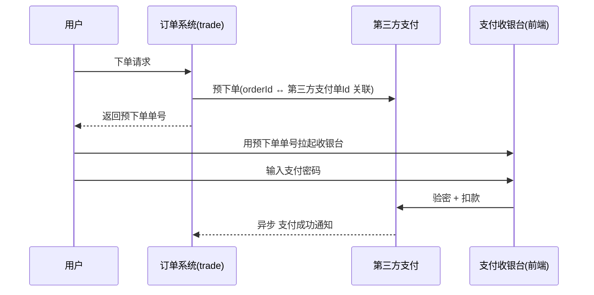
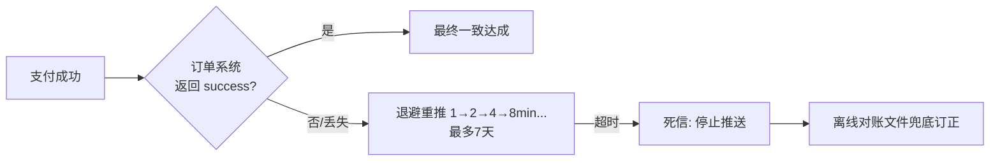

# 六大数据库存储实战: 第三方支付对接、异步通知与离线对账兜底

## 纲要

- 课程工程化简与回到支付主线
  - 本课程非微服务部署，库存与订单同库，因此把 Seata 分布式改造回退为本地事务
  - 下单核心完成后，用户凭 `trade` 模型进入支付
- 第三方支付对接模型
  - 订单系统 + 第三方支付能力（微信 / 支付宝 / 银行银联）
  - 标准链路：下单 → 选/默认支付方式 → 预下单（订单 ID ↔ 第三方支付单 ID 关联）→ 客户端拉起收银台 → 验密扣款 → 异步支付成功通知
- 支付成功通知的两种回传方式
  - HTTP / HTTPS：公网调用，敏感信息走 HTTPS，应用层加数字签名验签防伪造
  - MQ：同局域网或同公司系统间，简单且 MQ 自身保最终一致
- 分布式事务视角：最大努力提交型
  - 参与者一 = 第三方支付（验密扣款提交后发消息），参与者二 = 内部订单系统
  - 以「最终翻转订单为支付成功」作为最终一致节点
- 异步线的脆弱性与离线对账兜底
  - 外部调用可能永远失败（订单系统宕机 / 项目停更但用户已付），等价于参与者二死机
  - 离线对账：用预订单 ID 与订单 ID 关联，比对出「第三方已付、我方仍待支付/已取消」的订单并订正
- 重推退避与死信
  - 有离线兜底后不必无限重推：1 → 2 → 4 → 8 分钟退避，最多约 7 天
  - 超过时限成为死信，第三方停止推送，只能靠离线对账

## 课程工程化简与支付主线

说明一个前置背景：本课程并不是一套微服务部署，库存库与订单库是共享的，因此没有必在课程里一直维持 Seata 的分布式调用——那会影响后续教学流程的编排。做法是把 Seata 相关内容改回去：去掉 `@GlobalTransactional`、注释掉 Seata 配置、移除相关依赖；后续若结合真正的 Spring Cloud 微服务，再去重写 `TradeService`，用 `@GlobalTransactional` 做跨服务的 RPC 调用即可。

回到主线：实现下单核心流程后，用户要凭 `trade` 模型去做支付。整个支付包含两块——支付成功的状态回调，以及未来若长时间未支付，用户手动或系统被动取消订单。本篇先讲支付行为本身与异步通知机制。

## 第三方支付对接模型

订单系统背后都接有第三方支付能力，例如微信、支付宝，或直接对接银行渠道（四大行、银联）。无论哪种渠道，对接方式是一致的：

标准链路拆解：

1. 用户向订单系统发下单请求。
2. 下单后，订单系统让用户选择支付方式，或默认帮用户选一种（微信小程序常默认拉起微信支付）。
3. **预下单**：订单系统的 `orderId` 与第三方支付生成的支付单 ID 建立关联。这一步让订单系统与第三方支付系统形成「支付网关维度」的关联。
4. 用户客户端用这个预下单单号，直接向第三方支付拉起**支付收银台**（微信内就是输入密码的前端页）。
5. 用户在收银台输入密码，第三方支付内部走支付核心系统验密、扣款。
6. 扣款成功后，第三方支付网关通过**异步**方式产生一条「支付成功通知」回传给订单系统。

## 支付成功通知的两种回传方式

### 方式一：HTTP / HTTPS

涉及公网调用时，第三方支付对订单系统的回调通常是 HTTP 的（生产多用 HTTPS）。因为支付敏感，一般还要在应用层做**验签**：第三方支付公司会把一个数字签名随请求回传，订单系统用事前申请的密钥在 SDK 内校验签名，确认内容确实由第三方支付发出，否则外部程序可能伪造一条「支付成功」推给订单系统，但实际货款并不是第三方付的。

### 方式二：MQ

如果第三方支付与订单系统部署在同一局域网、或同属一家公司开发，双方只需通过 MQ 异步消息通知即可，简单很多——MQ 自身就能保证消息最终被订单系统消费到、回溯成支付成功。

两种方式的本质一样，只是通信载体不同。即便是 HTTP，如果订单系统不返回 `success` 响应，第三方支付公司会认定这次 HTTP 调用失败，于是**像 MQ 一样通过重试机制重新发起调用**。

## 分布式事务视角：这是最大努力提交型

把这条异步通知线放进分布式事务框架看，它正是**最大努力提交型**的解决方案：

- 事务参与者一 = 第三方支付公司（或内部系统），它完成接收用户、验密、扣款并 `commit` 数据后，通过消息通知 MQ，让参与者二执行自己的操作。
- MQ 在这里就是「通知支付成功消息」的通道，参与者二 = 内部的订单系统（或网关再经 HTTP 通知更外部的订单系统）。

它能保证的是：在「第三方支付 + 支付核心验密扣款成功」这个环节，尽最大努力把支付成功消息通知到订单系统，以**最终翻转订单为支付成功**作为最终一致的节点。

## 异步线的脆弱性与离线对账兜底

但这条异步线一旦涉及外部系统，就可能永远成功不了：设想订单系统宕机了七天七夜没起来，或者项目直接停更，而用户在停更前刚好完成了支付。这种通知消息可能永远送达不了——在分布式事务视角里，这等价于事务参与者二永久死机，最大努力提交型对此也没有完美解法。

应对方式通常是**离线对账**：第三方支付（如微信）会提供离线的对账文件，我们用其中的预订单 ID 与订单系统里的订单 ID 做关联，比对出「第三方已支付成功、但订单系统里仍是待支付甚至已取消」的订单。通过对账，把在线流程解决不了的最终一致问题，改用离线方式对出来，再自己补发消息或做账务订正。

## 重推退避与死信

正因为有了离线对账这一最后的兜底补偿，支付成功消息**并非必须在达到最终一致前无限重推**。这条异步线类似 MQ 里 consumer 的重推时限：

- 重推间隔退避：1 分钟 → 2 分钟 → 4 分钟 → 8 分钟……
- 最多通知到约 **7 天**。
- 超过这个时限，这条消息被定为**死信**，第三方支付不再推送，完全只能依靠离线对账解决。

## 技术点总结

- 本课程为教学化简，将 Seata 分布式改造回退为本地事务，真实微服务下再恢复 `@GlobalTransactional`。
- 支付标准链路是「下单 → 预下单（订单 ID ↔ 第三方支付单 ID 关联）→ 拉起收银台 → 验密扣款 → 异步通知」。
- 通知回传有 HTTP/HTTPS（需验签防伪造）与 MQ 两种，本质都是通信载体差异。
- 这条异步通知在分布式事务里属于「最大努力提交型」，以最终翻转订单为一致节点。
- 外部调用可能永久失败，最大努力提交型也兜不住，需离线对账作为最后补偿。
- 有对账兜底后，重推采用退避策略，超约 7 天成死信，改由离线对账解决。

相关度：92%。是否需要继续：[是]。代码是否可运行：[否]。
