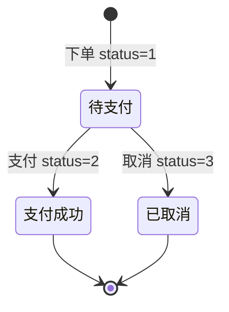
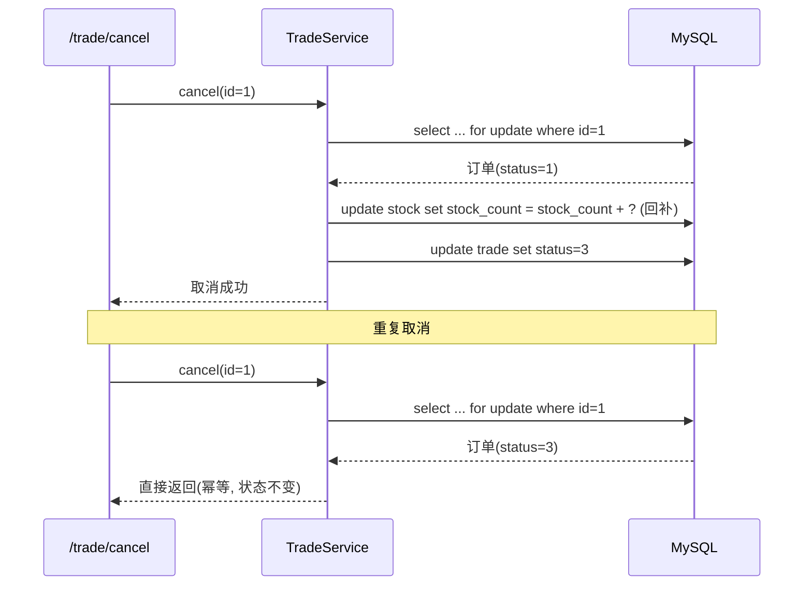

# 六大数据库存储实战: 手动取消订单与基于悲观锁的库存回补

## 纲要

- 取消的两种触发方式
  - 主动（手动）：订单处于待支付即可取消；已支付后取消按钮消失，后端也拦截
  - 被动（系统）：超时不支付，定时任务取消并释放库存给他人
  - 取消 ≠ 简单状态翻转，背后必须级联释放库存
- 订单状态机回顾
  - 1 待支付 → 2 支付成功 / 3 已取消
- `cancel` 方法实现
  - 按 `id` 的 `select ... for update` 悲观锁（不经由支付单回调）
  - 防御式分支：`null` 返回、`status=3` 幂等返回、`status=2` 返回不可取消、`status=1` 回补库存
  - `rollbackStock` 回补库存，失败抛异常触发回滚，`@Transactional(rollbackFor = Exception.class)`
- 库存回补 SQL
  - `tradeRollbackStock`：`stock_count + ?` 无条件加回（因为是回补，无「充足性」约束）
- 接口层与实测
  - `TradeController#cancel` 的 `try-catch` 双兜底
  - 取消后 `status` 1→3、库存回补；重复取消幂等、库存与状态都不变

## 取消的两种触发方式

订单的第三个状态机节点是「取消」。触发取消分两种：

- **主动（手动）取消**：用户自己点取消。只要订单还是待支付状态就能取消；一旦完成支付，前端的取消按钮直接消失，后端也会拦截校验，翻转不过去。
- **被动（系统）取消**：用户占着库存却长时间不支付，系统须把订单取消掉，把库存释放给其他人。这由一个定时任务在超时后触发。

关键点：**取消订单不是传统意义上「改个状态」那么简单，它的背后必须级联上一个库存的释放**。

## 订单状态机回顾



下单后 `status=1`（待支付）；用户第二次操作若是支付，`status` 变 2；若在「待支付」期间点取消，`status` 变 3。

## cancel 方法实现

在 `TradeService` 中新增 `cancel`，实现类里用 `@Transactional` 包住。由于取消是用户或系统主动触发、不再经由支付单回调，所以**直接按订单 `id` 走悲观锁**：

```java
@Override
@Transactional(rollbackFor = Exception.class)
public Trade cancel(Trade trade) {
    QueryWrapper<Trade> wrapper = new QueryWrapper<>();
    wrapper.eq("id", trade.getId());
    wrapper.last("for update");
    trade = getBaseMapper().selectOne(wrapper);
    if (trade == null) {
        return null; // 数据不存在
    }
    if (trade.getStatus().intValue() == 3) {
        return trade; // 已取消：幂等返回，外部视为取消成功
    }
    if (trade.getStatus().intValue() == 2) {
        return null; // 已支付：无法取消
    }
    // 仅剩 status == 1：回补库存后再翻转
    boolean isSuccess = stockService.tradeRollbackStock(
            trade.getSkuId(), trade.getShopId(), trade.getStockCount());
    if (!isSuccess) {
        throw new RuntimeException("库存回补失败");
    }
    trade.setStatus(3);
    updateById(trade);
    return trade;
}
```

四个防御式分支：

- `trade == null` → 直接返回，订单不存在。
- `status == 3`（已取消）→ 直接 `return trade`，这就是**幂等**：重复取消时外部仍收到「取消成功」，但状态不再变动。
- `status == 2`（已支付）→ 返回 `null`，已支付订单不能取消。
- `status == 1` → 这才是真正要处理的：先回补库存，再把状态翻成 3。

回补库存失败则抛 `RuntimeException`，配合 `@Transactional(rollbackFor = Exception.class)` 让整笔事务回滚，避免出现「状态翻成取消、库存却没回补」的不一致。

## 库存回补 SQL

回补用的 `tradeRollbackStock` 和扣减用的 `decreaseStock` 是镜像关系，但**没有「充足性」条件**——回补是做加法，不需要判断余额：

```xml
<update id="tradeRollbackStock">
    update stock
       set stock_count = stock_count + #{stockCount}
     where sku_id = #{skuId}
       and shop_id = #{shopId}
</update>
```

service 层只做受影响行数判定：

```java
@Override
public boolean tradeRollbackStock(Long skuId, Long shopId, Integer stockCount) {
    int affectedRow = getBaseMapper().tradeRollbackStock(skuId, shopId, stockCount);
    return affectedRow > 0;
}
```

注意回补动作所需的全部信息（skuId / shopId / stockCount）都从**订单原始数据**里取，不需要前端再传。

## 接口层

controller 侧同样用 `try-catch` + null 双兜底：

```java
@RestController
@RequestMapping("/trade")
public class TradeController {

    @Autowired
    private TradeService tradeService;

    @RequestMapping(value = "cancel", method = {RequestMethod.POST})
    @ResponseBody
    public JsonReturnType cancel(@RequestBody Trade trade) {
        try {
            trade = tradeService.cancel(trade);
        } catch (Exception ex) {
            return JsonReturnType.createErrorType("取消失败");
        }
        if (trade == null) {
            return JsonReturnType.createErrorType("取消失败");
        }
        return JsonReturnType.createType(trade);
    }
}
```

## 实测验证

假设当前库存为 98，存在一个 `status=1` 的待支付订单（如 `id=1`）：

- **第一次取消**：向 `http://localhost:9090/trade/cancel` 发送 `{ "id": 1 }`，返回取消成功。查库：`status` 变为 3，库存从 98 回补到 99。
- **再次取消同一订单**：无报错，但库存不再变化、状态仍停留在 3——证明取消操作是幂等的。



## API 速览

| API / 字段 | 取值示例 | 说明 |
| --- | --- | --- |
| `QueryWrapper#eq` | `eq("id", trade.getId())` | 按订单主键定位 |
| `QueryWrapper#last` | `last("for update")` | 悲观锁，所有订单写操作统一加锁 |
| `stock_rollback` SQL | `stock_count + ?` | 库存回补，无条件加回 |
| `Trade#getStatus` | `1 待支付 / 2 支付成功 / 3 已取消` | 状态机载体 |

## Demo 示例

**运行说明**

1. 确认 `StockMapper.xml` 中有 `tradeRollbackStock`（无条件加回），并确认 `stock` 表存在 `(sku_id, shop_id)` 唯一索引。
2. 准备一个 `status=1` 的待支付订单，记下其 `id` 与库存变化前的值。
3. 调用 `POST /trade/cancel`，请求体 `{ "id": <订单id> }`，确认返回成功、`status` 变 3、库存回补。
4. 重复调用同 `id`，确认返回成功但库存与状态都不再变化（幂等）。

**代码说明**

- `TradeServiceImpl#cancel`：悲观锁锁行 + 防御式状态分支，核心是 `status=1` 时的库存回补。
- `tradeRollbackStock`：与 `decreaseStock` 镜像，做加法无充足性约束。
- `TradeController#cancel`：`try-catch` + null 双兜底，已支付返回失败、已取消返回成功。

**技术点总结**

- 取消订单必须级联释放库存，不能只翻状态。
- 主动取消要求订单处于待支付；已支付订单后端拦截不可取消。
- 所有订单写操作统一用 `select ... for update` 悲观锁，取消也不例外。
- 防御式编程三分支：`null` 返回、`status=3` 幂等返回、`status=2` 不可取消，只剩 `status=1` 才回补。
- 库存回补是加法，无需「充足性」条件；回补信息全部取自订单原始数据。
- `@Transactional(rollbackFor = Exception.class)` 保证「回补 + 翻状态」原子，回补失败整体回滚。

相关度：93%。是否需要继续：[是]。代码是否可运行：[是]。
