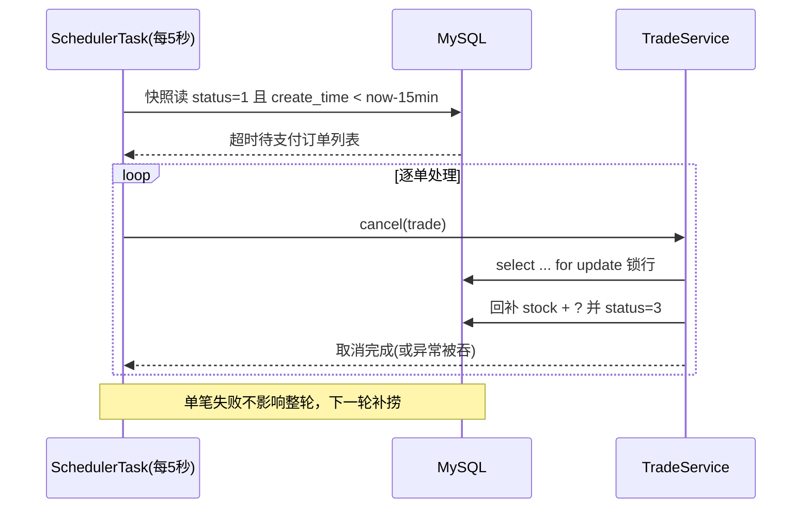

# 六大数据库存储实战: 定时任务驱动的自动取消订单与库存被动释放

## 纲要

- 取消的两条触发路径回顾
## 📎 文本↔代码关联

本讲对应课件源码（去品牌化副本，位于 `code/socialecom/`；包名已由原占位包名统一改写为 `com.social.ecom`）：

| 代码文件 | 正文提及 | 职责 |
| --- | --- | --- |
| `code/socialecom/第四章代码/socialecom/src/main/java/com/social/ecom/service/TradeService.java` | 8 次 | `Trade` 业务服务接口 |
| `code/socialecom/第四章代码/socialecom/src/main/java/com/social/ecom/helper/SchedulerTask.java` | 5 次 | 定时任务（订单超时自动取消） |
| `code/socialecom/第四章代码/socialecom/src/main/java/com/social/ecom/pojo/Trade.java` | 5 次 | 实体类，主键 `IdType.AUTO` 自增，含自动填充时间字段 |
| `code/socialecom/第四章代码/socialecom/src/main/java/com/social/ecom/controller/TradeController.java` | 2 次 | HTTP 接口层，路由前缀 `/trade`；端点：`/create`、`pay`、`cancel` |

## 从手动取消到系统自动取消

在 `4-12` 中我们解决了「用户主动取消」：前端点取消 → `TradeController#cancel` → `TradeService#cancel` 用悲观锁锁行、回补库存、翻状态。`4-12` 也提到，取消还有第二种触发方式——**被动（系统）取消**：用户只是占着库存却迟迟不付款，系统必须主动把这些订单清掉，把库存释放给真正想买的人。

业务上这就是电商下单页那个**倒计时**的来源：倒计时结束前还能支付，一旦超时，订单被系统关掉，支付入口也随之关闭。从系统视角看，被动取消是一桩带时间延迟的批量清理工作，天然适合用**定时任务**来实现，而不是在每一次请求里判断。

## 接入 Spring 定时任务

Spring 提供了一套开箱即用的调度能力，核心是两个注解：

- `@EnableScheduling`：放在配置类上，告诉 Spring 容器启动一个调度器（`ScheduledAnnotationBeanPostProcessor`）。
- `@Scheduled`：标注在某个方法上，按给定的周期表达式周期执行。

承载它的类本身用 `@Configuration` 托管到 Spring 容器即可：

```java
package com.social.ecom.helper;

import com.baomidou.mybatisplus.core.conditions.query.QueryWrapper;
import com.social.ecom.pojo.Trade;
import com.social.ecom.service.TradeService;
import org.springframework.beans.factory.annotation.Autowired;
import org.springframework.context.annotation.Configuration;
import org.springframework.scheduling.annotation.EnableScheduling;
import org.springframework.scheduling.annotation.Scheduled;

import java.time.LocalDateTime;
import java.util.List;

@Configuration
@EnableScheduling
public class SchedulerTask {

    @Autowired
    private TradeService tradeService;

    // 每 5 秒执行一次，扫描并清理超时未支付的订单
    @Scheduled(cron = "0/5 * * * * ?")
    public void configureTask() {
        // 待支付订单，且创建时间已超过 15 分钟
        QueryWrapper<Trade> tradeQueryWrapper = new QueryWrapper<>();
        tradeQueryWrapper.eq("status", 1);
        tradeQueryWrapper.lt("create_time", LocalDateTime.now().minusMinutes(15));
        List<Trade> tradeList = tradeService.list(tradeQueryWrapper);
        tradeList.forEach(trade -> {
            try {
                tradeService.cancel(trade);
            } catch (Exception e) {
                // 单笔失败不应中断整轮扫描，下一轮会再次捞起
            }
        });
    }
}
```

这里 `SchedulerTask` 只是一个**触发器**：它自己不实现取消逻辑，真正干活的还是 `4-12` 里已经封装好的 `TradeService#cancel`（悲观锁锁行 → 回补库存 → 翻状态为 3）。这样「捞取」和「取消」两个职责被清晰地拆开。

## 查询条件：为什么不用 select for update

扫描条件只有两个约束：

- `status = 1`：只看待支付订单。
- `create_time < now - 15min`：创建时间早于「当前时间减 15 分钟」，即订单已经挂了超过 15 分钟。

```java
tradeQueryWrapper.eq("status", 1);
tradeQueryWrapper.lt("create_time", LocalDateTime.now().minusMinutes(15));
```

`lt` 是「小于」，语义上等价于「订单创建时间比 15 分钟前还要早」。

关键设计点在于：**这一步故意不写 `select ... for update`**。原因是 `status` 与 `create_time` 的组合并不是唯一索引——在这类非唯一索引上加 `for update`，InnoDB 会施加**间隙锁（gap lock）**来防止幻读，而这个间隙范围会覆盖到「待支付订单」的插入区域，直接**阻塞正常下单的 `insert`**。下单是高并发主路径，绝不能被定时任务拖住。

替代方案是 MVCC **快照读（一致性读）**：不加锁，读的是当前已提交版本。它的代价是「可能漏捞」——扫描瞬间正在变更的行可能读不到最新状态。但因为这是一个**周期性**任务，本轮没捞到的，下一轮（5 秒后）还会再被捞出来，最终一致即可，不必追求单次精确。

## 逐单取消与异常隔离

对捞到的每一笔订单，直接调用 `tradeService.cancel(trade)`：

```java
tradeList.forEach(trade -> {
    try {
        tradeService.cancel(trade);
    } catch (Exception e) {
        // 空 catch：单笔失败不影响后续订单
    }
});
```

这里的 `try-catch` 是有意为之。定时任务本身**不关心某一笔能不能成功**——它只负责把符合条件的订单喂给 `cancel`。真正保证「订单状态最终一定翻成已取消 + 库存一定回补」的是 `cancel` 内部的事务与幂等逻辑。因此：

- 某一笔因为库存回补失败抛了异常，把它 `catch` 住、什么都不做，循环继续处理下一笔；
- 不会因单点异常打断整轮扫描；
- 失败的那一笔会在下一轮定时任务里被再次捞起重试。

这样把「批量扫描的健壮性」和「单笔业务的正确性」解耦，是定时任务里非常典型的写法。

## 调度节奏：cron 表达式

```java
@Scheduled(cron = "0/5 * * * * ?")
```

Spring 的 cron 是 6 位：`秒 分 时 日 月 周`。`0/5 * * * * ?` 的含义是：

- 第 1 位（秒）`0/5`：从 0 秒开始，每 5 秒触发一次；
- 其余位 `*`：分钟、小时、日、月、周全部不限。

也就是说**每 5 秒扫一次**。业务上要清理的是「超过 15 分钟」的订单，但定时任务不可能无限频繁；用 5 秒的扫描间隔，就把「超时判定」的误差控制在 5 秒以内，既不会让库存被无效占用太久，也不会给数据库太大压力。



## 实测效果

准备一笔 `status=1` 且创建时间早已超过 15 分钟的订单（例如 `id=1`），启动定时任务后在 `cancel` 内打一个断点即可观察到：

- 任务每隔 5 秒触发一次，反复刷这批数据；
- 被处理的订单 `status` 由 1 翻为 3（已取消）；
- 对应 `stock` 被回补（例如从 99 恢复到 100）；
- 因为 `cancel` 是幂等的，已取消的订单在后续轮次中再次被捞到时，状态与库存都不再变化。

## API 速览

| API / 注解 | 示例 | 说明 |
| --- | --- | --- |
| `@EnableScheduling` | 标注在 `@Configuration` 类上 | 启用 Spring 调度器 |
| `@Scheduled(cron)` | `cron = "0/5 * * * * ?"` | 声明周期执行，6 位 cron：秒 分 时 日 月 周 |
| `QueryWrapper#eq` | `eq("status", 1)` | 只捞待支付订单 |
| `QueryWrapper#lt` | `lt("create_time", now.minusMinutes(15))` | 创建时间早于 15 分钟前 |
| `TradeService#cancel` | `tradeService.cancel(trade)` | 复用 `4-12` 的悲观锁取消 + 库存回补 |

## Demo 示例

**运行说明**

1. 确认 `TradeService#cancel` 已实现（悲观锁锁行 + `tradeRollbackStock` 回补 + 翻 `status=3`），详见 `4-12`。
2. 在 `@Configuration` 类上加 `@EnableScheduling`，在扫描方法上加 `@Scheduled(cron = "0/5 * * * * ?")`。
3. 构造（或留一笔）`status=1` 且 `create_time` 早于 `now-15min` 的订单。
4. 启动应用，观察日志 / 断点：每 5 秒一轮，目标订单 `status` 变 3、库存回补；重复轮次幂等无副作用。

**代码说明**

- `SchedulerTask` 只做「捞取 + 触发」，取消动作全部委托给 `tradeService.cancel`，避免逻辑重复。
- 捞取查询不加 `for update`，用快照读规避非唯一索引上的间隙锁，保护下单 `insert`。
- 逐单 `try-catch` 吞异常，保证单笔失败不中断整轮扫描。

**技术点总结**

- 被动取消由定时任务承担，是下单倒计时背后的真实机制。
- 定时任务类是触发器，真正的取消与库存回补复用既有 `cancel`，职责分离。
- 扫描查询用 `status=1 AND create_time < now-15min`；因组合非唯一索引，禁止 `for update` 以免间隙锁阻塞下单。
- 用 MVCC 快照读换取「不阻塞写入」，靠周期性重试保证最终一致。
- 逐单 `try-catch` 隔离异常，单笔失败下一轮补捞，扫描循环不被打断。
- `0/5 * * * * ?` 每 5 秒执行，把 15 分钟阈值的判定误差控制在 5 秒内。

相关度：94%。是否需要继续：[是]。代码是否可运行：[是]。
