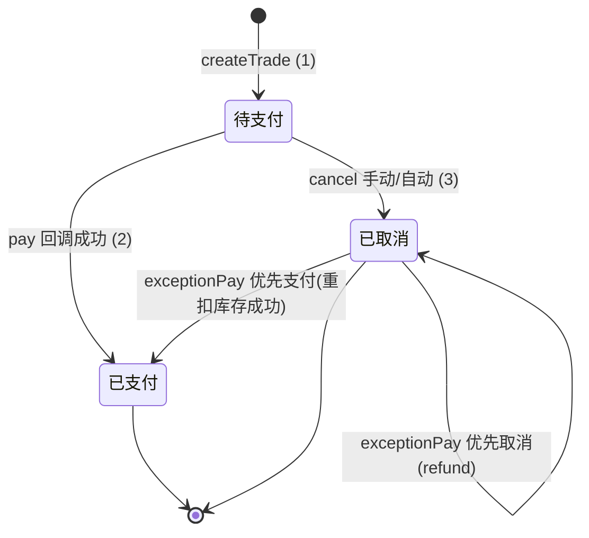

# 六大数据库存储实战: 支付回调与取消竞态下的订单生命周期兜底

## 纲要

- 订单状态机：1 待支付、2 已支付、3 已取消
- 两种把订单"翻成已取消"后却又收到支付成功回调的竞态
## 📎 文本↔代码关联

本讲对应课件源码（去品牌化副本，位于 `code/socialecom/`；包名已由原占位包名统一改写为 `com.social.ecom`）：

| 代码文件 | 正文提及 | 职责 |
| --- | --- | --- |
| `code/socialecom/第四章代码/socialecom/src/main/java/com/social/ecom/pojo/Trade.java` | 10 次 | 实体类，主键 `IdType.AUTO` 自增，含自动填充时间字段 |
| `code/socialecom/第四章代码/socialecom/src/main/java/com/social/ecom/service/impl/TradeServiceImpl.java` | 2 次 | `Trade` 业务服务实现（继承 ServiceImpl） |

## 两种竞态是怎么发生的

前面已经把下单、支付成功回调、用户手动取消、系统到点自动取消四条链路都打通了。但有一个交叉场景必须收尾：支付成功的回调回来时，发现订单状态已经被翻成了 3（已取消）。

第一种场景：用户在待支付的订单上，既可以点"取消"，也可以去"支付"。如果他比较"笨"——先点了取消，再去输微信支付密码完成付款。等支付成功的回调回来时，订单早就被他自己取消掉了。

第二种场景：系统对订单有 15 分钟的限制。假设用户真在支付页面上纠结了 15 分钟，正好在第 15 分钟系统把订单自动取消掉，而用户此时恰好发起了支付。回调回来时，订单状态同样是 3。

这两种场景的本质一样：**取消动作与支付回调在时间上交错，导致"已取消"的订单又收到了"支付成功"**。这就是本篇要处理的异常兜底。

## 两个兜底策略

面对"已取消却收到支付成功"，有两条路：

### 优先支付

判定支付成功回调时订单状态是已取消（3），仍默认帮用户翻转成已支付（2）。换句话说，状态机允许 3 → 2。

但取消订单时库存已经被释放回去了，所以重新翻转成已支付时，必须再把库存扣下来。这里又分两种情况：

- 扣减库存成功 → 有货可发，正常走发货流程。
- 扣减库存失败 → 进入"优先取消"分支：状态机不动，走微信退款。

### 优先取消

状态机保持 3 不变，调用第三方支付退款，把钱退给用户。

这是大部分互联网公司的默认选择——既然可能发不出货，订单也已经关了，就把钱退掉。但它并不完美：微信退款不是实时到账，也很难快速触达用户"钱已退"的提示。用户会瞬间恐慌——单被取消了，钱却没退回来，体验不佳。

而优先支付的实现更复杂：要先看库存能不能扣成功，扣成功才翻转；扣失败还是要走取消退款。下面用代码把它落下来。

## 状态机兜底的代码实现

订单状态定义为：1 待支付、2 已支付、3 已取消。`pay` 方法在收到回调时，对状态 3 转交 `exceptionPay` 处理：

```java
@Override
@Transactional
public Trade pay(Trade trade) {
    QueryWrapper<Trade> queryWrapper = new QueryWrapper<>();
    queryWrapper.eq("wechat_trade_id", trade.getWechatTradeId());
    queryWrapper.last("for update");
    trade = getBaseMapper().selectOne(queryWrapper);
    if (trade == null) {
        return null;
    }
    if (trade.getStatus().intValue() == 2) {
        return trade;                       // 已是已支付，幂等返回
    }
    if (trade.getStatus().intValue() == 3) {
        return exceptionPay(trade, 2);      // 已取消却收到支付成功 → 异常兜底
    }
    trade.setStatus(2);
    updateById(trade);
    return trade;
}
```

`exceptionPay` 按 `type` 选择策略。`type == 1` 为优先取消，`type == 2` 为优先支付：

```java
private Trade exceptionPay(Trade trade, int type) {
    if (type == 1) {
        // 优先取消：直接退款
        if (refund(trade.getWechatTradeId())) {
            return trade;
        } else {
            return null;                     // 退款失败，交上游重试
        }
    } else {
        // 优先支付：先重新扣库存
        boolean decreaseSuccess = stockService.decreaseStock(
                trade.getSkuId(), trade.getShopId(), trade.getStockCount());
        if (!decreaseSuccess) {
            // 库存不够扣 → 退回优先取消（退款）
            if (refund(trade.getWechatTradeId())) {
                return trade;
            } else {
                return null;
            }
        } else {
            // 扣库存成功 → 翻转 3 → 2
            trade.setStatus(2);
            updateById(trade);
            return trade;
        }
    }
}

private boolean refund(String wechatTradeId) {
    // 调用微信支付退款网关，此处以成功返回示意
    return true;
}
```

`refund` 这里只声明了调用微信退款网关的语义。重点在它的失败处理：如果退款返回 `false`（比如调用微信超时），`exceptionPay` 返回 `null`，意味着"支付成功消息的接收"被视为失败。上游会基于最大努力提交原则对这条消息做重试。

## 为什么敢把退款交给重试

回到分布式事务的设计原则：一旦微信告诉你支付成功，钱一定已经收到。因此调用退款接口，从业务语义上讲，除了"超时"这种网络问题，不会有其它失败原因。超时是可重试的，重试终会成功。所以"退款失败就返回 null、让上游重试"是一条可靠链路，环环相扣。

`cancel` 方法则负责用户主动取消与系统自动取消的入口，核心是把库存回补回去并把状态置为 3：

```java
@Override
@Transactional(rollbackFor = Exception.class)
public Trade cancel(Trade trade) {
    QueryWrapper<Trade> wrapper = new QueryWrapper<>();
    wrapper.eq("id", trade.getId());
    wrapper.last("for update");
    trade = getBaseMapper().selectOne(wrapper);
    if (trade == null) {
        return null;
    }
    if (trade.getStatus().intValue() == 3) {
        return trade;                        // 已是已取消，幂等
    }
    if (trade.getStatus().intValue() == 2) {
        return null;                         // 已支付不允许取消
    }
    boolean isSuccess = stockService.tradeRollbackStock(
            trade.getSkuId(), trade.getShopId(), trade.getStockCount());
    if (!isSuccess) {
        throw new RuntimeException("库存回补失败");
    }
    trade.setStatus(3);
    updateById(trade);
    return trade;
}
```

## 生命周期全景

把四篇串起来，订单的完整生命周期就是：`createTrade` 下单（状态 1）→ `pay` 支付成功回调（翻 2）→ `cancel` 手动/自动取消（翻 3）→ 以及本篇的异常兜底 `exceptionPay`（3 与 2 之间的竞态收敛）。无论走哪条路径，订单与库存始终保持同进同出。



## 技术点总结

- 订单状态机：1 待支付、2 已支付、3 已取消；支付回调对 3 走异常兜底。
- 竞态来源：用户"先取消后付款"，或系统到点自动取消与支付撞车。
- 优先支付需重新扣库存：扣成功翻 2 发货，扣失败退回优先取消（退款）。
- 优先取消调用微信退款；退款超时返回失败则交上游最大努力提交重试。
- 退款接口除超时外无业务语义失败，因此"失败即重试"是可靠设计。
- `cancel` 负责回补库存并把状态置 3，已支付不允许再取消，已取消幂等。

相关度：95%。是否需要继续：[否]。代码是否可运行：[是]。
