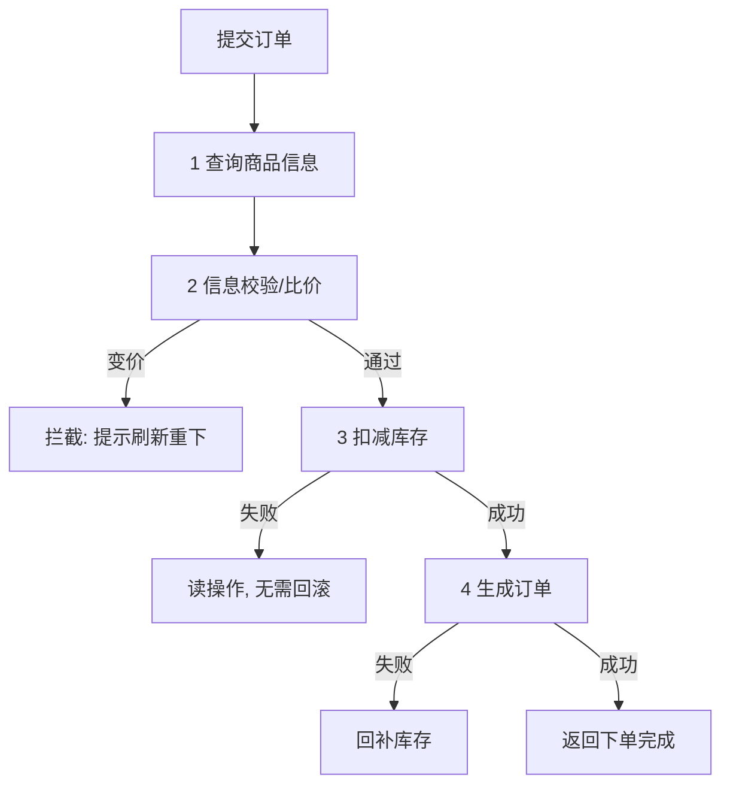

# 六大数据库存储实战: 下单流程编排、比价校验与回滚策略

## 纲要

- 本章导学（第 4 章全貌）
  - 串联最核心的下单流程
  - 下单中的分布式事务问题，并用 Seata 快速落地
  - 支付成功消息的接收与订单状态翻转
  - 取消订单：用户手动取消 + 系统到点自动取消
- 下单流程的本质
  - 与「商品发布」不同，下单是**消耗型**操作，全程面临资源竞争
  - 用户侧链路：提交页渲染 → 点击提交 → 进入后台流程
- 下单的四步编排
  - 一、查询商品信息：用户传来的未必是实时信息
  - 二、信息校验（比价）：拦截变价，避免客诉
  - 三、扣减库存：最卡点的一步，须与下单流程同进同出
  - 四、生成订单：任一步出错须自下而上回滚
- 回滚原则
  - 扣库存成功但生成订单失败 → 库存回补
  - 扣库存本身失败 → 前置校验都是读操作，无需回滚

## 本章导学

第 4 章聚焦「高事务保证要求的交易核心能力」。整章要带大家完成四件事：

1. 编写并串联整个交易里最重要的**下单流程**；
2. 讲清下单流程里涉及的**分布式事务**问题，并最终用 Seata 框架快速实现；
3. 实现**支付成功消息**的接收，以及据此翻转订单状态；
4. 把**取消订单**流程串起来，包括用户手动取消和系统到点自动取消。

本篇是这一章的「上」，先把下单流程的设计与编排讲清楚，后续篇章再逐段落代码。

## 下单流程的本质：消耗型操作

前面做商家、门店、商品、SKU、库存时，操作大多是「从无到有」的信息创建。但**下单流程本质不同——它是消耗型的**：每下一单，就要真实地扣掉一份库存。这意味着它全程都在面对资源竞争，不像商品发布那样只是写一条新记录。

从用户视角看，一次下单是这样的：

用户在前端页面拉起提交页、看到商品元素、点击提交，请求进入后台后，才真正开始编排。

## 下单的四步编排

后台下单流程要依次编排四件事：

### 一、查询商品信息

用户提交订单时，会把商品信息一并传上来。但**用户在前端看到的信息，未必是实时信息**——从他看到页面到点击提交这段时间里，商品可能已经被改价，或者已经没库存了。所以第一步必须把他传上来的商品信息重新 `load` 出来，以库内当前状态为准。

### 二、信息校验（比价）

这一步主要做**比价**：拿用户提交订单时看到的价格，和数据库里当前的实时价格做对比。

例如用户看到的 iPhone 是 8000，但后台编辑商品后变成了 9000。这时校验必须**拦截**住，告诉用户「商品可能已变价，请刷新页面重新下单」。

为什么不干脆用新的 9000 直接让用户下单？这是体验要求：设想用户提交页看到的是 8000，而下单后生成的订单却变成 9000，万一他没留意就直接去支付了，会引发大量客诉。所以变价必须在校验阶段拦住，而不是事后让用户吃哑巴亏。

### 三、扣减库存

这一步往往是整个互联网下单流程里**最卡点**的一环。秒杀、抢购类系统的大量优化都堆在这里。本门课程重点是分布式事务与存储能力建设，因此这里的扣库存等价于对数据库做一次减法操作。关键是：**必须保证「下单流程」与「扣减库存」同进同出**。

### 四、生成订单

扣库存完成后，进入生成订单。这一步连同前面的扣库存，整体不能出任何问题。

## 回滚原则

四步编排里，任何中间步骤失败，都要能**自下而上把订单回滚掉**：

- **扣库存成功，但生成订单失败** → 必须把刚才扣掉的库存**回补**回去，否则会出现「库存少了、订单没生成」的脏数据。
- **扣库存本身就失败** → 它前面的查询、校验都是**读操作**，没有写过任何数据，因此无需做任何回滚。

一句话概括完整流程：**查商品 → 比价校验 → 扣库存 → 生成订单**，其中扣库存与生成订单必须绑成一个原子整体，任一步出错依性质决定回滚或忽略。

## 技术点总结

- 下单是消耗型操作，与商品发布的「创建型」有本质区别，全程有资源竞争。
- 查询商品信息是因为前端展示价格可能不是实时值，必须以库内为准。
- 比价校验要在入库前拦截变价，是体验与客诉兜底，不是单纯的技术校验。
- 扣库存是下单链路最卡点的一步，本篇视作一次 DB 减法，须与下单同进同出。
- 回滚策略按「是否写过数据」区分：扣库存失败无需回滚（前置皆读），扣库存成功但订单失败必须回补库存。
- 完整的本地事务实现见同章「下单交易的本地事务串联与原子扣库存」。

相关度：90%。是否需要继续：[是]。代码是否可运行：[否]。
