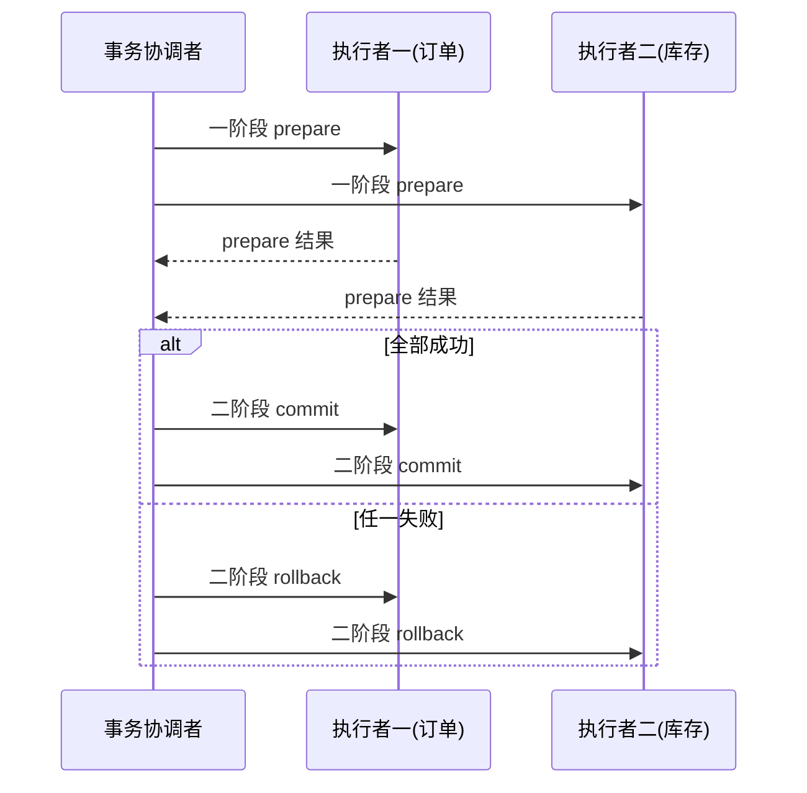
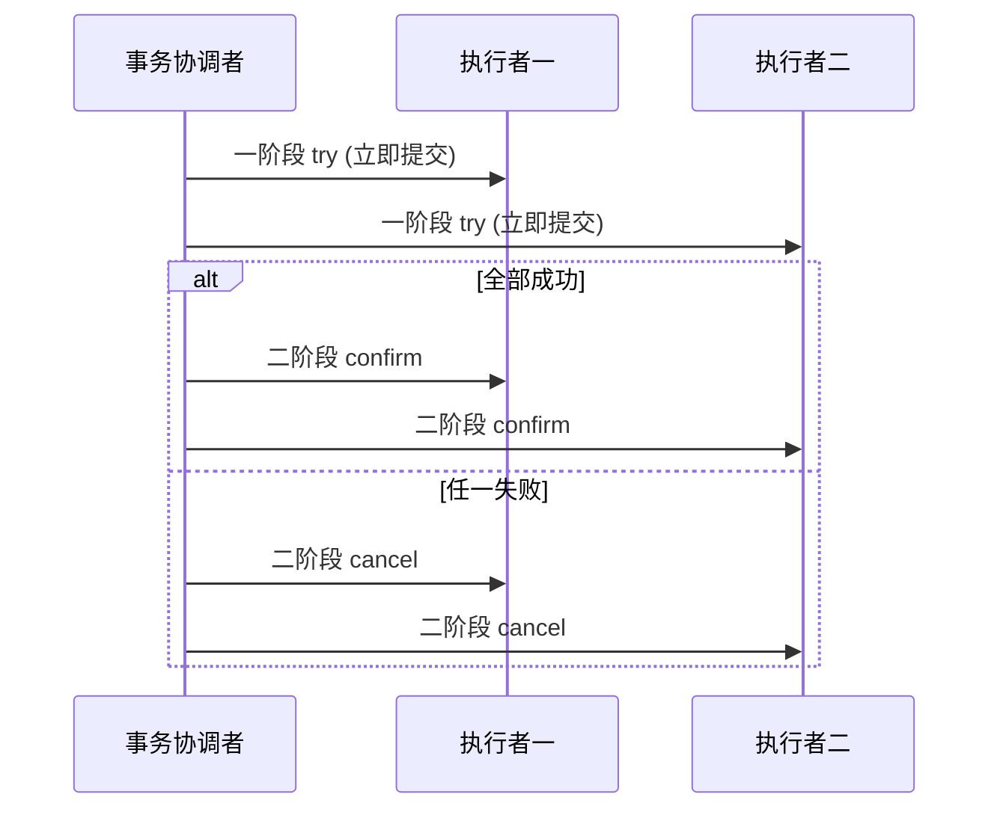
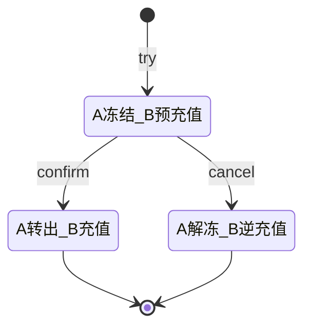

# 六大数据库存储实战: 二阶段提交与 TCC 两种分布式事务实现机制

## 纲要

- 分布式事务需要事务协调者 + 多个事务执行者
- 二阶段提交（XA 协议）
  - 一阶段：执行者各跑 prepare SQL，但不 commit/rollback，持有行锁、事务挂起
  - 二阶段：协调者汇总结果，全成功发 commit，任一失败发 rollback
  - 优势：强一致；劣势：长持锁、吞吐被最慢执行者拖死
- TCC（Try-Confirm-Cancel）
  - 应用层二阶段协议：一阶段 try SQL 直接提交，无事务挂起
  - 二阶段 confirm（可空）或 cancel
  - 用"冻结态"中间状态解决脏读：以转账为例 try 阶段 A 减百元冻结、B 预充值
  - 优势：无挂起、最终一致；依赖协调者重试保证 confirm 必达
- 最大努力提交型
  - 无协调者，借助 MQ：执行者一提交后发消息，执行者二尽力消费提交
  - 适用于解耦但必然最终成功的联动场景（如下单支付 + 销量加一）

## 起点：谁来协调多个执行者

本地事务里，订单与库存在同一个库，`@Transactional` 就能覆盖。一旦服务拆分——扣库存归库存服务（stockDB），生成订单归交易服务（tradeDB）——单次本地事务管不到两个库。一次下单接口要同时操作两个数据源且保证 ACID，这就是分布式事务。它至少需要一个**事务协调者**和多个**事务执行者**。

## 二阶段提交：用持锁换强一致

二阶段提交基于数据库的 XA 协议。流程如下：

- 一阶段：协调者向执行者一、执行者二分别发 `prepare`；两个执行者各自执行 `prepare` 对应的 SQL（insert/update），但**不提交、也不回滚**，事务进入挂起状态，彼此等待对方反馈。
- 协调者收集两个执行者的 `prepare` 结果：
  - 全部 `success` → 二阶段向两者发 `commit`，把一阶段的结果真正落库。
  - 任一失败 → 二阶段向两者发 `rollback`。

回到库存这个例子：库存作为执行者二，若库存不足，一阶段那条 `update` 返回影响 0 行，协调者便发 `rollback` 把订单回滚掉。

二阶段提交的关键特征在于：一阶段执行 `prepare` SQL 后既不 `commit` 也不 `rollback`，因此执行者始终持有着被更新记录的锁。外部想用 `select for update` 读这条库存行时，会因为二阶段 `commit`/`rollback` 迟迟未发生而被阻塞，直到协调者下发指令。这**完全保证了强一致，代价是牺牲可用性**。

对照 CAP：数据处于"处理中"时不能对外服务，即便外部请求也直接拒绝——这就是 C 与 A 不可兼得的本质。它的劣势同样明显：二阶段的 `commit`/`rollback` 要等所有执行者都完成并回报协调者，再由协调者下发；最快的执行者必须等最慢的执行者回应后才能继续，系统吞吐被短板效应拖死。而且协调者下发期间还要考虑发送失败与重试，网络等待更长。正因如此，应用层一般不会直接使用二阶段提交。

## TCC：把二阶段搬进应用层

TCC 即 Try-Confirm-Cancel，名字上与二阶段很像，但有个本质不同。

- 一阶段：协调者向执行者发 `try`；执行者跑 `try` SQL，**并且立即 commit**。也就是说一阶段就把可能产生"脏数据"的内容提交了，外部已经能读到。
- 二阶段：`confirm`（类似 commit，甚至可以是空实现）或 `cancel`（类似 rollback）。

TCC 不需要数据库支持 XA，只要数据能 `commit` 即可。执行者需要准备三套逻辑：`try`、`confirm`、`cancel`，每个阶段各自 `commit`。它不依赖事务挂起，外部能读到已提交数据（或暂时的中间态），从而保证最终一致——靠协调者对 `confirm` 重试来兜底：即便执行者一的 `confirm` 成功、执行者二的 `confirm` 暂时失败，协调者也会重试到执行者二 最终 `confirm` 成功。

### 用"冻结态"解决中间态脏读：以转账为例

单机转账 `a 减 100、b 加 100` 包在一个事务里很容易。搬到 TCC 下，靠引入中间状态来应对分布式不一致：

- A 用户一阶段 `try`：余额减 100，但这 100 是**冻结状态**——钱既不归你，也不归别人，连提现都不行。外部读到的是"少 100 但冻结"的货款。
- B 用户一阶段 `try`：**预充值**加 100——账户显示"100 正在汇入中"，但余额未变（甚至可以不向用户展示这个中间态）。
- 二阶段 `confirm`：A 的 -100 真正变成"转出"（钱不再属于你）；B 的 +100 真正变成"充值完成"。
- 二阶段 `cancel`：A 解冻（把钱还回）；B 逆充值（不要了）。

TCC 非常适合"分布式环境下要发生资源竞争、且要求同时成功同时失败"的场景。它通过中间状态，让分布式过程要么走到"转出 + 充值"，要么回到"解冻 + 逆充值"，不会出现钱凭空消失或半归属的中间态。

## 最大努力提交型：用 MQ 解耦

最大努力提交型不需要事务协调者，通常借助消息队列实现：执行者一先提交自己的事务，因为已经提交就无法回滚，于是向 MQ 发一条消息；MQ 转发给执行者二，由它去 `commit`。

由于 MQ 是异步的，执行者二感知不到执行者一是否成功，执行者一也感知不到执行者二——执行者二只有一种可能：**尽最大努力把事务二做成功**。这发生在两端业务解耦、但需要联动最终成功的场景，比如执行者一下单支付、执行者二商品销量加一。只要下单支付成功，销量加一必定能成功，两者解耦互不影响。这也是互联网中最常用的解耦手段。

## 技术点总结

- 二阶段提交（XA）：一阶段 prepare 持锁挂起、二阶段 commit/rollback，强一致但吞吐受最慢执行者制约，应用层少用。
- TCC：一阶段 try 立即提交、二阶段 confirm/cancel，无挂起、最终一致；用冻结态中间状态规避脏读。
- 最大努力提交型：无协调者、靠 MQ 转发，执行者二尽力提交，适合解耦且必最终成功的联动。
- 三者都是 CAP 中 C 与 A 的取舍：XA 取 CP，TCC 与最大努力取 BASE（基本可用 + 最终一致）。

相关度：92%。是否需要继续：[是]。代码是否可运行：[否]。
