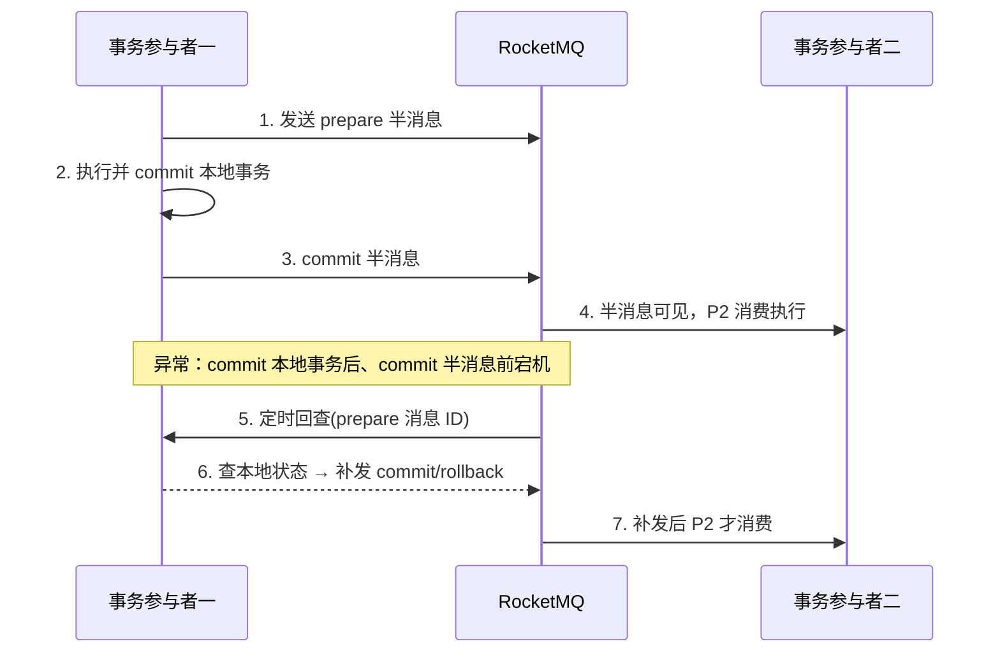
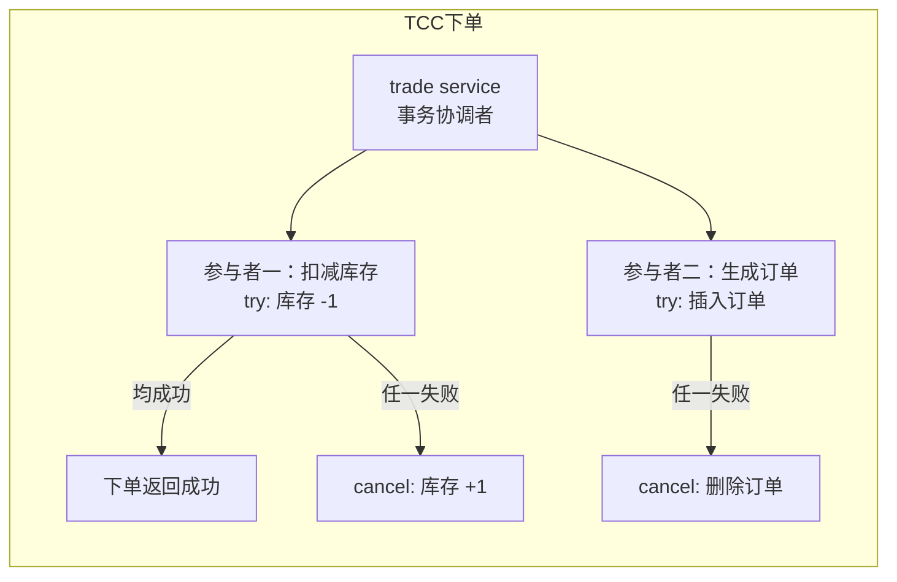

# 六大数据库存储实战: 事务型消息与 TCC 在下单流程中的落地取舍

## 纲要

- 事务型消息：修补「最大努力提交」的短板
## 📎 文本↔代码关联

本讲对应课件源码（去品牌化副本，位于 `code/socialecom/`；包名已由原占位包名统一改写为 `com.social.ecom`）：

| 代码文件 | 正文提及 | 职责 |
| --- | --- | --- |
| `code/socialecom/第四章代码/socialecom/src/main/java/com/social/ecom/pojo/Trade.java` | 2 次 | 实体类，主键 `IdType.AUTO` 自增，含自动填充时间字段 |

## 事务型消息：最大努力提交的天然短板

「最大努力提交型」的思路是：尽最大努力把分布式事务的每一段都提交掉。但它有个绕不开的空洞——

设想事务参与者一先 `commit` 本地事务成功，紧接着要往 MQ 投递消息通知参与者二，结果**这个进程在发消息前挂了**。消息没发出去，参与者二永远没有机会 `commit` 自己的事务。这就是最大努力提交型兜不住的场景。

事务型消息（以 RocketMQ 为代表）正是为补这个洞而生。

## RocketMQ 半消息 + 回查机制

RocketMQ 提供的方案分三步：

1. **发半消息（prepare）**：事务参与者一在执行本地事务前，先向 RocketMQ 发一条 `prepare` 消息。此时这条消息对参与者二是**不可见**的。
2. **提交本地事务**：参与者一执行自己的本地事务并 `commit`。
3. **提交半消息**：本地事务 `commit` 成功后，再把这条 `prepare` 消息 `commit` 掉。只有 `prepare` 被 `commit`，参与者二才能真正消费到、去执行自己的事务。

两种异常分支：

- **分支一**：`prepare` 消息发出，但参与者一本地事务 `rollback` 了 → 参与者一直接往 MQ 发一条 `rollback` 消息，半消息被丢弃，参与者二永远消费不到。
- **分支二（核心）**：参与者一本地事务 `commit` 成功，但还没来得及 `commit` 半消息，整个进程挂了。RocketMQ 很有「灵性」——它会**定期扫描长时间处于「已 prepare 却没被 commit/rollback」状态的消息**，主动向参与者一发起**回查（反查）**，带上 `prepare` 消息的 ID。由于参与者一在发 `prepare` 时已建立「本地事务 ↔ prepare 消息」的关联，回查时就能检查自己当时到底是 `commit` 还是 `rollback`：已 `rollback` 就补发 `rollback` 消息，已 `commit` 就补发 `commit` 消息。



## 事务型消息与 TCC 的共性

把事务型消息和前面讲过的 TCC 放在一起看，会发现二者神似：

- TCC 的第一阶段 `try`，与事务型消息的第一阶段 `prepare`，本质都是「先占住资源 / 先留个钩子，但对外不可见」。
- 区别只在于：事务型消息是**借助 RocketMQ 异步去检查数据源的真实状态**（回查），从而把参与者一和参与者二解耦，并且**摆脱了一个中心化的事务协调者**——MQ 自己就承担了状态兜底。

至此四种常用的分布式事务方案就讲完了。一句话归总：**只有二阶段提交（XA）满足强一致但牺牲可用；其余三种（TCC、最大努力提交、事务型消息）都遵从 BASE，保最终一致、保基本可用。**

## 回到下单流程：为什么选 TCC

把理论拉回「下单」这个具体场景。下单流程要求：扣减库存（参与者一）与生成订单（参与者二）要么同时成功、要么同时失败。

**为什么不能选强一致（XA）？** 若要保证强一致，扣库存和生成订单就必须走 XA 二阶段提交，库存行纪录会被完全上锁。这就意味着其他任何想操作「同一 SKU + 同一门店」库存行的事务都被阻塞——互联网高并发下这是不可接受的。

**为什么不能选最大努力提交 / 事务型消息？** 这两个方案里，参与者二（库存扣减）一旦成功提交就「落袋」，没有对应的回滚手段去撤销参与者一（订单）。如果订单侧失败，已扣的库存收不回来，数据永远对不上。

**所以下单场景最适合 TCC**——它用应用层的二阶段把两个参与者都变成「可预留、可取消」。



落地要点：

- 把 `trade` 的 service（即 `/trade/create` 背后的 service）当作**事务协调者**。
- **参与者一 = 扣减库存**：`try` 阶段执行库存减一。
- **参与者二 = 订单**：`trade` service 的 `try` 阶段执行生成订单。
- 两者同时成功，才返回下单成功；任一失败，库存的 `cancel` = 库存加一，订单的 `cancel` = 删除订单。
- **`confirm` 阶段本场景无需实现**：等第一阶段 `try` 完成即可，二阶段 `confirm` 留空实现。

由此也可以反推：因为下单存在「扣库存」这种强资源竞争、且要求可回滚，最大努力提交与事务型消息都不适用，TCC 才是正解。

## TCC 下单的设计骨架

下面是根据讲稿逻辑整理的 TCC 接口骨架（仅表达分工，非完整实现）：

```java
public interface OrderTccAction {

    /** 一阶段：try 扣减库存 */
    boolean tryDeductStock(Long skuId, Long shopId, Integer count);

    /** 一阶段：try 生成订单 */
    Long tryCreateOrder(Trade trade);

    /** 二阶段：confirm 提交（本场景为空实现） */
    void confirm();

    /** 二阶段：cancel 回滚——库存加回、订单删除 */
    void cancelStock(Long skuId, Long shopId, Integer count);
    void cancelOrder(Long orderId);
}
```

`trade` service 作为协调者，依次调用两个 `try`，全部成功则进入 `confirm`（空），任一失败则依次调用对应 `cancel`。

## 技术点总结

- 事务型消息用「半消息 + 回查」解决了最大努力提交型「本地事务成、消息没发出」的丢失问题。
- RocketMQ 的 `prepare` 消息对消费者不可见，直到被 `commit`；参与者一宕机时由 MQ 定时回查补发状态。
- 事务型消息与 TCC 都靠「第一阶段预留、对外不可见」解耦参与者，区别在前者借 MQ 异步回查、无中心协调者。
- 四种方案里只有 XA 强一致；TCC、最大努力提交、事务型消息都走 BASE。
- 下单流程因存在强资源竞争且要求可回滚，既不能选 XA（锁行阻塞），也不能选最大努力/消息型（无法回滚），**TCC 是正解**。

相关度：92%。是否需要继续：[是]。代码是否可运行：[否]。
