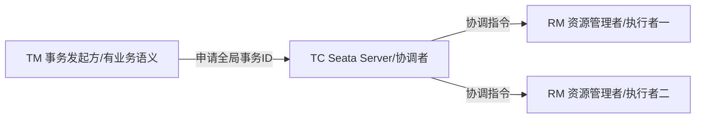
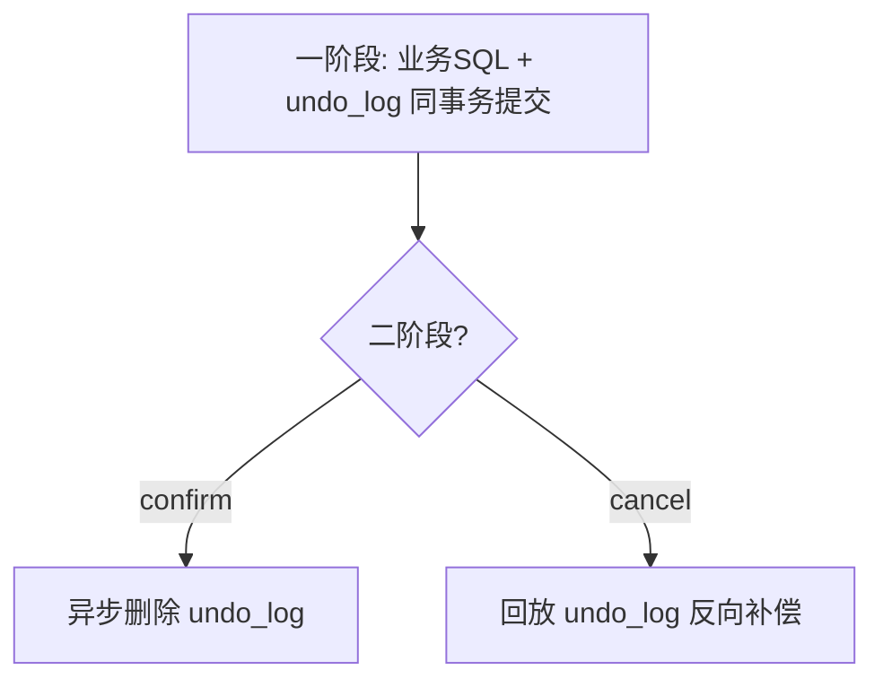

# 六大数据库存储实战: Seata 的四种事务模式与 TC/TM/RM 角色

## 纲要

- Seata 是阿里开源的分布式事务解决方案，提供 XA / AT / TCC / Saga 四套模式
- 三个核心角色
## 📎 代码说明

本讲为**原理 / 架构**篇，正文以推演与图示为主，无配套代码片段；本章课件源码中亦无对应类文件。

## Seata 解决什么问题

下单流程里，扣库存与生成订单虽然在我们的项目里同属一个服务，但订单库（tradeDB）与库存库（stockDB）是两个库，在数据库维度上就是分布式的。Seata 正是为这种场景设计的，它致力于在微服务架构下让分布式事务"开箱即用"。即便项目不是微服务，只要跨库，就能用 Seata 的 AT 模式把"库存扣减"和"订单落库"绑成同时成功、同时失败。

Seata 提供了四套模式：XA、AT、TCC、Saga。它们和前文讲的四种分布式事务实现方案并非一一对等，需要分别理解。

## 三个核心角色：TC / TM / RM

使用 Seata 前，先认清三个角色：

- **TC（Transaction Coordinator）**：事务协调者。在 Seata 架构里就是 Seata Server，负责全局事务的整体协调与控制，本身没有业务语义。
- **TM（Transaction Manager）**：事务管理者。真正发起分布式事务的微服务根节点，带有业务语义。每次发起分布式事务，都要向 TC 申请全局事务 ID，并由 TM 与 TC 协同做事务的发起与回滚。
- **RM（Resource Manager）**：资源管理器。真正去执行事务的一方，相当于前面讲的事务执行者。

不用 Seata 时，TM 和 TC 往往合并在同一个服务里；引入 Seata 后，TC 与 TM 可以拆开——TC 由 Seata Server 承担（只管事务管控），TM 负责下发业务流程。这样业务逻辑与事务管控彻底解耦。

## XA 模式：封装二阶段提交

XA 模式就是前文讲的二阶段提交：一阶段 prepare、二阶段 commit/rollback。Seata 只是把这套协议的外围调用封装掉，本质上和自己手写二阶段协议没有区别，仍然要依赖数据库的 XA 能力。

## AT 模式：无侵入的自动补偿

AT 是 Seata 首创、最常用的模式，称为"无侵入式自动补偿事务"。它对二阶段提交做了关键演进：

- **一阶段**：把业务 SQL 和对应的回滚日志（`undo_log`）作为**同一个本地事务**一起提交，然后释放本地锁与连接资源。也就是说，你只需写一阶段的业务 SQL（例如库存减一），Seata Server 会自动生成这条 SQL 的逆向语句（库存加一），连同业务 SQL 一起写进 `undo_log` 并提交。
- **二阶段 confirm**：如果全局事务要提交，只需异步删掉 `undo_log`，非常快。
- **二阶段 cancel**：如果全局事务要回滚，就回放 `undo_log`，对一阶段数据做反向补偿。你**不需要自己实现 cancel 方法**。

回到下单场景：用 AT 模式，只需让 Seata 把流程跑一遍，出错时它会自动把库存回滚。这正是 AT 省事的地方。

### AT 的隔离特性

- **写隔离**：一阶段本地事务提交前，必须先拿到全局锁。例如扣库存时仍要 `select for update` 锁住那行库存记录；拿不到全局锁就阻塞，超时则放弃。因此一阶段操作能做到写隔离。
- **读隔离**：AT 模式下一阶段数据已经提交，如果二阶段发生 cancel 回放 `undo_log`，读方可能读到一阶段已提交的数据，即存在脏读可能。Seata 的 AT 模式默认在应用层面对的是"读未提交"的尴尬——一阶段产生的数据对外可见，cancel 时再反向抹掉。

对比 TCC：TCC 之所以没有中间脏读态，是因为它引入了"冻结态"。AT 也可以改造成冻结态来彻底规避，但需要应用层做大量异常回避。正因如此，**AT 最常用，却会在全局维度产生中间脏数据态**；而 TCC 因为有冻结态可供选择，一致性更可控。

## TCC 模式：应用实现三套方法

TCC 模式是侵入式的自动补偿。应用层要实现 `try`/`confirm`/`cancel` 三个方法，Seata 负责串联。以库存为例，RM 要同时提供"减一"和"加一"两个操作，订单侧要提供 "insert" 和 "delete"。其中 `confirm` 有时可以空实现。TCC 相对麻烦，但一致性最可控。

## Saga 模式：长事务的编排

当事务链路很长（t1 → t2 → t3 → t4 串行，且中间过程可能持续很久），一旦某环节出问题需要把所有正向操作反向回滚，就用 Saga。它提供"一阶段正向服务 + 二阶段补偿服务"：正向服务由业务提供，补偿服务也由业务提供，Seata 的 Saga 流程负责调度串行执行与逆向回滚。

## 四模式对比与选型

| 模式 | 本质 | 侵入性 | 应用层工作量 | 一致性 |
| --- | --- | --- | --- | --- |
| XA | 封装数据库二阶段提交 | 低 | 低 | 强一致（CP） |
| AT | 无侵入的 TCC 式自动补偿 | 无侵入 | 只写业务 SQL | 最终一致，有全局脏数据态 |
| TCC | 应用层 try/confirm/cancel | 侵入 | 实现三套方法 | 最终一致，有中间冻结态 |
| Saga | 正向 + 补偿服务编排 | 侵入 | 提供正反向两套方法 | 最终一致，适合长事务 |

实际选型：图方便用 AT——它用 `undo_log` 规避了应用层额外处理；但 AT 有全局脏数据问题，不像 TCC 有中间状态可供选择。若对一致性和外部用户约束要求极高，仍要用侵入式 TCC。像交易下单这种"库存扣减与订单落库同时成功、同时失败"的场景，用 AT 模式完全足够。

## 技术点总结

- Seata 四模式：XA、AT、TCC、Saga，并非与前文四种方案一一对等。
- TC 是 Seata Server（协调者，无业务语义），TM 是事务发起方（有业务语义），RM 是执行者。
- AT 把业务 SQL 与 undo_log 同事务提交，二阶段 confirm 删日志、cancel 回放日志，无需手写 cancel。
- AT 写隔离靠全局锁，读隔离存在脏读可能；TCC 用冻结态规避，是二者一致性差异的根源。
- 省事选 AT，强一致与外部约束高选 TCC；交易下单用 AT 足够。

相关度：93%。是否需要继续：[是]。代码是否可运行：[否]。
