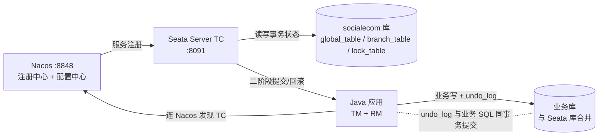
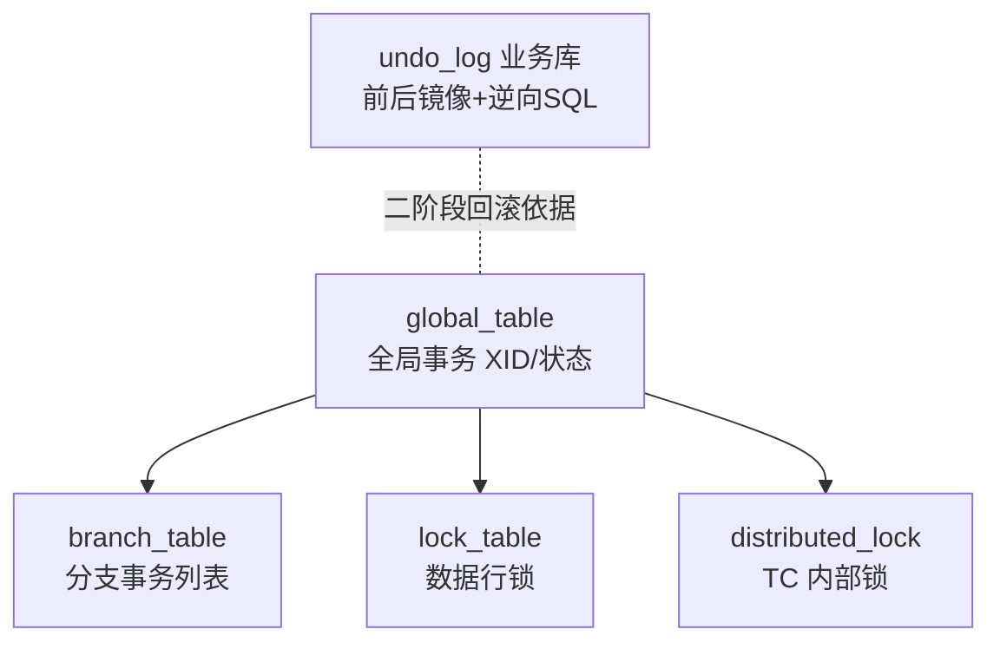

# 六大数据库存储实战: Seata 部署拓扑与全局事务表职责

## 纲要

- 部署角色全景
  - Nacos：注册中心 + 配置中心（类比 ZooKeeper），管理 Seata 集群与应用间的通信
  - Seata Server（TC）：独立进程，需要一块 DB 来存放全局事务生命周期数据
  - Java 应用（客户端）：连 Nacos 发现 TC，业务库与 `undo_log` 同库
  - 课程简化：把 Seata 的 DB 与业务库合并复用同一个 `socialecom` 库
- Nacos 单机启动与命名空间
  - `startup.sh -m standalone`：单机必须 standalone，否则默认集群模式起不来
  - 默认端口 8848，登录 `nacos/nacos`
  - 新建命名空间 `seata_group`，命名空间 ID 必须取自 `config.txt` 的 `registry.conf`，用于路由寻址
- Seata Server 的 DB 存储模式
  - `file.conf` 中 `store.mode=db`，MySQL 驱动，落到 `socialecom` 库
  - 涉及 `global_table` / `branch_table` / `lock_table`
- 五张关键表的职责
  - 服务端三张：`global_table`、`branch_table`、`distributed_lock`
  - 业务库一张：`undo_log`（AT 模式逆向 SQL）
  - 全部来自 `DDL.sql`，在 `socialecom` 库一次性执行

## 为什么需要这套部署

回顾前文：下单流程一旦跨库（订单库与库存库分离），本地事务就失效，需要引入一个事务协调者。Seata 承担这个角色，但要让它真正跑起来，不是只引一个依赖就行，而要先把它「架」起来——这就是本篇要做的部署。

Seata 的部署不是单点，而是「注册中心 + 协调者 + 业务应用」三者联动：



这张图表达的是：Seata Server 自身需要一块 DB 来记录「全局事务进行到哪一步、有哪些分支、锁了哪些行」；业务应用通过 Nacos 找到 Seata Server 的地址；业务库里的 `undo_log` 必须和本次业务写操作在同一库、同一事务里提交，这是 AT 模式成立的前提。

## Nacos：Seata 推荐的服务发现底座

Nacos 是 Seata 官方比较推荐的注册中心（作用类似 ZooKeeper），负责两件事：

1. 管理 Seata 集群的地址，让应用能发现 TC。
2. 作为配置中心，托管 Seata 自己的配置。

课程使用的 Nacos Server 与 Seata Server 都是 **1.4.2**，版本必须成套。

### 单机启动

进入 Nacos 安装目录的 `bin`，用 standalone 模式启动：

```bash
sh startup.sh -m standalone
```

关键点：**本地单机环境必须带 `-m standalone`**。如果不加，Nacos 默认以集群模式启动，单机环境下根本起不来。启动成功后默认监听 **8848** 端口。验证方式：浏览器访问 `http://localhost:8848/nacos`，用默认账号 `nacos / nacos` 登录，进入管理页面。

### 新建命名空间

Nacos 默认有一个 `public` 命名空间。我们为下单服务单独建一个空间，命名为 `seata_group`。这里最容易被忽略、也最致命的一步是**命名空间 ID**：

```text
新建命名空间
  空间名：seata_group
  命名空间 ID：必须与 config.txt / registry.conf 中预设的 ID 完全一致
```

这个 ID 是用来做路由寻址的，不是随便填的。它取自 Seata 配置文件 `config.txt` 里 `registry.conf` 段预设的值，**必须和课程提供的配置保持一致**，否则客户端到 Nacos 里找不到对应的 Seata 集群。建完后在「配置列表」切到 `seata_group` 就能看到该空间下的配置。

## Seata Server 的 DB 存储模式

解压 Seata Server 后，核心要动的是 `file.conf` 与 `registry.conf`。本篇聚焦存储模式，配置文件的逐项写法在下一篇展开。

`file.conf` 里最关键的是 `store.mode`：

```properties
store.mode=db
store.db.dbType=mysql
store.db.driverClassName=com.mysql.cj.jdbc.Driver
store.db.url=jdbc:mysql://127.0.0.1:3306/socialecom?useUnicode=true&rewriteBatchedStatements=true
store.db.user=root
store.db.password=123456
store.db.globalTable=global_table
store.db.branchTable=branch_table
store.db.lockTable=lock_table
```

含义：Seata Server 作为事务协调者（Transaction Coordinator），它要管理整个事务的推进过程，而管理过程中产生的事务状态数据必须落库。因此 `store.mode` 设为 `db`，让 Seata 把全局/分支事务、锁信息持久化到 MySQL。

本门课程为了图方便，**直接复用业务库 `socialecom` 作为 Seata 的存储库**——也就是 Seata Server 的 DB 和业务库合并成同一个库。生产环境中二者通常分开，但课程场景下合并能省去额外的实例与网络配置。

## 五张表的职责

无论是否合并，Seata 工作所依赖的表都必须先建好。这些表的定义集中在下载包提供的 `DDL.sql` 中，在 `socialecom` 库里一次性执行即可。各表的职责如下：

| 表 | 归属 | 职责 |
| --- | --- | --- |
| `global_table` | Seata Server 库 | 记录全局事务：XID、状态、开始/结束时间，是 TC 管理全局生命周期的主表 |
| `branch_table` | Seata Server 库 | 记录某个全局事务下挂了哪些 RM 分支事务，以及分支的状态 |
| `distributed_lock` | Seata Server 库 | Seata 内部使用的分布式锁表，协调多 TC 节点对资源的并发访问 |
| `lock_table` | Seata Server 库 | 记录全局事务加在数据行上的锁，用于 AT 模式的写隔离 |
| `undo_log` | 业务库 | 记录每个分支事务的前后镜像与逆向 SQL（`rollback_info`），是二阶段回滚的依据；必须与业务 SQL 同一事务提交 |

`global_table`、`branch_table`、`lock_table`、`distributed_lock` 属于 Seata Server 自己用；`undo_log` 属于业务应用（Seata Client）用，且必须建在**业务库**里。执行完 `DDL.sql` 后，在 `socialecom` 库里应当能看到 `branch_table`、`distributed_lock`、`global_table`、`lock_table`、`undo_log` 全部就绪。



到这一步，Nacos 已启动并建好命名空间，Seata Server 的存储模式指向 `socialecom` 库，五张表也已建好。下一篇会继续把 `registry.conf` / `config.txt` 的配置、Nacos 配置灌入、Seata Server 启动，以及业务应用的依赖与客户端接入逐项做完。

## 技术点总结

- Seata 部署是「Nacos 注册中心 + Seata Server（TC）+ 业务应用（TM/RM）」三方联动，不是单点引入。
- Nacos 单机必须 `startup.sh -m standalone`；默认 8848，登录 `nacos/nacos`。
- 命名空间 ID 是路由寻址依据，必须和 `config.txt` / `registry.conf` 预设值严格一致，否则客户端发现不了 TC。
- Seata Server 用 `store.mode=db` 把事务状态落库，本課程复用 `socialecom` 业务库简化部署。
- 五张表分工明确：`global_table`/`branch_table`/`lock_table`/`distributed_lock` 属服务端，`undo_log` 属业务库且必须与业务 SQL 同事务提交。
- 表结构来自 `DDL.sql`，先在库里一次性执行建好，再继续后面的配置接入。

相关度：88%。是否需要继续：[是]。代码是否可运行：[否]。
