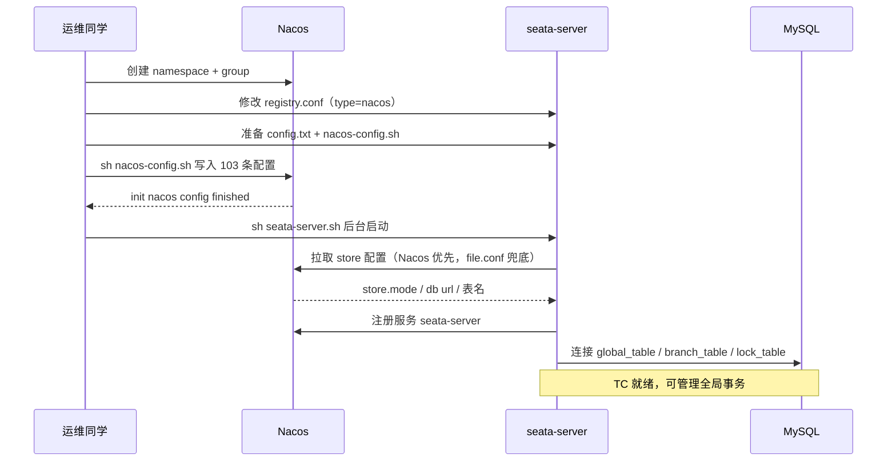

# 六大数据库存储实战: 使用 Seata 改造下单流程的服务端部署与配置接入

## 纲要

- Seata 三大角色与本次改造的目标形态
  - TC（seata-server）注册到 Nacos，配置由 Nacos 托管
  - 业务库与 Seata 依赖库共享同一个 MySQL 实例做全局事务管理
- seata-server 部署
  - `registry.conf`：注册中心指向 Nacos
  - `config.txt` + `nacos-config.sh`：把 store 配置灌入 Nacos
  - 后台启动 seata-server，监听 8091
- 客户端（RM/TM）接入
  - pom 依赖：druid、actuator、`seata-spring-boot-starter`、`nacos-client`、`spring-cloud-alibaba-seata`
  - `application.properties`：service / registry 两段配置
  - 一行代码改造：`@Transactional` → `@GlobalTransactional`

## 改造前的架构视角

本地事务版本的下单流程成立的前提是订单表与库存表在同一个 MySQL 实例上。一旦/post 拆分，一张本地事务表就覆盖不了两个库，需要引入分布式事务协调者。

Seata 的角色划分：

| 角色 | 全称 | 承担者 | 职责 |
| --- | --- | --- | --- |
| TC | Transaction Coordinator | seata-server（独立进程） | 维护全局事务与分支事务状态，驱动全局提交或回滚 |
| TM | Transaction Manager | 业务服务的 `@GlobalTransactional` 方法 | 开启、提交、回滚全局事务 |
| RM | Resource Manager | 业务服务的数据源代理 | 注册分支事务、上报分支状态、执行二阶段指令 |

```mermaid
flowchart LR
    TM[TradeService<br/>@GlobalTransactional] -->|注册全局事务| TC[seata-server TC<br/>:8091]
    TM -->|发现/订阅服务| N[Nacos :8848<br/>注册中心 + 配置中心]
    TC -->|注册服务| N
    TC -->|读取 store 配置| N
    TC -->|读写 global_table / branch_table / lock_table| DB[(MySQL<br/>Seata 库)]
    RM1[StockService RM] -->|注册分支 + undo_log| DB1[(业务/库存库)]
    RM2[TradeMapper RM] -->|注册分支 + undo_log| DB2[(订单库)]
    TM --> RM1
    TM --> RM2
    TC -->|二阶段提交/回滚| RM1
    TC -->|二阶段提交/回滚| RM2
```

本次的目标是让 seata-server 完成两件事：注册到 Nacos，以及连接到「业务库 + Seata 全局事务表」所在的 MySQL，从而具备管理全局事务的能力。

## 让 seata-server 注册到 Nacos

seata-server 启动时首先要向 Nacos 做服务注册，这一步由 `conf/registry.conf` 决定：

```conf
registry {
  # file 、nacos 、eureka、redis、zk、consul、etcd3、sofa
  type = "nacos"

  nacos {
    application = "seata-server"
    serverAddr = "127.0.0.1:8848"
    group = "SEATA_GROUP"
    namespace = "<在 Nacos 中创建的命名空间 ID>"
    username = "nacos"
    password = "nacos"
  }
}
```

关键点：

- `type = "nacos"`：整条链路统一用 Nacos 作注册中心，`file` 等其他分支保持默认即可。
- `application`：注册到 Nacos 的服务名，客户端侧 `seata.registry.nacos.application` 必须与之完全一致，否则 RM 找不到 TC。
- `group` 与 `namespace`：对应此前在 Nacos 上创建的分组与命名空间。命名空间填的是**命名空间 ID**，不是名称，这是最容易填错的一处。

`registry.conf` 里还有一段 `config` 配置，同样指向 Nacos，含义是：seata-server 启动时优先到 Nacos 读取自己需要的配置（store 模式、数据库连接、全局表名等），读不到才回退到本地的 `file.conf`。

## 把 store 配置灌进 Nacos

需要放到 seata 安装根目录的两个文件：

```dir
seata
├── bin
│   └── seata-server.sh
├── conf
│   ├── registry.conf
│   ├── file.conf
│   └── nacos-config.sh
└── config.txt
```

`config.txt` 里放着 seata-server 需要的所有配置项，其中最关键的是存储相关的一组：

```properties
store.mode=db
store.db.datasource=druid
store.db.dbType=mysql
store.db.driverClassName=com.mysql.cj.jdbc.Driver
store.db.url=jdbc:mysql://127.0.0.1:3306/seata?useUnicode=true&rewriteBatchedStatements=true
store.db.user=root
store.db.password=123456
store.db.globalTable=global_table
store.db.branchTable=branch_table
store.db.distributedLockTable=distributed_lock
store.db.queryLimit=100
```

也就是要把「存储模式」「全局事务表、分支事务表、分布式锁表的表名」「数据库连接地址」全部写进 Nacos，这样 seata-server 启动时能从配置中心读到完整的存储信息。

写入动作通过 `nacos-config.sh` 脚本完成，该脚本需要放在 `conf` 目录下执行：

```bash
sh nacos-config.sh \
  -h localhost \
  -p 8848 \
  -g SEATA_GROUP \
  -t <namespaceId> \
  -u nacos \
  -w nacos
```

参数对应关系：`-h/-p` 为 Nacos 地址，`-g` 为配置分组，`-t` 为命名空间 ID，`-u/-w` 为用户名密码。执行完成后会输出：

```text
total count:103 written
init nacos config finished, please start seata-server
```

到 Nacos 控制台的「配置列表」刷新，可以看到 `config.txt` 的 103 条配置已经全部落在对应的命名空间与分组下。这一步务必验证——配置没写进去，后面 seata-server 起不来或降级读本地 `file.conf`，排查成本很高。

## 启动 seata-server

```bash
cd bin
sh seata-server.sh -h 127.0.0.1 -p 8091 >/dev/null 2>&1 &
```

启动成功后 seata-server 监听 8091 端口，Nacos 的「服务列表」中能看到 `seata-server` 这个服务已经注册进来。至此服务端部署完成：



## 客户端依赖接入

业务服务要扮演 TM + RM，先把依赖补齐。版本必须成套对齐，混用版本在 Seata 上极易出现包冲突导致各种诡异问题。

```xml
<dependency>
    <groupId>com.alibaba</groupId>
    <artifactId>druid</artifactId>
    <version>1.2.2</version>
</dependency>
<dependency>
    <groupId>org.springframework.boot</groupId>
    <artifactId>spring-boot-starter-actuator</artifactId>
</dependency>
<dependency>
    <groupId>io.seata</groupId>
    <artifactId>seata-spring-boot-starter</artifactId>
    <version>1.4.2</version>
</dependency>
<dependency>
    <groupId>com.alibaba.nacos</groupId>
    <artifactId>nacos-client</artifactId>
    <version>1.4.2</version>
</dependency>
<dependency>
    <groupId>com.alibaba.cloud</groupId>
    <artifactId>spring-cloud-alibaba-seata</artifactId>
    <version>2.2.0.RELEASE</version>
    <type>pom</type>
    <scope>import</scope>
</dependency>
```

各依赖的作用：

| 依赖 | 作用 |
| --- | --- |
| `druid` | 数据源，Seata 的数据源代理需要包裹真实数据源 |
| `spring-boot-starter-actuator` | 服务注册与发现的基础设施 |
| `seata-spring-boot-starter` | Seata 客户端 starter，提供 `@GlobalTransactional` 与自动装配 |
| `nacos-client` | 让 RM 能通过 Nacos 发现 TC 服务地址 |
| `spring-cloud-alibaba-seata` | Spring Cloud Alibaba 的 Seata BOM，统一版本号（注意是 `pom` 类型 + `import` scope） |

## 客户端配置注入

依赖引完还不够，配置不注入的话 `@GlobalTransactional` 不会生效，启动时直接报错。第一行是最关键的开关：

```properties
# ===== Seata 基础开关 =====
seata.enabled=true
seata.application-id=springboot-seata
seata.enable-auto-data-source-proxy=true
seata.tx-service-group=default_tx_group

# ===== 注册中心（RM 通过它发现 TC） =====
seata.registry.type=nacos
seata.registry.nacos.application=seata-server
seata.registry.nacos.server-addr=127.0.0.1:8848
seata.registry.nacos.namespace=<namespaceId>
seata.registry.nacos.group=SEATA_GROUP
seata.registry.nacos.username=nacos
seata.registry.nacos.password=nacos
```

几个容易踩的点：

- `seata.enabled=true` 是总开关，不打开一切都不生效。
- `seata.application-id` 用于服务订阅时的唯一标识，取值随意但必须唯一。
- `seata.enable-auto-data-source-proxy=true`：打开数据源自动代理。AT 模式的分支事务、undo_log 生成都依赖代理后的数据源，这一项不开等于白接。
- `seata.tx-service-group=default_tx_group`：**必须和服务端 `file.conf` / Nacos 中的 `service.vgroup-mapping` 配置保持一致**，否则 RM 找不到对应的 TC 集群。

配置量确实不少——Seata 的使用看起来简单，实际接入过程的复杂度主要都在这堆 Nacos 注册与配置参数上。

## 一行代码改造

所有前置工作做完之后，真正的代码改造只有一处：把本地事务注解换成全局事务注解。

```java
@Override
//@Transactional(rollbackFor = Exception.class)
@GlobalTransactional(rollbackFor = Exception.class)
public Trade createTrade(Trade trade) {
    Sku sku = skuService.getById(trade.getSkuId());
    if (sku == null) {
        return null;
    }
    if (sku.getPrice().compareTo(trade.getSinglePrice()) != 0) {
        return null;
    }
    boolean stockDecreaseSuccess =
            stockService.decreaseStock(trade.getSkuId(), trade.getShopId(), trade.getStockCount());
    if (!stockDecreaseSuccess) {
        throw new RuntimeException("扣减库存失败");
    }
    trade.setStatus(1);
    save(trade);
    return trade;
}
```

虽然当前 `stock` 与 `trade` 仍在同一份物理库上，但改成 `@GlobalTransactional` 之后，Seata 会按分布式事务的语义把它们拆成两个分支事务来管理：一阶段各自本地提交并写 undo_log，二阶段由 TC 决定是异步删除日志还是用日志回滚。

## API 速览

| 配置项 / API | 取值示例 | 说明 |
| --- | --- | --- |
| `registry.type` | `nacos` | seata-server 注册中心类型 |
| `registry.nacos.application` | `seata-server` | 客户端按此服务名发现 TC |
| `config.txt` store 段 | `store.mode=db` 等 | 灌入 Nacos 的存储配置，优先级高于本地 `file.conf` |
| `nacos-config.sh` | `-h -p -g -t -u -w` | 把 `config.txt` 批量写入 Nacos 配置中心 |
| `seata-server.sh` | 后台启动 `:8091` | TC 进程入口 |
| `seata.enabled` | `true` | 客户端 Seata 总开关 |
| `seata.enable-auto-data-source-proxy` | `true` | 开启数据源自动代理，AT 模式必需 |
| `seata.tx-service-group` | `default_tx_group` | 事务分组，需与服务端 vgroup-mapping 对应 |
| `@GlobalTransactional` | `rollbackFor = Exception.class` | 全局事务边界，替代 `@Transactional` |

## Demo 示例

**运行说明**

1. 启动 Nacos，创建命名空间并在其下准备 `SEATA_GROUP` 分组，记录命名空间 ID。
2. 在 Seata 库里建三张表：`global_table`、`branch_table`、`distributed_lock`（表名要与 `config.txt` 中的 `store.db.*Table` 一致），并在每个业务库中建 `undo_log` 表。
3. 按上文修改 `registry.conf` 与 `config.txt`，执行 `nacos-config.sh` 完成 103 条配置导入。
4. `sh bin/seata-server.sh` 后台启动，在 Nacos 服务列表确认 `seata-server` 已注册。
5. 业务工程引入五依赖、补齐 `application.properties`，把 `@Transactional` 换成 `@GlobalTransactional`。

**代码说明**

- `pom.xml` 中五依赖版本必须成套（本文为 seata 1.4.2 / nacos-client 1.4.2 / spring-cloud-alibaba-seata 2.2.0.RELEASE）。
- `application.properties` 的 `tx-service-group` 与服务端 `vgroup-mapping` 是配对关系，改一处必须同步另一处。
- `TradeServiceImpl#createTrade` 是改动点：仅替换注解，业务流程无需调整。

**技术点总结**

- 服务端配置的读取顺序是：Nacos 优先，本地 `file.conf` 兜底，因此必须先用脚本把配置灌进 Nacos 并到控制台确认。
- `registry.conf` 里的 `namespace` 填 ID 不填名称；`application` 要与客户端的 `seata.registry.nacos.application` 严格一致。
- `seata.enable-auto-data-source-proxy` 决定 AT 模式能否生效，务必打开。
- 依赖版本要成套对齐，混版本在 Seata 上会表现为各种难以定位的启动或运行时异常。
- 改造点的代码量极小，代价主要在部署与配置，接入前应先把 Nacos、Seata 表结构、配置导入这条链路跑通。

相关度：92%。是否需要继续：[是]。代码是否可运行：[是]。
