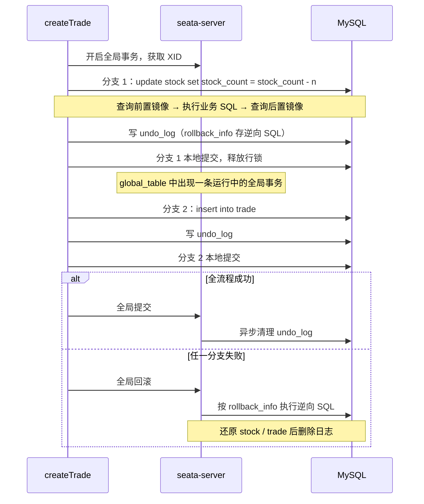

# 六大数据库存储实战: Seata AT 模式下的下单流程验证与 undo_log 观测

## 纲要

- 客户端配置收尾
  - `seata.config.*`：配置中心地址、命名空间、分组
  - `seata.service.*`：事务分组映射与全局事务开关
  - `client.rm.report-success-enable`：阶段一上报开关
- 兼容性改造
  - Seata 1.4.2 对 `DATETIME` 解析的缺陷
  - 把业务表的时间字段统一改成 `TIMESTAMP`
- AT 模式运行观测
  - 一阶段本地提交立即生效，不等全局事务结束
  - `global_table` 中的运行中全局事务
  - `undo_log` 中的逆向 SQL（`rollback_info`）
- 完整验证
  - 断点中断导致 RM 与 TC 失联，触发一阶段回滚
  - 无断点正常下单，订单入库、库存扣减、undo_log 被清理

## 补齐客户端剩余配置

上一步做完依赖引入和 registry 段配置后，还差两段。第一段是配置中心（`seata.config.*`）：

```properties
# ===== 配置中心 =====
seata.config.type=nacos
seata.config.nacos.server-addr=127.0.0.1:8848
seata.config.nacos.namespace=<namespaceId>
seata.config.nacos.group=SEATA_GROUP
seata.config.nacos.username=nacos
seata.config.nacos.password=nacos
```

第二段是 service 段，它决定了 RM 与 TC 之间的对应关系：

```properties
# ===== service 映射 =====
seata.service.vgroup-mapping.default_tx_group=default
seata.service.disable-global-transaction=false
seata.client.rm.report-success-enable=false
```

三项的含义：

| 配置项 | 作用 |
| --- | --- |
| `seata.service.vgroup-mapping.default_tx_group=default` | 把客户端的 `default_tx_group` 事务分组映射到 TC 集群名 `default`。键名后缀要与 `seata.tx-service-group` 完全一致 |
| `seata.service.disable-global-transaction=false` | 不禁用全局事务，即 `@GlobalTransactional` 生效 |
| `seata.client.rm.report-success-enable=false` | 关闭一阶段成功上报。TC 不再依赖 RM 主动上报成功结果，减少一次交互 |

把 registry、config、service 三段拼起来，完整的客户端配置如下：

```properties
# ===== Seata 基础开关 =====
seata.enabled=true
seata.application-id=springboot-seata
seata.enable-auto-data-source-proxy=true
seata.tx-service-group=default_tx_group

# ===== 注册中心 =====
seata.registry.type=nacos
seata.registry.nacos.application=seata-server
seata.registry.nacos.server-addr=127.0.0.1:8848
seata.registry.nacos.namespace=<namespaceId>
seata.registry.nacos.group=SEATA_GROUP
seata.registry.nacos.username=nacos
seata.registry.nacos.password=nacos

# ===== 配置中心 =====
seata.config.type=nacos
seata.config.nacos.server-addr=127.0.0.1:8848
seata.config.nacos.namespace=<namespaceId>
seata.config.nacos.group=SEATA_GROUP
seata.config.nacos.username=nacos
seata.config.nacos.password=nacos

# ===== service 映射 =====
seata.service.vgroup-mapping.default_tx_group=default
seata.service.disable-global-transaction=false
seata.client.rm.report-success-enable=false
```

配置齐全后启动应用，控制台不再报 Seata 相关错误，说明 `@GlobalTransactional` 已经可以生效。

## 必须做的兼容性改造：DATETIME 改成 TIMESTAMP

在真正跑通之前，还需要改一次数据库表结构。Seata 1.4.2 对整个 `DATETIME` 类型字段的解析支持不好：一旦参与全局事务的表里存在 `DATETIME` 字段，生成 undo_log 时会直接报错。

因此凡是被 Seata 管理的表，时间字段统一改成 `TIMESTAMP`：

```sql
-- trade 表
ALTER TABLE `trade`
  MODIFY COLUMN `create_time` TIMESTAMP NULL DEFAULT NULL COMMENT '创建时间',
  MODIFY COLUMN `update_time` TIMESTAMP NULL DEFAULT NULL COMMENT '更新时间';

-- stock 表
ALTER TABLE `stock`
  MODIFY COLUMN `create_time` TIMESTAMP NULL DEFAULT NULL COMMENT '创建时间',
  MODIFY COLUMN `update_time` TIMESTAMP NULL DEFAULT NULL COMMENT '更新时间';
```

这是一个纯踩坑经验类的改动：它不是业务要求，而是特定版本的 Seata 在序列化前后镜像时的实现限制。如果不改，现象会是 RM 端在写 undo_log 时抛错，而不是一个直观的事务失败。

## AT 模式的两阶段到底做了什么

改造完成后，用 debug 模式启动并在 `createTrade` 的扣库存、写订单两处打上断点，逐帧观察数据库状态。

**第一步：`stockService.decreaseStock` 返回成功之后立刻查库。**

此时观察到：

- `stock` 表的库存**已经被扣掉了**（例如 100 → 99）。
- `trade` 表**没有新增记录**。

这一点与本地事务版本有本质区别。若打的是 `@Transactional`，整段流程还在同一本地事务里未提交，此时任何其他连接看到的库存都还是旧值，快照读仍然给出 100。而在 AT 模式下，分支事务在一阶段就已经**本地提交并释放了行锁**，别的连接立刻能看到 99。`@GlobalTransactional` 提供的一致性保障不靠「不提交」，而靠「提交时同步写一份逆向日志，必要时按日志回滚」。



**第二步：查 `global_table`。**

表中已经出现一条处于运行中的全局事务记录，携带本次全局事务的 XID。

**第三步：查 `undo_log`——这是最关键的一张表。**

`undo_log` 中多了一条记录，它是伴随着 `stock` 分支事务的提交一起产生的，在 `rollback_info` 字段里保存着**逆向操作**：把刚刚减掉的库存再加回去。`rollback_info` 是 blob 字段，直接看不出来内容，但它的存在已经说明一件事——一旦后续分支执行出错，之前已经提交的 `stock` 分支要靠这条 `rollback_info` 被回滚。

## 断点中断触发回滚

继续放行断点时，因为停留在断点上的时间过长，请求报错。此时再查数据：

```text
stock 库存回滚到原来的值（100）
trade 表没有新增记录
undo_log 记录被消费清理
```

原因是 seata-server 认定与 RM 之间的连接「断裂」：RM 长时间不响应分支事务的后续动作，TC 侧判定全局事务失败，于是按已有的 undo_log 把已经提交的 `stock` 分支回滚掉。这个意外恰好验证了一阶段 + 二阶段回滚机制是真实生效的。

## 无断点完整跑通

把所有断点去掉，重新发起下单请求（先把上一个用例中扣成 0 的库存补到 100）：

```json
{
  "skuId": 1,
  "shopId": 2,
  "stockCount": 1,
  "singlePrice": 8000,
  "totalPrice": 8000,
  "userId": 1
}
```

返回下单成功，检查数据库：

| 表 | 期望结果 | 实际结果 |
| --- | --- | --- |
| `trade` | 新增一条订单，`status = 1` | 一致 |
| `stock` | 对应库存行扣减 1 | 一致 |
| `undo_log` | 二阶段全局提交后记录被清理 | 已清空 |
| `global_table` | 全局事务结束 | 运行中的记录消失 |

一次完整的分布式事务就此跑通。回顾整个改造，业务代码的改动只有 `@Transactional` → `@GlobalTransactional` 这一行，前置的配置、依赖、版本兼容、表结构改造才是真正的成本。

## API 速览

| 配置项 / 对象 | 取值示例 | 说明 |
| --- | --- | --- |
| `seata.config.type` | `nacos` | 客户端配置中心类型 |
| `seata.service.vgroup-mapping.<group>` | `default` | 事务分组到 TC 集群的映射，group 后缀需匹配 `tx-service-group` |
| `seata.service.disable-global-transaction` | `false` | 是否禁用全局事务 |
| `seata.client.rm.report-success-enable` | `false` | 是否上报一阶段成功，关闭可减少一次 RM→TC 交互 |
| `global_table` | Seata 服务端表 | 记录运行中的全局事务与 XID |
| `branch_table` | Seata 服务端表 | 记录分支事务及其归属的全局事务 |
| `undo_log` | 业务库表 | 记录分支的前后镜像与 `rollback_info` 逆向 SQL |
| `@GlobalTransactional` | `rollbackFor = Exception.class` | 全局事务边界，内部每个 RM 分支默认走 AT 模式 |

## Demo 示例

**运行说明**

1. 确认 seata-server 已在 Nacos 注册、`config.txt` 的 103 条配置已在配置中心可见。
2. 业务库中建好 `undo_log` 表，Seata 库中建好 `global_table`、`branch_table`、`distributed_lock`。
3. 执行本文开头的两条 `ALTER`，把 `trade`、`stock` 的时间字段改为 `TIMESTAMP`。
4. 补齐 `application.properties` 的 registry / config / service 三段，启动应用并确认无 Seata 报错。
5. 用 debug 模式在 `createTrade` 打断点观察一阶段提实现象，再去掉断点跑一次完整请求。

**代码说明**

以下是一个最小化的 Spring Boot 集成骨架，用于对照各段配置的落位（**根据讲稿逻辑整理**，可直接作为接入模板使用）：

```java
@SpringBootApplication
public class SocialecomApplication {
    public static void main(String[] args) {
        SpringApplication.run(SocialecomApplication.class, args);
    }
}

@Service
public class TradeServiceImpl extends ServiceImpl<TradeMapper, Trade> implements TradeService {

    @Autowired
    private SkuService skuService;

    @Autowired
    private StockService stockService;

    /**
     * 分布式事务入口：一次下单要同时保证订单入库与库存扣减的一致性
     */
    @Override
    @GlobalTransactional(rollbackFor = Exception.class)
    public Trade createTrade(Trade trade) {
        Sku sku = skuService.getById(trade.getSkuId());
        if (sku == null) {
            return null;
        }
        if (sku.getPrice().compareTo(trade.getSinglePrice()) != 0) {
            return null;
        }
        boolean stockDecreaseSuccess =
                stockService.decreaseStock(trade.getSkuId(), trade.getShopId(), trade.getStockCount());
        if (!stockDecreaseSuccess) {
            // 抛异常触发全局回滚，已提交的 stock 分支由 undo_log 还原
            throw new RuntimeException("扣减库存失败");
        }
        trade.setStatus(1);
        save(trade);
        return trade;
    }
}
```

**技术点总结**

- `vgroup-mapping` 的键后缀必须与 `seata.tx-service-group` 一致，这是 RM 找到 TC 的关键映射。
- Seata 1.4.2 对 `DATETIME` 支持不佳，全局事务涉及的表应统一改用 `TIMESTAMP`，否则写 undo_log 会报错。
- AT 模式的一阶段是「本地提交 + 写 undo_log」，因此其他连接能马上看到未完成的中间状态，隔离性依赖 `select for update` 式的读隔离或业务侧规避。
- `undo_log.rollback_info` 是 blob 存储的逆向 SQL，是二阶段回滚的依据。
- RM 与 TC 断连会被判定为全局事务失败并触发回滚；调试时长时间停留断点会导致事务被打断，验证时要去掉断点重跑。
- 全局提交后 undo_log 会被异步清理，看到 undo_log 被清空说明二阶段已正常完成。

相关度：90%。是否需要继续：[是]。代码是否可运行：[是]。
