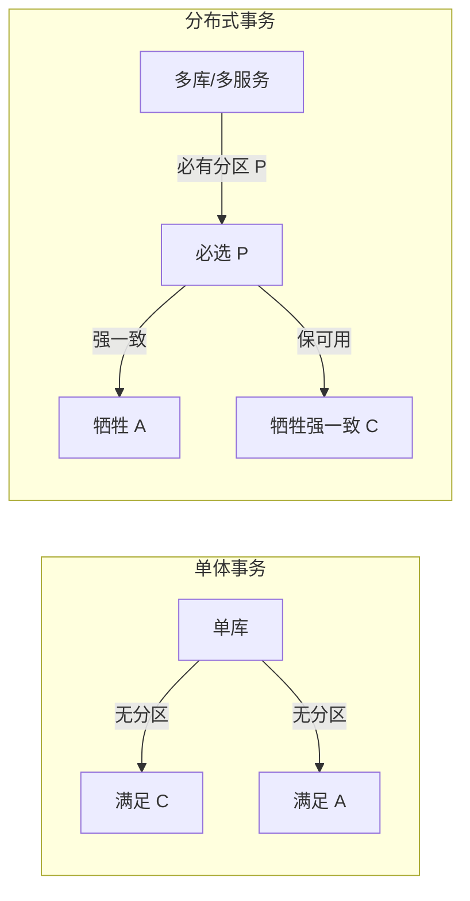
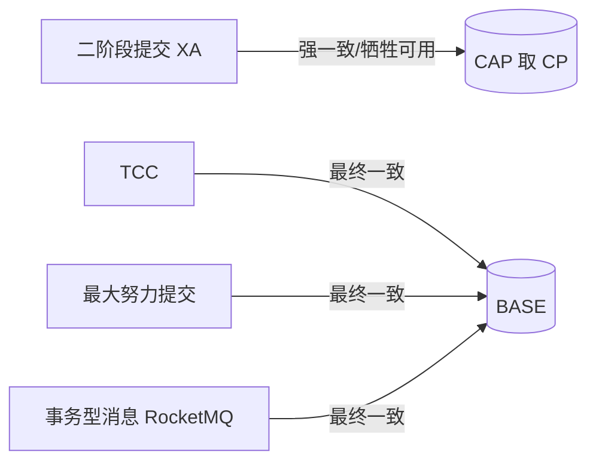

# 40. 六大数据库存储实战: 分布式事务的 CAP/BASE 理论与四种实现方案总览

## 纲要

- 为什么下单流程会碰到分布式事务
## 📎 文本↔代码关联

本讲对应课件源码（去品牌化副本，位于 `code/socialecom/`；包名已由原占位包名统一改写为 `com.social.ecom`）：

| 代码文件 | 正文提及 | 职责 |
| --- | --- | --- |
| `code/socialecom/第四章代码/socialecom/src/main/java/com/social/ecom/service/impl/TradeServiceImpl.java` | 2 次 | `Trade` 业务服务实现（继承 ServiceImpl） |
| `code/socialecom/第四章代码/socialecom/src/main/java/com/social/ecom/pojo/Trade.java` | 1 次 | 实体类，主键 `IdType.AUTO` 自增，含自动填充时间字段 |

## 问题的起点：本地事务何时不够用

在单体库版本的下单流程里，`TradeServiceImpl#createTrade` 上标注了 `@Transactional`，`save` 订单与 `stockService.decreaseStock` 扣库存发生在同一个 MySQL 实例的同一个事务里，靠数据库本身保证原子性。

一旦服务拆分——扣库存由另一个库存服务负责，订单与库存各自落到独立的数据库（tradeDB 与 stockDB）——单次本地事务就管不到两个库了。此时的诉求是：在一次下单接口里同时操作两个数据源，并且要保证两个库的写操作满足 ACID，要么同时成功、要么同时失败。这就是分布式事务要解决的问题。

## CAP 理论：一致性、可用性、分区容错性

CAP 由三个首字母组成：

- **C（Consistent）一致性**：从外部视角看，分布式系统的所有分区在同一时刻表现完全一致。
- **A（Available）可用性**：每次请求都能拿到（非错误的）响应，服务对外可服务。
- **P（Partition tolerance）分区容错性**：网络分区（节点间通信失败）发生时系统仍能继续工作。

CAP 的核心结论是：**C、A、P 三者只能同时满足其二**，不能三者兼得。

落到分布式事务的场景：

- 分布式天然带有网络分区的可能，因此 **P 是必选项**。
- 剩下的 C 和 A 必须二选一：
 - 要**强一致**（任何时刻所有分区数据一致）→ 在分区未收敛前数据源相当于不可用。
 - 要**可用性**（随时能读到数据）→ 数据一致性必然会出问题。

也就是说，既像单体事务那样同时保证强一致与可用、又满足分布式分区容错，这样的「完美分布式事务」在现实里不存在。

作为对照，**本地事务没有分区容错的诉求**（它只在一个库里），所以 C 与 A 可以同时满足——这也解释了为什么单体库下单无需引入任何分布式事务框架。一旦进入分布式，就必须在 C 与 A 之间做取舍。

## BASE 理论：退而求其次的工程妥协

BASE 是与 CAP 配套的妥协方案，三个字母分别是：

- **BA（Basically Available）基本可用**：系统尽量在大部分时间里维持「基本可用」的状态，而不是彻底不可用。
- **S（Soft state）柔性状态**：允许系统在不同节点间存在中间态、不一致态。
- **E（Eventually consistent）最终一致**：不要求实时一致，但经过一段时间后数据必须达到一致。

关键区分：**CAP 里的 C 通常指强一致**——任何时间节点外部看到的全部分区都完全一致。而在分布式环境下，要保证强一致就必须牺牲可用性，对互联网服务来说「不可用」等于服务失去价值。于是把 C 降级为 BA（基本可用），再借助柔性的方式让短暂的不一致能被用户提前看到，但**最终仍要确保数据达到一致**。

因此互联网应用的主流选择是：**牺牲强一致，换取基本可用 + 柔性最终一致**。例如二阶段提交走的是「牺牲可用性、保强一致」路线；而 TCC、最大努力提交、事务型消息走的是「保基本可用、保最终一致」的 BASE 路线。

## 四种分布式事务实现方案

整段分布式事务的本质，是在 C 与 A 之间找平衡点。常见实现有四类：

| 方案 | 一致性保证 | 理论归属 | 特点 |
| --- | --- | --- | --- |
| 二阶段提交（XA 协议） | 强一致 | — | 唯一能严格满足强一致的方案，代价是长时间持锁、可用性差 |
| TCC（Try-Confirm-Cancel） | 最终一致 | BASE | 应用层自己模拟二阶段，try 预留资源、confirm 提交、cancel 回滚 |
| 最大努力提交型 | 最终一致 | BASE | 尽最大努力提交每一段，依靠重试达到最终一致 |
| 事务型消息（RocketMQ） | 最终一致 | BASE | 借助可靠消息解耦执行者，本质是柔性的最终一致 |

几个要点：

- **二阶段提交**借助数据库的 XA 协议，是唯一满足强一致的分布式事务方案。如果你的业务必须强一致，没有其他选择，只有二阶段提交。
- **TCC** 是应用层对二阶段提交的模拟：它不再依赖数据库 XA，而是由业务代码在 try 阶段预留资源、confirm 阶段真正提交、cancel 阶段回滚。它牺牲了强一致，但保证了最终一致，因此仍属 BASE 理论的实践。
- **最大努力提交型**尽最大努力提交分布式事务的每一段，最终达到一致，同样是 BASE 的实践者。
- **事务型消息**一旦涉及消息中间件，本质也是一种柔性最终一致的分布式事务实现。

## 小结视角

分布式事务这个提法本身要打引号——它从来不是「既要强一致、又要高可用、还要分布式」的银弹，而是在 C 与 A 之间按业务诉求做取舍。强一致只有二阶段提交一条路，代价是可用性；绝大多数互联网场景选择 BASE 路线，用最终一致换系统的持续可用。下面会逐一用图示拆解这些方案的链路与差异，并落到下单流程的具体实践。

