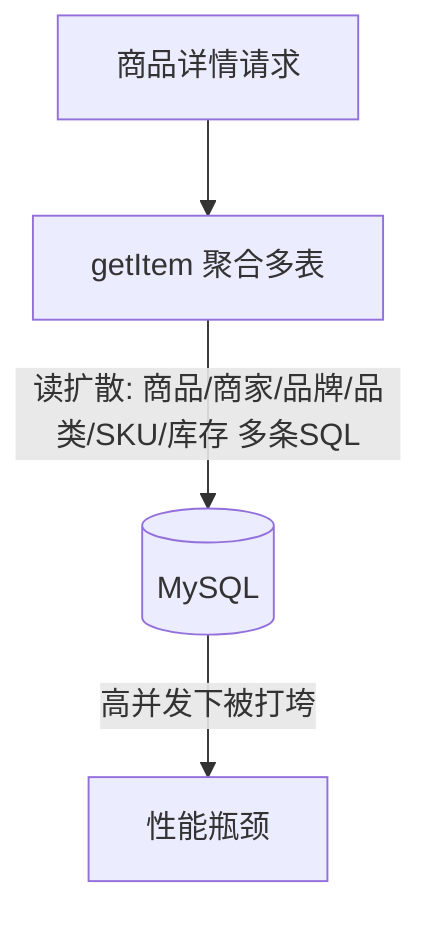

# 六大数据库存储实战: 商品详情缓存化与读扩散治理

## 纲要

- 读扩散问题：`getItem` 一次接口聚合商品/商家/品牌/品类/SKU/库存等多表，下推大量 SQL 到 MySQL
- 优化方向：把商品详情搬进 Redis，用内存挡 C 端流量
- 接入三步：引 `spring-boot-starter-data-redis` → 配 `application.yml` → 写 `RedisTemplate` 序列化配置
- 序列化选型：用 Jackson（保留对象类型信息），而非裸 JSON 字符串（反序列化丢类结构）
- 两段式 key 设计：商品主体 `item_{id}` 与 SKU `item_{id}_SKUlist_{shopID}` 拆分，避免 shopID 污染商品缓存命中率
- 读取顺序：先查 Redis，未命中再查库并回填

## 读扩散：一次详情页打垮 MySQL

商品详情页的 `getItem` 方法，内部要聚合很多次 SQL：商品主体表、关联的商家信息、品牌信息、品类信息、SKU 信息，甚至库存信息，全部通过这个小接口聚到一起。一次详情请求就往 MySQL 里下推了一大堆 SQL。

这种"一个读接口触发多条 SQL"的模式叫**读扩散**。在巨大流量下，那么多表同时做关联查询，瞬间产生海量 SQL，真实生产环境根本跑不通。最容易想到的优化，就是把这些接口用缓存挡起来。



## 接入 Redis 的三步

### 第一步：引依赖

在 `pom.xml` 引入 Spring Data Redis（课程使用 2.5.4）：

```xml
<dependency>
    <groupId>org.springframework.boot</groupId>
    <artifactId>spring-boot-starter-data-redis</artifactId>
    <version>2.5.4</version>
</dependency>
```

### 第二步：改配置

在 `application.yml` 配置 Redis 连接。Redis 默认有 16 个库（0–15），这里选序号 1 做隔离；host 与端口用默认 `localhost:6379`：

```yaml
spring:
  redis:
    database: 1
    host: localhost
    port: 6379
```

### 第三步：配 RedisTemplate 序列化

和配置 MyBatis 的 `Configuration` 一样，需要一个 `RedisConfig` 产出 `RedisTemplate` 作为后续所有 Redis 操作的句柄。关键点在于 key/value 的序列化方式。

为什么不用裸 JSON 字符串？如果直接把对象转成 JSON 字符串当 String 塞进 Redis，反序列化时 `Item` 类的结构信息就丢了——取出来只是一段带 `id`/`createTime` 等字段的字符串，还得手动转回对象。用 `RedisTemplate` 的 Jackson 序列化，则在序列化/反序列化时**保留对象的类型信息**，取出来直接就是 `Item` 对象，无需手写转换。

```java
// 根据讲稿逻辑补充：清洗后的 RedisTemplate Jackson 配置（可运行）
@Configuration
public class RedisConfig {

    @Bean
    public RedisTemplate<String, Object> redisTemplate(RedisConnectionFactory factory) {
        RedisTemplate<String, Object> template = new RedisTemplate<>();
        template.setConnectionFactory(factory);

        // key 用 String 序列化
        StringRedisSerializer stringSerializer = new StringRedisSerializer();
        template.setKeySerializer(stringSerializer);
        template.setHashKeySerializer(stringSerializer);

        // value 用 Jackson，保留类型信息，反序列化无需手动转换
        GenericJackson2JsonRedisSerializer jsonSerializer =
                new GenericJackson2JsonRedisSerializer();
        template.setValueSerializer(jsonSerializer);
        template.setHashValueSerializer(jsonSerializer);

        template.afterPropertiesSet();
        return template;
    }
}
```

## 两段式 key：拆分商品与 SKU

商品详情的缓存内容分两部分：一是商品相关信息（主体字段），二是 SKU 相关信息（含 `shopID` 维度）。两者共同组成一份缓存。

但 `shopID` 维度会导致一个问题：如果把 `shopID` 编码进同一个商品 key，商品主体的缓存命中率会很差。因此采用**模型拆分**——拆成两段式 key：

- 商品主体：`item_{id}`
- SKU 信息：`item_{id}_SKUlist_{shopID}`

```mermaid
flowchart LR
    A[缓存读取] -->|item_{id}| B[商品主体缓存]
    A -->|item_{id}_SKUlist_{shopID}| C[SKU 缓存]
    B --> D[聚合商品详情]
    C --> D
```

拆开的好处：商品主体只跟 `itemId` 走，命中率高；SKU 跟随 `itemId + shopId`，互不污染。

## 读取顺序：先缓存后库

装配好 `RedisTemplate`（用 `@Autowired` 注入）后，读取时用 `opsForValue()` 操作 String 结构：

```java
// 根据讲稿逻辑补充：先查缓存，未命中再查库并回填
@Autowired
private RedisTemplate<String, Object> redisTemplate;

public ItemVO getItem(Long id, Long shopId) {
    String itemKey = "item_" + id;
    ItemVO cached = (ItemVO) redisTemplate.opsForValue().get(itemKey);
    if (cached != null) {
        return cached;                              // 命中缓存，直接返回
    }
    ItemVO item = itemMapper.selectItemDetail(id);  // 未命中，回源 MySQL
    redisTemplate.opsForValue().set(itemKey, item, Duration.ofMinutes(10));
    return item;
}
```

完整链路是：先以 `item_{id}` 查商品主体缓存，再以 `item_{id}_SKUlist_{shopID}` 查 SKU 缓存；两者都未命中才下推 SQL 到 MySQL，并把结果回填 Redis。这就把读扩散产生的大量 SQL 挡在了内存层。

## 技术点总结

- 读扩散：一个详情接口聚合多表、下推大量 SQL，高并发下打垮 MySQL。
- 接入三步：引 starter → 配 `application.yml`（database 隔离、host/port）→ 写 `RedisTemplate` 配置。
- 序列化用 Jackson 保留类型信息，优于裸 JSON 字符串（反序列化丢类结构）。
- 两段式 key 拆分商品主体与 SKU，避免 `shopID` 污染商品缓存命中率。
- 读取顺序：先 Redis 后 MySQL，未命中回填，用内存挡 C 端流量。

相关度：92%。是否需要继续：[是]。代码是否可运行：[是]。
