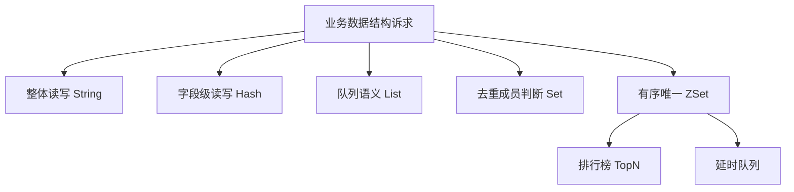

# 六大数据库存储实战: Redis 五种基础数据结构与跳表查询原理

## 纲要

- Redis 对外暴露的是五种基础结构：String、Hash、List、Set、ZSet，选型的第一原则是"用最小的心智成本表达业务对象"
- String 承载 JSON 序列化对象，虽然表达力弱于 Hash/List，但规避了 key 不存在时的分支复杂度
- Hash 是 value 级别的 map，做对象字段级的读写；List 做队列；Set 做去重；ZSet 做有序唯一容器
- ZSet 需要排序能力，Redis 没有选红黑树，而是选了跳表（Skip List）：多层索引链表，用空间换时间
- 跳表层数越多空间浪费越大，因此元素少时 Redis 用压缩表（listpack）替代跳表
- 一条链表 + 多级索引，就是 Redis 在"快"这件事上的第一个答案

## 为什么 Redis 快：先看它提供什么结构

讨论 Redis 为什么快，最容易掉入"因为它是内存数据库"这个偷懒答案。内存只是前提，真正决定单次命令耗时的是**数据在内存中的组织方式**。Redis 把最常用的操作抽象成了五种基础结构，每种结构对应一类确定的访问语义。

### String：事实上的通用结构

String 是 Redis 最常用的结构。`SET key value` 写入、`GET key` 读出，复杂度都是 O(1)。

实际工程中最常见的用法，是把一个 Java 对象序列化成 JSON 字符串写到 String 里，读取时反序列化回来。这个做法看起来"浪费"了 List、Map、Set 这些表达能力更强的结构，但它换来的是简单：

- 序列化后的对象天然是一个整体，不存在"字段写了一半"的中间状态
- 不需要处理 key 不存在、内部 field 不存在的多层分支
- 只要引入一套 JSON 库，对象与字符串之间可以自由转换

代价当然是有的：修改对象任意一个字段都要整读整写。所以 String 适合"整体读写"的场景，比如商品详情、用户会话、配置项。

### Hash：value 内部再嵌套一层 map

Hash 的 value 本身是一个 field-value 的映射。它可以把一个对象的多个字段放进同一个 key，从而支持字段粒度的读写：

- 只更新一个字段时不需要读出整个对象再整体写回
- 同一个 key 下的多个 field 共享过期时间，管理上更集中

Hash 是 String 之外最贴近"面向对象管理"的一种结构。但要注意，"不存在"这件事在 Hash 里会变成两级：key 不存在、key 存在但 field 不存在。业务代码如果对这两级不加区分，很容易出现隐晦的空指针。

### List：左右进出的队列

List 类比数组或链表，支持从左端和右端进出。它的价值在于天然的队列语义，经典的组合是 `LPUSH` + `BRPOP` 实现阻塞队列，用専用于削峰、异步任务投递这类场景。

### Set：无序且唯一的容器

Set 保证容器内部的元素唯一。由于它不保证顺序，实际用途主要集中在**去重**与成员判断，也就是替代应用层的 `contains` 逻辑。

把去重放到 Redis 而不是应用内存里，本质原因是：分布式部署下，多个实例各自拥有一份内存集合，数据是割裂的；集中到 Redis 才能保证全局唯一。

### ZSet：带排序能力的唯一容器

ZSet 在 Set 的基础上增加了排序能力。凡是需要"高性能 + 有序"的场景——游戏排行榜、热榜 TopN、延时队列——ZSet 几乎是唯一选择。

一种退而求其次的做法是：用 List 把数据拉回应用进程内存再排序，或者直接用本机内存做排序。这样做的代价是**放弃了分布式环境下数据的集中管理**，每台机器看到的排名都不一样。ZSet 解决的正是这个问题。



## 有序容器该用什么实现：路的三次选择

有了"ZSet 要支持排序"这个需求，接下来的问题是底层用什么数据结构。

### 第一次尝试：有序链表

最直观的方案是一条已经排好序的单向链表，插入时从头遍历，找到第一个比待插入元素大的位置插进去。

```text
1 -> 2 -> 3 -> 4 -> 5 -> 8 -> 12

插入 7：从头遍历到 5，发现 5 < 7 < 8，在中间插入
插入 13：必须遍历到链表尾部
```

这个方案的致命问题在插入：运气不好时需要遍历整条链表。**单次操作 O(N)**，数据量一大完全不可用，所以它只适合作为理解跳表的起点，不具备落地价值。

### 第二次尝试：红黑树

红黑树是 Java `TreeMap` 背后的实现。它的核心思路是二分查找 + 通过旋转把树高压低，插入、删除、查找都能稳定在 O(logN)。

作为通用的有序 map，红黑树非常优秀。但 Redis 并没有在 ZSet 里选择它。原因不在复杂度，而在实现成本：红黑树的插入删除涉及复杂的旋转与颜色调整，且区间扫描时需要中序遍历，对内存局部性并不友好。

### 第三次尝试：跳表

Redis 给出的答案是**跳表**：在原始链表之上，每隔若干元素抽取一层"稀疏链表"，每一层的节点保存指向更远节点的指针。跳表的层数可以叠加：底层每隔 3 个元素抽一个，上一层每隔 8 个元素抽一个，以此类推。

```text
第 2 层:  1 ----------------------> 8
第 1 层:  1 ----------> 4 --------> 8 ---------> 13
第 0 层:  1 -> 2 -> 3 -> 4 -> 5 -> 8 -> 12 -> 13
```

查询元素 5 的过程：

- 不用跳表：从 1 开始顺序扫描，需要比较 5 次
- 用跳表：在第 1 层从 1 跳到 4，发现 4 < 5；再往后是 8，发现 8 > 5，说明目标位于 4 和 8 之间；下潜到第 0 层，从 4 出发很快就命中 5

层数越高，每一层需要"攀爬"的节点数越少，查询效率越高。这是一种典型的**用空间换时间**：本来一条链表加上几个指针就够了，现在为了查询效率额外维护了多层索引。

| 方案 | 查询 | 插入 | 实现复杂度 | 区间扫描 |
| --- | --- | --- | --- | --- |
| 有序链表 | O(N) | O(N) | 极低 | 天然顺序，友好 |
| 红黑树 | O(logN) | O(logN)，含旋转 | 高 | 需要中序遍历 |
| 跳表 | O(logN) | O(logN) | 中，插入只用改指针 | 底层链表直接顺序走 |

跳表在这个对比里的优势很清晰：复杂度与红黑树同阶，但插入删除只涉及相邻指针的修改，实现和维护成本都低得多；同时第 0 层本身就是一条完整的有序链表，做范围查询直接顺着走即可。

## 空间不是白花的：压缩表的兜底

跳表有一个绕不开的代价：**层数越多，额外指针占用的空间越多**。

如果 ZSet 里只有 4 个元素，为它维护两层索引几乎毫无意义——直接顺序扫描反而更快，还省内存。因此 Redis 做了一个随数据量切换的优化：

- 元素个数少、且每个元素都很短时，用**压缩表**存储：一段紧凑的连续内存，省掉所有指针开销
- 一旦元素数量或单个元素长度超过阈值，才转换成真正的跳表结构

这个转换是自动的，对调用方完全透明。理解它的意义在于：**Redis 并不是无条件地追求查询速度，而是在内存成本和查询成本之间按数据量做切换**。真正采用 ZSet 承载大规模有序数据时，才需要关心跳表带来的内存开销。

## 小结

- String / Hash / List / Set / ZSet 各自对应确定的访问语义，选型时先想清楚业务是"整体读写""字段读写""队列""去重"还是"排序"
- 把对象序列化成 JSON 存 String 不是偷懒，而是用最小的分支复杂度换取可维护性
- ZSet 的排序能力由跳表提供：多层索引链表，查询 O(logN)，本质是空间换时间
- 数据量小时 Redis 自动退化成压缩表，避免跳表指针的空间浪费
- "Redis 快"的第一层答案：合适的内存数据结构，而不是单单一句"因为它在内存里"

相关度：95%。是否需要继续：[是]。代码是否可运行：[否]。
