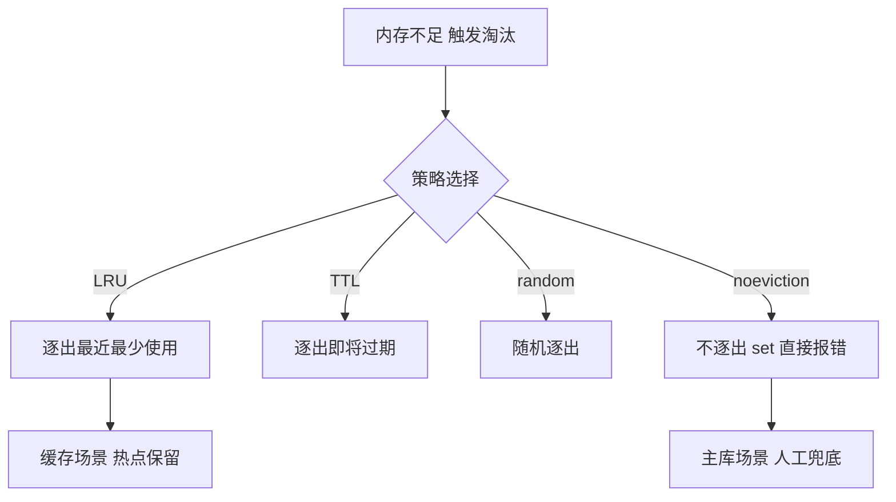

# 六大数据库存储实战: Redis 缓存 key 的淘汰策略

## 纲要

- 内存有上限，Redis server 分配的内存用尽后就无法再 `set`，因此必须靠淘汰策略兜底
- 强烈建议给每个 key 设置过期时间（expire time），原因有两点：避免无价值数据常驻内存、给脏数据一个自动清理窗口
- 四类淘汰策略：LRU（最近最少使用）、TTL（优先淘汰即将过期）、random（随机淘汰）、noeviction（禁止逐出、直接报错）
- LRU 让热点数据保留、冷数据让位，契合"缓存只留有用的"这一初衷
- noeviction 适用于把 Redis 当主库（如秒杀库存以 Redis 为准）的场景，靠运维兜底而非自动淘汰

## 为什么必须关注淘汰策略

Redis 是内存数据库，不可能无限把数据放进内存。随着 `set` 的数据量逐步增加，负载会升高；一旦给 Redis server 分配的内存用完，它就再也 `set` 不进新 key。所以使用 Redis 一定要清楚它的淘汰策略，配置错了就是灾难。

最根本的一条建议：**给每一个 key 都设置过期时间（expire time）**，哪怕设得很长。原因有两点。

第一，不设置过期时间，就只能依赖淘汰策略去逐出；但某些策略下该 key 可能是最后才被逐出、甚至永远不被读出，这部分数据在 Redis 里毫无作用，反而白白占用宝贵内存。

第二，Redis 与数据库之间无法保证强一致，甚至最终一致也难保证，于是必然面临**缓存脏数据**问题。给 key 设了过期时间，最不济：脏数据等到超时后自动清除，后续再通过数据回源从数据库拿到最新值。等于给脏数据加了一道自动失效的兜底。

## 四类淘汰策略

Redis 的淘汰策略按维度可分为四类：

### LRU：最近最少使用

LRU（Least Recently Used）是最常用的策略。它认为：一个 key 被 `set` / `get` 的次数越少，越应该被淘汰。把商品内容放进 Redis，一旦被用户访问，LRU 计时更新，它就该最晚被淘汰；那些冷门、没人访问的商品，没有存在 Redis 里的价值，就该让位。

这正是 LRU 的设计初衷——**缓存只保留热点数据**。

### TTL：优先淘汰即将过期的

TTL 策略从"已经设置过过期时间"的 key 里，挑选出离过期最近的优先淘汰。它依赖你设置的 expire time，也是前文强调"一定要设过期时间"的最重要依据：当 Redis 发现自身内存不足、难以承载后续大量 `set` 时，就按 expire time 与当前时间的远近，把即将过期的 key 逐出。

### random：随机淘汰

从已设置过期时间的数据里随机淘汰。这种一般很少作为常驻策略，更多用于特定测试或兜底。

### noeviction：禁止逐出

noeviction 不逐出任何 key，内存不足时直接让 `set` 报错。听起来激进，其实很常用——前提是**你不是把 Redis 当缓存，而是当主数据库**。

比如秒杀系统里，库存数据以 Redis 为准、数据库反而只是备份，目的就是用 Redis 的内存性能保住下单链路。这种场景下，一旦因为内存不够被某个莫名其妙的 key 逐出，对应用是灾难性的。于是选择 noeviction：我的 key 不允许被系统自动淘汰，只能人工介入处理。当然，这意味着整套运维要跟上——不断电、高配硬件、专人盯盘、大量报警与补偿策略。

## 策略对照

| 策略 | 逐出对象 | 适用场景 |
| --- | --- | --- |
| LRU | 最近最少使用的 key | 通用缓存，留热点去冷数据 |
| TTL | 已过期时间中即将过期的 | 已设 expire 的常规缓存 |
| random | 已设过期时间中随机 | 特殊测试 / 兜底 |
| noeviction | 不逐出，`set` 报错 | Redis 当主库（秒杀库存等） |

一句话概括：**缓存用 LRU/TTL 让内存流动起来，主库用 noeviction 把淘汰权收回到人手里；而无论哪种，先给 key 设过期时间是底线。**

## 技术点总结

- 内存有上限，必须依赖淘汰策略，否则无法继续 `set`。
- 每个 key 都要设过期时间：省内存 + 给脏数据自动清理窗口。
- LRU 保热点、TTL 保即将过期、random 随机、noeviction 禁止逐出并报错。
- noeviction 面向"Redis 当主库"的强一致诉求，靠运维而非自动淘汰兜底。

相关度：93%。是否需要继续：[是]。代码是否可运行：[否]。
