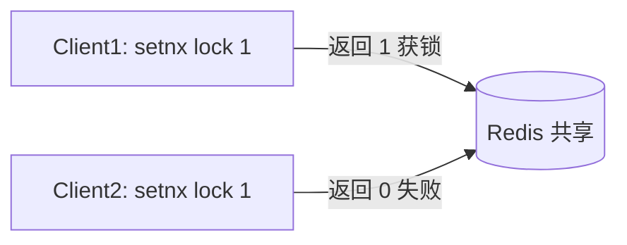
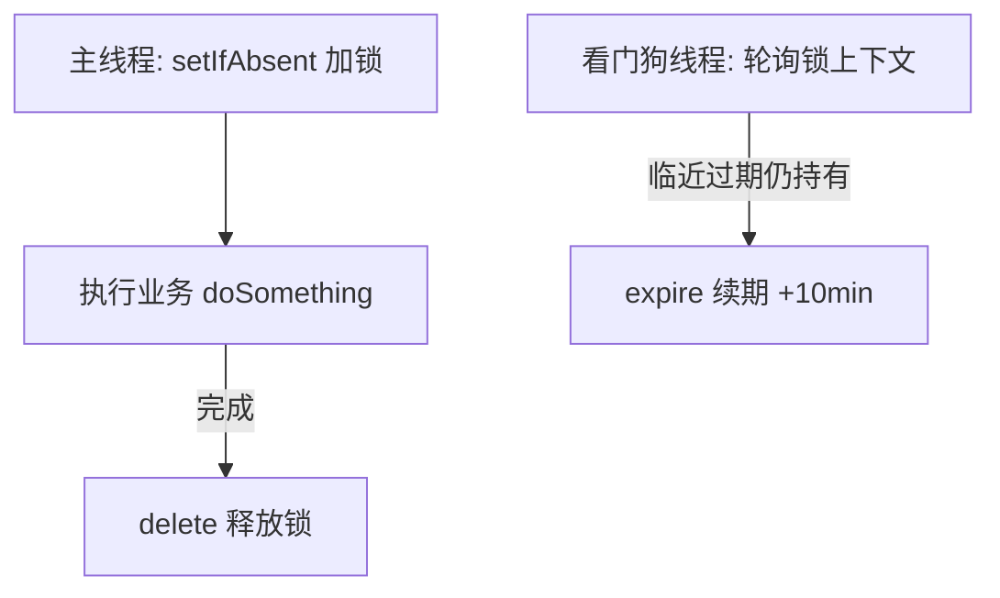

# 六大数据库存储实战: 基于 Redis 的分布式锁实现与三大坑

## 纲要

- 为什么用 Redis 做分布式锁：比 MySQL `select for update` 成本低
- `SETNX`（Set If Not Exist）机制：借 Redis 单线程，唯一条命令定胜负
- 坑一：只加锁不释放 → 进程崩溃锁永驻
  - 加 `expire` 补救，但 `setnx` + `expire` 非原子
  - 解法一：Lua 脚本把两条命令原子化；解法二：`SET key value EX 10 NX` 三合一（Redisson/`setIfAbsent` 即用此）
- 坑二：`expire` 过期后业务仍未执行完 → 锁被提前删、并发重入
  - 解法：看门狗（watchdog）监听线程，临近过期自动续期
- 残余边界：进程整体崩溃时锁最多持有到 TTL，这是 Redis 锁的"尽力而为"本质

## 为什么选 Redis 做分布式锁

MySQL 里可以用 `select for update` 或乐观锁在单点数据库的行记录上实现分布式锁，但成本较高：要起事务、插一行、再 `select for update` 傻等。因此很多研发更喜欢用 Redis 实现分布式锁。

## SETNX：单线程定胜负的加锁原语

`SETNX` 即 Set If Not Exist。假设 Redis 里有个 key 叫 `lock`，client1 执行 `setnx lock 1`：若 `lock` 不存在，返回影响行数 1，表示获锁成功。并发的 client2 也执行 `setnx lock 1`，返回 0，表示没抢到。

它之所以能当分布式锁，是借了 Redis 的单线程特性——同一时刻只有一条命令能成功设置这个 `lock`。只要 Redis 是共享的，多个 client 就能同时去竞争这把锁：谁先上锁成功谁就持有，失败方要么 `while` 自旋每隔几百毫秒重试，要么重试若干次超时后直接报错。这很像数据库里 `select for update` 加乐观锁 + 自旋的套路。



## 坑一：加了锁却没释放

最朴素的写法：

```java
// 第一步：上锁
redis.setnx("lock", "1");
// 第二步：执行业务
doSomething();
// 第三步：释放锁
redis.delete("lock");
```

问题在第二步：若 `doSomething()` 抛异常、或本地服务宕机，`delete("lock")` 永远不会执行，这把锁就永远挂着。

想到的补救是给锁加过期时间：

```java
redis.setnx("lock", "1");
redis.expire("lock", 600);   // 10 分钟，到期自动释放
doSomething();
redis.delete("lock");
```

但 `setnx` 和 `expire` 之间是**非原子**的——万一在两条命令之间进程崩溃，`expire` 永远跑不到，锁照样永驻。

Redis 给了两种正确解法：

- **解法一：Lua 脚本**。把 `setnx` 和 `expire` 封装进一个 Lua 脚本植入 Redis。Lua 脚本在 Redis 单线程里作为原子批量执行，两条命令同成功同失败。
- **解法二：`SET key value EX 10 NX`**。Redis 直接提供一条复合命令：设置 key、值、过期时间（EX），且**仅当 key 不存在（NX）时才执行**，把三条语义合一。`RedisTemplate` 的 `setIfAbsent` 用的就是这条命令，而不是原始的 `setnx` + `expire`。

```java
// 根据讲稿逻辑补充：原子加锁（SET key value EX nx）
Boolean locked = redisTemplate.opsForValue()
        .setIfAbsent("lock", "1", Duration.ofMinutes(10));
if (Boolean.TRUE.equals(locked)) {
    try {
        doSomething();
    } finally {
        redisTemplate.delete("lock");
    }
}
```

## 坑二：业务没跑完，锁先过期了

上面的方案看似接近完美，但还有一个假设：`doSomething()` 一定在 10 分钟内跑完。如果线程在 `doSomething()` 内部阻塞、任务超期，`expire` 时间一到，`lock` 被自动删除。恰在此时 client2 也来执行加锁命令，于是两个 client 同时拿到锁、同时跑 `doSomething()`，而 `doSomething()` 内部并没有对竞争资源做任何保护，并发问题就出现了。

解法是为锁**续期**：起一个独立的监听线程（看门狗），保存所有 Redis 锁的上下文（哪个线程上的锁、过期时间 10 分钟）。它在 10 分钟内轮询：只要发现某把锁临近过期且仍被持有，就执行 `expire` 再延 10 分钟。主线程跑完 `doSomething()` 后，无脑 `delete` 即可。



## 残余边界：看门狗也不是银弹

看门狗解决了"业务慢导致锁提前过期"的问题。但要想一想边界情况：如果主线程和看门狗线程**整体都挂了**，就没有任何线程去续期，这把锁最多再持有到 TTL（10 分钟）才被自动释放——这段时间内别的 client 拿不到锁，而原本该继续的 `doSomething()` 也不该继续。

这说明 Redis 分布式锁的安全底线最终还是靠 **TTL** 兜底：它保证锁"一定会在某个时间点之后释放"，但无法在进程整体崩溃时立刻释放。因此 Redis 锁是"尽力而为"的分布式锁，不是像 `select for update` 那样严格依赖数据库事务的强锁。用之前要清楚这个权衡。

## 技术点总结

- `SETNX` 借 Redis 单线程实现"唯一条命令定胜负"的分布式锁。
- 坑一：不释放锁会永驻；用 `SET key value EX NX`（或 Lua 脚本）保证加锁与过期原子。
- 坑二：业务超期导致锁提前过期、并发重入；用看门狗线程自动续期。
- 看门狗仍有边界：进程整体崩溃时锁最多持有到 TTL，Redis 锁本质是尽力而为。
- 能用 `setIfAbsent`（底层 `SET ... NX`）就不要手写 `setnx` + `expire`。

相关度：92%。是否需要继续：[是]。代码是否可运行：[是]。
