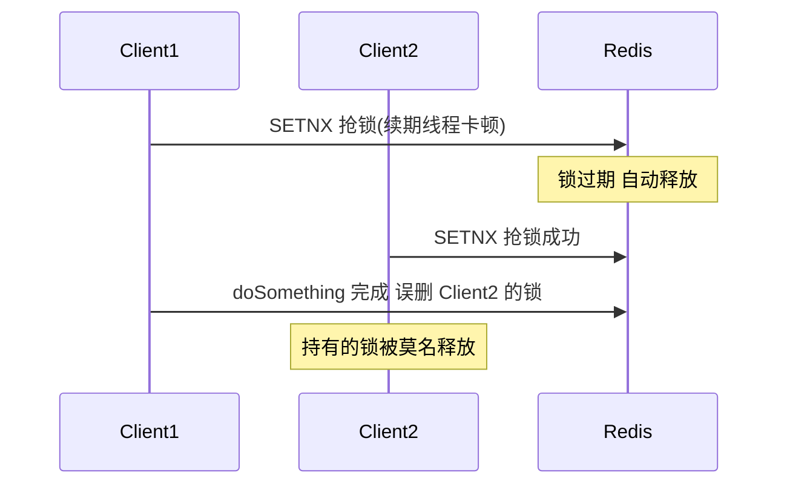
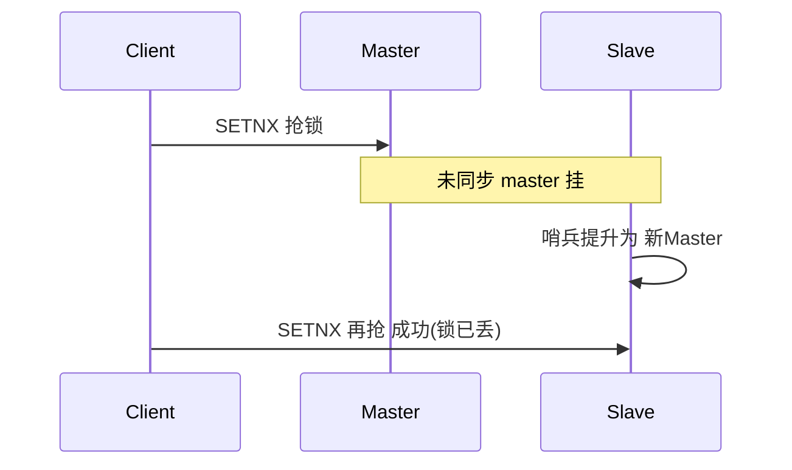
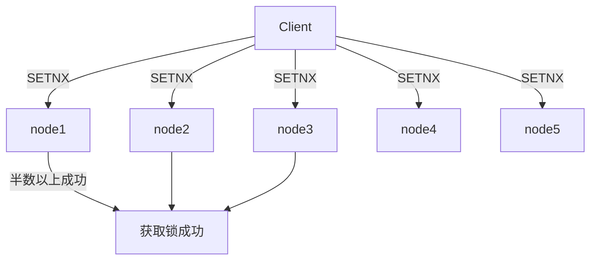

# 六大数据库存储实战: Redis 分布式锁的陷阱与 Redisson 红锁

## 纲要

- 用 `SETNX` + 看门狗（续期线程）实现分布式锁，但存在"误删他人锁"与"主从切换丢锁"两大坑
- 误删问题：用 value 写入机器 IP + 线程 ID，删除前先 `GET` 校验身份，一致才删
- 易失性风险：Redis 主从切换时，未同步的 `SETNX` 在新 master 上"不存在"，锁失效
- 强一致场景（交易支付）建议用数据库实现分布式锁；Redis 锁适合可容忍重入的业务
- 推荐 **Redisson**：封装获取/释放锁与看门狗，并用 Redlock（红锁）解决主从切换问题

## SETNX 实现分布式锁的第一个坑：误删他人锁

最朴素的 Redis 分布式锁，是 `SETNX`（set if not exists）抢锁，配合一个监听（看门狗）线程在持有期间定时续期，避免业务没跑完锁就过期。

但这里有个极端边界：假设 client1 的续期线程在第 10 分钟因 CPU 卡顿，没把续期指令准时发下去，锁实际已释放；此时 client2 的 `SETNX` 进来成功拿到锁。偏偏这时 client1 的 `doSomething` 执行完，调用 `deleteLock` ——它把 **client2 持有的锁**给删了。本不持有锁的线程，释放了别人持有的锁，后果很严重。

解法很简单：让删除操作与获取操作的对象对称。获取锁时，把 value 编码成"机器 IP + 线程 ID"，保证分布式环境下全局唯一。删除前先 `GET` 这个 lock，判断 value 里的 IP + 线程 ID 是否与自己完全一致；一致才执行 `deleteLock`，不一致就说明锁已被别人持有、自动释放过，不再删除。

## 第二个坑：Redis 易失性导致锁丢失

Redis 本质是内存级易失存储，任何异常都可能让 `SETNX` 失效。典型场景是主从部署：client 把 `SETNX` 写到 master，还没来得及同步到 slave，master 挂了；哨兵自动把 slave 提升为新 master，新 master 上根本没有这条锁记录，于是另一个 client 的 `SETNX` 又能成功——锁凭空消失。

这类隐患平时不显，一旦 Redis 抖动或任务出现超长执行，就会让大量脏数据涌入 `doSomething`，造成严重影响。所以**交易、支付这类要求强一致的场景，建议用数据库实现分布式锁**；Redis 锁只适合业务上能容忍重入、允许偶发失效的场景。

## 推荐方案：Redisson 与 Redlock

自己封装 `SETNX` + 续期 + 身份校验，代码复杂且坑多，强烈建议直接使用 **Redisson**。它的好处：

- 内部封装了获取锁、释放锁、看门狗续期线程的全部细节，开箱即用（引入包 + 注解即可）。
- 实现了 **Redlock（红锁）**：当 client 连接的是 Redis 集群时，要求超过半数的节点同时 `SETNX` 成功，才判定获取锁成功。

Redlock 的价值在于化解主从切换风险：即使某个节点发生主从切换，只要超过 N/2+1 个节点持有这把锁，竞选上的新 master 也必然拥有该锁的数据，从而从"单点写入"升级为"多数派写入"的分布式安全。

一句话：**能用 Redisson 就别自己造轮子；强一致用数据库锁，Redis 锁留给可容忍重入的场景。**

## 技术点总结

- 朴素 `SETNX` 两坑：看门狗卡顿导致误删他人锁；主从切换导致锁丢失。
- 误删解法：value 存 IP+线程ID，`DEL` 前 `GET` 校验身份。
- 易失性 + 主从切换使 Redis 锁不适合强一致的交易支付场景。
- Redisson 封装锁与看门狗，并用 Redlock 多数派写入化解主从切换风险。

相关度：91%。是否需要继续：[是]。代码是否可运行：[否]。
