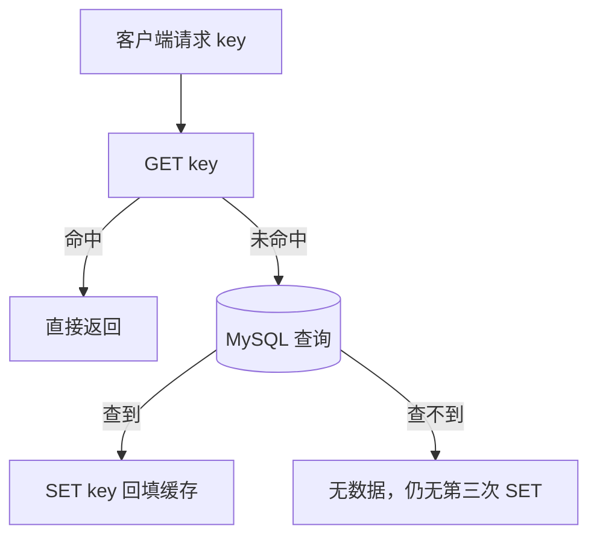
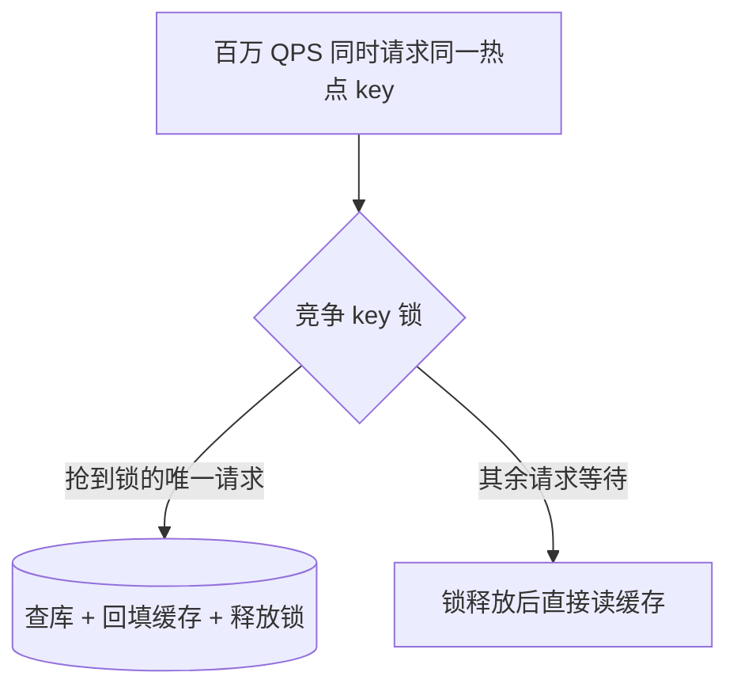

# 六大数据库存储实战: 规避 Redis 缓存三大弱点（穿透、击穿、雪崩）

## 纲要

- 缓存的三大弱点本质都是"缓存没挡住，流量打到数据库，把库压垮"
- 缓存穿透：查询一个**根本不存在**的 key，缓存与数据库都查不到，每次都穿透到库
  - 解法：缓存空对象/空值标志位（不用 null）+ 恶意请求做 IP 拦截
- 缓存击穿：某个**存在**的热点 key 在失效瞬间遭高并发集中访问，请求同时落到库
  - 解法：缓存预热 + 应用层排队（锁/令牌）平滑回源
- 缓存雪崩：大量热点 key 在**同一时刻**集体失效，回源流量同时打到库
  - 解法：过期时间加随机抖动，错峰失效

## 为什么缓存也有短板

缓存（Redis 或 Memcached）优势再多，仍要面对三种典型失效场景。三者名词差异很大，但本质相同：缓存没起作用，请求回源到数据库，数据库被打垮。只是触发路径完全不同，因此解法也不同。

通用读取链路是先查缓存，命中直接返回；未命中才查库，并把结果 `set` 回缓存供下次命中：



## 缓存穿透：查不存在的 key

缓存穿透指客户端访问一个**不存在**的 key：缓存查不到，数据库也查不到，于是"第三次回填缓存"永远不会发生。结果每一次请求都变成一次数据库主键查询。一旦这种请求达到千万级 QPS，单点 MySQL 很难扛住。

穿透分两种情况：

- **业务逻辑允许（非恶意）**：商品原本在列表页可见，但进了详情页时商家把它下架或删除了，缓存和数据库都没有，自然不会回填。
- **恶意（黑客）**：明知接口有此漏洞，在前端疯狂请求大批不存在的 ID，每次都打到库上。

通用解法：无论数据库查到与否，都往缓存里放一个"不存在标志位"——查到有数据就放数据，**查不到也 `set` 一个 key，但里面塞空对象（不是 null）**。

```java
// 根据讲稿逻辑补充：用空对象标志位挡穿透，绝不用 null
public ItemVO getItemWithGuard(Long id) {
    String key = "item_" + id;
    Object cached = redisTemplate.opsForValue().get(key);
    if (cached != null) {
        if (cached instanceof NullObject) {        // 命中空标志位，直接返回，不回源
            return null;
        }
        return (ItemVO) cached;
    }
    ItemVO item = itemMapper.selectItemDetail(id);
    if (item != null) {
        redisTemplate.opsForValue().set(key, item, Duration.ofMinutes(10));
    } else {
        // 关键：放空对象，而不是什么都不放；下次同样的 id 直接被挡在缓存层
        redisTemplate.opsForValue().set(key, new NullObject(), Duration.ofMinutes(10));
    }
    return item;
}
```

为什么强调**不用 null**？很多代码用 `get(key) == null` 判断缓存未命中；若把 null 当标志位，后续接手的人很容易在判断逻辑上留坑。更稳妥的做法按类型区分：

- 整型用 `-1` 之类的不存在主键值替代
- 字符串用空字符串 `""`
- 对象编码成 JSON，或放一个关键字段（如 `id = null`）的空对象

对恶意情况，还可额外叠加风控：识别对端 IP、关小黑屋（直接拒绝访问），前提是有足够样本判定其为恶意请求。

## 缓存击穿：热点 key 失效瞬间的高并发

缓存击穿的对象是一个**存在**的 key。由于首次缓存里没有它，请求穿透到库；但同一秒内几百万 QPS 同时访问这个 key，缓存因高并发全部未命中，请求一起打到库并各自 `set` 回缓存。

也就是说，数据库里明明有值，但突发的并发流量在同一瞬间集中爆发到库，数据库负载瞬间拉高。

两种解法：

- **缓存预热**：商品发布写库之前，先往 Redis 填一份，并设置较长失效时间。客户端来取时直接命中，源头就不进库。
- **应用层排队**：在客户端加一把与 key 关联的锁，只有拿到锁的唯一请求能穿透到库，其余请求在客户端等待；拿到锁的请求把 Redis 填满、释放锁后，剩余请求直接从缓存取。



排队的风险是：若拿到锁的请求超时或被阻塞，所有请求都得排队。可改用**令牌机制**——例如 100 个请求只放 2~3 个去回源，数据库压力降到 1%~2%，仍能完成缓存填充。

## 缓存雪崩：同一时刻集体失效

设想穿透和击穿都做得很好，大量数据已在 Redis 挡住。但设置缓存时过期时间是个固定值（比如 10 分钟）：一个商品列表页拉出 20 个商品，同时回源、同时把这 20 个 key 设进缓存，失效时间却都是 10 分钟后。

10 分钟一到，这波流量又同时涌向 MySQL。线上观察表明，MySQL 的 `select` 突增时间点，往往和缓存失效时刻高度对称。

这种"同一时间点大批量 key 同时失效，请求全部回源"的场景叫缓存雪崩。

解法只有一句话：**错峰 + 随机时间**。任何请求从库取出数据后，在设定过期时间时叠加随机抖动：

```java
// 根据讲稿逻辑补充：基础 10 分钟 + 前后随机抖动，错峰失效
int base = 10 * 60;                       // 基础 10 分钟（秒）
int jitter = new Random().nextInt(180);   // 0~3 分钟随机抖动
redisTemplate.opsForValue().set(key, item, Duration.ofSeconds(base + jitter));
```

这样每个 key 的失效时间都不一致，MySQL 接收回源的流量被平滑开，库压力可控。

## 三类弱点的对照

| 弱点 | 触发条件 | 流量特征 | 核心解法 |
| --- | --- | --- | --- |
| 穿透 | key 根本不存在 | 每次都打到库 | 空对象标志位（非 null）+ 恶意 IP 拦截 |
| 击穿 | key 存在、失效瞬间高并发 | 同一瞬间集中爆发 | 缓存预热 + 应用层排队/令牌 |
| 雪崩 | 大量热点 key 同时失效 | 同一时刻集体回源 | 过期时间随机抖动错峰 |

## 技术点总结

- 穿透：查不存在的 key，缓存与库都无，每次都落库；用空对象标志位（非 null）挡，恶意请求叠加 IP 拦截
- 击穿：存在的热点 key 失效瞬间被高并发集中打；用预热 + 锁/令牌排队平滑回源
- 雪崩：大量 key 同一时刻集体失效；过期时间加随机抖动错峰
- 三类本质都是"缓存失效 → 流量回源 → 库被打垮"，但触发路径不同，解法不能混用

相关度：95%。是否需要继续：[是]。代码是否可运行：[是]。
