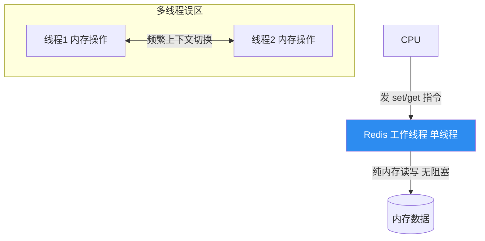
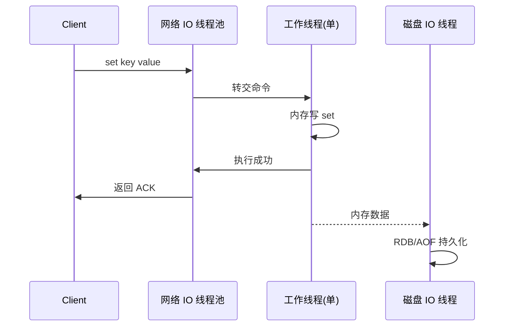
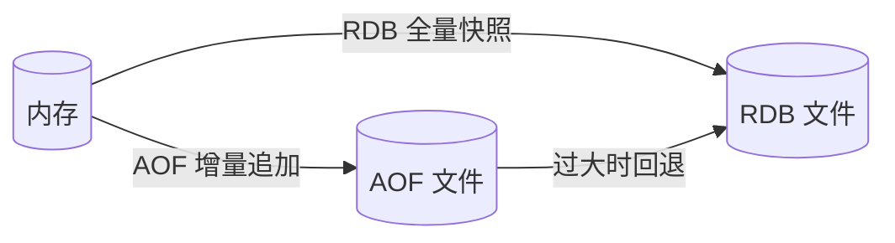

# 54. 六大数据库存储实战: Redis 单线程工作模型与多套 IO 线程

## 纲要

- Redis 对外看似"单线程"，但进程内部其实区分了三套线程：一个工作线程、网络 IO 线程池、磁盘 IO 线程池
- 工作线程只做内存级的 `set` / `get`，不碰磁盘 IO，因此无系统调用阻塞、无线程切换开销
- 单线程比多线程快的底层原理：纯内存操作下"排队"比"多线程抢占切换"更快（检票口模型）
- 多 CPU 环境下，把单个工作线程绑定到固定 CPU，避免跨 CPU 的寄存器数据交换
- 多个工作线程操作同一份内存必须加锁，所以 Redis 选择单工作线程；并发提效的正路是数据分片（多份内存隔离）
- 磁盘 IO 线程负责持久化：RDB 全量快照、AOF 增量日志；AOF 过大时回退为 RDB 全量并重写

## 📎 代码说明

本讲为**原理 / 架构 / 选型**篇，正文以图示与推演为主，无配套代码片段，课程课件亦未提供本章源码文件。

## 单线程为什么反而比多线程快

初学 Redis 的人常有一个困惑：它只靠一个线程，为什么横向吞吐能那么高？要回答这个问题，得先拆成两个子问题：单线程为什么比多线程快？以及 Redis 内部真的只有一个线程吗？

先看第一个问题。Redis 的工作线程只做两件事：从内存里读（`get`）和往内存里写（`set`），所有数据结构最终都能泛化成这两类内存操作。因为工作线程**不碰磁盘、不碰网络系统调用**，运行过程是无阻塞的——CPU 把指令塞进这个线程，它就在内存里直接读写，全程不需要发生线程切换。

多线程模型的代价恰恰在切换。假设两个线程都在做内存级的 `set`/`get`，虽然它们同样不阻塞，但单核 CPU 不得不在这两个线程之间频繁做上下文切换。举例：单线程处理一批内存操作要 1 秒，多线程模型可能因为约 0.2 秒的线程切换开销变成 1.2 秒。对纯内存场景而言，多线程不仅没提速，反而更慢。

这背后的底层原理可以概括为：**排队永远比多线程抢占更快**。想象一个检票口，所有人有序排队，检票员专注服务当前客户、快速处理完；总体耗时，反而低于所有人一拥而上抢占检票员时间、迫使其在各路客诉间反复切换。我们平时用多线程解决高并发，本质是为应对 IO 阻塞——某个线程卡在 IO 上时，其他线程仍能响应。而 Redis 是纯内存存取，根本没有 IO 阻塞，于是单线程模型最能发挥 CPU 优势。

补充一点：在多 CPU 机器上，建议把 Redis 的单工作线程绑定到某个固定 CPU 上，让它永远只被这一个 CPU 执行。否则线程 A 跑在 CPU-A、线程 B 跑在 CPU-B，会产生 CPU 之间寄存器的数据频繁交换，绑定后效率比多 CPU 多线程更高。

## Redis 真的只有一个线程吗

第二个问题：Redis 并不是"真·单线程"。严格说它区分了三套线程池，只是**工作线程只有一个**，网络 IO 线程和磁盘 IO 线程可以是多个。

整个请求生命周期是这样的：

1. 客户端通过网络连上 Redis，发出 `set key value`。
2. **网络 IO 线程池**监听 server 的 socket 端口，从多个 socket 上把数据读上来，解析出命令，转交给工作线程。
3. **工作线程**（唯一）真正执行 `set`，把数据写入内存；执行完毕通知网络 IO 线程。
4. **网络 IO 线程**把 ACK 回送给客户端。
5. **磁盘 IO 线程**在后台把内存数据持久化到文件系统，与工作线程并行、互不阻塞。

所以前面讨论的"单线程 vs 多线程"，指的都是这个唯一的工作线程。客户端要拿到响应，最大瓶颈就在"内存 ↔ 工作线程"这条链路上；只要它解决掉，网络 IO 线程和磁盘 IO 线程都可以平行扩容。

## 为什么不用多线程操作同一份内存

有人会想：既然单线程是瓶颈，那在多 CPU 上开两个 Redis 工作线程、各自绑一个 CPU，岂不更快？答案要分情况。

如果两份内存**完全隔离**（不同线程操作不同内存），的确比单线程高。但这种隔离，本质就是分布式里的**分片**：把数据按规则拆到不同节点，各节点独立内存。这也是后面章节要展开的内容。

而现实里 Redis 操作的是**同一份内存**。一旦多个工作线程读写同一份数据，就必须加锁防止误改；否则像 `a` 覆盖 `b` 这类操作，会让原子性无法保证。一旦加锁，"多线程免切换"的前提就不成立了——锁竞争本身就会带来切换与等待。因此"多工作线程共享一份内存"的方案在 Redis 里并不存在，它选择了单工作线程，把并发提效交给分片隔离去解决。

## 磁盘 IO 线程：持久化的两板斧

Redis 是内存数据库，但挂掉后总希望数据能尽量恢复（注意是"尽量"，因为缓存丢了可以从数据库回源）。磁盘 IO 线程提供两种持久化：

- **RDB（全量快照）**：把某一时刻的内存数据结构整体 dump 成一个文件写入文件系统。恢复时全量回放。
- **AOF（增量日志）**：以追加写（append）方式记录写命令，按固定频率（如每秒）或写入量阈值触发落盘。AOF 文件会随写入不断增长，因此当文件大到一定程度，磁盘 IO 线程会用 RDB 做一次全量备份，并删除旧 AOF——这样重启时优先用 RDB 全量回放，而不是漫长的 AOF 增量回放。

## 技术点总结

- 单线程快的前提是纯内存、无 IO 阻塞、无线程切换开销；排队比多线程抢占更高效。
- Redis 内部三套线程：单工作线程（内存读写）+ 网络 IO 线程池（收发命令）+ 磁盘 IO 线程池（持久化）。
- 多 CPU 下绑定固定 CPU，避免跨核寄存器交换；共享内存的多线程方案因加锁而不成立，并发靠分片。
- 持久化：RDB 全量快照、AOF 增量日志，AOF 过大回退 RDB 全量。

