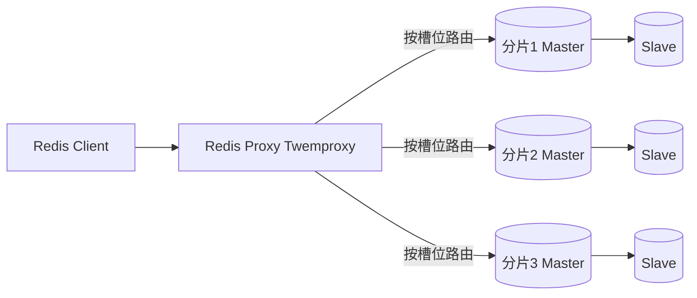
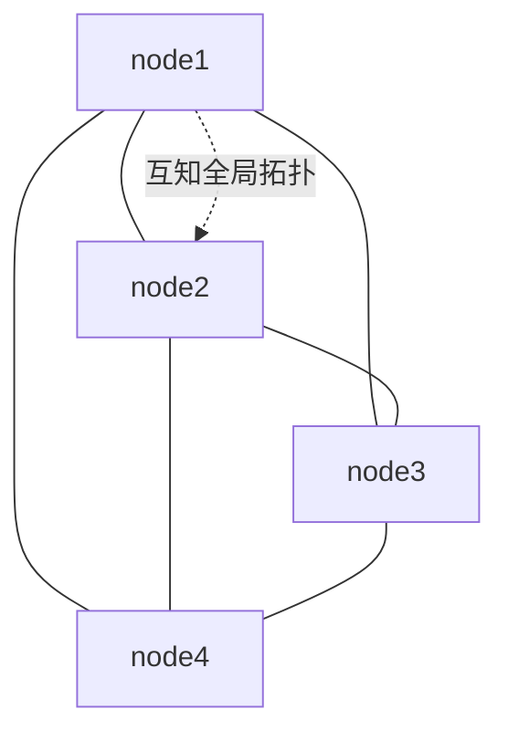
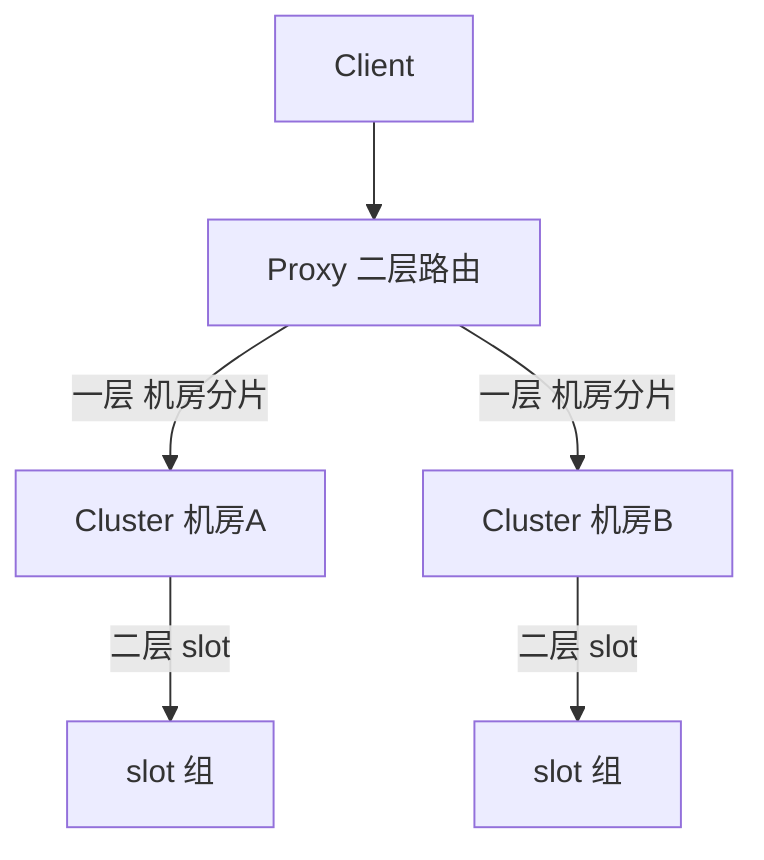

# 57. 六大数据库存储实战: Redis 分片部署与 Cluster 集群模式

## 纲要

- 在哨兵主从之上，很多公司引入**分片部署**：多套 master + 多套 slave，按一致性哈希规则把 key 分散到不同分片
- 用 Redis proxy（如 Twitter 的 Twemproxy）屏蔽分片差异，client 只连 proxy，由 proxy 负责路由
- Redis Cluster（自 3.0 起提供）抛弃 master/slave 身份，改为多个 node 网状互联，每个 node 互知全局拓扑
- client 连任意 node 都能拿到全局寻址，自行决定 key 落在哪个分片，无需外部感知 slot 迁移
- 节点故障自动调整并迁移数据；但 Cluster 难做跨机房隔离，缓存场景更推荐分片部署
- 演进：单机 → 主从 → 哨兵 → 分片部署（主从+哨兵+proxy，或 cluster+proxy 二层路由）

## 📎 代码说明

本讲为**原理 / 架构 / 选型**篇，正文以图示与推演为主，无配套代码片段，课程课件亦未提供本章源码文件。

## 分片部署：多主多从

在哨兵主从模式基础上，不少公司进一步引入**分片部署**。做法是起多套 master、多套 slave，例如三组分片，每组都是一套主从。client 根据一致性哈希的槽位分布，把 9 个 key 大致均摊到三组分片上（每组 3 个）。

这样一来，写请求可以并行打到多个分片的 master，读请求打到对应分片的 slave，读写隔离与横向扩展同时成立——只要一致性哈希算法固定，总能找到对应的 master / slave。

早期（Redis Cluster 诞生前）很多互联网公司会自己基于开源 master/slave 改造源码实现分片。Twitter 的 **Twemproxy** 就是典型的 Redis proxy 设计：client 只连接 proxy，由 proxy 管理所有 master/slave 的分片机制。client 因此完全不用关心分片细节。

## Cluster 模式：去掉身份，全局拓扑

Redis 在 3.0 引入 Cluster 模式，设计理念更简单：不再区分 master 和 slave 的"身份"，而是若干个 **node** 互相组网。

假设有 4 个 node，它们之间用无向箭头互相级联、互相感知——每个 node 都知道另外三个 node 的 IP 地址、各自负责的槽位（slot）、以及谁是 master 谁是 slave。它们通过竞选选出 master 与 slave 角色。

client 无论连上哪个 node（哪怕运气差连到了某个 master），该 node 都会把完整网络拓扑告诉 client。于是 client 内存里也有一份全局寻址，写 key 时即便定位在 master2 上，也能直接向 master2 建连请求数据。Cluster 把"身份"换成了"全局视角"：每个 node 知道自己是 master 几、slave 几，也知道其他节点的角色与槽位，并把这份信息拷贝给连上来的 client，由 client 自己做外围路由。

由于节点间互感知，某个 slave 挂掉，剩余三节点会自动调整分布并迁移数据；node 迁移后 client 也能感知新位置，继续写对节点。这正是 Cluster 不需要外部感知 slot 迁移的优势。

## 为什么大型部署很少纯用 Cluster

Cluster 很火，但真正拿它做大型跨机房集群的并不多，根源在**机房隔离难做**。现在讲究两地三中心、三套机房，怎么部署 Cluster？

一种思路是每机房部署一个 Redis master，再把某机房的 slave 作为另一机房的另一个 slave 的 master，完成互相备份——可以，但很别扭。更关键的是：缓存场景本就可以多 master 分片（不像数据库只能单点写入），即便某个分片数据全丢，也无非是该机房数据回源数据库，问题不大。

而 Cluster 只能存在于单机房内；要做跨机房，只能每机房各部署一套 Cluster，再在外围套一层分片部署——即 proxy 既要感知不同机房的分片策略，又要感知内部 Cluster 结构，做**二层路由**（先选分片 Cluster，再在分片内选 slot）。这给 proxy 的运维带来不小压力。

因此结论很明确：缓存场景大多用**分片部署**（多 master + proxy 屏蔽差异），而非把 Cluster 直接铺到跨机房。

## 四种策略的演进

| 策略 | 高可用 | 自动切主 | 跨机房 | 典型用途 |
| --- | --- | --- | --- | --- |
| 单机 | 否 | 否 | — | 开发、极简场景 |
| 主从 | 部分 | 否 | — | 读写分离，单机房 |
| 哨兵 | 是 | 是 | 难 | 自动故障转移 |
| 分片部署 | 是 | 是（proxy 路由） | 易 | 大规模、跨机房缓存 |

分片部署可以组合为"主从 + 哨兵 + proxy 屏蔽分片差异"，也可以把主从哨兵升级成 Cluster 部署、在单机房内再由 proxy 做二层路由。

## 技术点总结

- 分片部署：多主多从 + 一致性哈希，proxy（Twemproxy）屏蔽分片，client 只连 proxy。
- Cluster（3.0+）：node 网状互联、全局拓扑互知，client 自路由，无需外部感知 slot 迁移。
- Cluster 难做跨机房隔离，缓存场景更推荐分片部署而非纯 Cluster 跨机房。
- 演进链路：单机 → 主从 → 哨兵 → 分片部署（proxy 一层或 Cluster+proxy 二层）。

