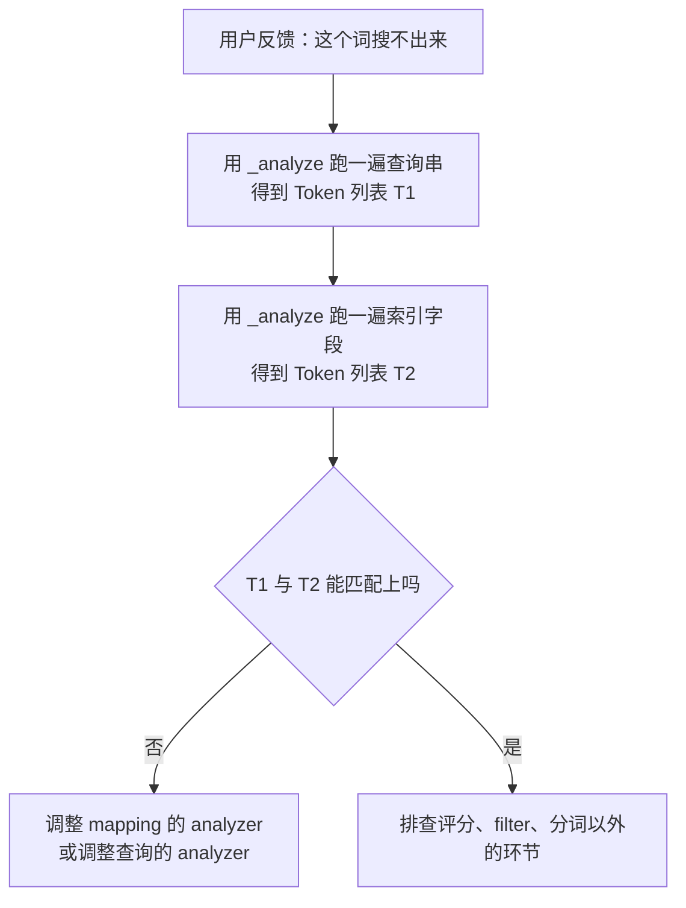

# 六大数据库存储实战: 分词器到底做了什么，从字符过滤到词干归一化

## 纲要

- 倒排索引的前置环节是**分析过程（Analysis）**：文本 → 倒排索引条目，中间由 Analyzer 完成
- Analyzer 三段固定流水线
    - 字符过滤（Character Filter）：清洗 HTML 标签、转义符等噪声
    - 切词（Tokenizer）：按规则把文本切成一串 Token
    - 分词过滤（Token Filter）：大小写归一化、词干归一化、停用词剔除
- 英文分词天然靠空格切分，中文必须依赖 IK 之类的词典分词器
- `_analyze` API 是排查"为什么搜不出来"的标准手段：把输入文本与索引内的处理方式对齐比对
- IK 分词器：`ik_smart`（粗粒度）与 `ik_max_word`（细粒度）的取舍

## 为什么必须理解分词

上一节讲清楚了倒排索引的结构：一条记录被拆成一串有意义的词，再以「词 → 文档列表」的形式建索引。但"一串有意义的词"是怎么来的，并没有展开。

这个转换过程在 Elasticsearch 里叫**分析过程**，执行它的组件叫 **Analyzer（分析器）**。它决定了：

- 用户输入的查询串会被切成什么样
- 索引里的文档会被切成什么样
- 两边能不能对上

检索不到数据，绝大多数时候不是索引坏了，而是**两端的分析过程不一致**。所以分词不是搜索引擎的边角料，而是全文检索的地基。

## 分析过程的三段流水线

Elasticsearch 的 Analyzer 由三个可扩展节点顺序组成，顺序固定、不可调换：


三个节点都支持插件扩展，但职责边界是固定的：

| 阶段 | 作用对象 | 典型动作 |
| --- | --- | --- |
| Character Filter | 未分词的原始字符流 | 剔除 HTML 标签、把 `&` 这类符号转写成 `and` |
| Tokenizer | 清洗后的文本 | 按规则切分成 Token（英文按空格，中文按词典） |
| Token Filter | 已切好的 Token 序列 | 大小写归一化、词干归一化、停用词过滤、同义词扩展 |

注意区分两个"过滤"：**字符过滤**发生在分词之前，按字符处理；**分词过滤**发生在分词之后，按词处理。这是最容易搞混的一对概念。

## 字符过滤模块

假设原始文本是一段 HTML：

```html
<p>i want an apple & a banana</p>
```

字符过滤模块做两件事：

- `<p>`、`</p>` 这类段落标签本身没有检索语义，如果把它建进索引，索引会被大量无意义的标签撑爆，因此直接剔除
- `&` 不能简单丢掉，它确实有语义，因此在英文分词器中会被转写成单词 `and`

清洗之后得到：

```text
i want an apple and a banana
```

关键点：**字符过滤是"转写 + 剔除"，不是无脑删除**。像 `&` 这种有语义的符号要保留其语义，而纯排版标签则彻底移除。这也是为什么中文场景常常需要配置 `html_strip` 这类字符过滤器——业务库里的商品详情、文章内容往往带着富文本标签入库。

## 切词模块

切词真正把文本切成 Token。英文分词器是最简单的一种：英文天生有空格语义，按空格切开即可。

```text
i want an apple and a banana
→ [i] [want] [an] [apple] [and] [a] [banana]
```

这里正好解释了中文搜索的历史难题：英文靠空格就能完成切分，而中文没有天然分隔符，且同一个词在不同句子里的切法不同。例如"研究生命起源"可以切成"研究 / 生命 / 起源"，也可以切成"研究生 / 命 / 起源"。

所以中文必须依赖 **IK 分词器**这类基于词典 + 歧义消解的分词器。IK 提供两种模式：

| 模式 | 切分粒度 | 适用场景 |
| --- | --- | --- |
| `ik_max_word` | 最细粒度，穷举所有可能的词 | 建索引：让索引尽可能"全"，提高召回率 |
| `ik_smart` | 粗粒度，只切出最合理的词 | 查询：让查询意图更明确，提高准确率 |

工程上的常见组合是**索引时用 `ik_max_word`，查询时用 `ik_smart`**：索引侧宁可多切，保证用户能搜到；查询侧宁可少切，保证结果不要发散。

## 分词过滤模块

切完词之后才是分词过滤，针对英文最重要的两步是：

- **大小写归一化**：`I` 和 `i` 在人眼看来语义相同，但计算机做字符串等值比较时它们是两个不同的串。默认会把大写统一转成小写
- **词干归一化（Stemming）**：把单词还原成词干，`apple` → `appl`；同时把 `an`、`a` 这类无意义的量词、停用词归一化掉

最终产出的 Token 流：

```text
[i] [want] [appl] [and] [banana]
```

这一步的价值在于**提升召回**：用户搜 `apples` 能命中 `apple`，搜 `Apple` 能命中 `apple`。代价是精度略有损失——词干归一化后无法区分 `organization` 和 `organ`，对需要精确匹配的字段（如商品编码、订单号）就不该做 stemming。

## 用 `_analyze` API 做对齐验证

实际排查问题时，不可能去翻文档猜引擎内部把文本切成了什么。标准做法是调用 `_analyze` API，把整套流水线跑一遍，直接看产出：

```bash
# 用标准分析器试切一段英文
curl -X POST "http://localhost:9200/_analyze" -H 'Content-Type: application/json' -d '{
  "analyzer": "standard",
  "text": "<p>i want an apple & a banana</p>"
}'

# 用 IK 粗粒度模式试切中文
curl -X POST "http://localhost:9200/_analyze" -H 'Content-Type: application/json' -d '{
  "analyzer": "ik_smart",
  "text": "苹果手机专卖店"
}'

# 直接验证某个索引字段实际使用的分析器
curl -X POST "http://localhost:9200/item/_analyze" -H 'Content-Type: application/json' -d '{
  "field": "name",
  "text": "iPhone SE"
}'
```

排查套路是三段式：



绝大多数"索引里有数据但搜不到"的问题，都能在这个比对里现形。

## 索引与查询两端的一致性

分析过程在**写入时**和**查询时**都会执行，两者使用的分析器必须匹配：

| 场景 | 索引时分析器 | 查询时分析器 | 结果 |
| --- | --- | --- | --- |
| 两端一致 | `ik_max_word` | `ik_max_word` | 行为符合预期 |
| 刻意差异化 | `ik_max_word` | `ik_smart` | 常见工程优化：召回与精度的平衡 |
| 配置遗漏 | `standard` | `ik_smart` | 中文被切成单字，检索结果发散 |
| 字段类型错误 | `keyword` | 任意 | 整串作为一个 Term，只能全等匹配 |

`keyword` 类型不参与分析，整串原样入索引。如果商品名称被误建成 `keyword`，用户搜"苹果"就永远搜不到"苹果手机"，除非输入完全一致的完整串。这是 mapping 设计阶段最常见的坑。

## API 速览

| API / 配置项 | 说明 |
| --- | --- |
| `POST /_analyze` | 用指定 analyzer 试切文本，返回 Token 列表 |
| `POST /<index>/_analyze` | 用目标索引某个字段的实际配置试切文本 |
| `analyzer` | 指定分析器名称（`standard` / `ik_smart` / `ik_max_word`） |
| `field` | 复用索引中已有字段的分析器配置 |
| `char_filter` | 字符过滤器，如 `html_strip` |
| `tokenizer` | 切词器，如 `standard` / `ik_max_word` |
| `filter` | 分词过滤器，如 `lowercase` / `stemmer` / `stop` |

## Demo 示例

下面给出一个完整可运行的 mapping + 分析验证示例，展示"索引端细切、查询端粗切"的组合（根据讲稿逻辑补充）。

### 运行说明

```bash
# 前置：ES 7.x，并安装 ik 插件
# bin/elasticsearch-plugin install https://.../elasticsearch-analysis-ik-7.7.1.zip

# 1. 建索引：name 字段索引时用 ik_max_word，查询时用 ik_smart
curl -X PUT "http://localhost:9200/item" -H 'Content-Type: application/json' -d '{
  "settings": {
    "number_of_shards": 1,
    "number_of_replicas": 1
  },
  "mappings": {
    "properties": {
      "id":   { "type": "long" },
      "name": { "type": "text", "analyzer": "ik_max_word", "search_analyzer": "ik_smart" }
    }
  }
}'

# 2. 写入两条数据
curl -X POST "http://localhost:9200/item/_doc/1" -H 'Content-Type: application/json' \
  -d '{"id": 1, "name": "iPhone SE"}'
curl -X POST "http://localhost:9200/item/_doc/2" -H 'Content-Type: application/json' \
  -d '{"id": 2, "name": "iPad mini"}'

# 3. 验证：查"iphone"能命中，查"手机"不命中
curl -X POST "http://localhost:9200/item/_search" -H 'Content-Type: application/json' \
  -d '{"query": {"match": {"name": "iphone"}}}'
```

### 代码说明

- `analyzer` 作用于**写入**，要求切得全，保证任何查询词都有机会命中
- `search_analyzer` 作用于**查询**，要求切得准，避免查询意图被稀释
- 建索引必须显式指定 `mappings`，否则 ES 会按动态映射猜测类型，字符串字段极易被推断成 `keyword` + `text` 多字段，导致后续行为不可控
- 索引不存在时 ES 不会自动按预期配置创建索引，必须先建索引再灌数据

### 技术点总结

- Analyzer = 字符过滤 → 切词 → 分词过滤，三段顺序固定
- 字符过滤处理噪声与转义，分词过滤处理归一化和停用词
- 英文靠空格切分，中文必须依赖 IK 等词典分词器
- `ik_max_word` 建索引、`ik_smart` 做查询是收益最高的默认组合
- 排查检索问题一律先跑 `_analyze` 做两端对齐比对

相关度：96%。是否需要继续：[是]。代码是否可运行：[是]。
