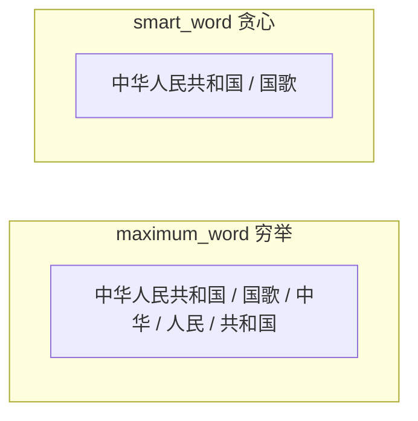

# 六大数据库存储实战: IK 中文分词器是怎么工作的

## 纲要

- 英文靠空格就能切词，中文没有天然分隔符，英文分词器对中文只能按 UTF-8 切成单字，完全不可用
- IK 分词器的根基是**词库**：一个 TXT 文件装下所有有意义的中文词；不在词库里的词退化为单字切分
- 词库可扩展：不同行业（如医学论文）可以导入自己的专业词库
- IK 两种切词算法：`maximum_word`（穷举，尽可能不丢语义）与 `smart_word`（贪心，尽可能不重叠）
- 工程搭配：建索引用 `maximum_word`（召回全），查询用 `smart_word`（意图准）
- IK 还支持停用词（啊/的/得/地，类比英文 the）与同义词扩展，用于搜索调优

## 📎 代码说明

本讲代码以**内联片段**形式呈现在正文中。课程课件仅发布第 2/3/4 章（MySQL 核心能力）的完整工程源码，本讲所属章节未随课件发布独立源码文件，故不做外部文件关联，请以正文片段为准。

## 为什么中文分词这么难

英文天然有空格，按空格切分就能得到单词。但中文没有空格，同一个句子切法还随语义变化。例如"中华人民共和国国歌"，若直接丢进英文分词器，它只会按 UTF-8 把每个汉字切开，得到 9 个单字 token：

```text
中华人民共和国国歌 → 中 / 华 / 人 / 民 / 共 / 和 / 国 / 国 / 歌
```

这种切法完全不可用——搜"国歌"会把任何含"国"或"歌"字的中文文本都召回。中文必须依赖基于词典的分词器，IK 就是最常用的一款。

## IK 的根基：词库

IK 分词器上来就带一个**词库**。可以把词库理解成一个 TXT 文件，里面装了所有有意义的中文单词、词组。分词能力逃不开这个词库——凡是词库里的词，按词切；不在词库里的，退化为单字切分。

把所有中文词收进一个词库是个浩大工程。IK 官方只提供生活通用词，但设计上开放了扩展点：做医学论文搜索的研发，可以把医学专业术语词库导一份进去，词库就覆盖了该领域。这是 IK 开放式设计的核心——提供基础词库，把行业定制能力交给使用者。

## 两种切词算法：贪心 vs 穷举

IK 提供两种切词方式，用"中华人民共和国国歌"最能看清区别。

### maximum_word（穷举，尽可能不丢语义）

尽最大可能把词库里所有有意义的词都分出来，允许重叠：

```text
中华人民共和国国歌
→ 中华人民共和国 / 国歌 / 中华 / 人民 / 共和国 / 华人 ……
```

注意"中华"在这里出现、"人民"在这里也出现，即便彼此重叠，仍都被分出。它的原则是**尽可能不要丢失语义**。

### smart_word（贪心，尽可能不重叠）

典型的贪心算法，切出最长、最不重叠不重复的词：

```text
中华人民共和国国歌
→ 中华人民共和国 / 国歌
```

它只切出两个词，中华、人民、共和国这些重叠部分不再单独出现。原则是**尽可能匹配最长的语义**。



## 建索引用 max，查询用 smart

两种算法可以共用，搭配动机来自搜索的两端：

- **建索引（写入）用 `maximum_word`**：把输入内容尽可能多地建进索引，不丢失任何可能的语义，保证用户任何查询词都有机会命中（提高召回率）
- **查询（读取）用 `smart_word`**：对用户关键词做最长语义切分，尽量准确理解意图，避免结果发散（提高准确率）

为什么查询不用 max？设想用户搜"中华人民共和国国歌"，大概率是想找和这首歌强相关的内容。若用 max 去匹配，一篇列举了大量"中华""人民"却无关的文档也会被命中，相关性反而被稀释。用 smart 切出"中华人民共和国 / 国歌"去匹配，命中的才真正相关。

> 在 Elasticsearch 里，这两种算法对应 `ik_max_word` 与 `ik_smart` 两个 analyzer。分析过程（字符过滤→切词→分词过滤）属于 ES 的 Analyzer 流水线，详见 6-3。

## 停用词与同义词

IK 还提供两项常用调优能力：

- **停用词**：分词过滤阶段直接咔嚓掉不参与索引/查询的词。中文的"啊/的/得/地"就像英文的 `the`，没有检索语义，剔除后索引更干净
- **同义词**：把一组词定义为同义。例如定义"中华"与"中国"同义，那么无论分词结果是"中华"还是"中国"，都会把另一半也当作分词结果阐述出来，扩大召回

这两项在搜索能力调优时非常管用。

## 技术点总结

- 中文无空格，英文分词器只能单字切，必须靠 IK 这类词典分词器
- IK 的核心是词库（TXT），在库里按词切，不在库里退化为单字；词库可行业扩展
- `maximum_word` 穷举不丢语义（重叠），`smart_word` 贪心不重叠（最长语义）
- 建索引用 max 提召回，查询用 smart 提准确，是标准搭配
- 停用词剔除无语义字（的/得/地），同义词扩展召回，二者用于搜索调优

相关度：94%。是否需要继续：[是]。代码是否可运行：[否]。
